# 使用 AngularJS 开发单页 Web 应用：P108：餐厅服务器设置（Windows版）🖥️


在本节课中，我们将学习如何为餐厅网站设置一个独立的服务器。由于课程项目需要实现更新菜单的功能，每个学生都需要拥有自己的服务器和数据副本，而不是共享一个中央服务器。我们将按照指南，在 Windows 系统上完成服务器的部署。

## 课程背景与更新说明

在之前的课程中，由于网站不需要更新餐厅菜单的功能，我们可以使用一个中央服务器为所有学生提供菜单数据。然而，在本课程中，我们将添加允许餐厅所有者更新菜单的功能。由于每个部署的应用都能更新服务器上的数据，因此不能再使用单一的中央服务器。每位学生都需要设置自己的服务器，并拥有可以操作的数据副本，以便完成作业和前端应用开发。

不过，这个设置过程实际上非常直接。

我需要暂时中断本次讲座，进行一个更新说明。2022年11月28日，Heroku 将停止其免费套餐服务。这意味着我们将无法再完全免费地部署我们的应用。因此，我们需要为这门课程寻找新的解决方案。虽然我之前提到的需要自定义应用的理由对于将要为真实客户部署的完整应用仍然成立，但那些需要该功能的部分已超出本课程范围。

因此，从2022年11月开始，我们将不再通过 Ruby on Rails 自定义应用提供的 REST API 来托管数据，而是将应用托管在 Google Firebase 上，Firebase 的数据库已经提供了 REST API 功能。

在课程的其余部分，每当你看到我使用 Heroku 应用的 URL 时，你应该改用屏幕上现在显示的 Firebase URL。观看课程讲座时，请务必参考 Github 仓库中的实际代码，因为我们使用新的 Firebase URL 的方式与之前使用 Heroku URL 的方式有细微差别。

我也会更新本课程的常见问题解答，以包含此信息，这样你就可以随时在那里查看更新后的 URL，而无需回看本视频。

另外请注意，当前代码已更新，每个菜单项的所有图片现在都是 Github 仓库和 Github 部署的一部分。这些图片将不再从 Heroku 应用获取。

最后一点，虽然所有示例代码都已更新为使用 Google Firebase URL，但第60讲及以后的讲座仍在使用 Heroku URL。这是因为第60讲及以后的内容不是本课程的一部分，它们的示例代码只是展示了已完成的餐厅网站，该网站已完全部署到 Heroku，但并未使用付费套餐。你无需这样做即可完成本课程，但如果你选择研究完整的应用，它可以作为参考。

因此，对你来说，目前的要点是：如果你想，可以跳过这节关于如何用 Heroku 设置服务器的讲座视频，直接进入第51讲。如果你不想设置，你根本不需要设置任何东西。你只需要 Firebase URL，它通过我们讨论的 REST API 为你提供所有数据。

祝你在接下来的课程中好运。

## 开始设置

我们将按照为你准备的指南开始设置。我已经在 Chrome 浏览器中加载了该指南。要访问它，你需要前往 `github.com/jhu-ep-coursera/restaurant-server`。这个仓库包含了将作为我们中餐厅（David Chu’s China Bistro）后端服务器的功能。

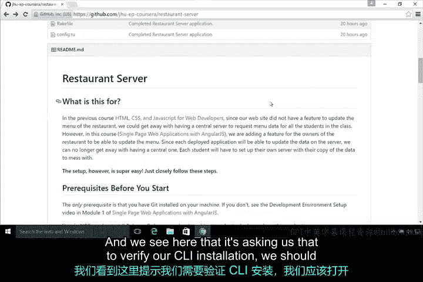

在首页的 `README.md` 文件中，我们为你提供了如何逐步设置自己服务器的指南，而无需在本地机器上安装任何东西。让我们开始浏览这个指南。我将在 Windows 上演示，并会有另一个视频演示在 Mac 上的操作。

## 步骤详解

### 步骤 1：克隆仓库

第一步是克隆我们正在使用的这个仓库。以下是给出的命令：

```bash
git clone https://github.com/jhu-ep-coursera/restaurant-server.git
```

我们复制该命令，打开命令提示符（CMD）。进入合适的目录后，粘贴命令并执行，将餐厅服务器仓库克隆到本地机器。

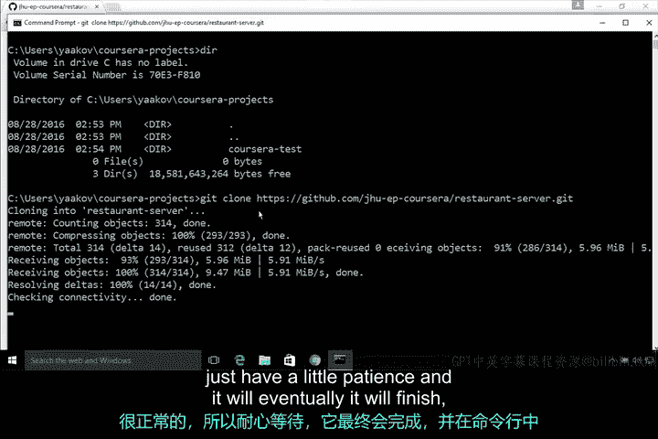

### 步骤 2：注册 Heroku 账户

下一步是注册 Heroku 账户。指南中提供了注册 URL。打开该链接，点击“免费注册”按钮，按照基本流程（邮箱、密码等）完成注册。

### 步骤 3：下载并安装 Heroku CLI

接下来，我们需要下载并安装 Heroku 命令行界面（CLI）。这个工具将用于远程控制我们的 Heroku 部署。这个工具过去也叫 Heroku Toolbelt，它们是同一个东西。

访问提供的 URL，页面会自动识别我们运行的是 Windows 系统。点击下载 `Heroku-toolbelt.exe` 文件并运行安装程序。按照提示点击“下一步”完成安装。

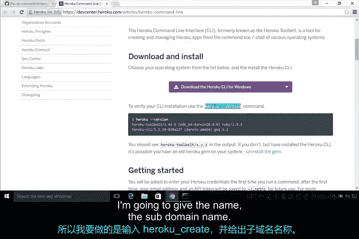

安装完成后，为了验证 CLI 是否安装成功，我们需要在命令提示符中输入命令 `heroku --version`。如果在 Windows 中遇到“heroku 不是内部或外部命令”的错误，通常是因为我们在命令提示符打开时安装了软件。解决方法是关闭并重新打开命令提示符，然后再次尝试该命令。成功后会显示 Heroku CLI 的版本号。

### 步骤 4：登录 Heroku

现在，我们需要使用 Heroku CLI 登录到我们的账户。使用以下命令：

```bash
heroku login
```

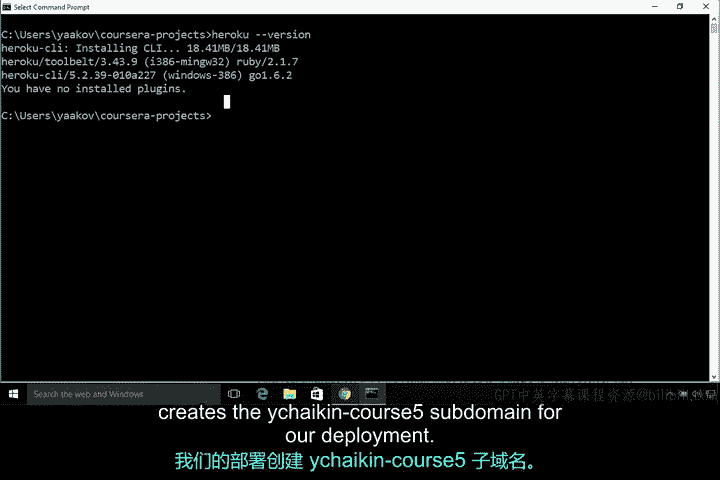

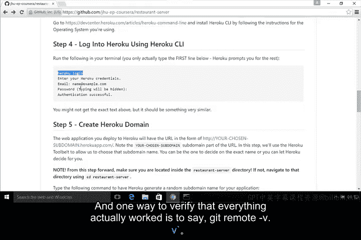

执行命令后，会提示输入注册时使用的邮箱和密码。输入密码时，屏幕上不会显示字符，这是正常现象。登录成功后，会显示确认信息。

### 步骤 5：选择子域名

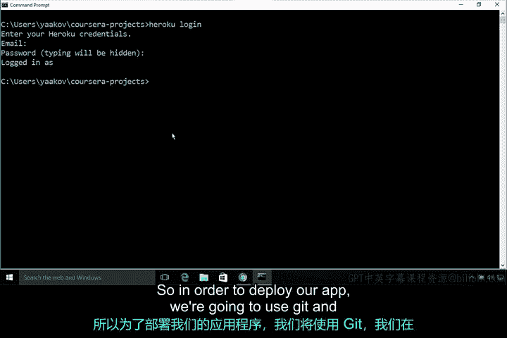

第五步是为我们的网站选择一个子域名。部署完成后，我们的网站 URL 将类似于 `http://你的子域名.herokuapp.com`。

我们可以让 Heroku 随机分配一个名字（使用 `heroku create`），但通常我们更希望自定义一个。我们可以这样操作：

```bash
heroku create 你的子域名
```

子域名可以是你的 Github 用户名或其他容易记住的字符串，只要它是有效的 URL 字符串即可。**非常重要的一点是**，从这一步开始，我们必须确保位于 `restaurant-server` 目录（即我们克隆的本地 Git 仓库）内。如果不在，请使用 `cd restaurant-server` 命令导航到该目录。

执行创建命令后，可以使用 `git remote -v` 命令验证。如果成功，你会看到列表中新增了指向 Heroku 的远程仓库地址。

### 步骤 6：部署应用

现在，我们需要部署应用。使用 Git 将代码推送到 Heroku：

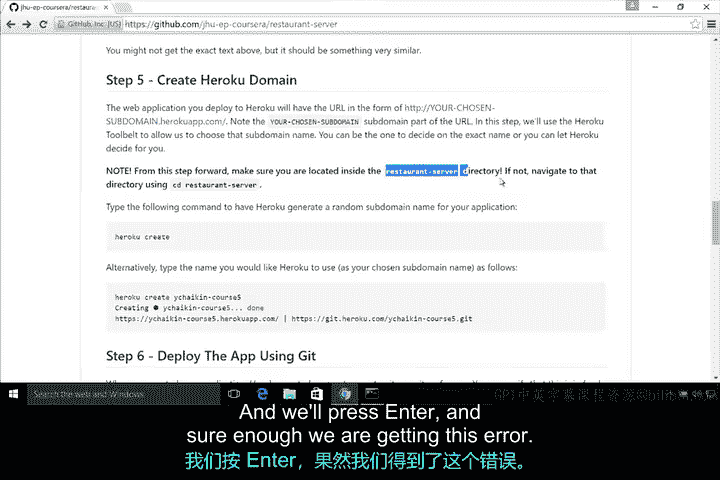

```bash
git push heroku master
```

这个命令会将本地的 `master` 分支代码上传到 Heroku。上传过程中，Heroku 会检测到这是一个 Ruby on Rails 应用，并自动安装所需的依赖（gems），然后部署应用。

部署完成后，我们可以通过访问 `http://你的子域名.herokuapp.com` 来验证应用是否已上线。此时，你可能会看到一个“内部服务器错误（500）”，这是正常的，因为我们还没有设置数据库。

### 步骤 7：设置数据库

接下来，我们需要在 Heroku 上为我们的应用创建数据库和表结构。运行数据库迁移命令：

```bash
heroku run rake db:migrate
```

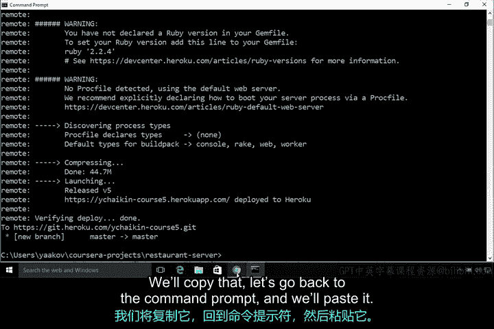

这个命令会在 Heroku 上为你的应用远程创建数据库架构。

然后，我们需要为数据库填充一些初始数据（例如菜单项）：

```bash
heroku run rake db:seed
```

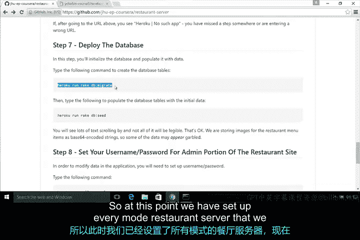

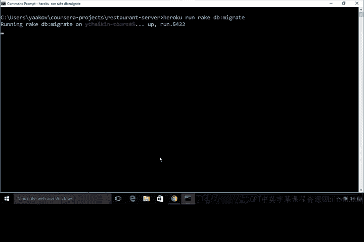

这个命令会运行一段时间，并将数据（包括经过 Base64 编码的菜单图片）插入数据库。完成后，再次访问你的应用 URL，现在应该能看到返回的 JSON 数据，这表明服务器已正常工作。

### 步骤 8：设置管理员账户

最后，我们需要为餐厅网站的管理员部分设置用户名和密码，以防止未经授权的访问。

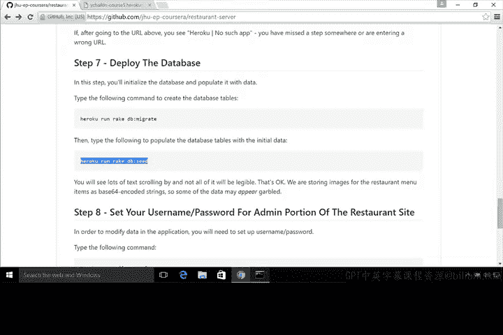

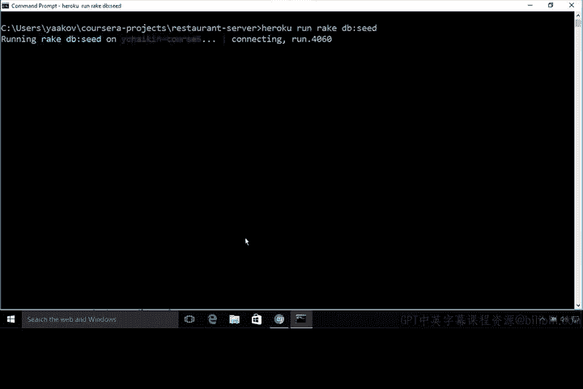

首先，打开 Rails 控制台：

```bash
heroku run rails console
```

进入控制台后，执行以下命令来创建管理员用户（请将 `some_username` 和 `some_password` 替换为你自己的用户名和密码）：

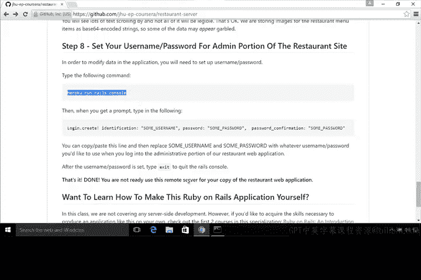

```ruby
User.create(username: ‘你的用户名‘, password: ‘你的密码‘, password_confirmation: ‘你的密码‘)
```

例如：`User.create(username: ‘yaakov‘, password: ‘hello123‘, password_confirmation: ‘hello123‘)`。执行后，如果看到提交成功的提示，则表示用户已创建。

完成后，输入 `exit` 退出 Rails 控制台。

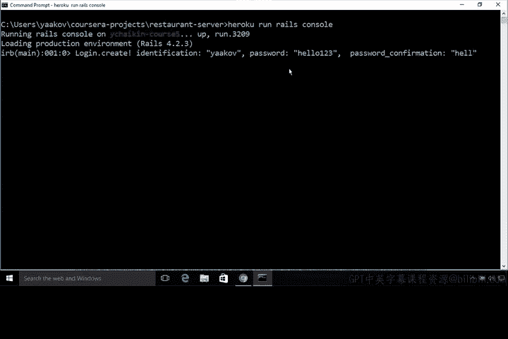

## 总结

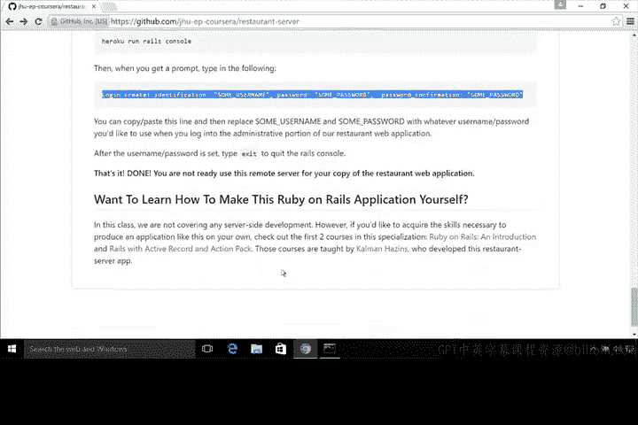

在本节课中，我们一起学习了如何在 Windows 系统上为餐厅网站设置独立的 Heroku 服务器。我们完成了从克隆代码仓库、注册 Heroku、安装 CLI、登录、选择子域名、部署应用、初始化数据库到创建管理员账户的全过程。现在，你已经拥有了一个可以用于前端开发的后端服务器。请注意，由于 Heroku 政策变更，课程后续将使用 Firebase 作为数据源，但本节的设置原理仍然具有学习价值。