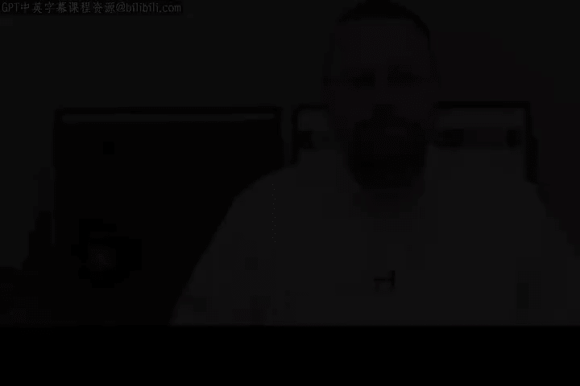
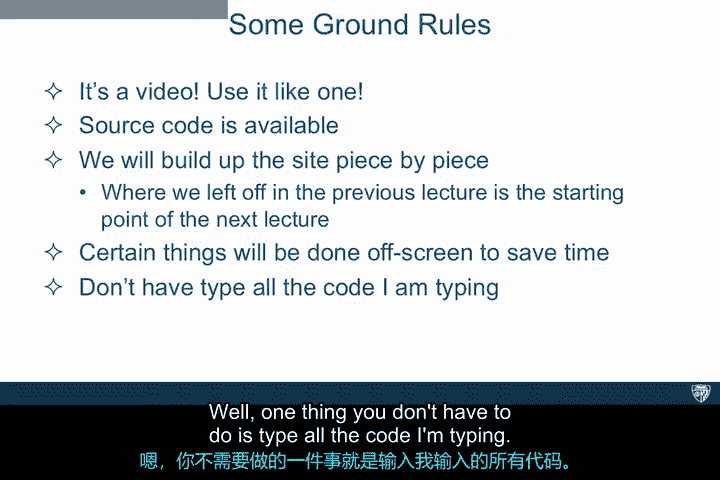
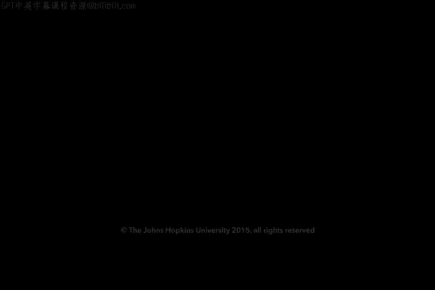

# 约翰霍普金斯大学《使用 AngularJS 开发单页 Web 应用｜Single Page Web Applications with AngularJS》中英 - P109：108_第51讲（第1部分）：餐厅应用的基本结构.zh_en - GPT中英字幕课程资源 - BV1dsFDeZEQr

🎼。

Okay， we're about to start coding， about to jump into the code editor and really live there for the rest of the course。

 which is a pretty good place to live， you know， for a coding course。However， before we start。

 let's go over some ground rules and overview of the setup so you understand the framework within which I'm going to present this code to you。

😊，So first of all， let's not forget this is a video so you could use it like one。

Pause it if you feel that I'm going too fast， rewind it if you want to hear something again if it's too slow。

 increase the playback speed， you could do that in the Coursera video player and make me sound like a chipmunk or if it's too fast simply slow down the speed and I'll sound really。

 really deep anyway， the point is you could go at your own pace even if I'm going too fast or too slow for you。

The other point is the source code that I'm going to be presenting to you。

 it's going to be available to you just like a regular lecture folder。

 so you can always look at the source code and you don't have to rely on the video all the time to look something up。

😊，We' are going to be building this website David Choose China Bistro piece by piece。

 and which means that where we left off in the previous lecture is going to be the starting point of the next lecture this way it will give you a good breakup where you could see the pieces and how they are progressing from lecture to lecture so which means I will copy the entire end result of one lecture。

 copy to the next lecture and that's going to be our starting point for the next video。

Now I would love to record everything that goes on into building this website completely。

 every single minute， every single I don't know， let me think。

 but of course you're not gonna want to watch something like that you're gonna get bored to tears and there's certainly quite a good number of typing you know typos and things like that so all those type of things will have to be done off screen or I'm going to put you to sleep so understand a lot of things I'm simply going to code up before the video and then go over those things in the video instead of having to type all that kind of live some things I'll type live but a lot of things will be done off screen and then explain on screen。

😊，The last thing we should cover before we start is what do you get out of this How do you learn as we go through and build this website Well one thing you don't have to do is type all the code on typing again。

 the source code is available however I will give you a good idea as to how to try to acquire the knowledge as we're going through after each lecture my idea is for you to take the lecture files。

 take the lecture code and tweak that code a little bit， play around with it a little bit。

 change some things， try to deploy it using browser sync or just deploy it to your own Github pages and play around with it。

 see what you could change and then you could always undo those changes and move on you could always redownload the repository the code is always gonna be there so certainly you don't have to sit there and pause the video every two seconds and try to type everything in you already have the code but get it familiar with the code and getting close up and personal with the code is a really good idea for you to get the most out of these lectures。

😊。

Okay， I think we're ready seeing the code editor。

