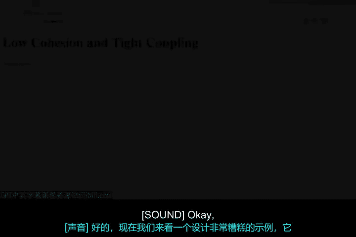
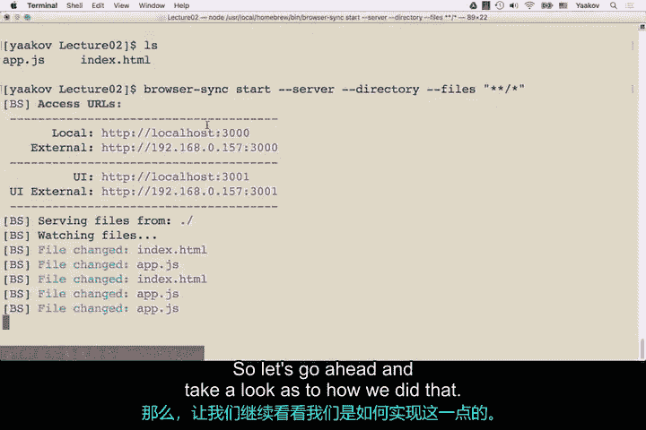
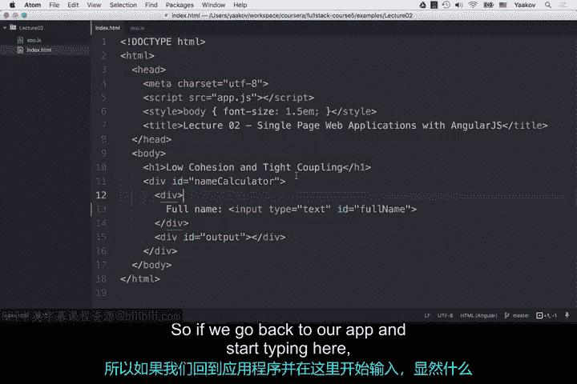
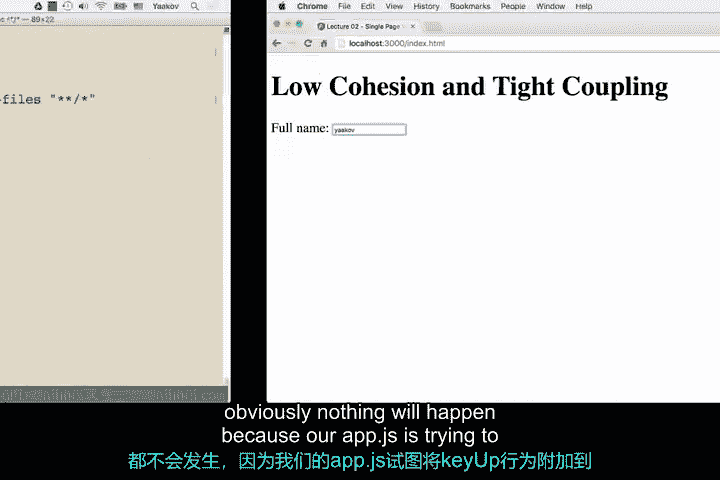
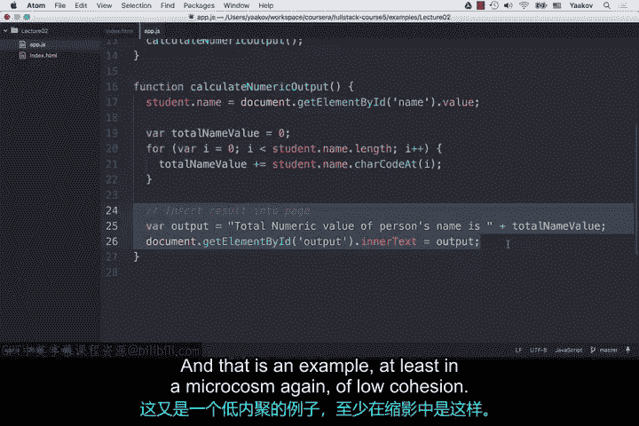
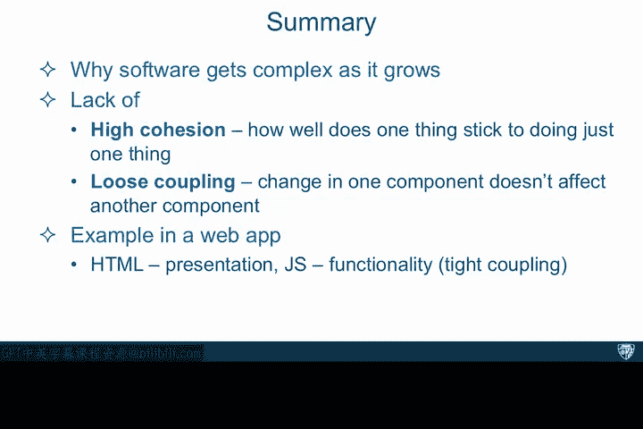

# 约翰霍普金斯大学《使用 AngularJS 开发单页 Web 应用｜Single Page Web Applications with AngularJS》中英 - P10：9_第2讲（第2部分）：为什么代码会变得复杂.zh_en - GPT中英字幕课程资源 - BV1dsFDeZEQr

🎼。

Okay so for our example of really bad design， which will have low cohesion and type coupling。

 we have this app where basically when you enter your name here and as you type it will tell you the numeric value of your name based on the ASI character values that you enter and as you erase basically any press any key the value will be updated let's go ahead and take a look as to how we did that this is our browser sync and our app consists of two things the index at HTML and app do Gs and this is located in lecture 02 folder which is located in your examples folder of the Git repository that hopefully you cloned that has examples for the rest of the course and in our HTML we really need to pay attention to only a couple of tags one is this input tag which has an ID name that we're going to attach some behavior to and the other one is a placeholder tag with an ID output。

And now if we jump over to our Ab Gs which is by the way。

 is included obviously in this page so you could act on it and in Abdo Gs what we have here。

 we have a object literal student with a name at this point as an empty string and the type of student is a student in the next few lines what we're doing really is just setting up some listeners for different events the first one is dumb content loaded listener and that listener basically as you know from previous course is just going to fire this fire this function when the entire page is loaded and is instantiated inside the browser's memory so therefore old HTML has been processed at the time that this content loaded function is fired and the content loaded function all it does is just looks for the ID or the element with an ID name as you can remember that our input field right here and what it does is it sets up a listener keyop listener that says every time you press a key inside of that。

😊，Text box， I want you to fire this key up function。

 so the keyU function does nothing more than call this calculate numeric output to calculate the numeric value of whatever is been entered into our input text box。

😊，So let's take a look at this calculate numeric output what it does is again grabs the value of the input field in our HTML page and saves it into that object student that name and what it does next is it loops over that student that name and basically looks at a character code at each position within the string once it kind of adds them all up it creates an output string total numeric value of a person's name is and just adds to it the total numeric value and then it goes ahead and pulls the element that has the ID output and sets its inner text property to our output Well what's wrong with this code Well quite a few things actually let's take a look at our index that HTML Inex that HTML is there to display things it's there to present things so therefore it's a really separate piece from the functionality we've learned about the three different core technologies HTML CSS and ja well HTML and CSS。

😊，Is really there to present things， it's not really there to have functionality。

 so it would be really bad， in fact， it would be tight coupling。😊。

If I would change something in my HTML and that would completely break or affect the way I implement my functionality in my ja。

 So for example， as a designer， I might decide that you know what I don't want your name to be here。

 I really want full name to be here。 and therefore name doesn't really quite distinguish it enough。

 So I would want to change it to say full name instead of just name Well， what would that do。

 but that would do is it would break our applications。

 So if we go back to our app and start typing here， obviously nothing will happen。😊。

Because our Abda GS is trying to attach the keyA behavior to this particular element with the ID name。

 well it's no longer the ID name， so what do we have here？

We have tight coupling because our application code。

 our Abdot Gs very tightly depends on how our H index at HTML。

 our presentation code is written and that's a really bad thing and obviously it goes not just for this。

 but it goes for other things inside here like for example the output idea as well。

 we're directly accessing this output right inside of our a dot Gs code but let's take a look at this calculating numeric output function This function should really do just one thing or at least have very closely related things inside of it。

 but if you take a closer look。 we're doing a whole bunch of stuff there that really seemingly completely unrelated to calculating numeric value of a string because that's really all we want。

 and here what we're doing is we're again reaching out to our HTML making it a tight coupling but we're also at the same time calculating the total value but we don't stop there we go and take that value and insert some。

😊，Text inside of our HTML document。 So really this calculate numeric output is doing way too many unrelated things。

 It would be much better if this functionality of actually inserting our result into the page was really completely separated from this function in a functionality of getting the value that we're want to get the numeric value of get that string should also be a separate thing and really the calculate numeric output really should just be calculate numeric passing it a string and then just getting the primary functionality and the single functionality of just calculating the numeric value and everything else should be out of it。

 So this is in a microcosm it's obviously not a big deal in a small application。

 but in a microcosm this is an example of low cohesion because in the same function we have functionality that is really not that closely related to each other。

 and that is an example at least in a microcosm again of low cohesion。😊。

So to summarize we spoke about why software gets complex as it grows and one of the main reasons that we spoke about was the lack of high cohesion in other words how well does one thing stick to doing just that one thing the other part was loose coupling and loose coupling is when change in one component doesn't really affect another component and we saw an example in a real web app what happens when you have tight coupling HTML remember is just presentation and JavaScript is our functionality so when things inside HTML or changes inside HTML directly affect and make us change things inside our ja that's an example of tight coupling that we would really want to avoid。

😊。

An example of low cohesion was one our one function really seemingly did three fairly unrelated things。

 so what we really want an hour of software is high cohesion and loose coupling and as we go forward you'll see how Angular GS lets us accomplish these goals。

