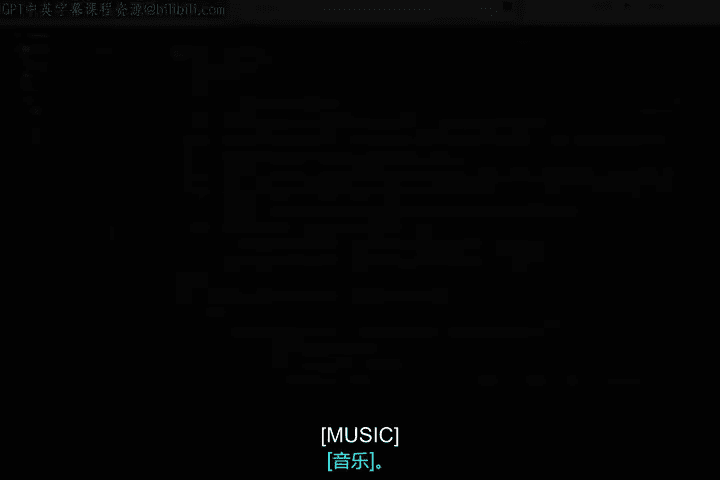
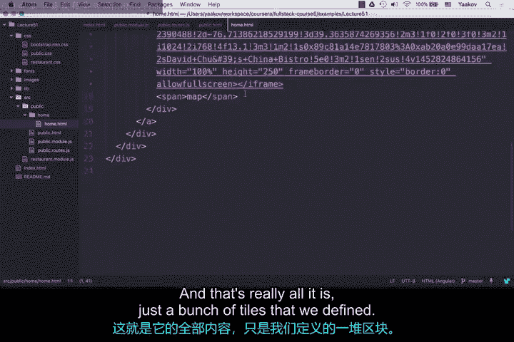
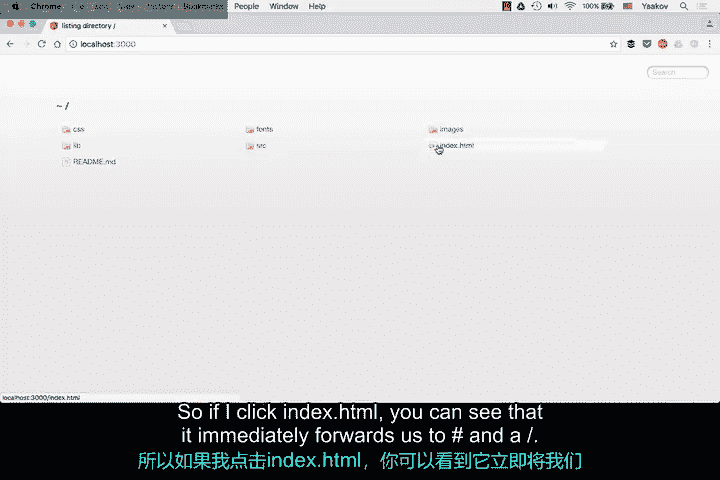
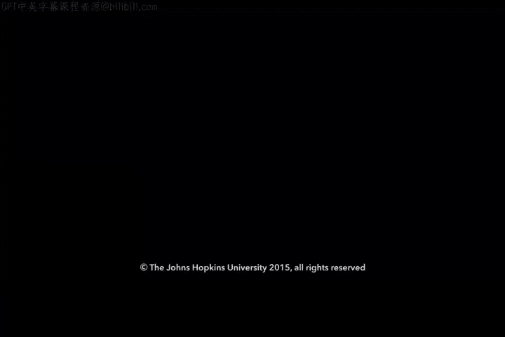

# 约翰霍普金斯大学《使用 AngularJS 开发单页 Web 应用｜Single Page Web Applications with AngularJS》中英 - P110：109_第51讲（第2部分）：餐厅应用的基本结构.zh_en - GPT中英字幕课程资源 - BV1dsFDeZEQr

🎼。

Okay so I'm back in my code editor and I'm located in lecture 51 which is located in the Fulltag Cose5 examples folder and what I'm going to do in this lecture is I'm going to go over the very first basic setup of how we took our previous website which was not done with Angular GS and split it up into pieces that will fit into our structure going forward and the split kind of follows fairly closely to the way we split up the website when we just did regular straightforward AjaX so let's start with index at HTML so this is our index at HTML and there's really nothing much change in here except now on the body tag we have an NG app and we declared our kind of starting module the main module as restaurant and we have this one more tag that we haven't seen before called NG strict DI basically that's telling Angular Gs to do strict dependency injection which means that。

Angular will throw an error if we ever try to inject something without protecting it from minimization like we've been doing all the lectures with dollar sign inject and a minimization array as regular strings。

 so if you just skip all that， Angular will complain and will not let us go forward so this is kind of a protection so we don't forget to do something like that。

😊，Now the rest of this file is pretty much the same with we before。 This is our header。

 our responsive header， and we could go all the way。 that's where the header basically ends。

 And if you remember when we made the browser small for like mobile view。

 This is that big giant call button so people can just tap it and right underneath it it would say we deliver and that's pretty much it and then we could skip this piece for a second。

 and then we have the footer which basically has our entire footer in it all the way to the bottom where we're gonna have some imports and before we go to the imports。

 let's go scroll back up and see what we have in the middle。 the UI view。

 So this is our placeholder for the Ui view that the Ui router we insert the templates into As you can see that's pretty much it。

 that's pretty much our starting point Now inside the view of view we put a couple of things here just to say loading website UI view tag will go ahead and display whatever is inside of it。

😊，UI router hasn't yet inserted anything inside of it So as we're going along and this page kind of gets displayed so you know that pages get displayed and get processed sequentially by the browser this this tag will get processed and without yet knowing what UI view is it will just ignore that and go ahead and display what's inside of it and the truth is even after it figures out what the UI view is before UI router insert these particular template that we need inside of here。

 the contents of the UI router view tag will be displayed。

 which means if our site is slow server is slow as something the user will see a loading site so the user will please know what's going on so let's scroll down all the way and see what imports we're making here what sources we're importing here so we have a bunch of sources sitting in our Lib folder right here and I already put all of them in here that we're gonna need for the rest of the website so they'll sit there already and we have jQury and we're using 2。

1。4 and the reason we do。That is because the bootsottrap we're using。

 which is bootsottrap 3 something actually we could probably open it up and take a look real quick the bootstrap is 3。

3。6 and I just took the same exact bootstrap version that we used in the previous site and that bootstrap requires that we don't use the latest 3。

1 of JQury so I just used again the same version of JQury that was used in the previous version of the website。

Then we import InularGS and we import Angular UI router The next thing we do is import our JavaScript for the main module of the restaurant and we're going to go over that in a minute and also we're going to have this public module and you'll see why and for now we just have the module declaration and the routes for that module and that's it that's basically all of the website that we have at least in the index at HTML。

Let's take a look at our source now let's close the lib here and let's take a look at our restaurant at module。

gs so this is the main module that everything starts with you can see we're declared it as restaurant and we're importing as a dependency a public module and we'll take a look at what that is in a minute。

Now we could have had a separate routes file here for the routes of the restaurant。

 but since there's only one thing we want to do here。

 we just go ahead and put our routes directly in the module dogs it really doesn't matter it's really an organizationizational thing so here we can figure our call config。

 give it the config function and the only thing that the config function injects is the URL router provider we want to make sure again to protect it from minimization and basically the only thing we can figure here is to say that if any user goes to any URL that we don't map in any our routes。

 go ahead and bring them back to the slash basically to the home to the root directory of our application。

Okay， so let's go and take a look at this public module and the public module is sitting right here inside of this public folder inside the source。

😊，We open it up， we could see that we have public that module dogs。 Let's take a look at that。

As you can see， public like modulegs has nothing more than just decing the public and just telling that that it depends on Ui router fact let's move that over here。

 I like it better this way and the other thing we need to do is to take a look at our routes Now before we go on why did we split it up into public restaurant in public Well。

 the reason we did that is because we're projecting that we're gonna have an administrative portion of this website as well So we really need to have two separate kind of sub websites or sub things that are really going to be pretty different So therefore it makes sense to have a public module that will be responsible kind of for the public face of the website that everybody will see and an administrator or admin kind of module that will be responsible for the internal administrative panel so to speak that the owner of the restaurant will be able to log in with username and password into and update the menu obviously the two things will look drastically different but they will share the common header and footer so we still。

😊，want the restaurant module to kind of encompass both of them。

 but at the same time they have their own dependencies and they have their own things that they do。

 so they're pretty separate。Okay， so the next thing let's take a look at our public。ruse。js。Okay。

 so here you see we're calling our module public， we're retrieving it。

 we're not putting any square brackets afterwards because that would be declaring it again。

 so we're retrieving it and calling the dot config and we're passing in a route config our route config function is injected with the state provider and URL provider。

😊，And actually now as I look at it， I see that we really didn't need this。

 this is kind of by default we put it in here， but we really didn't need this because we're not really using the URL provider so as well not have it all we really need is this state provider because that's all we're doing here Okay。

 so let's take a look at our state provider route that we've defined。

The first one we declare is the public that's the state that iss going to hold all of our public stuff underneath the home view。

 the very first view that the user sees， then the page with all the categories of the menu items and finally another state where the page just displays one category。

 all the menu items for that particular category。As you could see。

 this public state does not have a URL property defined。

 but it does have a template URL defined right here that's kind of the holder of this whole public state。

And you can see something we've never seen before， which is a property called abstract and is defined to true what abstracts true does it says is that you can never go directly to the state this state is more like a parent it's apparent to other states that other states can inherit from and share attributes of the state but you can never go directly to that state and that is why it's marked with abstract true so which means that states like public home will share this public do html。

 the source public public ht they will share that and it will actually inject something in here if we open up public dohtm。

 you could see that there's another ui view inside of it and we're going to talk about this in a second but let's go back to the routes so the public state provides a template URL this public do html that will get injected inside of our if we scroll up again here。

😊，Inside of our UI view in the main index that HTML， so main index HTML。

Using these routes iss going to get this template injected into it well this template looks like that and that template itself has a UI view in it。

 which means any children of that template。Looking back。

 which is this is a child of that template will inject their template In this case。

 this home thatt HTMLm inside of this tag right here。

 So we're kind of putting and kind of templating piece by piece and wrapping together this whole big onion so to speak of our states so we can control each little piece individually and not have to code the whole thing at once。

 but be able to kind of split it up piece by piece。

 Okay so let's go back to our routes dogs publicrogs and you can see that public that home state is defined with the URL slash and here's our home that HTMLm。

 First， actually， let's take a look at the parent template of this state and it's we're something that we looked right here and all it's really doing is defining that child template or defining that child template placeholder for the UI view that's where it's going go。

😊，And what it's doing first is actually importing public that CSS so we have CSS put up also for public and also for administrative purposes in the future administrative or admin module in the future。

 but for now it's just public so if you look at CSS here。😊。

You can see we have the restaurant CSS that's obviously something that involves the entire website no matter where you are。

 So this is something that is going to be shared across public and administrative portion of the website and we also have public that css which is something that you'll see the marking homepage if you scroll down it's probably going to say categories page that we don't have yet this is something we took directly from the previous website obviously I didn't do this by hand just now single category page that displays all the item for a single category and so on in other words all this cs has only to do with the public portion of the website going back to the routes you could see here we have this home that htm that is addressed at s so add s inside a public h we're going to insert this home HTMLt inside of this Ui view tag and home thath is sitting inside of this home folder if we double click will'll open it up and if you could tell。

😊，This is really our home snippet from the before， if you looked at the previous lecture where we spoke about how we combine different snippets of the entire website。

 which is this is basically a home snippet， maybe we didn't use this tag we kind of left this tag in the main index at HTML but in here we just brought the whole thing in and that's really all it is it just a bunch of bunch of tiles that we defined the home tile that's the big giant tile where you could click in the。

😊。

And the map tile， as you could see here， and somewhere here， there was a special style as well。

 and there's the special style right here。Okay so at this point we really wired together the entire website and while we don't have yet the categories page。

 the page that shows off all of the categories in our menu and certainly don't have the page that shows off a list of items for a one particular category。

 we should have our home that HTML working just fine Well I already have browser sync started up inside the lecture folder of 51 and if we go to our browser。

 you could see that when we go to In that HTML in fact let's actually erase this real quick。

And this is our directory structure this is because I turned on the dash dash directory on my browser sync So if I click index that HTML you could see that it immediately forwards us to hash and a slash so we are at the public home state at the moment if we scroll down you could see everything is how it should be and if we actually grab the corner of it and try to squeeze it it is still a responsive website you can see things are changing and this big button here shows up the call we could open up the sliding menu and it only shows up when it's kind of in a smaller mobile view and we could pull it back out and it becomes a regular website。

😊。

Now if we open up our console， clear that， open up our console and try to click on one of these buttons even though they're not even clickable yet because we haven't really defined this as a normal link but we still already have something on there in fact let's go back to the code editor and look at our home tile and you could see here I already place the UIS wrap in here and we're gonna to have another substate of public remember public was abstract we're gonna have another substate of public called menu and basically that's going to take us to all of the categories inside of our menu and we already have't defined even though we don't have the actual state defined yet so guess what's going to happen if I click on this sure enough it's going to say could not resolve public that menu from state public home well because we don't really have that yet we haven't defined it yet so those errors are pretty good it's good that means it it's working if I click here can't look at menu items from state。

😊，Look at home， so those things are working and we're ready to develop our site further。

 see you in the next lecture。😊。

