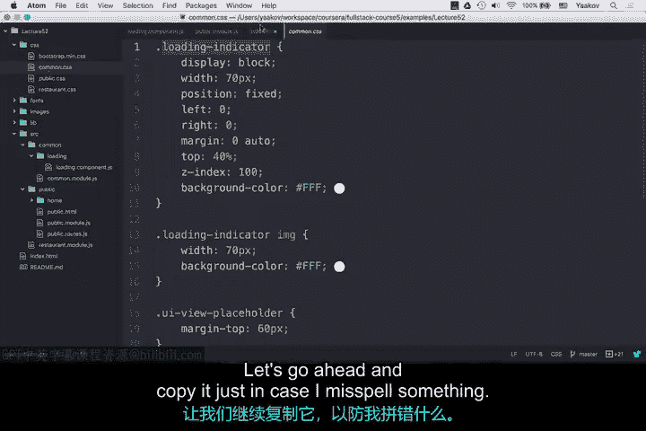
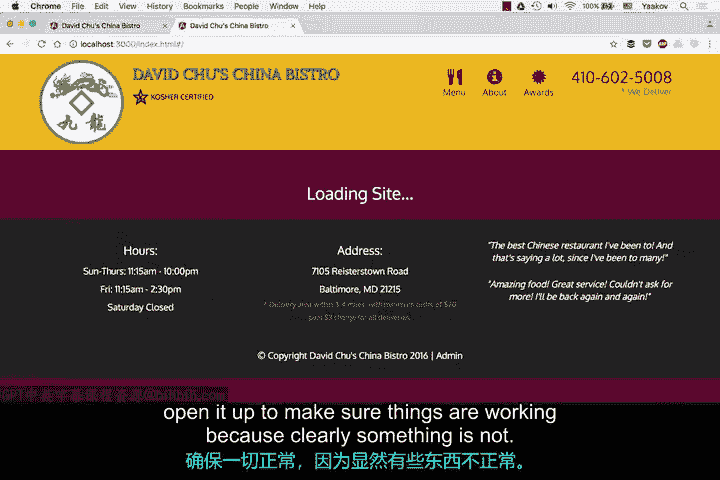
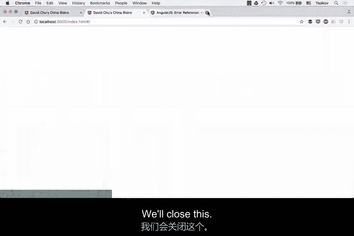

# 约翰霍普金斯大学《使用 AngularJS 开发单页 Web 应用｜Single Page Web Applications with AngularJS》中英 - P111：110_第52讲：编写加载器旋转器.zh_en - GPT中英字幕课程资源 - BV1dsFDeZEQr

🎼。

Okay so we're back in the next lecture and we're located in the folder lecture 52。

 which is located in fullt course 5 examples folder and in this lecture what we're going to do is we're going to code up a loader that loading spinning image to tell the user that something is going on in the system and the need to wait Now obviously this is not something that's going to be needed only for the public portion of our website but also going to be needed for the admin portion of website as well So it sounds like we're going to need something that's going to contain things that both modules our future administrator module and the public module will reuse sounds like we need a separate module that both of our modules public and a future administrative module can depend on and then share So the module we created is called common and it's going to sit right here in this common folder inside the source so let's going open it up and it's open up our common module and all we're doing here is we're just declaring a module called common and using this。

Mo we're going create our loading spinner resource and we're gonna to put it inside of this loading folder。

 Let's go ahead and open it up。 You see we have this loading that component js。

 let's go and open it up。 and let's go over this loader component Obviously you could see we're attaching it to the common module。

 We're going to call it just simple loading which means the tag is just going to be very simple just a loading tag and we don't need a temp URL URL since it's just one line is just an image and it's going to point to this spinner that svg and it's only going to show up if our controller tells us that the show property is true。

 and that's what we're using this ng if4 our controller loading controller is right here。

 we're injecting the rootcope because in a second we're gonna have to attach something to the rootcope and we're defining a dollar sign controller equals this so we could reuse it inside of our inner functions。

😊，And this listener is something that's going to help us cancel this listener setup for the spinner active。

And let's take a look at the dollar sign on a it， our lifecycle method that will get called to initialize our loading controller。

 So what we're doing here is to begin with we're showing our controller that show equals the false and then we're setting up a listener so some events within an application will happen somebody will request some URL somebody will do some other asynchronous action and the user needs to know that something is going on so we need to turn on that spinner Well that action somewhere else in the system will throw an event hopefully that will be called spinner colon activate as I told you in the events lecture。

 it's always a great idea to namespace your string events that way you know where they're coming from So we namespaced it as spinner and the action is activate and we do know since this is just gonna be one view and we're actually attaching the listener on the scope on the rootcope we need to grab that listener that inside of our un。

😊，When this view is being unloaded， we want to destroy that listener otherwise we're going to have memory leaks here。

 so that's why this listener is kind of externalized to this variable right here and we are setting it to listener。

 whatever we are setting this root scopepe on to and then we're calling that listener ontroy to basically unregister our listener。

The listener handler is going to be this on spinner activate and thiss just a function right here on spinner activate the angular passes the event and the data that came together with that event and the only data we're interested in is this on property and the on property is going to be either true or false So this spinner activate will either throw this event with true on equals true or on equals false So whatever that is we're going to set that to the controller that show which should go ahead and either show or hide this spinner image in our HTMLm okay and that's pretty much it。

 The only thing that's left is for us to go to our module do js dial public that module dogs and say that we're not just going to depend on Ui router we're also going to depend on common since that's what we named our common module just common right if we take a look at it again Yes it's just called common The last but not least is for us to go to index that HTMLtm。

😊，And we could scroll down to right under where it declares a restaurant and we could do it right here。

 and we could say fixed position loading indicator。Okay， and let's go ahead and use that loading。

Okay， so now we have our loading icon。And inside of our component， as you could see。

 we didn't really give it any styles and that's okay because inside of CSS。

 we also imported this new one called Common that CSS with a few CSS rules that we're going to need for our common module。

 so we'll close that and we can actually then class this as loading dash indicator I believe that's what it's called right loading indicator that's correct。

 let's go ahead and copy it just in case let me spell something。

Loading indicator so that's good。 And now as we save that。

 we should go back to our browser and open it up to make sure things are working。

 clearly something is not and it is airing out。

So let's go back to our code editor and see what we messed up here。Let's see。

 we have this and we have the loading component。Did we actually import the ja file that would have been a problem if we didn't and we did not import the JavaScript file and I'd say that's kind of a problem wouldn't you Okay。

 so let's go ahead and make a copy of this and let's say this is our common module let me make sure to now import the module first right so we need to say common。

Common dot is that we're sitting common dot module dot Js。 And one more thing。

 let's copy it in and make another copy and say。Loading。Loading dot。Component dot Js。 Okay。

 I think we're good。 Let's go back to our browser。We'll close this。

 close a bunch of these and you can see other than the SVG words which we're going to ignore this is actually working just fine so the last thing that's left to do in terms of our loading indicator is to have some kind of mechanism that turns on the loading indicator and then turns it off and that's what we're going to do in the next lecture。

