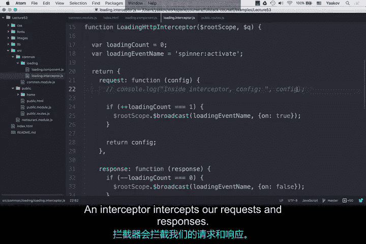

# 约翰霍普金斯大学《使用 AngularJS 开发单页 Web 应用｜Single Page Web Applications with AngularJS》中英 - P112：111_第53讲：编写HTTP拦截器.zh_en - GPT中英字幕课程资源 - BV1dsFDeZEQr

🎼。

Okay so we're continuing in our code editor and I'm in lecture 53 folder which is located in fullt dash course 5 examples folder in a previous lecture。

 we coded up our loading that component do Gs to turn on when somebody throws a spinner activate event with the data on equals true and that's going to show us a little spin icon fixed in the middle of the screen Now the question is who is going to throw this spinner activate event we could try to throw the spinner activate event everywhere in our system whenever we see that something is asynchronous is about to happen for example。

 when we try to pull data from the restaurant server right before we do that we could throw the spinner event with the on equals true and then after it returns in handling our response or our promise we could throw another event with the spinner activate with on property equals false and I think that probably be okay however。

A couple of issues with that number one is is that we would actually have to remember to sprinkle it all over our code whenever we are trying to use the dollar sign Htp service。

😊，Number two is there are times when we use the HtP service without even knowing ourselves about it。

 for example， if we go to the public module and look at our routes， you'll see that for example。

 when we go to this state public and especially public that home it will pull in this home that H actually first pull in public at H and then we pull in home that HTML the requests for these snippets of HTML are actually asynchronous calls that are made by angular using the Dallas sign HP service so we don't even have in this case kind of a normal ability to tell it。

 go ahead and turn on the spinner and turn off the spinner Well it happens to be that the Dallas sign Htp service provides an ability for us to configure it to actually plug in to the entire lifecycl of sending the request and receiving the request such that we can kind of catch the request as it goes out and catch the response as it goes back in and those are called。

terceptorsAnd this is what we're going to have now。 and inside of our common loading folder here。

 we're going to create this file called loading intercept。js。😊，And basically。

 this is our interceptor， so let's go over what this does。An interceptor is a factory。

 meaning it's going to create this function for us and wait for the return value from this function and this function you could see has a return value and that's in itself an object so if a place a cursor here you could see that this a whole thing is just one object literal right here。

😊，And this object literallyeral has three properties has the request property has the response property and has the response error property。

 So let's go over as to how we're going to code this up。

 The request property is expected to be a function that takes in a config object and a config of object in here on the request is basically everything that's going to be needed for the Dallas sign HtP service to make the request meaning the URL。

 the request headers， whatever else is needed to making that request So when an HtP service makes a request it's going to first go to this function right here before actually going out and making the request This gives us an ability to hook into this whole process and actually broadcast make the rootcope broadcast our loading event which is this right here spinner activate with the value on being true Now when the response comes back。

We can again broadcast using the rootcope again with that same loading event。

 but in this case the on property is going to be false so we could turn it off and finally。

 if there's a response error and the response error gets called when a previous interceptor either through an error because it can have more than one interceptor attached to the HP service or it resolved with a rejection so something went wrong in the previous interceptor and it basically is receiving back an error so we can handle that error by first of all since were when we made the request it turned it on through the event with the on equals true now that we got an error we know we could turn off the loading indicator so we could again broadcast that loading event name with the on property equals false。

And the last thing we need to do inside the response error function is that we need to reject the promise All of this is being done with promises and if we don't reject this response。

 this call will still return to the caller， but it will look like our promise resolved successfully。

 which is not the case the caller will then erroneously assume that the data being returned is the data it's looking for instead of the error。

That will obviously cause all kinds of issues， so that's why we need to explicitly reject the response here。

Now one last thing you'll notice that may look a little confusing is this loading count。

 and you can see that we're actually adding to the loading count and figuring out whether or not it's one。

And in the response we're subtracting from the loading count and then seeing if it' zero and the same thing in the response error。

 we're first subtracting from it and seeing it at zero。

 Why are we doing that Well the reason we're doing it is because since these requests are asynchronous it is totally possible in fact happens all the time when a few requests happen at the same time so for example。

 the HP service can be loading a few templates at the same time and making a few requests at same time We wouldn't want to turn it off completely when the first request came back while the second request is still pending which means we need a counter and increment account or every time there's a new request and decrement account or every time one of the requests back comes back So as long as we still have pending requests this loading indicator will still keep going and we will not throw another event with the on property equals false we will wait until we decrement account to the point。

Where there is nothing loading at all。 So it's a0。 and then we'll broadcast that you could go ahead and turn off。

So that's our interceptor just for fun here， I actually put in a logging statement so we could see what is inside a config after we hook it up so we could save that now。

😊，And at this point all we have is a factory we just created a factory on the common module。

 we really haven't done anything at all to the D sign HTP service let's go to the module to the common dot module do Gs and go ahead and configure the HP service provider the way we do that as you remember we just say configurefig。

😊，And we call， let's call it a config function。And now we need to define this config function。😊。

Config that dacine inject。And what we need to inject is a HtP provider， HtP provider。

 because we need to configure that provider， So we'll say function， config。HTP provider。

 and now we need to add to the HTP provider Interceptors array。

 The HtP provider service has a special property called interceptors that holds an array of all these interceptors that when the HtP service goes out to do its job it first checks that array to see if it needs to have one of the interceptors work its magic on one of the requests or the responses before it actually goes through with the request。

 So let's go ahead and configure it HttP provider that interceptors interceptors plural and that's an array so we'll push and what we push is the name of our interceptor and that is loading HtP interceptor So that's the name that we need to push on here。

 So now our HtP provider is going to have an interceptor loading HP interceptor as part of its request and response system。

 So let's save that。Let's go to index at HTML to make sure I actually included at the very bottom the loading loading interceptor。

 js。 and let's save that now And remember the interceptor had this inside the request property or function that is the request property we have this console log and we're basically outputting this config object that the interceptor is being called with。

 so let's go back to our browser I already started brows sync inside the lecture 53 folder and so here we are our browser So if we reload right now we should at least momentarily see the spinning icon here。

 let's do controller or commander on Mac。any of you caught that。

 but we saw the little loader there in the middle。 Now， let's go ahead and open the console。

And let's go ahead and do another reload so we could just see that and you could see inside the interceptor config and there's two of them and let's take a look at it。

 let's open that object。😊，That config object and you could see there's headers。

 We could see a bunch of headers here。 This case is just accept HTML Tx HTML and you could see that it is showing us the URL property on that config object and the URLl is source public public ht。

 well guess what that's from the template URL inside the public routes js and the second object here let's open it up Sure enough is going to be source publicho htl we go back to our public routes dojs you'll see that these are the two template URLs T URLl properties that are in there。

 so you can see that as the hp service is going out to pull or to request this HTML snippet files from the server it's making an hp request and our interceptor intercepts that and is able to throw an event a loading event And then when that request resolves and comes back it's able to throw another event。

The on property equals false。 So for now I'm going go ahead and just comment it out and leave it for you so you can uncommented later and mess with it。

 but we don't really need this constantly going out to our console。

 So we'll leave it off Okay so now we have an interceptor and interceptor intercepts our requests and responses and is able to throw these events that turn on and off our loading indicator that is happily sitting inside of our index that HTML and the loading indicator is that component we previously coded that is listening for these events that we're throwing and turning itself on and on or turning on the image tag on and off inside of our page。

😊。

