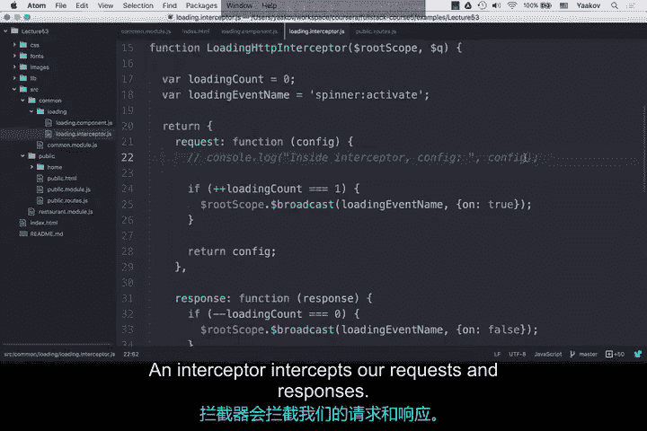

# 使用 AngularJS 开发单页 Web 应用：第53讲：编写 HTTP 拦截器 🛠️


## 概述
在本节课中，我们将学习如何编写一个 HTTP 拦截器。HTTP 拦截器允许我们在 HTTP 请求发出前和响应返回后，插入自定义的逻辑。我们将利用这个功能，实现一个全局的加载指示器，在应用进行异步请求时自动显示和隐藏。

---

## 加载指示器与事件广播
上一节我们介绍了加载指示器组件，它通过监听 `spinner.activate` 事件来控制自身的显示与隐藏。现在的问题是，谁应该来触发这个事件？

我们可以在代码中任何发起异步 HTTP 请求的地方手动触发这个事件。例如，在向餐厅服务器请求数据之前，广播 `spinner.activate` 事件并将 `on` 属性设为 `true`；在请求返回后，再广播一次事件并将 `on` 属性设为 `false`。

然而，这种方法存在两个问题：
1.  我们需要在**所有**使用 `$http` 服务的地方都记住添加这段代码。
2.  有些 HTTP 请求是框架自动发起的，我们无法直接控制。例如，在路由配置中加载 HTML 模板文件时，AngularJS 会使用 `$http` 服务异步获取这些文件，我们无法在这些地方手动插入事件广播代码。

幸运的是，`$http` 服务提供了一种配置方式，允许我们“拦截”请求和响应的整个生命周期。这就是**拦截器**。

---

## 什么是拦截器？
拦截器本质上是一个工厂函数，它返回一个包含特定方法的对象。这个对象可以“钩入” `$http` 服务的请求/响应流程。

以下是拦截器对象的核心方法：
*   **`request`**: 在请求**发出前**被调用。我们可以在这里执行操作，例如广播“开始加载”事件。
*   **`response`**: 在请求**成功返回**后被调用。我们可以在这里执行操作，例如广播“结束加载”事件。
*   **`responseError`**: 在请求**失败**（或之前的拦截器抛出错误）后被调用。我们同样需要在这里处理错误并广播“结束加载”事件。

---

## 创建拦截器工厂
现在，让我们开始编写拦截器。我们在 `common/loading` 文件夹下创建一个新文件 `loading.interceptor.js`。

这个文件将定义一个工厂，用于创建我们的拦截器。以下是该拦截器的实现代码：

```javascript
(function () {
    'use strict';

    angular.module('common')
        .factory('loadingHttpInterceptor', LoadingHttpInterceptor);

    LoadingHttpInterceptor.$inject = ['$rootScope', '$q'];
    function LoadingHttpInterceptor($rootScope, $q) {

        var loadingCount = 0;

        return {
            request: function (config) {
                // console.log("Inside interceptor, config: ", config);

                if (++loadingCount === 1) {
                    $rootScope.$broadcast('spinner:activate', {on: true});
                }

                return config;
            },

            response: function (response) {
                if (--loadingCount === 0) {
                    $rootScope.$broadcast('spinner:activate', {on: false});
                }

                return response;
            },

            responseError: function (response) {
                if (--loadingCount === 0) {
                    $rootScope.$broadcast('spinner:activate', {on: false});
                }

                return $q.reject(response);
            }
        };
    }
})();
```

### 代码解析
1.  **依赖注入**：我们注入了 `$rootScope` 用于广播事件，以及 `$q` 服务用于在发生错误时拒绝 Promise。
2.  **`loadingCount` 计数器**：这是一个关键变量。因为多个 HTTP 请求可能同时发生，我们需要一个计数器来跟踪正在进行的请求数量。只有当第一个请求开始时（`loadingCount` 从 0 变为 1），我们才广播“开始加载”事件；只有当最后一个请求完成时（`loadingCount` 减到 0），我们才广播“结束加载”事件。
3.  **`request` 方法**：每个请求发出前，计数器加 1。如果加 1 后等于 1，说明这是第一个待处理的请求，于是广播 `spinner:activate` 事件并设置 `on: true`。最后，必须返回 `config` 对象，以便请求能继续执行。
4.  **`response` 方法**：每个成功响应返回后，计数器减 1。如果减 1 后等于 0，说明所有请求都已处理完毕，于是广播 `spinner:activate` 事件并设置 `on: false`。最后，返回 `response` 对象。
5.  **`responseError` 方法**：处理请求失败的情况。逻辑与 `response` 方法类似：计数器减 1，检查是否为 0，并广播“结束加载”事件。**关键区别**在于，我们必须调用 `$q.reject(response)` 来显式地拒绝这个 Promise，这样调用 `$http` 服务的代码才能正确地进入错误处理流程。

---

## 配置 HTTP 提供者
仅仅创建拦截器工厂是不够的，我们还需要告诉 AngularJS 的 `$http` 服务使用这个拦截器。这需要在模块的配置阶段完成。

我们打开 `common.module.js` 文件，添加配置代码：

```javascript
(function () {
    'use strict';

    angular.module('common', [])
        .config(config);

    config.$inject = ['$httpProvider'];
    function config($httpProvider) {
        $httpProvider.interceptors.push('loadingHttpInterceptor');
    }
})();
```

### 配置解析
1.  在 `config` 函数中，我们注入了 `$httpProvider`。
2.  `$httpProvider` 有一个 `interceptors` 数组，用于注册所有全局的 HTTP 拦截器。
3.  我们使用 `.push()` 方法，将之前创建的拦截器工厂名称 `'loadingHttpInterceptor'` 添加到这个数组中。

完成此配置后，应用中的所有 `$http` 请求在发出和返回时，都会经过我们定义的拦截器逻辑。

---

## 测试拦截器
最后，我们需要确保在 `index.html` 中引入了新创建的拦截器文件。

```html
<script src="src/common/loading/loading.interceptor.js"></script>
```

现在，当我们运行应用并刷新页面时，应该能看到加载指示器短暂地出现。这是因为 AngularJS 在启动时，会通过 `$http` 服务异步加载路由中定义的 HTML 模板文件，而我们的拦截器成功地捕获了这些请求并触发了加载事件。

我们可以在浏览器的开发者工具控制台中，查看拦截器内 `console.log` 输出的 `config` 对象，里面包含了请求的 URL、请求头等信息，这验证了拦截器正在工作。

---

## 总结
本节课中我们一起学习了 HTTP 拦截器的强大功能。我们创建了一个名为 `loadingHttpInterceptor` 的拦截器，它能够：
1.  自动跟踪所有并发的 HTTP 请求。
2.  在第一个请求开始时，自动显示全局加载指示器。
3.  在最后一个请求完成（无论成功或失败）时，自动隐藏加载指示器。
4.  通过配置 `$httpProvider.interceptors` 数组，将其注册为全局拦截器。



通过使用拦截器，我们实现了关注点分离：加载状态的管理逻辑被集中到了拦截器中，业务代码无需再关心何时显示或隐藏加载图标，代码变得更加简洁和可维护。这是构建健壮单页应用的一个重要模式。