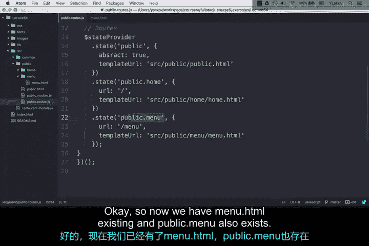
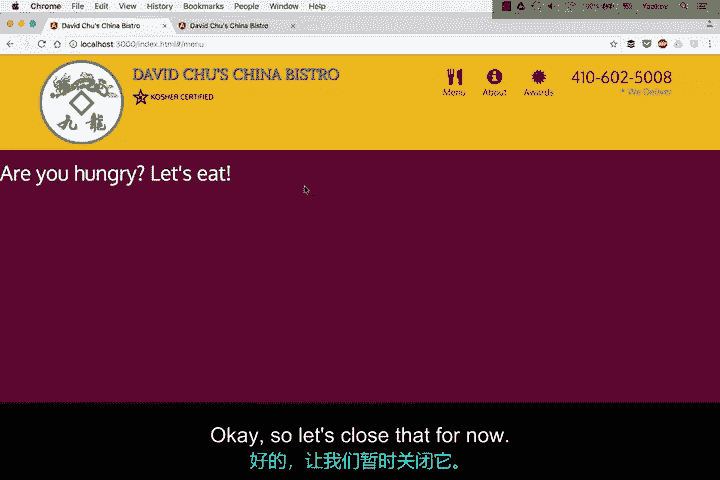
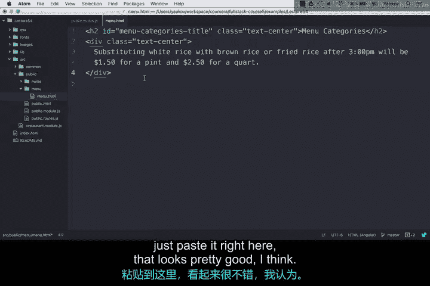
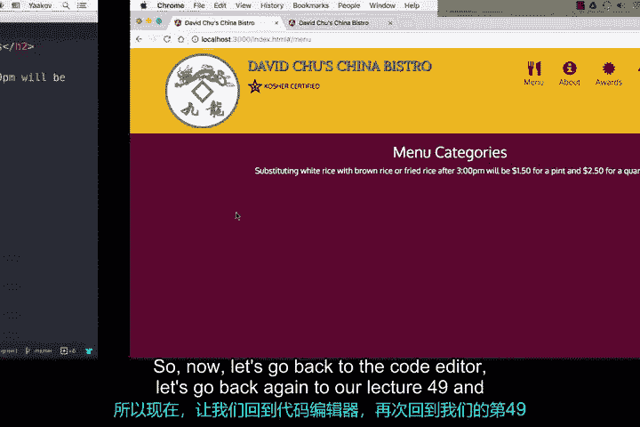
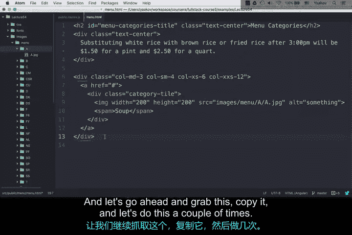
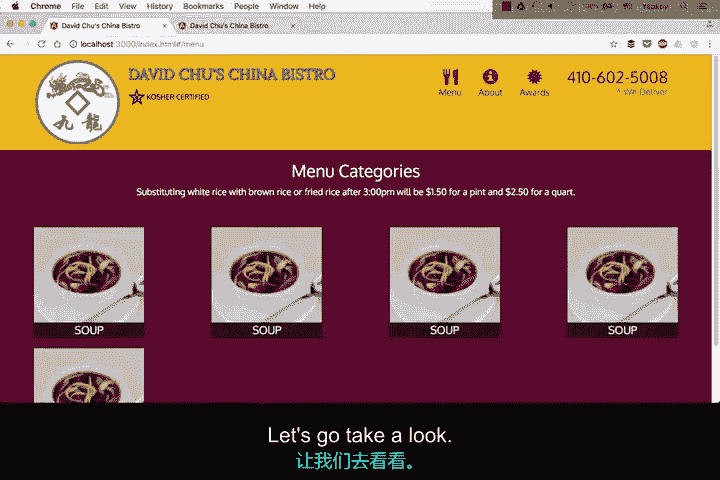
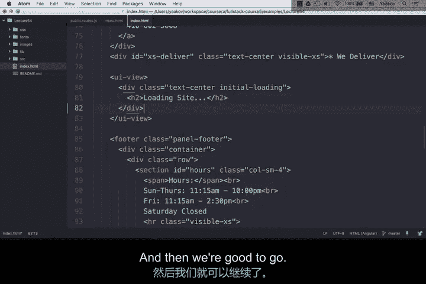
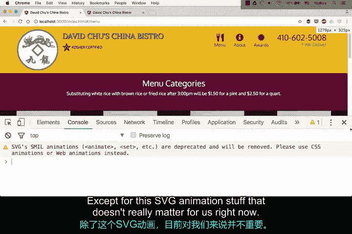
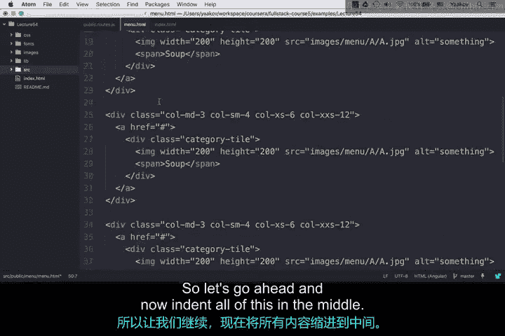
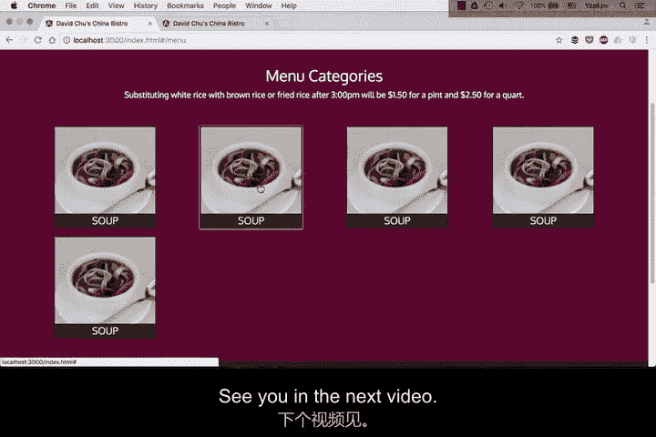

# 约翰霍普金斯大学《使用 AngularJS 开发单页 Web 应用｜Single Page Web Applications with AngularJS》中英 - P113：112_第54讲：编写菜单分类视图（第1部分）.zh_en - GPT中英字幕课程资源 - BV1dsFDeZEQr

🎼。

Okay continuing back in the code editor and I'm located in lecture 54。

 which is located in fulltag dash course 5 examples folder And just a reminder what we have right here in our tree structure is the exact copy of where we left off in the previous lecture lecture 53 and I already started the browser sync inside lecture 54 folder so let's go to the browser and here's our web page as it stands right now and the next thing we want to do is we want when the user clicks on this menu tile that it should actually go to the menu and the menu at this point at this stage when they click on this menu tile will be just a list of different categories within the menu so soups lunch dinner。

 sushi， whatever because this is just a front page of the restaurant but we want the menu to start with all the categories of the menu with a picture for each category basically Jess like we had before and since I have the version of the entire website as we implemented it with。

😊，Angular Js sitting in lecture 49， I actually started a separate browser sync session and here it is here's our page that is our menu page if we go to the front page again and click on this menu we get to see the menu categories and this is the page we're about to implement again。

 this is being served from lecture 49 folder and this is our previous version of this restaurant app with just regular AjaX implementation。

 no Angular Js at all。😊，Okay so this is the button and when we click in fact let's open it up and if I go to console and you can see I clicked it before already and it says。

 in fact let's go ahead and clear it， if I click it again。

 you'll see I can't resolve here public that menu well it's because we preset up that this goes to public that menu state in the UI router and that's where we're going to start let's go back to our code editor and go to public。

ros。js and let's go ahead and create one more state called state and we call it public that menu and that state is going to have a URL。

😊，And the URL is going to be slash menu。And for now。

 let's just give it a template URL of source public menu menu。 HTML。Okay， let's save that。

And the next thing we need to do is we need to actually create the menu that HTML inside of this menu folder。

 so we'll go to public， we'll click new folder， and we'll say menu。

 so now there should be a menu folder here and then here we'll click new not new folder mistake new file。

 and we'll call menu that HTML。😊，Let's say that let's go back to a route。

 So now so this menu that HTML template is now going to get inserted in the same place where we previously inserted home that HTML because they are part of the same parent right public this one is home this one is menu This one is going to get inserted inside of the UI view tag inside of public that HTML So that's what got inserted when we went to public that home and we go now to public that menu。

 whatever is inside menu that HTML here is going to get inserted into that public that HTML into this UI view tag Okay so let's go ahead and build menu that HTML。

😊，And menu HTMLl。 and let's just say something like a very big H1。 Are you hungry。

 Let's eat but because that's what's really all about in the restaurant， isn't it Okay。

 so now we have menu that HTMLl existing and menu or public that menu also exists。

 Let's go back to our browser and let's close this up for a minute and now we could should be able to click menu and you could see here in the in the bottom here。

 it shows up pound sign slash menu， Let's click that and look at that it's working menu。

 are you hungry， let's eat So that that's where that got inserted， In fact。

 let's go and inspect that so you could get a better feel as to what's going on here。

 you could see that Ui view tag right here and there's our H1 that got inserted right here and notice that we ourselves sitting inside of another Ui tag which is right here and this Ui tag is right。

 where is that coming from this one Well this one is coming from index that HTMLl and this one Ui tag is coming from。

😊。

Public that H。 So we have nested views here now。 Okay， so let's close that for now。

 Let's go back to the code editor And so what is really go here I actually opened up our lecture 49 in Adam editor and there it is。

 and we have the couple of snippets here。 We have the title categories titles。😊。

cateategories title snippet。ht， that's the title of our menu page where O has all categories。

 and it also category snippet where it has these repeating blocks and if you look at the code of the previous website if you go ahead and look in this script。

jS， you'll see what we're doing is we're grabbing this code substituting these you know interpolation simulation type of variables or properties and then we're looping it。

 looping it and over and over with the data that we have。

So what we're going to do actually is we're going to grab this title because we don't need to loop that we'll copy it right there and let's go back to our menu at HTML and just paste it right here that looks pretty good I think and now if we save it and go back to our browser you could see now the menu here showed up under our slash menu state So now let's go back to the code editor let's go back again to our lecture 49。

And let's grab this whole snippet right here and that's really the HTML for each category to display in a grid。

 so let's go ahead and make some space here and paste it in here so obviously we don't want to call on click on D so we could go ahead and erase that for now we'll leave this pound thing for now。

And the only other things that we need to fix here is this image and we'll just pick something from our images folder。

 We'll go to the menu， just pick the very first one a Jpeg so here would be short name would be a and this would be a Jpeg there we go an alternative name I don't know we'll just say something it doesn't matter what that is now this name is gonna be I don't know soup and let's go ahead and grab this copy it and let's do this a couple of times one2 maybe34 let's just paste it a few times let's save that let's go back to our browser and look at that look at that we have the category names and I even named it properly soup okay so looks like we're on our way。

 let's go back to code editor and we'll stop here I think for this lecture in the next lecture we're gonna have to do something about having to repeat the stuff over and over and we'll deal with it then。

And we're back to the same lecture again here's what happened as I was closing up and committing this lecture to the repository。

 I noticed that we have a gift waiting for us in the console let's go take a look。😊。

Here's our webage。 And if we open up our console， we see interesting warning here。 warning。

 try to load Angular more than once。 What in the world is going on there。

 and it' actually trying to do this again。 Well， that means we have some sort of a bug in our code。

 And if you Google it， you'll find out that one of the most common reasons why this warning shows up is if you don't have your HTML properly validated。

 In other words， your HTML isn't valid。 Something somewhere is messed up。 Okay。

 so let's start from our index at HTML。 And now I'm going to pretend as if I never looked at this code for this error before and figure it out in about two seconds。

 That's right， I'm that qualified。 anyway， But obviously。

 I actually look for it before I started recording this video And this kind of a hard to spot type of a problem。

 but here's where the problem is。 The problem is that this div right here is not closed inside of our UI view。

😊。

So all we really got to do to fix it is close this div。And then we're good to go。 let's save it。

 Let's go back to the browser。 and voila look at that except for this SvG animation stuff that doesn't really matter for us right now。

 everything else looks horrible。 Oh， isn't that nice。

 You fix one error and then another one shows up。 Well。

 let's go back to the code and see where I'm mess up here。 Okay。

 so this is probably happening because I have a grid here but I don't have a container。

 So let's actually try to stick all of this in the container let's do a div and then give the div a class of a container and this is totally bootstrap and it's not really this course at all。

 but it's something fun at anyway， right， so let's go ahead and now indent all of this in the middle。

 a little bit over let's save that let's go back oh much nicer。😊。

I'm much happier， but hungry looking at this thing， I'm definitely getting hungry。

 See you in the next video。

