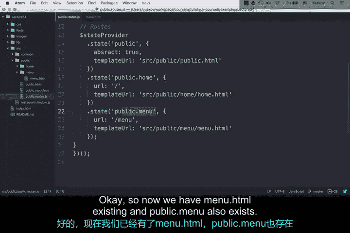
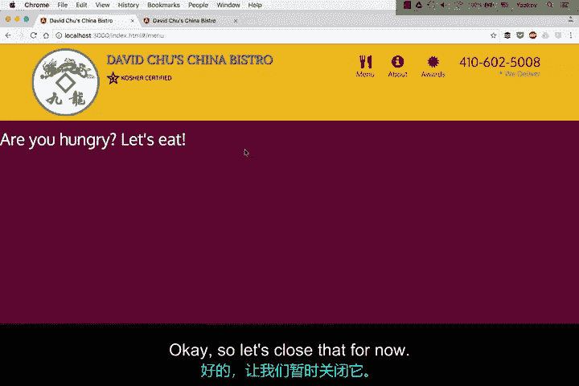
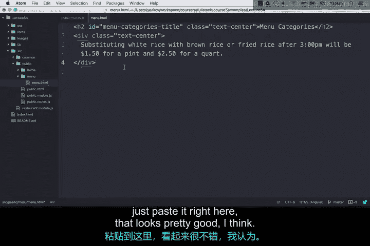
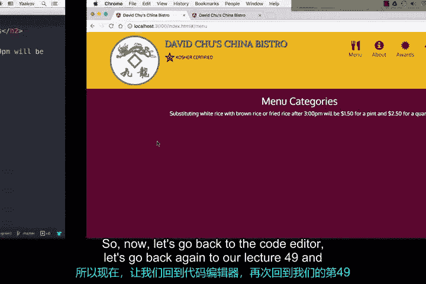
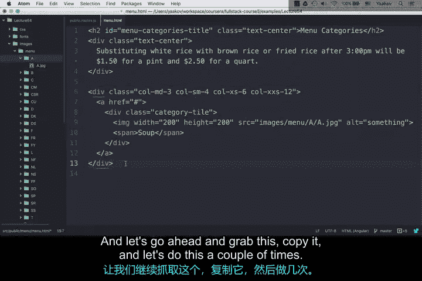
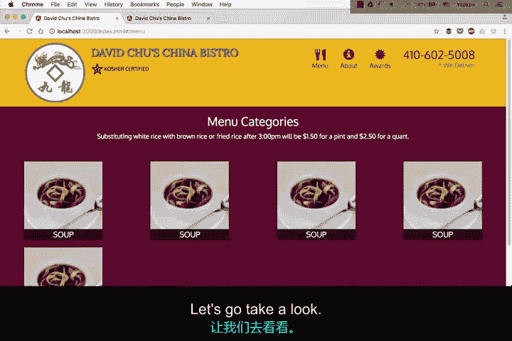
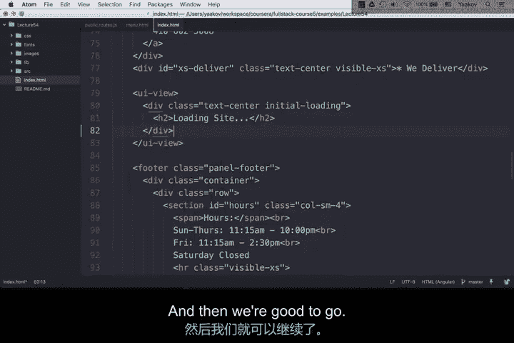
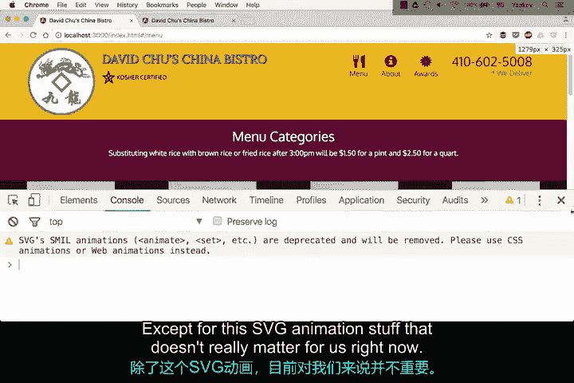
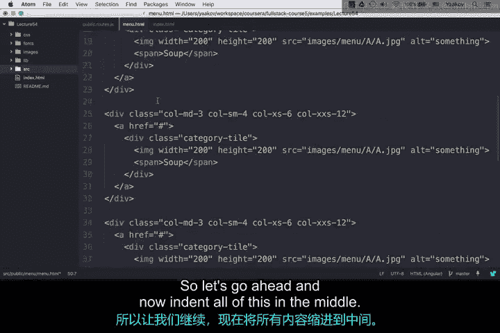
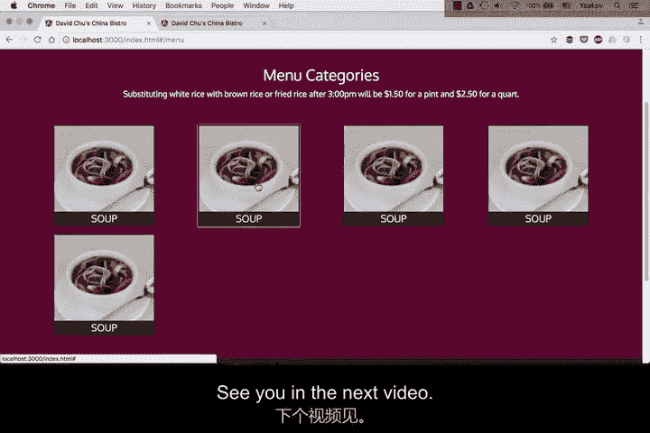

# 使用 AngularJS 开发单页 Web 应用：第54讲：编写菜单分类视图（第1部分）


在本节课中，我们将学习如何为餐厅网站创建菜单分类视图。我们将从主页的菜单按钮开始，设置路由，并构建一个显示所有菜单类别的页面。

## 概述

上一节我们完成了主页的构建。本节中，我们来看看如何实现点击菜单按钮后跳转到菜单页面的功能。菜单页面将首先展示所有菜品的分类，例如汤类、午餐、晚餐和寿司等。

## 设置菜单状态路由

首先，我们需要在 `public.routes.js` 文件中为菜单页面创建一个新的路由状态。

```javascript
.state('public.menu', {
  url: '/menu',
  templateUrl: 'src/public/menu/menu.html'
})
```

这段代码定义了一个名为 `public.menu` 的状态。当用户访问 `/menu` 路径时，AngularJS 会加载 `src/public/menu/menu.html` 文件中的模板内容，并将其插入到父视图的 `ui-view` 标签中。

## 创建菜单页面模板

接下来，我们在 `src/public/` 目录下创建一个名为 `menu` 的文件夹，并在其中新建 `menu.html` 文件。

最初，我们可以先添加一个简单的标题来测试路由是否正常工作。

```html
<h1>Are you hungry? Let's eat!</h1>
```



保存后，在浏览器中点击菜单按钮，页面应能成功跳转并显示这个标题。通过开发者工具检查，可以看到这个 `h1` 标签被正确地插入到了嵌套的 `ui-view` 中。



## 构建分类视图

为了构建完整的菜单分类页面，我们需要参考之前（第49讲）没有使用 AngularJS 时实现的版本。该版本包含两个主要部分：页面标题和分类项目网格。

以下是页面标题的代码片段，我们可以直接复制到 `menu.html` 中。





```html
<div class="container">
  <div class="text-center">
    <h2>Our Menu</h2>
    <p>Choose from our delicious menu items below. Click on any category to see the items within.</p>
  </div>
</div>
```

接着，我们需要处理每个分类项目的显示。以下是单个分类项目的 HTML 结构。

```html
<div class="col-md-3 col-sm-4 col-xs-6 col-xxs-12">
  <a href="#">
    <div class="category-tile">
      
      <span>Soup</span>
    </div>
  </a>
</div>
```



我们将这个结构复制几份到 `menu.html` 中，并暂时硬编码一些数据（如图片路径和分类名称）以进行布局测试。保存后，页面应能显示多个分类区块。

## 修复 HTML 验证与布局错误

在测试过程中，控制台可能会出现“尝试多次加载 Angular”的警告。这通常是由于 HTML 结构无效导致的。检查 `index.html` 或主要模板文件，确保所有标签（特别是 `div` 标签）都正确闭合。

此外，如果页面布局混乱，可能是因为缺少 Bootstrap 的容器类。我们可以将分类网格代码包裹在一个 `div` 容器中来解决布局问题。



```html
<div class="container">
  <!-- 分类网格代码放在这里 -->
</div>
```

修复后，页面布局将恢复正常。

## 总结









本节课中我们一起学习了创建菜单分类视图的第一步。我们设置了 `public.menu` 状态路由，创建了基本的菜单页面模板，并从旧版本中复制了标题和分类项目的 HTML 结构进行初步渲染。我们还解决了因 HTML 标签未闭合和缺少容器导致的页面错误。在下一讲中，我们将使用 AngularJS 的数据绑定和循环指令来动态生成这些分类项目，替换当前的硬编码方式。