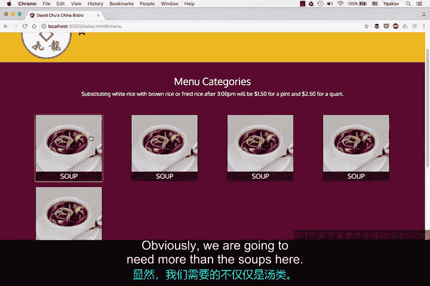
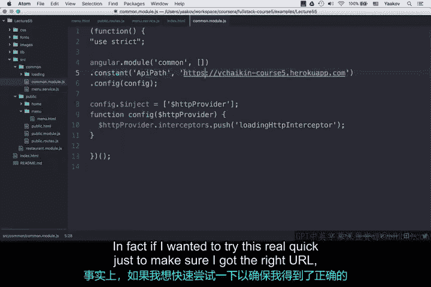
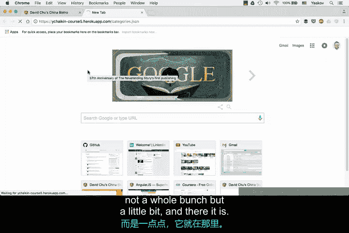
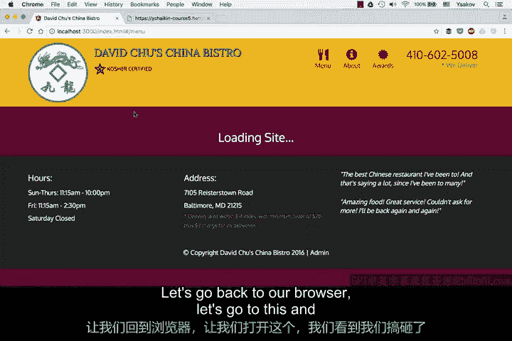
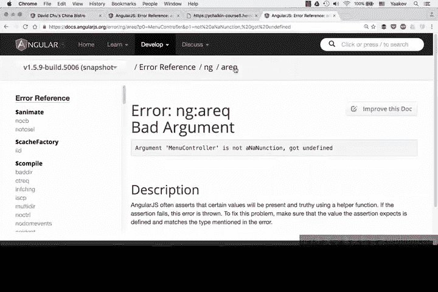
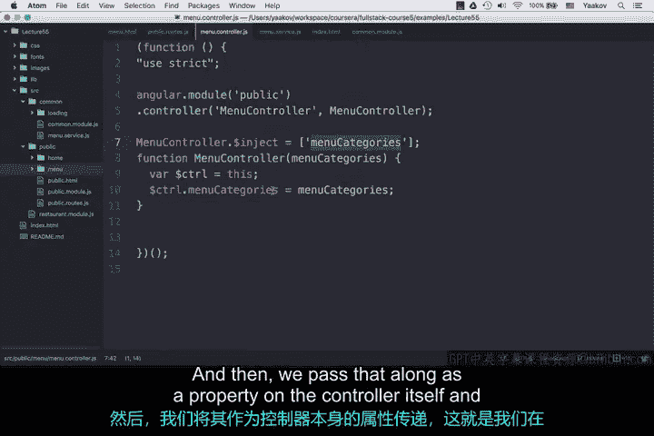

# 约翰霍普金斯大学《使用 AngularJS 开发单页 Web 应用｜Single Page Web Applications with AngularJS》中英 - P114：113_第55讲：编写菜单分类视图（第2部分）.zh_en - GPT中英字幕课程资源 - BV1dsFDeZEQr

🎼。

Okay， so I'm back in the code editor located in lecture 55。

 which is located in fulltag dash coursese 5 Exles folder。

 and this is our menu that HTML that is supposed to show us a list of menu categories together with the title of the whole menu with some dire word about some kind of a white rice with brown rice substitution。

😀呵。😊，Anyway， the point is this is our menu categories page。

 this is all the categories if we go to the browser and I already started my browser sync and I click on this menu it now shows us all of these tiles as category Obviously we're going to need more than the soups here that means we're going to need to have some data somehow we're going to need to pass some data into this menu that HTML once we get that data we could now figure out how we could get that data into each one of these tiles that we're displaying for each category well it sounds like we need a controller not an implicit one but an explicit controller to control this menu that HTML let's go back to public that routes that js and let's add the controller right here in our public that menu state let's put a comma here and we say controller we'll call it a menu controller。

😊。

And we'd like to use controller S syntax。Because that's the better practice we'll call it menu CTtRL menu controller and now obviously the controller by itself is not going to do anything for us。

 We actually need this controller to get some data from somewhere and usually the way we get the data to the controller if that controller needs the data to function already upfront in other words。

 if that controller doesn't even make sense to exist before the data shows up。

 We usually want to do that inside a resolve directly on our state So let's go ahead and define a resolve。

And we'll define it with the key menu categories。Because that's what we need we need the menu categories。

 And the question is how we're going to get these menu categories。

 how are we're going to get this data Obviously this data is the thing that lives on the server。

 It's not going to sit here on our client side which means we're gonna to make an HtP request which means we need the Das sign HTP service for that it's better instead of putting it inside of a controller somewhere to put it in a separate service So I'm going go ahead and wire up the service which I haven't created it yet。

 but I should be able to create it right now， So first we'll call it menu service that's where it's going to give us all the menu related data and now I'm just using an inline notation to safeguard it from muification and again here we're going inject this menu service。

😊，And what we need to return here is we need to return something from that menu service。That what。

 I guess at this point， it should be that get categories， right？Okay。

 so we need all of the categories to be returned Okay so if I say that right now。

 not much is going to happen other than possibly some errors because we don't really have the menu service even defined So let's go ahead and define it The thing is where should we define it should we define it in public or should we define it in common and I think we need to define it in common simply because when we go to the admin portion of this website。

 we're still going to need the categories we're still going to need all the data so we might as well just centralize it So let's go to the common and we'll just in inside the common create a new file。

 we'll call it menu that service do Js。Okay， so let's quickly write at least the first method that we need for it。

 which is the method of get categories。 First thing we need to do is create a quick ify here。

And there we go。We'll say that we want to be safeguarded from all kinds of errors。

 so we'll say use strict。And then we'll go ahead and define our menu service on the module Common。

 So we'll say angular do module willll call up module Common。

 will'll retrieve that and we'll define a service。And we'll call it service menu service。

Mu service is going to be the name of the function that actually defines it。

And let's go ahead and inject a couple of things into it。We're definitely going to need the HP。

Service to be injected in here， but we might want to inject something else。

 Let's just go ahead and type this up real quick。And we'll say function。

Minnu service and here we need HtTP。And as usual， we'll just say our service equals this and the first method we want is service that get menu categories。

Okay。Actually， we probably named it something and we've named it get categories。

 so let's keep that the same， get categories， not menu categories。Okay， so in here。

 what we're going to need to do is we're going need to return whatever it is that's returned from our D signine HTP service。

 and we're going to get some path。Here I don't remember which one it is yet。

 but right nowll just say then we'll close that with a semicolon and here we need a function don't need the name and we function is gonna have some response and we need to return from that function because that's a promise need to return response that data because the actual data always exists on the data property of the response Now what do we put in here exactly well we put the URL off our rest endpoint that was created for us by our restaurant server So it's going be something like slash categorygories that Json and I already know this because I looked this up before that's the endpoint。

 The thing is though we need the front part of the endpoint。

 we need Hp colon slash and so on and so forth。 Now I could just hardcode this URL right here but it strikes me that that would be a bad idea because we're gonna to have other methods that are going to use the same thing Instead it's probably better to define a constant in our common module and then reuse this constant everywhere So let's go。

BackTo the common module do Js。 And let's define a constant here。

And we'll call that constant API path。And the question is， what is our API path Well。

 our API path is that restaurant server that we deployed for ourselves in one of the previous lectures and as if you remember I deployed mine with the subdomain of my username course 5 heroroku app co and we probably need to make an HPS because Github is going to be using HPS to deploy it so if we're going make a request with with just HP Chrome and other browsers will probably complain because it's not going to like the security situation of the encrypted page calling a nonenryed resource so we'll go ahead and just use that so we got our Hp here that's our API path for all the otherlash categories and so on and now if we go back to the menu service we can actually use this right here but first we need to actually inject it So let's go ahead and inject our API。

😊，path。And inject it into the function。And now we could just use the API path like so。

So it's API path plus slash slash categories that Json。 Okay， once we're done， we could save that。

 Let's go to index that HTML and actually。Import that in our scripts。

 And it's going to be one of the common ones。 We'll copy this， and we'll say。

Not loading the just say menu that services。js and we'll save that。Okay。

 so now we have just to review a constant with API path， we have the menu。service。js。

 which is our menu service that we've defined as a service that has a get categories method that returns the data that is returned by these categories。

 Json and in fact， if I wanted to try this real quick just to make sure I got the right URL。

 I'll go back to the browser open up a new tab and say scatego。

 JsonN and when I should get in my browser is a whole bunch of JsonN。

Well， not the whole bunch， but a little bit。

And there it is， so that's working， so the URL is the correct URL that we're constructing in the code。

Okay， so we have this， we have our menu service。 The only thing that's left is to look at our resolve。

 It looks like the resolve that we set up is complete。

 So now what we have left is to actually define our menu controller。

 So let's go ahead and define it straight inside of our menu folder and we'll say menu do controller dot Js again an iffi。

And then we're ready to go with use strict。Strict。And we need to define the controller on our public module。

 so we'll go ahead and retrieve the public module and we'll say that controller and we'll call the controller。

 we call it menu controller。We'll call the function the same way。

And we'll go ahead and define the menu controller。 But first， before we define it。

 we need to inject this menu categories that's coming from the result。

 So we'll go ahead and say menu controller。The da sign inject and will inject。

 forgot what the name was。Let's just copy it menu categories right here。

We'll define the function of menu controller and inject the menu categories here as well。

Don't need that And here we'll just do our regular CTRl equals this just in case we're gonna to need it later。

 but for now we'll just say controller CTtRl that menu categories equals menu categories so we copy it into the controller so now menu categories is a property on the instance of the controller of the menu categories controller so we'll save that and that's the case now this menu controller if we look is bound to our menu that HTML so if we go to menu that HTML right here so we should be able to now output the menu categories and in fact let's go ahead and do that we'll do it in kind of an ugly way but that will work anyway we'll just interpolate let's go take a look as to what our label was menu CTRl we'll interpret it menu CTRl that let's go back to the controller It's menu categories。

That menu categories。 and let's go ahead and tell it that it should filter it as JSO so we can actually see it better。

 Let's save that。 let's go back to our browser， Let's go to this and we see that we mess something up。

Let's take a look。Oh， I misspelled service without an R。 that's kind of a problem。

 So let's go to our index at HTML and let's say service， let's save that， go back to the browser。

 could close that up。And it's not working。Let's see why isn't that working。Let's click this。

Mu controller is not a。And sometimes these URLs get messed up。

 so let's actually try to copy it this way and maybe open it up there。

Let's see if it tells better oh menu controller is not a function and got undefined。 Okay。

 so let's go back to our code and besides our service right here。

 we might want to import the controller as well if I ever want it to work right so we defined it in menu slash menu do controller do js。

 let's save that So now it is actually going to get loaded。 let's go back to our browser。

Let's see if it's happier now it looks like it's happier。

 andvoila we got all of this Jason flying in our face right here before the menu。

 so point is now we're able to pass along the data from the server directly into our menu that HTML right here so a menu that HTML is now ready to get interpolated with all this data that now passed along through the resolve using the menu server that reached out to the restaurant server and passed it along to us as a menu categories into our controller right here。

😊，And then we passed it along as a property on the controller itself。

And that's how we got it right here， and at this point we're ready to start interpoolating that data and actually creating our menu page which lists all the categories。

