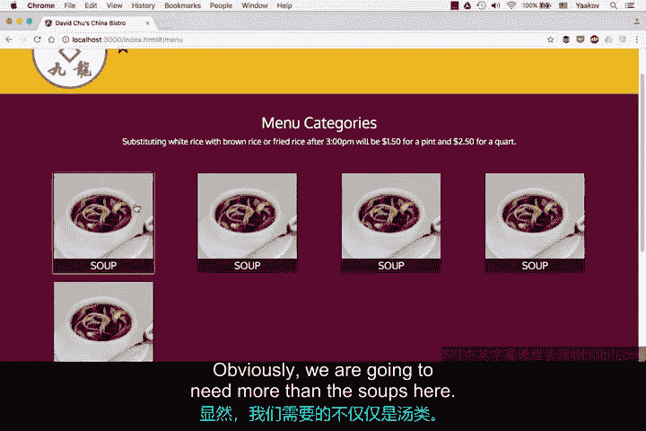
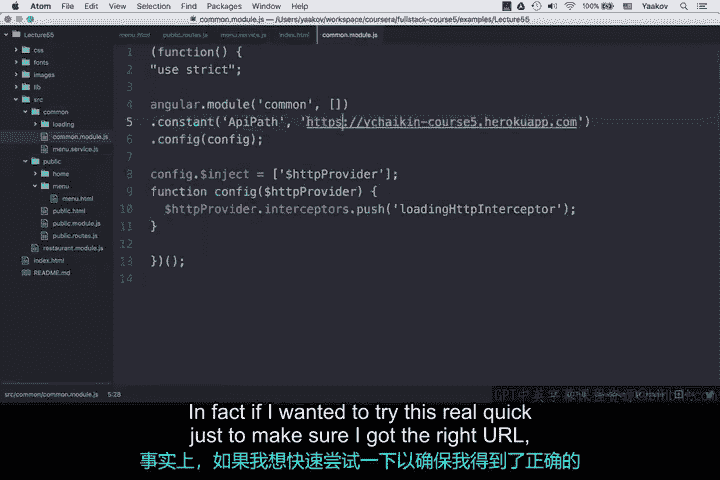
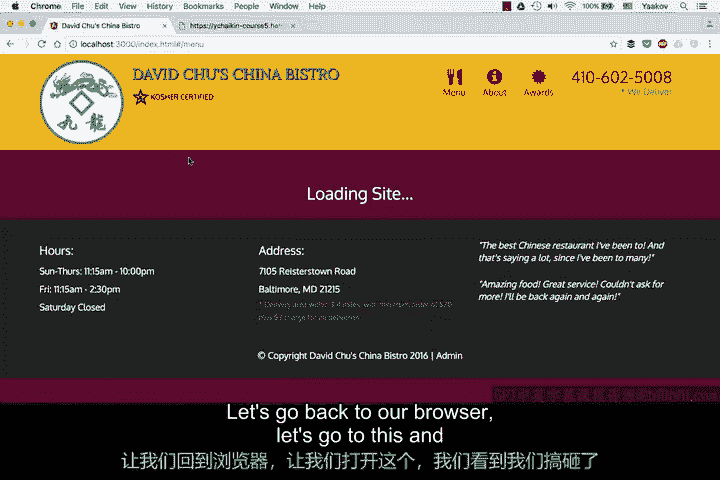
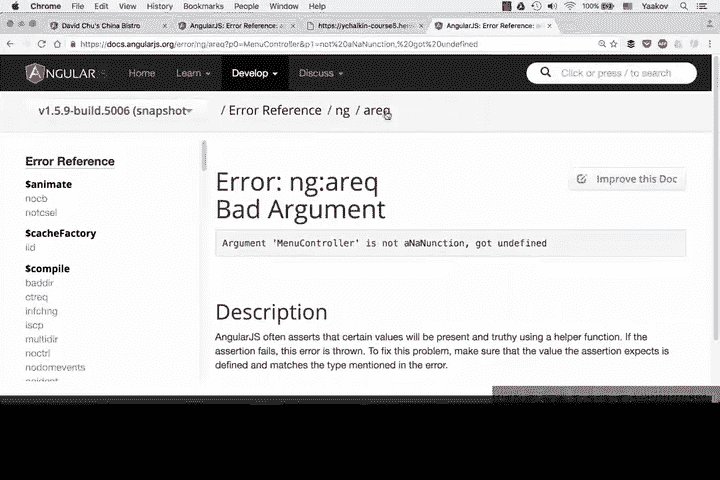
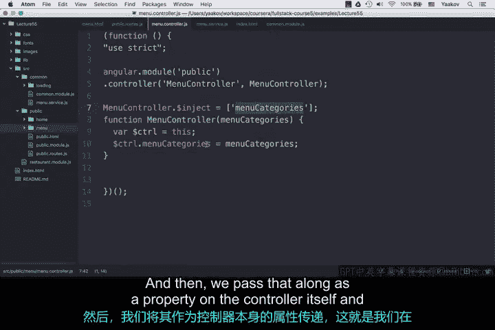

# 使用 AngularJS 开发单页 Web 应用：第55讲：编写菜单分类视图（第2部分）

在本节课中，我们将继续构建菜单分类视图。我们将学习如何通过定义控制器和服务，从服务器获取数据，并将其动态地显示在页面上。

---

上一节我们介绍了菜单页面的基本结构。本节中，我们来看看如何为这个页面注入动态数据。

我回到了位于第55讲的代码编辑器中，该目录位于 `fulltag-coursese5-exles` 文件夹。这是我们的 `menu.html` 文件，它应该显示一个菜单分类列表，以及整个菜单的标题和一些描述。

无论如何，重点是这是我们的菜单分类页面。如果我们在浏览器中查看，并点击菜单，它会显示所有这些分类卡片。显然，我们需要的不仅仅是“汤”类，这意味着我们需要以某种方式获取数据。我们需要将数据传递到这个 `menu.html` 文件中。一旦获得数据，我们就可以弄清楚如何将数据填充到每个分类卡片中。

这听起来我们需要一个控制器，不是一个隐式控制器，而是一个显式控制器来控制这个 `menu.html`。让我们回到 `public.routes.js`，在我们的 `public.menu` 状态中添加控制器。

以下是添加控制器的步骤：

1.  在 `public.menu` 状态中添加一个逗号。
2.  定义 `controller` 属性。
3.  使用 `controllerAs` 语法，这是一种更好的实践。
4.  将控制器命名为 `MenuController`。

现在，控制器本身不会为我们做任何事情。我们实际上需要这个控制器从某个地方获取数据。通常，如果控制器需要数据才能正常运行（换句话说，如果数据未出现，该控制器甚至没有存在的意义），我们通常希望在状态定义中直接通过 `resolve` 来获取数据。

让我们继续定义一个 `resolve`。

以下是定义 `resolve` 的步骤：

1.  定义键为 `menuCategories`，因为我们需要菜单分类数据。
2.  问题是如何获取这些数据。显然，数据存在于服务器上，不会在客户端。
3.  这意味着我们需要发起一个 HTTP 请求，因此我们需要 `$http` 服务。
4.  更好的做法不是将 HTTP 调用放在控制器里，而是放在一个单独的服务中。

因此，我将创建一个尚未存在的服务。首先，我们称之为 `MenuService`，它将提供所有与菜单相关的数据。我使用内联注释来防止代码压缩时出现问题。在这里，我们将注入这个 `MenuService`。

我们需要从这里返回的是 `MenuService` 中的某个方法。此时，它应该是 `getCategories` 方法。我们需要返回所有的分类。

如果我现在就这样写，除了可能产生一些错误外，不会发生太多事情，因为我们实际上还没有定义 `MenuService`。让我们来定义它。

问题是我们应该在哪里定义它？是定义在 `public` 目录下还是 `common` 目录下？我认为需要定义在 `common` 目录下，因为当我们进入网站的管理部分时，我们仍然需要分类数据，我们仍然需要所有数据，所以最好将其集中管理。

让我们进入 `common` 目录，在里面创建一个新文件，命名为 `menu.service.js`。

让我们快速编写至少我们需要的第一个方法，即 `getCategories` 方法。

以下是创建 `MenuService` 的步骤：

1.  创建一个立即执行函数表达式（IIFE）并使用 `‘use strict’`。
2.  在 `common` 模块上定义我们的服务：`angular.module(‘common’)`。
3.  调用 `.service` 方法，服务名称为 `MenuService`。
4.  在函数中注入 `$http` 服务。
5.  定义 `getCategories` 方法，该方法返回一个 HTTP GET 请求的 Promise。
6.  请求的 URL 是服务器提供的 REST 端点，例如 `/categories.json`。

不过，我们需要完整的 URL 前缀（如 `http://...`）。我可以直接在这里硬编码这个 URL，但我觉得这不是一个好主意，因为其他方法也会使用相同的前缀。更好的做法是在我们的 `common` 模块中定义一个常量，然后在各处重复使用这个常量。

让我们回到 `common.module.js`，定义一个常量。

以下是定义 API 路径常量的步骤：

1.  使用 `.constant` 方法定义一个名为 `ApiPath` 的常量。
2.  常量的值是我们之前部署的餐厅服务器的 URL（例如 `https://username-course5.herokuapp.com`）。我们需要使用 HTTPS，因为 GitHub 部署会使用 HTTPS，如果加密页面调用非加密资源，浏览器可能会因安全原因报错。

现在，回到 `menu.service.js`，我们可以使用这个常量。首先需要将其注入到服务函数中。

现在，我们可以这样构造 URL：`ApiPath + ‘/categories.json’`。

完成后，保存文件。我们需要在 `index.html` 中引入这个新的服务脚本文件。它将是 `common` 模块的一部分。复制一个现有的 `common` 脚本标签，将其路径改为 `menu.service.js` 并保存。

现在，我们回顾一下：我们有一个包含 `ApiPath` 的常量，一个定义了 `MenuService` 的服务文件，该服务有一个 `getCategories` 方法，该方法通过请求 `/categories.json` 端点返回数据。

为了确认 URL 正确，我可以在浏览器新标签页中打开这个 URL，应该能看到返回的 JSON 数据。测试成功，URL 是正确的。

我们有了 `MenuService`，剩下的就是查看我们的 `resolve`。我们设置的 `resolve` 看起来已经完成了。

接下来，我们需要实际定义我们的 `MenuController`。让我们在 `menu` 文件夹内定义它，创建文件 `menu.controller.js`，同样使用 IIFE 和 `‘use strict’`。

我们需要在 `public` 模块上定义这个控制器：`angular.module(‘public’)`。然后调用 `.controller` 方法，控制器名称为 `MenuController`，函数名相同。

在定义控制器函数之前，我们需要注入从 `resolve` 传来的 `menuCategories`。使用 `$inject` 属性进行注入。

在控制器函数内部，我们将 `menuCategories` 赋值给控制器实例的一个属性（例如 `ctrl.menuCategories = menuCategories`），这样它就可以在关联的模板中使用了。

保存文件。现在，这个 `MenuController` 绑定到了我们的 `menu.html`。因此，我们应该能够在 `menu.html` 中输出 `menuCategories`。

为了快速验证，我们可以在 `menu.html` 中使用插值表达式以一种简单（可能不太美观）的方式输出数据。例如：`{{ ctrl.menuCategories | json }}`。保存后，回到浏览器查看页面。

如果出现错误，比如“MenuController is not a function”，通常是因为没有在 `index.html` 中正确引入控制器脚本文件。确保在 `index.html` 中添加了 `menu.controller.js` 的 `<script>` 标签。

修复引入问题后，刷新页面，现在我们应该能看到 JSON 数据成功显示在菜单标题之前。

至此，我们已经能够将数据从服务器通过 `resolve` 传递到 `menu.html` 中。`MenuService` 访问餐厅服务器，将数据作为 `menuCategories` 传递给控制器，控制器再将其作为自身的一个属性暴露出来。这样，我们就获得了数据。

现在，我们准备开始插值这些数据，并实际创建列出所有分类的菜单页面。

---

本节课中，我们一起学习了如何为 AngularJS 单页应用中的视图注入动态数据。我们通过以下步骤实现了从服务器获取数据并传递给视图控制器：
1.  在路由状态中定义了 `resolve` 属性，用于预先获取数据。
2.  创建了 `MenuService` 服务来封装 HTTP 请求，并定义了 `getCategories` 方法。
3.  在 `common` 模块中定义了 `ApiPath` 常量，以便集中管理 API 基础 URL。
4.  创建了 `MenuController` 控制器，并通过依赖注入接收 `resolve` 提供的数据。
5.  将数据绑定到控制器实例，从而使其在关联的 HTML 模板中可用。
通过这种方式，我们成功地将后端数据与前端视图连接起来，为下一步动态渲染菜单分类列表奠定了基础。