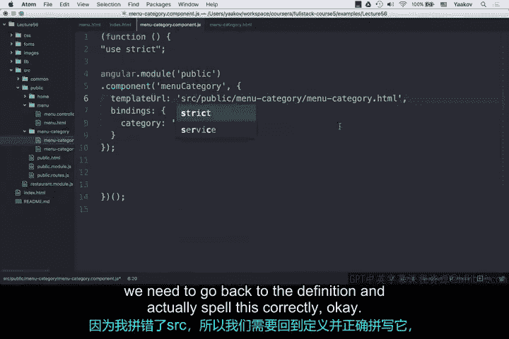
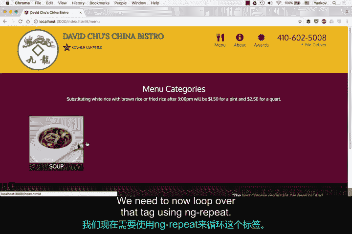
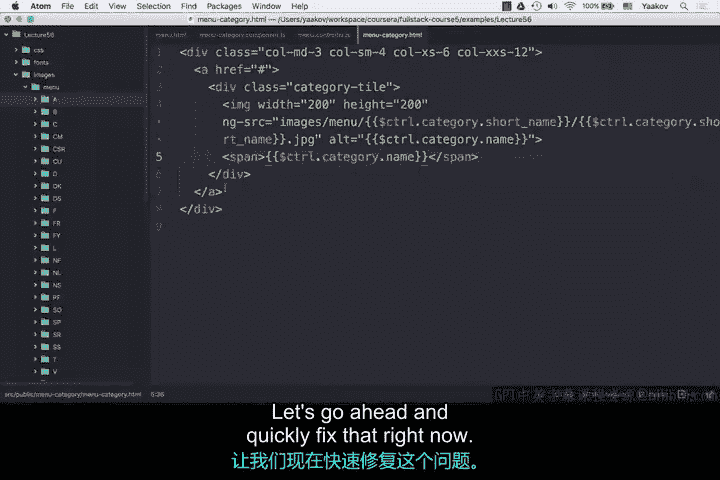

# 约翰霍普金斯大学《使用 AngularJS 开发单页 Web 应用｜Single Page Web Applications with AngularJS》中英 - P115：114_第56讲：编写菜单分类视图（第3部分）.zh_en - GPT中英字幕课程资源 - BV1dsFDeZEQr

🎼。

Okay， so we're back in a code editor in the lecture 56 folder which is located in Fulltag dash coursese 5 examples folder and in the last lecture what we did was we successfully passed in the categories data to this menu that HTML template and you could see we actually just basically interpolated it straight in the web page and just made it look like JSON if we go to the page right now and you could see that's the JSON for all the categories。

Okay so we can actually remove that now now that we verify it's there and let's save that and let's just verify that things are working here。

 Yes， no longer do we have this JSsonN in a page Okay so the next thing we want to do is actually look at each category tile that we're printing out or we're interpolating to the page obviously we do not want to list them like this one by one by hand we want to be able to loop over this particular set of tags and technically speaking I could just put an engine repeat right here。

 but it would be a much cleaner page if we actually created a component out of this little piece of HTML and on top of which we could refer to it as like menu category tile so that would be a much more semantic if we just place a menu category tile right here instead of this whole bunch of HTML which we have to figure out what that is So let's go ahead and create a component's go to our public folder and let's create one more folder and we'll call that menu dash category。

😊，And inside of that menu category will create a file we'll call it menu dash category。

T component dot Js。Okay， so here we're going to get our Efi。

Startro file pretty much always with an ifffie。And will declare that。 We won't。To used strict。

So willll help us out if we make a mistake Okay， so now we need to declare our menu category component。

 so we'll go ahead and call Angular and we'll load up the public module and we'll create component。

We'll call it menu category。 And as you remember， it takes an object that defines this component。

 The first thing we'll do is give it a template URL。

And we're going to put our template for this into public slash menu category。

 basically in the same folder as the component GS。So it's menu category。

 HTML and we also need some bindings as you can see we have we're going to need some some sort of data from a particular category。

 so in that case we're going to need two nuclear bindings。And what we need is one single category。

And since we don't want to change anything inside that's kind of the best practice。

 we'll do one way binding right here okay that's really all we need and now what we need to do is create a menu category template。

 menu categories category。h and we'll go ahead and go to our menu the HTML and grab this whole thing right here。

😊，We'll copy it。And place it into our menu category like so。

 And now instead of having this whole bunch of HTML here。

 we could replace it with just saying menu category。

And that's our tag right there and we can now take all of this out of here except the last div I've got to be careful here。

 the La div still has to be with a container， So here's our menu category。

 So if we display this right now save it。 and first of all we need to make sure to import the menu dash category that component Gs into our HTML so let's go ahead and do that right now and it's in the public module so we'll do it under the public module heading here so we know where things are So here we have menu dash category and this is menu dash category and it component。

Doesn't quite fit in our screen right now， but it's okay。See it a little bit better that way。 Okay。

 so we imported the category menu category component。

 and if we save it right now and go to our browser。We see that we mess something up。

And it can't find menu category， menu categorygo that HTMLt。

Oh so because I misspelled the SRC and I misspelled it with so we need to go back to the definition and actually spell this correctly。

 Okay， let's go back to our page。

And there we go。 So we have this one tag sitting right there。

 Obviously we don't need one tag We need to now loop over that tag using Nng repeat so let's go back to our menu that HTMLm and actually write an N repeat right here before we do though let's go ahead and close up this component and the index HTMLm for now and let's look at the controller that's going to be passing data to this template and that's menucontroller do js so what we're expecting here is menu categories property on the control instance itself Okay so let's go back to menu that HTMLt and now what we could do is say Nng repeat。

And we'll say menu category。One menu category in menu CTRL。

 that's the name of our controller that we gave if we look at our routes。

 you'll see that we gave the menu that CTRL for this menu controller as the label。

So dot and menu categories that we copied and pasteed from the controller。

 the menu dot controller do Gs and our menu category component， if we take a look at it real quick。

 Exp a category as a binding， so we need to put that as an attribute， let's go back and say category。

Not category title just category， and that's going to be equal to menu category that's the one through the loop。

 so let's go actually put space here so we can see it a little bit better。Okay。

 so now we could see it a little bit better and let's save that let's go back to our browser and as you could see we have a whole bunch of soups here because we're not really changing anything or interpoolating anything inside of our component so let's go ahead and change that right now let's go to our menu category that HTML which is the template for our component so each one of these keeps getting inserted as we are looping over this menu category。

And we need to interpolate it。 Let's take a look real quick into our network tab。

So when we requested， we should be able to see。Let we reload that again real quick。

 we should be able to see the call to menu category。And I don't see the Colta our restaurant service。

 so let's try to reload this hardreload it and let's see if we can find it now we're looking for categories that Jason and there it is and let's take a look as to what it's giving us。

 you could see it's giving us each one in the array is giving us ID short name the name let's see the name special instructions and this URL Okay so now we we know basically how we can interpolate it in our menu category component。

And the first thing we need to do is change the source to the right source right now is just pointing to the a image the whole time。

 First of all remember an image source might get loaded before angle is ready for it。

 so we'll change this to Nng source we'll say s and interpolate it with CTRl or dollar signs CTRl that's our default control label that category that something that's being passed into us as an attribute and then short underscore name and really we need to unfortunately do this one more time right here for the name of the actual image and unfortunately this whole folder structure is really left over from the fact that we used to have besides for the actual a jPg or something like that for the category picture we used to have all the pictures for all the items here as well and we no longer have that because they're now sitting in the restaurant server and being served dynamically because now we can update those pictures and the truth is what we really should do is take out every single one of those pictures and put it straight inside the menu。

Foldler inside the images instead of having that separate。 but we'll fix that later。

 and we'll just leave that alone for now。 Okay， so let's save that。 let's go back to the browser。

 Okay， so yes， so now we're pulling different pictures for every single category。

 So let's go back and edit the alt here。 The alt should be same thing。

 at least the beginning of the same thing and。We'll close that and put here name， instead of。

The short name and the same thing for the actual span that it' going to say now is's going to say name。

 So we say that。 go back to the browser。 Okay， so yes。

 now you could see that every single category has its own picture that is appropriate for it and has its own name that we're pulling out from the categories array and that's it So the menu categories or the menu view is pretty much done。

 So now if we go back to a front page and we click on the menu it will show us all of the categories in our menu。

It strikes me that this menu button is not on， it truly should be active， but it's not。

Let's go ahead and quickly fix that right now。 Let's close that and go to our index that HTMLt and let's look for the menu in here。

And so there's our LI with the menu we see UI SRf that makes our link for us。

 however there is nothing that is actually making this active and the way to make this active is to actually put the word active in it or the class active I should say。

 so let's go ahead and cut that out of here and this was on the LI itself we want to make sure that we give the proper selectors and we'll do UISF active。

And we'll give it the active class。 So whenever public that menu is the state that the UI router is going to be in。

 this active will also activate this active class and therefore this whole menu will light up with a particular background and notice that I'm not using Uisf active on the same element as UISR and that's okay let's also support it since it's nested together that's good to go。

 let's go ahead and save that and let's go back to our browser and you can see that now menu is active。

 So if we go back to the homepage click this you see now menu stays active， go back to the homepage。

 click this and now menu is still active。 Okay so now we have our menu categories view and we're ready to move on。

