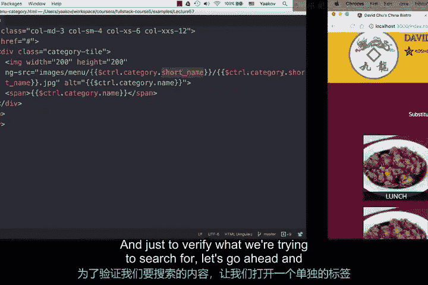
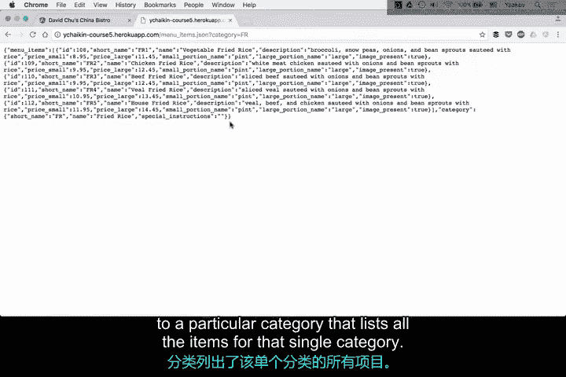
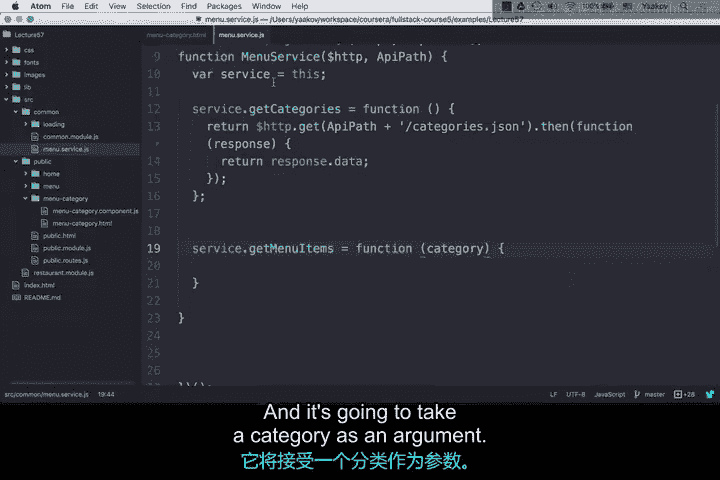
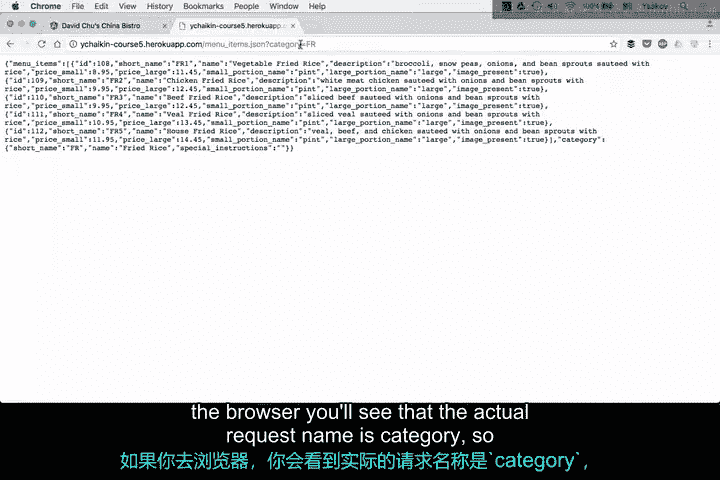
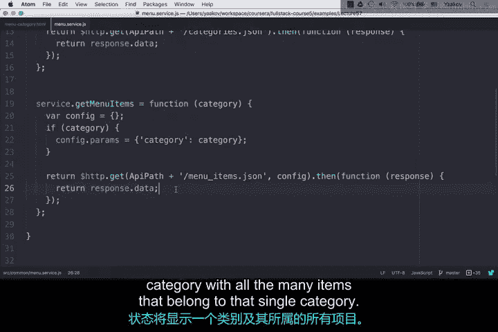

# 约翰霍普金斯大学《使用 AngularJS 开发单页 Web 应用｜Single Page Web Applications with AngularJS》中英 - P116：115_第57讲：单个分类视图（第1部分）.zh_en - GPT中英字幕课程资源 - BV1dsFDeZEQr

🎼。

Okay and we're back in our code editor and I'm located in lecture 57 folder。

 which is located in fulltag course 5 examples folder and here let's take a look at our HTML template for the menu category so that's the thing if we go back to the browser since my browser syncers is started So that HTML template is responsible for this one tile each one of these tiles is really this HTML right here So now we have all the category listed。

 but what we're still missing is the actual single category page where it lists all the menu items for that particular category and the way we get to it is by clicking on this whole tile or clicking this whole tile particular piece of it using the anchor tag the atag and you can see it's right now just a hash because we haven't really programmed it So what we're gonna need to do is actually program it such that it goes to a different state that state that lists all the menu items for one single category Now in order to do that we're gonna have to pull out the data for one single category。

😊，Because so far all we have is a list of categories with their names and maybe descriptions。

 but we don't have the single category menu data yet。

 which means that before we even attempt to configure our next view state which is go ahead and go to our menu service that pulls the data for us from the server and code up one more method that gets the menu items for a particular category based on the short name of that particular category and just to verify what we're trying to search for。

 let's go ahead and open a separate tab and we'll find our。

Server right here with menu items。 So this will give us all the menu items， all of them together。

 However， what we really want is we want a question mark and we already have here， for example。

 category equals L， the short name L。 So right now it became a little bit smaller list and you could see all the short names is L 3 L5。

 so on。 If we do a different one like FR。But you can see now we have all the menu items for this FR short name category。

 so that's what we need to do， we need to be able to pull out this data dynamically every time we go to a particular category that lists all the items for that single category。

So let's go back to our code editor and let's go into the common into the menuserv。js。

 and we're going to need to write one more method， we'll call this method service。 get menu items。

And it's going to be a function。And it's going to take a category。

As an argument and I could probably name it category short name。

 but actually if you go to the browser， you'll see that the actual request name is category。

 so we'll keep it as category here as well。

Okay， we'll put a semicoe in here and what we need to return here is our D sign HP call。

We'll do get and do the same thing as before API path。Plus。

 slash menu items was our URL 8 items that Jason。And we need to somehow pass in the actual category as a request parameter now we could just go ahead and try to open it up ourselves and you know basically concatenate most strings or before we do that。

 let's go ahead and create an object。😊，Called config。

And we'll place our category request parameter into the object Well， let's verify first of all。

 there is a category because if there isn't we're going to have to output the entire thing if category exists。

 we'll say config do parameterss and we'll give it an object with category as our request parameter and category as the actual value so now we could go ahead and un this line we'll just put a comma and pass in the config object that our Http service expects as a config object with the parameterss properly to be able to place these parameterss and interpolate them properly onto the URL and since it's the promise we need to handle the response properly and we'll go ahead and say the function what I need the name but it's going have a response right here。

 let's give us a little bit more room on the screen will close the tree view over there and what we need to do is return response that data since the actual data is going to come。

Back with the dot data property on the response。Now we could save that and we're ready to configure our next view state that will display a single category with all the menu items that belong to that single category。

