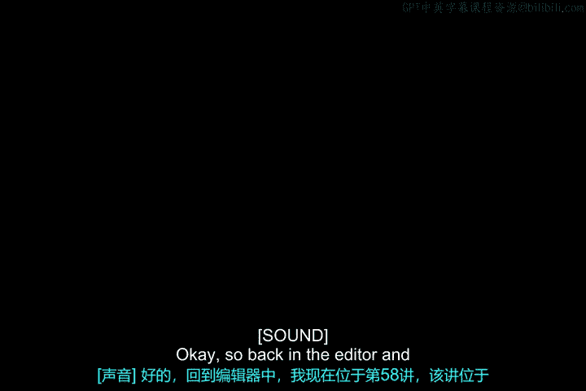
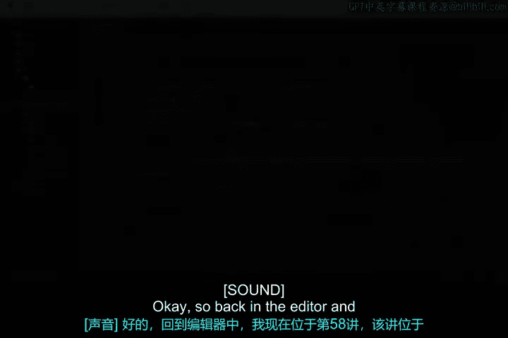
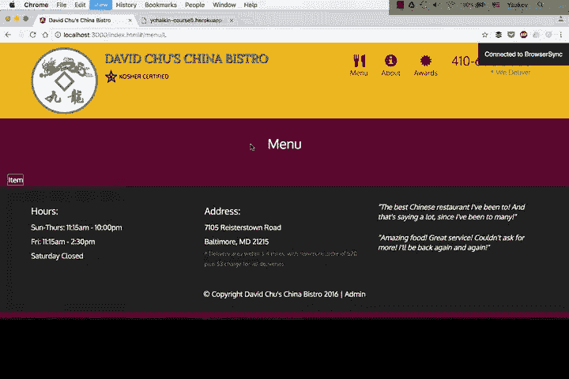
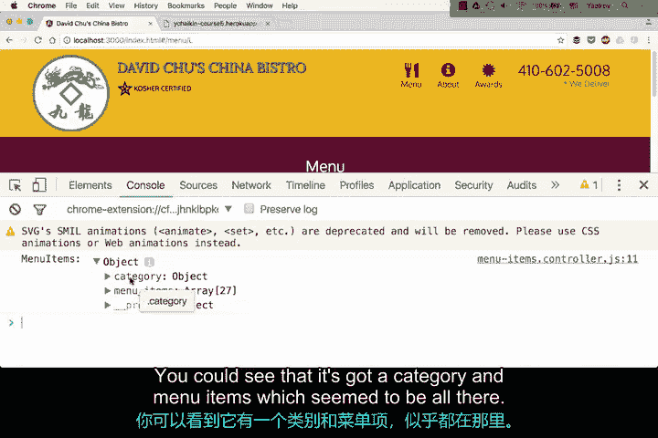
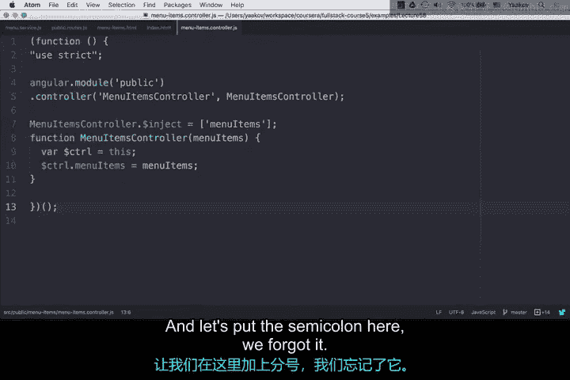

# 约翰霍普金斯大学《使用 AngularJS 开发单页 Web 应用｜Single Page Web Applications with AngularJS》中英 - P117：116_第58讲：单个分类视图（第2部分）.zh_en - GPT中英字幕课程资源 - BV1dsFDeZEQr

🎼。

Okay， so back in the editor and I'm located in lecture 58。

 which is located in full stackag Dash coursese 5 examplesles folder。😊，And before we move on。

 I'd like to take just a second to explain something in the regular development。

 I really wouldn't be keep going with the next next feature without first stopping and unit testing my code。

 for example， this get menu items method really begs to be kind of tested to make sure I didn't mess up something or made some spelling error somewhere however。

 the link of this course is kind of huge And if I really truly write every single thing onscreen and go over it with you this course will be 10 weeks instead of five plus we're gonna to lose the flow over the features that we moving on and kind of adding but however I just want to make a dire warning to you that when you write your own code after you write something definitely first test it before you move on so I kind of feel bad that I'm telling you do as I say but not as I do but just realize that this is only a special case for recording for this course either way I will provide all the unit tests for the app including the admin portion at the very end so you'll still have the code。

😊，You can look through it later if you'd like。Okay。

 so back to the code and the next thing we need to do is write yet another state for our menu items for single category。

 so let's go to public。rowse。gs and we'll scroll down and we'll add one more state right here。

Call state and we'll call it public do because this is going to be a child of public。That menu items。

 So just the menu items for a particular category and we'll configure that state with a URL of slash menu slash and here we actually need a particular category name or short name for the category in order to figure out which category we should try to pull and display on our single category page So we'll go ahead and create a request parameter we'll call it category。

 that we'll match this URL Okay， so the next thing we need to do is they actually create a template for this template URL and we'll go ahead and put it into source public menu items。

 We haven't created that yet， but we will menu dash items that HTML Okay。

 and let's save that for now。 let's go ahead and create that menu items folder。Mnu dash。

 menu dash items。 and inside of it will create。Mnu dash。Items。htm and here we'll just say yum。

It's actually a rapid inside of H1。Okay let's save that so now let's quickly configure the link to get to this particular state and the way we need to configure it is through the menu categories。

 the page that displays all of the categories and that sits inside of our component the menu category that component and that's the template from it and let's now substitute this H ref with the UI S ref to refer to our state and our state was called public that menu items that we just code it up and we need to pass it the category parameter and the way we do that is passing an object into it and say category that's the name of our parameter and it is controller that category that short underscore name is what we need to pass it so if we save it now and go back to our browser and click on the menu。

😊，And now we should be able to click on the lunch menu。

And see yum and we're good here and you could see that URL change to menu with an L， we go back。

 we'll go to appetizers， that's B， and still says yM because we haven't really programmed anything for any particular single category。

Let's go back to that page and let's go back to our code editor so we no longer need the menu category that HTML template and since this is working what we need to do now is place whatever we use to place inside of our menu items as snippet and if we go back to the previous version of the website which is sitting in lecture 49 we have a couple of things that we need to put in there for the menu items for single category 1 is the menu items title。

 that thing right here let's go ahead and copy that。And let's go back。

To this and place it right here and as I made the mistake before。

 really need to put it inside of a container。Let's go ahead and do that。

Because the container in this case travels with each single。Subview。As opposed to before。

 the only reason we don't have a container here is because we're kind of inserting it into something that already has a container。

 And the second thing we need to is the actual menu item。

 and this is that snippet here that we could just go ahead and grab go back to the other menu items that HTMLt and just paste it right here and obviously all these interpolations aren't going to work at all right now。

 we can actually go back to the browser and try it and the I as you could see the menu it doesn't work as we don't have the menu pointing to the right image。

 so nothing's really much showing up， but it's picking up our HTML。

 So before we wire a controller to our state。 Let's go ahead and create that controller for this particular template。

 Let's go to menu items。 Let's call new file called menu dash items do controller。😊，Dug Js。

We'll set up our iffi again。Use strict。And we're defining it in the public module。

 so we'll say angular。Module will go ahead and load the public module。We'll say controller。

 and let's call it menu items controller。Amil Cole。The function the same way。Okay。

 so what do we need to inject into this menu items controller？Well。

 we need to inject the menu items data， in other words。

 the data that this controller is going to need to start with in order to display all the menu items for a particular category。

 so we'll go ahead and create that array and call it menu items。😊。

And we'll create the function called menu items controller。

And we'll inject the menu items that will come from the resolve of our state route。 And here。

 all we will need to do is just again， let's just do this for。

Good measure you wouldn't really need this right now。

 but it's good practice so we'll say controller that menu items and now all we're doing is we're exposing this particular menu items array as a menu items property on the control instance itself。

Okay， so that's really all we need to do here And what's left is for us to wire this controller into our routes。

 our state route， So let's go back to our public。 routes。

 js and we'll put a comma here and we'll say controller。

And the controller name is menu items controller， we'll give it a controller as and let's call it menu items CTtRL。

 and we also need to inject a resolve into it so we'll specify a resolve。

As an object with menu items as the key and again we'll define our menu items return our promise as an inline magnification。

 so we need menu service for that and we'll do function。

 we need menu service and here we're going to return from that promise we're going to return menu service that get menu items and here we need to pass at the parameter。

 this category parameter to the menu items Well we didn't have it wired in yet so let's go ahead and do that right now we'll say state parameterss。

We'll put a common between， and we need state parameters here， too。 Let's close the。

A view of the files。 So we have a little bit more room， mostly say state parameters here as well。

 Okay， now we need to pull out the state parameters category。That category。

 and that's this category that is going to be passed in on the URL。 Okay， semico on here。

 go ahead and save that， make sure our controller is saved。 and let's go to our menu items。

And let's go ahead and print out all adjacent that's going to come as part of our menu items that we injected in here through the resolve。

 and the way we do that is just to interpolate the menu items right there。

And we'll even put JON filter in here so we can see a little bit better。 we'll save that。

 let's go back to our browser and you can see something's not working。And if I had to guess。

This probably has to do with yep， our menu items controller is not defined。

 You could actually read all these squiggs at this point already。

 and the reason that is is because of course we forgot to import it into our HTML so let's go ahead and go back to all the way to the bottom。

Public， let's close this up again actually， close up the view of the files and let's go ahead and copy this line and we'll just erase this piece right here and it's really a menu items slash menu dash items。

That controller dot Js。 Okay， now that we defined it here， let's go back to our browser。

 It looks pretty happy。 And if we reload this。😊，We're actually not getting what I thought we we were getting。

 which is。The Jason right here。 So let's go back into our。Controller。

 and let's go ahead and just log this right here， Lo what we have inside。

 So let's do this controller that menu items。So input some kind of a。Message。Mnu items。Save that。

Let's reload this page right there。Open it up。

And here's the object。And you can see that it's got a category in menu items which seem to be all there。

 let's go back and see this is a controller。

Oh， yes， of course。 In the public routes， we actually specify this as menu items controllers the label and inside of our。

Mnu items。 I did specified it as dollar sign controller， and that's not right。

 So menu items controller， that's the label that we gave it inside the public routes。

 and that's the label we have to use。 Okay， so we'll save that。 Let's go back to the browser。

 And as you can see， we have this whole bunch of Json， which now means it's working。

 So let's go back and remove this logging statement because we'll no longer need it。

And let's put the semico in here， we forgot it， and the next part basically is for us to go ahead and go to the menu items and do something with this so it actually iterates through all of our menu items and displays them properly for us。

