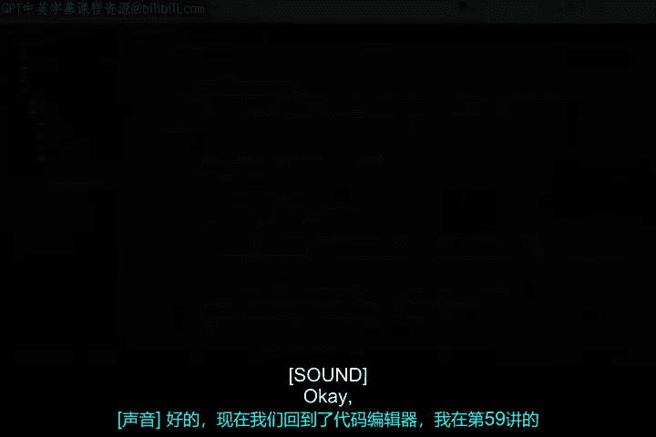
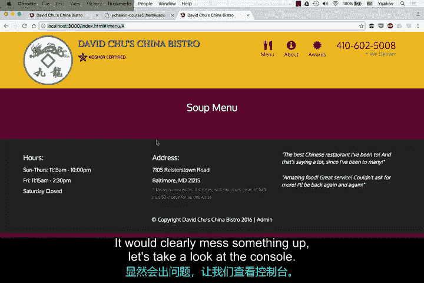
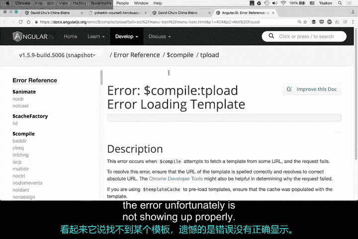
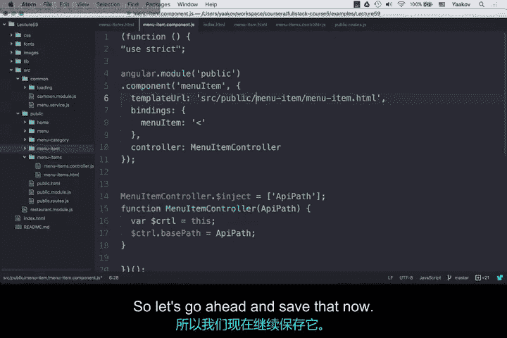
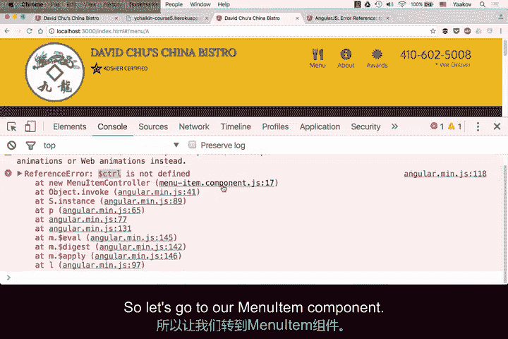
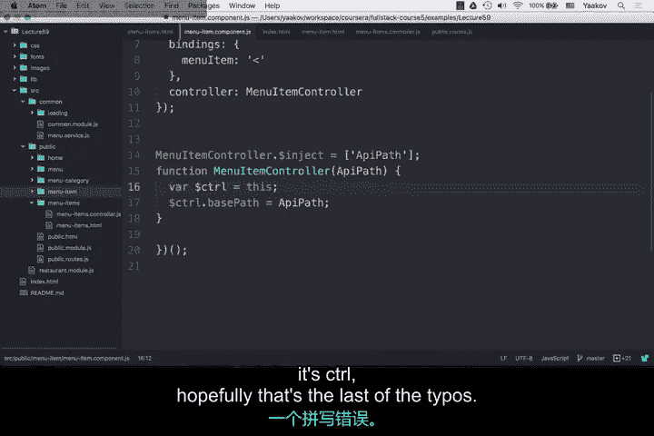

# 约翰霍普金斯大学《使用 AngularJS 开发单页 Web 应用｜Single Page Web Applications with AngularJS》中英 - P118：117_第59讲：单个分类视图（第3部分）.zh_en - GPT中英字幕课程资源 - BV1dsFDeZEQr

🎼。

Okay， so we're back in the code editor and I'm in lecture 59 folder。

 which is located in Fulltag dashash coursese 5 examplesles folder and here's our menu items。

htm and that's the template HTML that's controlled by the menu items controller that we've defined and wired in inside of our routes。

So if we go to the browser and actually on the page for a particular menu right here。

 which is menu short name a if we find the call to the server。

 you could see menu underscore items that JSson with the category equals a we can actually take a look at the preview what it's responding with and you could see that responding with an object that has two properties in it one is category and the other one is menu items So the first thing we could do is right away go back to our menu items template definitely remove this we don't need that but also update this heading part here where it talks about what menu name it is and the special instructions that should be easy let's go ahead and make a couple of new lines and it'll just put it right here when we need to interpolate it。

And the label that we gave our controller could be seen in public routes。js。

 let's scroll down and we see the label is menu items CTtRL， let's copy that。

 let's place it right here and if we look at our controller the property that we're exposing through the controller that holds that data is menu item so we'll go ahead and copy that。

And say menu items controller， that menu items， that category。

 that's the one that came back from the call， the category property。

That name that's going to tell us whatever the name menu is， and very similarly。

 let's just copy this part right here real quick。We'll give the special instructions that will take this instead of name to be saying special underscore instructions and let's go ahead and also maybe。

Indent this a little bit more properly。 Okay， this is pretty good。

 And let's go back to the browser and take a look。 you can see here now we have this soup menu because that's the a short name is for soups。

 If we go back， actually， I noticed that we have this container and we're closing this container right here。

 So that means I place my menu item， at least the。😊。

Placeholder for the menu item outside of the container and I was wrong。

 let's go ahead and put it inside of the container。😊，We save that now。 it will still not work。

 but at least it will be formatted a little bit better。

 You could see now it's sitting where it's supposed to and supposed to before it was somewhere in the foot or somehow。

 Okay so that's our title and that's pretty good and the next thing is we need to iterate over this whole menu item for all the menu items that are inside of our data that is being returned through the controller Well one way we could do it is put N repeat right here。

 but that would make it pretty messy。 instead let's go ahead and create a separate component that would even make this HTML much more semantic as we're gonna actually represent each menu item single menu item as a tag that's going to be backed by a component。

 So let's go to the public and create another folder and we'll call it in the single menu item one menu item。

It will create a component called menu item that component dot JS。And again。

 we'll give it ourselves a starting iffy here。And we'll say use strict。

And we're defining this component on our public module。

 so we'll go ahead and we'll load the public module。And we'll define a component。

And we'll call component menu item。We'll close it， and we'll specify the object。

They have a template URL of source menu dash item with a singular menu dash item。

That HTML and we're definitely going to have to pass something into this template because obviously we're going to have some data that is going to come from the menu items template that we're going to need to pass in into the actual single menu so。

Let's go ahead and create bindings。And the bindings will do menu item。

And since the menu item is not something we're going to modify。

 we're going to go ahead and use one way binding。Okay， so let's go ahead and save that。

 and let's go ahead and create menu dash item that HTML template and we'll do it straight in that same folder。

😊，Right there and we'll go and take this HTML。Right here。And we'll cut it out of here。

And we'll place it inside the menu item HTMLt let's save that and let's save this and since menu item。

ht is a template for our component， we don't need to give it any sort of controller as because it defaults to Do sign CTtRl which means we could go ahead and start interpolating this menu item inside of our menu item HTML so I could go ahead and start real quick to do dollar sign controller menu item and it's going to have short name I' go ahead and copy this because we're going have to repeat this over and over the image I'm actually going to leave alone for now I'll just go ahead and place something right here。

For the al I'm probably going to want to put the name of the item itself so the name of the menu item if I actually go back and open up my Chrome developer tools。

 let's reload that real quick and let's take a look if we could find real quick the items the menu items right here and the menu item single menu item is going to have hopefully just the name correct so it's going to have just the name so it could go back。

😊，And basically copy this right here， copy this interpolation right here， and place it inside here。

 except instead of short name， we'll just give it a name。That we will make more sense。

 Then we could put the item price。 Then we could copy this right here again and place it into the item price except I don't think we want to leave it like this because this is a dollar amount and we have a standard filter in angular called currency。

 So we'll go ahead and apply the currency filter。 and the same goes for the portion name let's go ahead and place that in front of it。

 and and the price underscore large。 And again， that's a dollar amount。

 So we'll put the currency filter on it。 And finally portion name。

And we'll need the name and the description， and now we could save that。Okay。

 so now it looks like we interpolated pretty much everything inside the single menu item that we'm going to have to display when we iterate over all the menu items that our controller is gonna to pass into this particular component。

 the only thing we didn't do is take care of the image right here So first of all。

 we need to do N source as we've discussed before but what should we put in here should we go ahead and hardcode the URL to our server previously we use the images folder and it was just sitting here locally。

 but since we want to update those images， we now need to pull them from the server every time。 Well。

 right now there's really no other way for me to do anything other than hardcode the entire URL but I would like to change that as you can remember in the common。

 we had this common module do js with the API path。

And this is really our base URL right there so what I would like to do is I would like to inject this API path into the controller that is responsible for my component so if I go to my menu item component Gs and I don't really have a controller here because Angular is giving one to me for free but now I'm going to have to have one because I need to use the injection to inject that API path into it so I'll say controller and I will call it menu item in a singular controller。

So obviously now I'm going to have to define it。😊，So this is menu item singular controller。

 and we need to set up the magification protection here。 And what we need to inject is our API path。

 So again， you find a function called menu item。Controller and API path is what we need to inject into it。

 And now we just do the standard CTtRl。Cause this NCTRl dot is called base path is equal to our API path。

Okay， so now we've exposed the base path as a property on our controller and our controller is what controls this menu item template HTML。

 which means we can now substitute this something for actual Dinectrl。 base path。

And we need to put a slash after that images， slash。And then one more thing， which is。Controller。

That menu item。That short name， because that's the name of our image it goes by the short name。

 So it is a dot JPg and so on。 and we pull it out out of the menu item property on our controller that we bound through the bindings of our component。

 So let's go back here， let's save that。And now just a couple of things left to do to make it all work number one is we need to declare our menu dashite thatcompent。

gs in our index at HTML let's not forget that so let's go all the way to the bottom and this is still in the public。

So let's make a copy of the last statement and just change it。In this case， it's menu item single。

 menu dashitecomponent。js。We'll save that。 And the last thing we need to do is we need to go to our menu items。

 That's where we need to insert our component。 and our component is called menu dash item。

That's how we called it， and we need to now iterate for every item we need to do an NG repeat。

And that's going to be equal to a single menu item。In our menu items。

Controller and expose menu items and as you remember， we had two properties there。

 one is category and one is menu underscore items。So now we're able to pull out a single menu item out of there。

 but our menu item still expect something right if you go to the component definition it's expecting a menu item as an attribute。

 so let's go ahead and give it this menu item as an attribute so we'll say menu item equals to and it's equal to this menu item that we pulled out from the NG repeat loop。

Let's actually put in the next line， it looks a little bit better。Okay， so let's save that。

Let's go to our browser。Let's close this up。And we clearly mess something up。

 let's take a look at the console。

And it looks like it's saying that you cannot find a particular template and the error unfortunately is not showing up properly。

Let's go ahead and try to。Copy it manually and put it all there。

Let see what the error is and it just insists on just telling us that it cannot load this particular menu dash item that HTML and says it's just not found。

 Let's go back to our code and look at our menu item that component。Oh。

 and we could see that I forgot the word public in there because it's sitting in the public folder。

 So let's ahead and save that now。 go back to our。

Page and now we don't seem to have CTRL Dallas Science Thero defined inside of our menu item that component online 17。

 so let's go to our menu component。

And what's going on here is I misspelled the name。 it's C T RL。 okay。

 hopefully that's the last of the typos and we go back， there's no arrows and look at that。

 We have our whole menu for our soups right here。

Eat away and it has all the dulla signs where it need to be。If we go ahead and go from the front。

And go to the menu。And go to the soups。Go back， go to appetizers。

 they all seem to be there and all seem to be working just fine。Okay。

 that pretty much completes the reimplementation of our previous website in Angular JS。

 obviously we didn't go over any of the stylings or anything like that。

 but the entire website is totally done and the only thing that's left for us is to code up the administrative portion to let the owners of the restaurant update this menu whenever they'd like。

So hopefully now you're starting to see the power of AngGS and how we could make things very modular and then put those components back together to work together to achieve kind of the entire website where each part of it can be worked in in isolation by itself。

 which is much much easier way of approaching any software development project。

