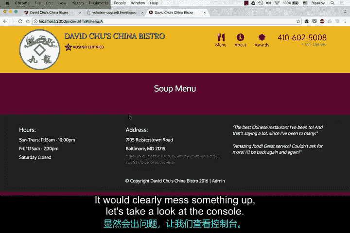
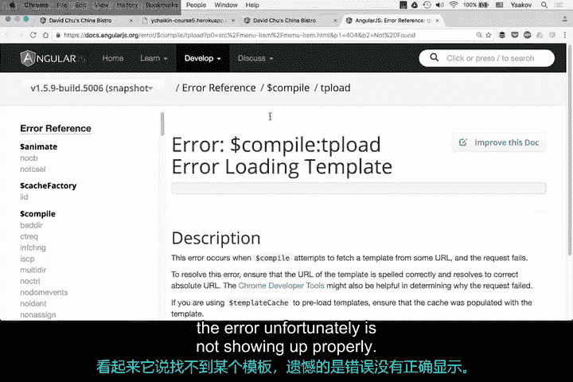
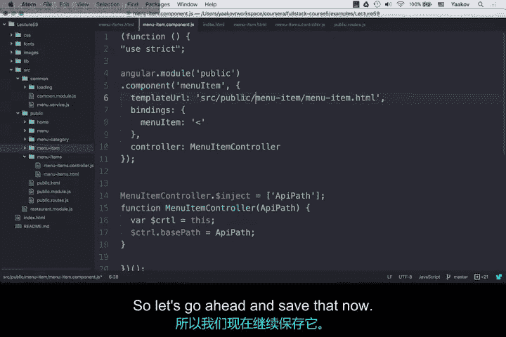
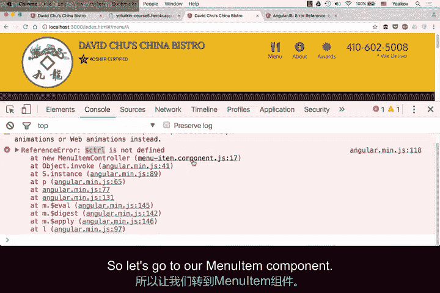
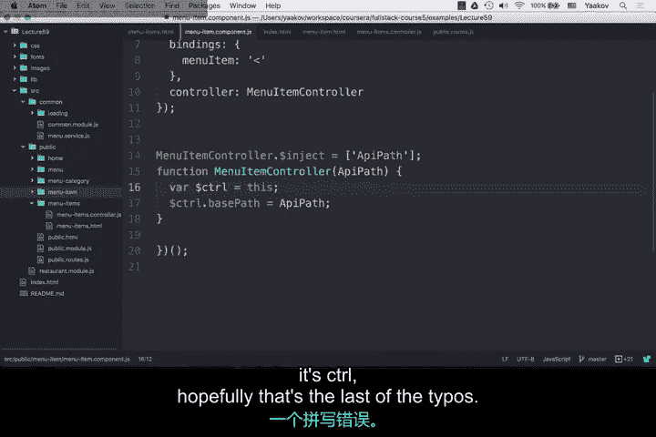

# 使用 AngularJS 开发单页 Web 应用：P118：单个分类视图（第3部分）📝


在本节课中，我们将继续构建单个分类菜单项的视图。我们将创建一个可复用的组件来展示每个菜单项，并学习如何将数据从父控制器传递到子组件中，最终完成菜单页面的动态渲染。

---

## 更新菜单项模板标题

上一节我们设置了路由和控制器来获取特定分类的菜单数据。本节中，我们首先更新模板，以显示从服务器返回的分类名称和特殊说明。

我们打开 `menu-items.html` 模板文件。需要移除之前的占位符文本，并插入从控制器获取的动态数据。控制器 `MenuItemsController` 暴露了一个名为 `menuItems` 的属性，该属性包含 `category` 和 `menu_items` 两个部分。

以下是更新标题部分的步骤：
1.  使用 `{{ menuItems.category.name }}` 显示分类名称。
2.  使用 `{{ menuItems.category.special_instructions }}` 显示特殊说明。

确保这些内容被正确地放置在页面的容器（container）内，以保证页面布局正确。

---

## 创建可复用的菜单项组件

接下来，我们需要遍历并显示所有菜单项。与其在模板中使用复杂的 `ng-repeat`，不如创建一个独立的组件。这样可以使代码更清晰、更易于维护。

我们将在 `public` 目录下创建一个名为 `menu-item` 的新文件夹，并在其中创建组件文件。

### 定义组件

首先，创建组件定义文件 `menu-item.component.js`：

```javascript
(function () {
  'use strict';
  angular.module('public')
  .component('menuItem', {
    templateUrl: 'public/menu-item/menu-item.html',
    bindings: {
      menuItem: '<' // 单向数据绑定
    },
    controller: 'MenuItemController'
  });
})();
```

### 创建组件模板

然后，创建对应的模板文件 `menu-item.html`。我们将从主模板中剪切出单个菜单项的HTML结构，并粘贴到此文件中。在模板中，我们需要使用 `$ctrl` 来访问绑定到组件的数据。

```html
<!-- public/menu-item/menu-item.html -->
<div class="menu-item-tile">
  <div class="row">
    <div class="col-sm-5">
      <div class="menu-item-photo">
        <!-- 动态图片URL将在控制器中构建 -->
        
      </div>
    </div>
    <div class="menu-item-description col-sm-7">
      <h3 class="menu-item-title">{{$ctrl.menuItem.name}}</h3>
      <p class="menu-item-details">{{$ctrl.menuItem.description}}</p>
    </div>
  </div>
  <div class="row">
    <div class="col-xs-12">
      <div class="menu-item-price">
        {{$ctrl.menuItem.price_small | currency}}<span> {{$ctrl.menuItem.small_portion_name}}</span>
        {{$ctrl.menuItem.price_large | currency}}<span> {{$ctrl.menuItem.large_portion_name}}</span>
      </div>
      <hr class="visible-xs">
    </div>
  </div>
</div>
```

注意，我们使用了AngularJS的内置 `currency` 过滤器来格式化价格。图片的 `ng-src` 属性需要动态构建，这将在控制器中完成。

### 实现组件控制器

由于需要构建图片的完整URL，我们必须注入之前定义的 `ApiPath` 常量。因此，我们需要为组件创建一个控制器。

创建 `menu-item.controller.js` 文件：

```javascript
(function () {
  'use strict';
  angular.module('public')
  .controller('MenuItemController', MenuItemController);
  MenuItemController.$inject = ['ApiPath'];
  function MenuItemController(ApiPath) {
    var $ctrl = this;
    $ctrl.basePath = ApiPath; // 将API基础路径暴露给模板
  }
})();
```

控制器注入了 `ApiPath` 服务，并将其赋值给 `$ctrl.basePath`，这样模板就可以使用它来拼接完整的图片URL。

---

## 在主模板中使用组件

现在，组件已经准备就绪。我们需要回到 `menu-items.html` 主模板，使用 `ng-repeat` 指令遍历菜单项列表，并为每一项渲染我们刚创建的 `<menu-item>` 组件。

更新 `menu-items.html`：

```html
<!-- 在显示标题和说明之后 -->
<div class="container">
  <!-- ... 标题和特殊说明 ... -->
  <menu-item
    ng-repeat="menuItem in menuItems.menu_items"
    menu-item="menuItem">
  </menu-item>
</div>
```

这里，`ng-repeat="menuItem in menuItems.menu_items"` 会遍历控制器返回的 `menu_items` 数组。对于每个 `menuItem` 对象，我们将其通过 `menu-item` 属性传递给 `<menu-item>` 组件。



---



## 最终检查与总结



最后，确保在 `index.html` 中正确引入了新创建的组件和控制器的脚本文件。





```html
<script src="public/menu-item/menu-item.component.js"></script>
<script src="public/menu-item/menu-item.controller.js"></script>
```

保存所有文件并刷新浏览器。现在，点击不同的菜单分类（如汤类、开胃菜），页面应该能正确显示该分类下的所有菜单项，包括图片、名称、描述和价格。

本节课中我们一起学习了：
1.  **更新动态标题**：在模板中绑定控制器数据，显示分类信息。
2.  **创建AngularJS组件**：将可复用的UI部分封装成独立的组件，提高代码模块化。
3.  **实现组件控制器**：通过依赖注入获取服务（如 `ApiPath`），为组件模板提供数据。
4.  **使用组件与数据绑定**：在父模板中使用 `ng-repeat` 和自定义组件，并通过属性绑定传递数据。


通过将页面拆分为独立的组件，我们使得每个部分都可以独立开发和测试，这是构建复杂单页应用（SPA）非常有效的方法。至此，我们已成功使用AngularJS重新实现了餐厅菜单网站的核心功能。