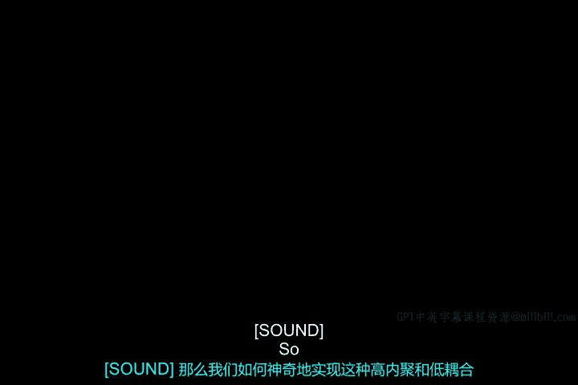
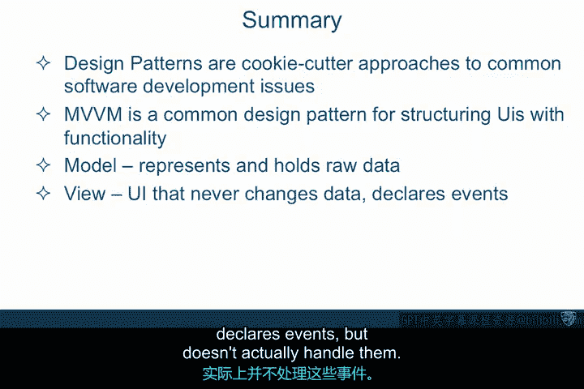

# 约翰霍普金斯大学《使用 AngularJS 开发单页 Web 应用｜Single Page Web Applications with AngularJS》中英 - P11：10_第3讲：模型-视图-视图模型（MVVM）.zh_en - GPT中英字幕课程资源 - BV1dsFDeZEQr

🎼。

So how do we magically achieve this high cohesion and loose coupling？

Hopefully it's starting to become clear that we need to think not only about what our code is supposed to accomplish。

 but also how to structure our code， how to break it up into several separate pieces of functionality that somehow work together to achieve the goal of implementing the business logic we need a consistent approach but what approach do we take do we go to the drawing board and start architecting perhaps trying to implement our architecture to see how it would withstand the growth of our codeb Sure you could do that and you would do that if you were interested in research however。

 what you're interested in is getting the functionality implemented as fast as possible you would turn to someone more experienced and ask them for advice for your particular situation。

😊，Luckily， since similar situations arise over and over。

 developers over the years have adapted a set of cookie cutter approaches to those situations。

Implementations of those approaches will differ from framework to framework and sometimes from one developer to another。

 but the general idea of how to architect such a solution is fairly standard。

These approaches that developers came up with as a design and architecture solutions to problems that fit a certain pattern are called design patterns。

In non-standard situations， you usually have to have some experience recognizing that the problem you're trying to solve fits a particular pattern that we have a cookie cutter solution for。

 a design pattern。However， in fairly common situations like designing a user interface with some functionality attached to it。

 there are standard design patterns the developers use In our case， we have such a pattern。

 it's called model view view model。😊，So let's look at some key components of our model view view model or MVVM architecture the first component is the model it represents and holds raw data。

 this is something you would get directly from the database or from RE API call from the server。

Now some of this data in some form may be displayed in the view。

 it doesn't mean that all of it is going to get displayed or even any of it is going to get displayed。

 it's very possible that given some values that are coming back from the server。

 you will take those values and add them or somehow manipulate them and actually display the result of that to the user。

😊，Now this component can also contain logic to retrieve the data from some source， for example。

 it could basically make an HTP call an AjaX call to the server to retrieve the raw data one of the most important things to remember about this component though is that it contains no logic associated with displaying the actual model it doesn't know how it's going to get displayed。

 it doesn't know who's responsible to get it displayed， it just contains the data。

The other component is the view while the view is fairly simple。

 it's the user interface in a web application， the view is just HTML and CSS it only displays the data that it is given never changes that data it just displays it and on top of that it declaratively broadcasts events but never handles them itself now again declaratively means that you don't actually write any JavaScript code in order to trigger or to raise an event from the view it just declaratively states that if such an event happens where should we go to handle that event and it points to the view model which we're about to discuss。

😊，The next component is our view model， the view model is the representation of the state of the view。

 it's the model that is the data that represents the view。

 it's kind of a becking the backside of the model it holds the data that's displayed in the view and in response to events in other words it does the presentation logic if there is any business logic like processing of some data it usually calls other functionality to get that done。

😊，The most important thing to remember about this component is that it never asks the view to display anything What that means is that it never directly manipulates the DO。

 so it never calls get element by D it doesn't even know what IDs are present in the HTML to begin with it doesn't care This allows us that loose coupling that we spoke about between the view that is the HTML and CSS and the view model our JavaScript that supports that view with presentation logic。

😊，There is one more crucial component to this design pattern and that is the declarative binder。

 the declarative binder declaratively binds the model of the view model to the view。

 it's that glue between the view model we just discussed and the view that contains HTML and CSS。

Declarative here means you don't have to write any code for this to happen。

 that's where the framework comes in， the framework does this magic for you。😊，This component。

 the declarative binder is the key enabler of the whole MVVM pattern Without it。

 you would have to write all these bindings by hand and the whole pattern goes out the window Let's take a look at a diagram。

So we know we have these three components that we spoke about that is the view。

 the view model and the model the view is our UIR presentation。

 The view model is our presentation logic notice that the view is implemented using HTML and CSS in a web application and the view model is implemented in ja as well as the model is also implemented in ja So with the usual thing happens is the presentation logic reaches out to the model to ask for some business data or for some sort of data the model returns that data to the view model at that point the view model binds that data to certain components of certain things inside the view that data binding happens declaratively which means you don't actually manipulate anything inside the view you don't manipulate the DOm in order to display that view model data in the view Now Anglo Gs is flexible enough to recognize that。

😊，Model view view model is not a one solution fits all Since the framework did want to limit the developers to just one approach。

 some features of Angular Gs allow you to break away from the MVVM pattern and do whatever other pattern you feel is most suitable for the situation This is even to the point of letting you manipulate the dom directly in your ja code。

 This makes the framework extremely adaptable as there's almost always an easy way to integrate other jascript libraries into it。

 For example， if you wanted to use Angular Gs with D3Gs。

 which is a very popular custom powerful graphing library， you can easily do that。

 and that's why Angular sometimes is also called model view whatever or Mv star because it doesn't restrict you to the MVVM pattern but lets you use it if you choose to or not if you don't。

😊，Okay， so let's summarize。Design patterns are cookie cutter approaches to common software development issues。

One design pattern that we're going to be using is called MVVM which stands for model view of View model。

 and that's a common design pattern for structuring UIs with some functionality together the model in the pattern represents and holds raw data the view in the pattern is the UI that never changes data and declares events but doesn't actually handle them。

The view model is the data representation of the state of ROUI。

The final part of this design pattern is the declarative binder。

 which declaratively binds the view model to the view。

Now Angular is flexible enough not to be restricted to MVVM。

 but allows other design patterns depending on the situation and the developer's choice。In general。

 the goal of design patterns including MVVM is to achieve high cohesion and loose coupling in a couple of lectures we're going to take the same name calculator example and reimplement it using Angular JS while doing a much better job achieving our goal of high cohesion and loose coupling。

😊。

