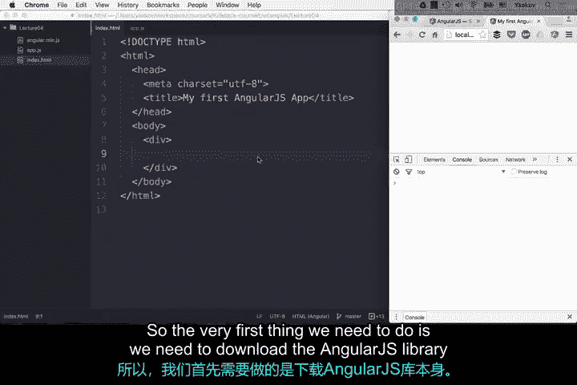
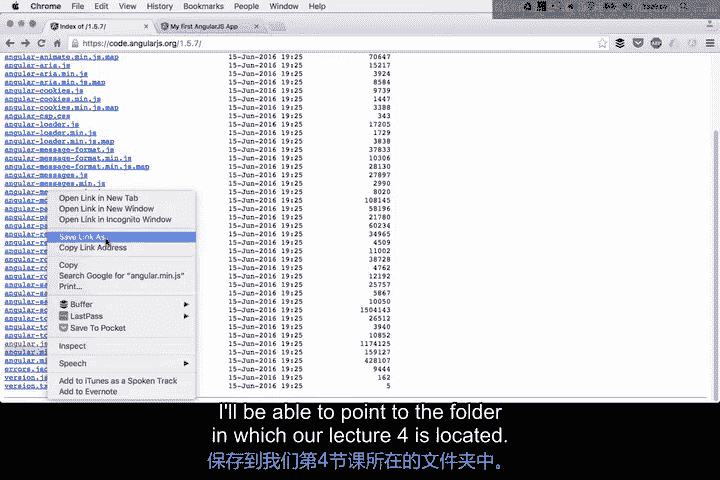
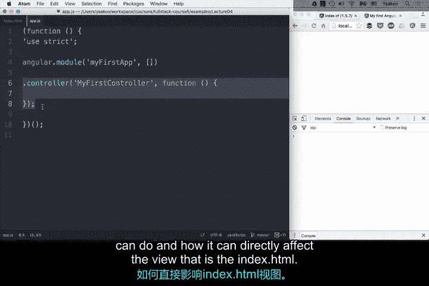

# 约翰霍普金斯大学《使用 AngularJS 开发单页 Web 应用｜Single Page Web Applications with AngularJS》中英 - P12：11_第4讲：AngularJS安装和第一个简单应用.zh_en - GPT中英字幕课程资源 - BV1dsFDeZEQr

🎼。

In this lecture， we're going to see how to install Angular JS into your HTML page and how to write our very first Angular JS application。

So right now I'm located in my at editor and I'm looking at lecture 04 folder which is located in the examples in the fullt dash course 5 folder I also prestared my browser sync so on the right you see the browser sync basically showing us so far just an empty page from our index at HTML that we started so the very first thing we need to do is we need to download Angular Gs library itself so let's go to the browser and we'll switch to this tab and already preloaded Angular Js。

org so what you want to do is you want to go to develop and click on download and here we'll tell you all the different versions of Angular GS now since this course is based on Angular GS1 not Angular JS2 do not choose anything that has two point and so on next to it instead find the latest version of Angular Js1。

 something and click on that and you'll see。

whole bunch of different packages that Angular Js provides what you want to look for is the one that just is very plain says Angular dotjs Well this is actually the unmified version。

 the one that has all the spacing in it and all the full named variable names but in order to save bandwidth we're gonna go ahead and grab Angular dot Minndatjs and you could see here if I right click and click save link as I will be able to point to the folder in which our lecture4 is located I already did that so I'm not going to do that again and you could see here that my Angular dotminndajs is already in the lecture 04 folder。

I also created an additional file where we're going to put our own logic which is AbdojS and in this point it is just an empty javascript file so the first thing we need to do is we need to reference those two files in our HTML page we'll already premade that so I will go ahead and cut and paste it right here so all we need to do is put two script tags the first one is Angular。

minjs and the second one is Abdojs and obviously we want our Abdojs to follow Angularminjs because this is HTML and browsers interpret these lines sequentially so since we're going to be using Angular Js inside of our Abdojs we want that to be processed first and then be available to use inside Abdo JS。

Okay， so let's go ahead and go to our Abda Gs and we'll go ahead and hide the sidebar here and let's write our very first Angular GS application so the very first thing we're going to start with is we're going to start with an ifFI and immediately invoked function expression if you don't remember what that is please look in the previous course where it explains in detail why we want to do something like that。

 but in short we want to make sure that no local variables bleed into the global scope。😊。

So once we've defined our ify we're ready to start our Angular GS application and the very first thing we want to do is define our main app the thing that's going to be responsible for some chunk of HTML in our index that HTML So the thing that Angular Gs exposes on the global scope is really just one particular object and that object is called Angular So Angular is able we're able to now execute things on it and one of the things we're able to do is say module and define our module and we'll call it my first app and the first thing that this module method takes is the name of our application and the second is a list of dependencies that our module or our application is going to need in a form of an array in this case we're going to just leave is an emptyRA because we have no dependencies at this point at all just a regular plane Angular GS application so when we go ahead and define that we can now go ahead and hook up my first app into our index that H。

😊，So if we go to index HTML there's a special attribute to place really anywhere we want。

 but usually you want to put it on the very outer tag that you want the angular application to be responsible for and the attribute is called NG app which stands for Angular application and we want to name it exactly the same way we named it in our appjS which is my first app so when we save that now it means that anything in this DOtry from the beginning where we mentioned NG app to the end of that tag which in this case is beginning HTML and N HTML our angular application is responsible for so this module has now been bound this Angular JS app has been bound to our HTML。

Now almost in all cases， you don't want to just stop there What we want to do is want to define another construct of Angular that will be responsible for a smaller portion of our page。

 for example， just this div so what we're going go is we're going go to appgs and we're going to go ahead and remove the semicollon and since module function returns module instance we can just go ahead and chain the next call to that controller and that controller function is really the way we define the view model of our view。

 our view being indexed at HTML so it takes two things number one。

 it takes the name of our view model or the name of our controller and we'll call it my first controller and it takes a function that defines the functionality for that particular controller so when I save that right here I now have my first controller available being that its functionality is defined by this function which is this。

😊，Point is empty。 It's available to be bound to our view。 So let's go ahead and do that。

 Let's copy that and go to HTMLtml and say Nng controller。Equals to my first controller。

 So when I do that now everything below this div and until this div is closed is being controlled by this my first controller because Angular looks for this name inside of our a do Gs and sees that this name matches right here this controller it knows that the function responsible for that piece of functionality inside of our view is this function right here。

 So if I say that and I should see no errors whatsoever at this point we haven't really implemented any functionality but we have at this point bound things in our jascript two things that are in our index at HTML So if you think back to what we discussed about view and the view model this is that relationship this index at HTML is really the view or in this particular case。

 just this div is really a piece of a view and this piece of the view is being bound to。😊。

App Js and in particular being bound to this function defined by the controller。

 this binding or this binder is happening automatically and it's done by Angular Js for you。

There's one more best practice that I'd like to insert here that we should use from now on and that is declaring our function with use strict use strict and when we do that we' are enabling certain things to just protect us from making mistakes。

 For example， we know that the entire iffy construct that we've put in here is there to protect us from bleeding things into the global scope but what happens if I say and I'll go ahead and comment this use strict for now what happens if I say x equals hello Well。

 according to the rules of jascript， since x has not been defined with a var key word。

 it will go ahead and define itself on the global scope Now usually that's not what we want to do and we don't want these type of mistakes by accident to kind of slip slip by So if we use strict let's un that now and go ahead and save that you'll see that the browser is complaining and saying that x is not defined in other words it's seeing that。

is really defined inside of a function yet it has no var keyword in front of it and if I put the var keyword in front of it。

 it will go ahead and not complain anymore so from now on we're going to use our iffy immediately invoked function expression and we' use U strict to make sure we don't make any careless mistakes that will probably hurt us down the road。

In the next lecture， we're going to see a little bit more about what this controller can do and how can effect directly affect the view that is the index that HTML。

