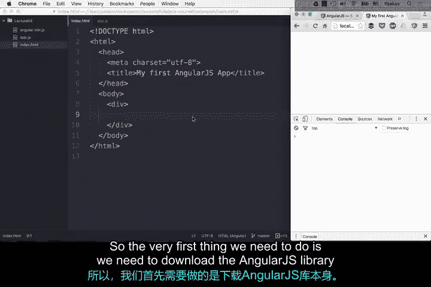
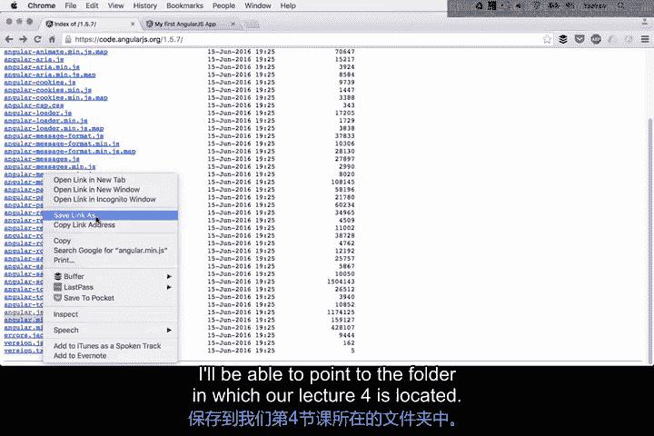
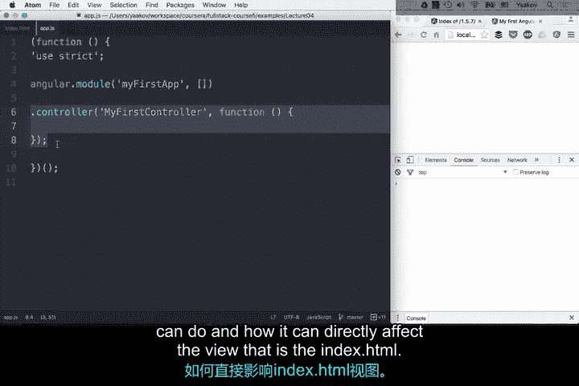
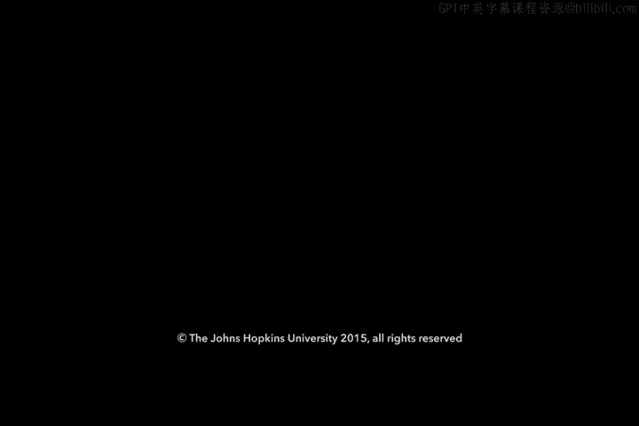

# 使用 AngularJS 开发单页 Web 应用：第4讲：AngularJS 安装和第一个简单应用 🚀


在本节课中，我们将学习如何将 AngularJS 库引入到 HTML 页面中，并编写我们的第一个 AngularJS 应用程序。我们将从下载 AngularJS 开始，逐步创建一个简单的应用，并理解其核心组件（如模块和控制器）是如何与 HTML 视图绑定的。

---

## 下载 AngularJS 库

首先，我们需要获取 AngularJS 库文件。请访问 AngularJS 官方网站（angularjs.org），进入下载页面。

以下是具体步骤：



1.  确保选择 AngularJS 1.x 版本，而不是 2.x 或更高版本。
2.  在提供的文件列表中，找到并下载 `angular.min.js` 文件。这是经过压缩的版本，有助于节省带宽。
3.  将下载的 `angular.min.js` 文件保存到你的项目文件夹中（例如 `lecture04` 文件夹）。

## 创建项目文件结构

在项目文件夹中，我们至少需要两个文件：
*   `angular.min.js`： 我们刚刚下载的 AngularJS 库文件。
*   `app.js`： 一个空的 JavaScript 文件，用于编写我们自己的应用逻辑。



## 在 HTML 中引入脚本

接下来，我们需要在 HTML 文件中引用这两个 JavaScript 文件。顺序很重要：必须先引入 AngularJS 库，再引入我们自己的应用逻辑文件。

```html
<script src="angular.min.js"></script>
<script src="app.js"></script>
```

这样，`app.js` 中的代码就可以使用 AngularJS 提供的功能了。

---

## 编写第一个 AngularJS 应用

现在，让我们开始编写 `app.js` 文件中的代码。

### 1. 使用 IIFE 和 `use strict`

首先，我们使用一个**立即调用函数表达式（IIFE）** 来包裹所有代码，并启用 `"use strict"` 模式。这可以防止变量意外泄露到全局作用域，并帮助我们避免一些常见的编码错误。

```javascript
(function () {
  'use strict';

  // 我们的 AngularJS 代码将写在这里

})();
```

### 2. 定义 AngularJS 模块

AngularJS 在全局作用域中暴露了一个名为 `angular` 的对象。我们通过调用 `angular.module` 方法来定义一个模块。模块是 AngularJS 应用的容器。

```javascript
angular.module('MyFirstApp', []);
```

*   `'MyFirstApp'`： 我们给这个应用模块起的名字。
*   `[]`： 一个空数组，表示这个模块当前不依赖任何其他模块。

### 3. 将模块绑定到 HTML 视图

为了让 AngularJS 管理我们的 HTML，需要在 HTML 标签上使用 `ng-app` 指令，并将其值设置为我们的模块名。

```html
<html ng-app="MyFirstApp">
```

这行代码告诉 AngularJS，从 `<html>` 标签开始，整个页面都由名为 `"MyFirstApp"` 的模块来管理。

### 4. 创建控制器

控制器是**视图模型（ViewModel）** 的具体实现，负责管理与之关联的那部分视图的数据和逻辑。我们通过链式调用在模块上定义控制器。

```javascript
angular.module('MyFirstApp', [])
.controller('MyFirstController', function () {
  // 控制器的逻辑将在这里定义
});
```

*   `'MyFirstController'`： 控制器的名称。
*   `function () { ... }`： 一个函数，用于定义该控制器的行为。

### 5. 将控制器绑定到 HTML 视图

在 HTML 中，我们使用 `ng-controller` 指令将控制器绑定到某个具体的 DOM 元素上。

```html
<div ng-controller="MyFirstController">
  <!-- 这个 div 区域由 ‘MyFirstController’ 控制 -->
</div>
```

现在，这个 `<div>` 元素及其内部内容就与 `MyFirstController` 控制器关联起来了。AngularJS 会自动建立视图（HTML）和视图模型（控制器函数）之间的绑定。

---

## 核心概念回顾与总结

本节课我们一起学习了搭建第一个 AngularJS 应用的基础步骤：

1.  **下载与引入**： 获取 `angular.min.js` 并在 HTML 中正确引入。
2.  **模块化**： 使用 `angular.module('模块名', [])` 创建应用的核心容器。
3.  **视图绑定**： 通过 `ng-app="模块名"` 指令将模块作用域绑定到 HTML。
4.  **控制器**： 使用 `.controller('控制器名', function(){...})` 定义视图模型，并通过 `ng-controller="控制器名"` 将其与页面的一部分视图关联。

我们使用了 **IIFE** 和 **`"use strict"`** 来保证代码的严谨性，防止污染全局命名空间。此时，虽然控制器函数内部还是空的，但 AngularJS 的**数据绑定**框架已经就绪。





在下一讲中，我们将深入探索控制器如何具体地影响和更新视图，让我们的应用真正“动”起来。