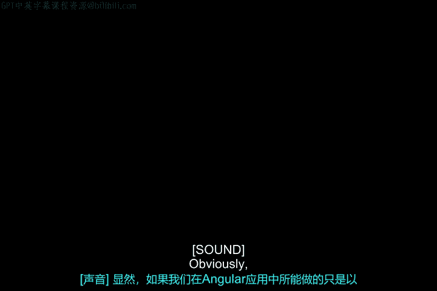
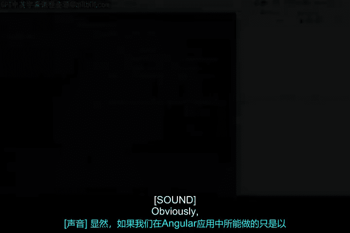
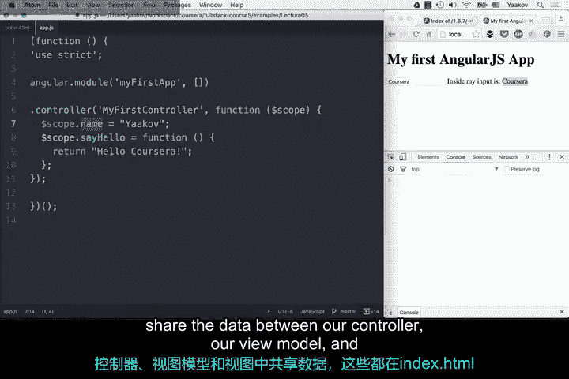
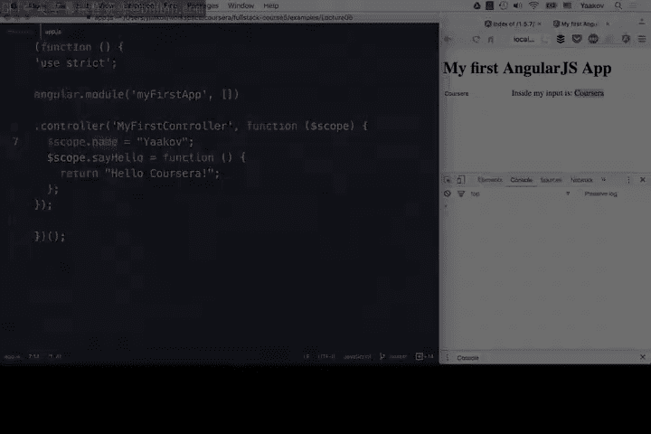

# 约翰霍普金斯大学《使用 AngularJS 开发单页 Web 应用｜Single Page Web Applications with AngularJS》中英 - P13：12_第5讲：通过作用域与视图共享数据.zh_en - GPT中英字幕课程资源 - BV1dsFDeZEQr

🎼。

Obviously it would be pretty boring if all we could do with our angular application is somehow magically connect our ja to some piece of HTML page and really do nothing else with it so really we need some sort of a mechanism for the view which is our index at HTML and for Abdo Gs which has or contains our view model to be able to share data right now I'm located in the folder called lecture 05。

 which is located in the fulltag dash course 5 slash examples folder and I've already set up my browser sync so it's displaying the page that we're looking at which is this index at HTML In fact let's give it a little bit of a better title than that does' give it an NH1。

😊，And we'll tell it my first angular。JS app so we could see something actually in the page Okay so let's go ahead and close the file browser inside atom。

 And now what we're going to do is we're going to use a special object that Angular Js provides for us in order to share data between our view model and our view and that special object is called dollar sign scope whenever by the way you see inside Angular Js dollar sign in front of some variable name it means that this is something that is reserved for Angular。

 This is something that Angular provides there's nothing really stopping you from naming your own variables with the dollar sign but the convention is for you not to do that because Angular is reserveserving kind of the dollar sign for anything that it provides out of the box。

 So this scope variable right here and we'll discuss later how the scope variable or how the scope object even gets here can have properties is defined on it that are going to be exposed to the view。

 So if I say scope that name。😊，And say Yaakov。This dot name is actually now sitting on the scope and this scope is available inside my NG controller or anything below it or inside of it that this Nng controller is in charge of。

😊，So I could place an expression here which is double curly braces or mo or however you want to call these characters and I could say name if I place name over here since name is sitting on the scope and the scope is defined right here with a name the angular framework will assume that this is something that it should look for on the scope if I say that you'll see that all a sudden yakov here shows up in my page because it looked on the scope which is bound to this particular view model which is bound this particular controller and it's being displayed therefore right here between these two divs Now the value of name is not the only thing that we can reference here we can reference whatever we want on the scope and then expose that to our index that HTML so for example。

 I could go ahead and create a function let's say called say hello。😊。

And this is going to be a function。That returns。Hello， Coursera。

So now I could go back to my index at HTML， and instead of name。

 I could call that function since again scope is something that's assumed。

 I could just say say hello， not for to forget the par because this is a function not just a value and when I say that now see it says hello Coursera。

Now a more interesting case is for me to show you that I could declarably bind a piece of HTML to my scope。

 so let's go ahead and erase that and put an input field here and in this case it'll be just a text box and I'll use a special attribute angular attribute called Nng model to tell it that I want the value of this input attribute to always be equal to something on my scope。

 something called name so it will now assume that there's something on my scope code name and if we go back and look there is in fact something on my scopes called name and it's equal yaakov if we go back to our In HTML we'll see that now we're binding that value to whatever the input value here is and you see here in our HTML or in our webage the yaakov showed up as the value of this input box now in fact。

 if we keep changing that。😊，This is something that is changing actually the value that is attached to the name property on our scope one quick way to determine that its actually true is to not only bind this name value or the name property to this input element。

 but also output it right next to it， let's say inside。😊。

My input is and then we could just go ahead and output name so if we save it。

 you could say since we refreshed it， it set inside my input is yaov but as we change this this take a look as to what's going with this variable as we're going to change that since this variable is completely bound to our scopes name property the second we change it which is what this is doing it's looking for any changes on the name property of our scope it's going to automatically change this name as well so I could say Cosera and you could see as I type the other value that is being output through this expression that we'll talk about a little bit later is also being updated。

😊，So in this lecture， we spoke about how we could bind the data and share the data between our controller。

 our view model， and our view， which is represented in Inex@ HTML。😊。

