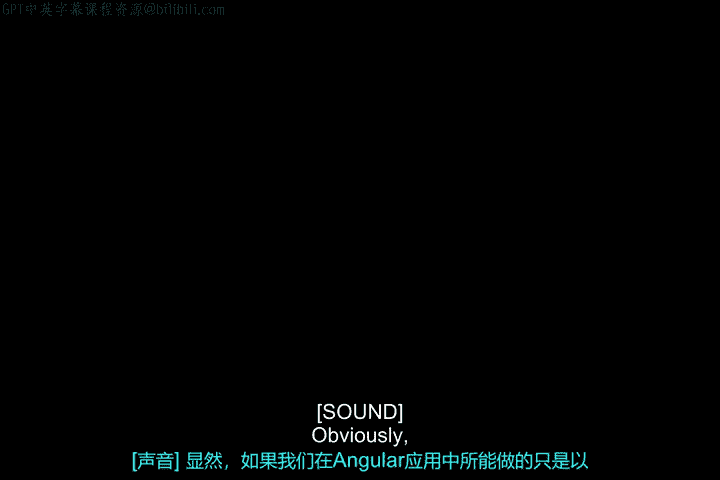
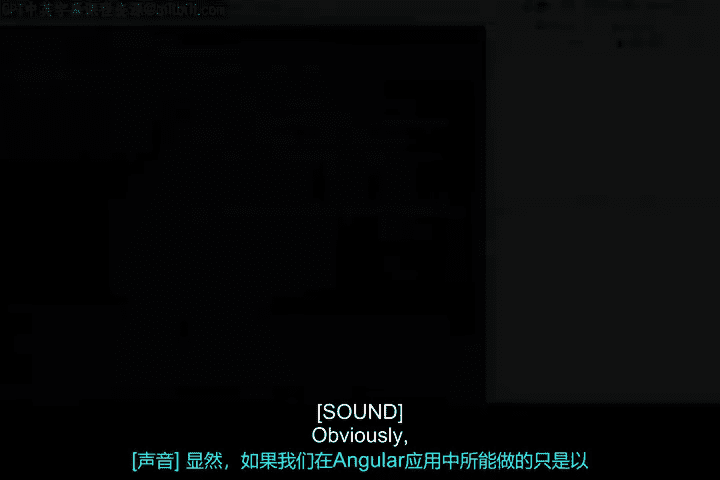
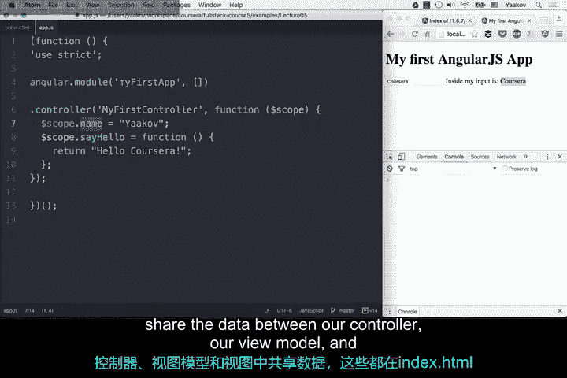
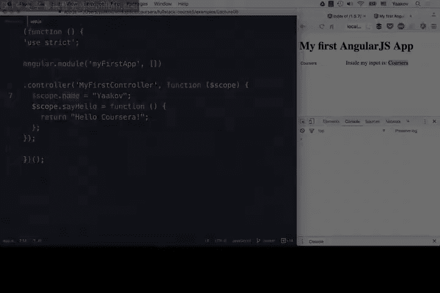

# 使用 AngularJS 开发单页 Web 应用：P13：第5讲：通过作用域与视图共享数据 🎯





在本节课中，我们将学习 AngularJS 中一个核心概念：**作用域（Scope）**。我们将探讨如何利用 `$scope` 对象在控制器（视图模型）和视图（HTML 页面）之间共享数据，实现双向数据绑定。

---

显然，如果我们的 Angular 应用只能神奇地将 JavaScript 连接到 HTML 页面，而无法进行其他操作，那将非常乏味。因此，我们确实需要一种机制，让我们的视图（即 `index.html`）和包含我们视图模型的 AngularJS 能够共享数据。

我现在位于 `lecture05` 文件夹中，该文件夹在 `fullstack-course5/examples` 目录下。我已经设置好了 Browser Sync，所以它正在显示我们正在查看的页面，即 `index.html`。

首先，让我们给页面一个更好的标题。我们使用一个 `<h1>` 标签，并写上“我的第一个 AngularJS 应用”，这样我们就能在页面上看到一些实际内容了。

接下来，我们将使用 AngularJS 提供的一个特殊对象，在视图模型和视图之间共享数据。这个特殊对象叫做 **`$scope`**。在 AngularJS 中，当你看到变量名前面带有美元符号（`$`）时，这意味着这是 Angular 保留或提供的东西。虽然没有什么能阻止你用自己的变量名使用 `$`，但约定俗成的是不要这样做，因为 Angular 将 `$` 前缀保留给其内置的功能。

这个 `$scope` 对象（我们稍后会讨论它如何出现）可以定义一些属性，这些属性将暴露给视图。

例如，在控制器中，我可以这样写：
```javascript
$scope.name = ‘Yaakov’;
```
现在，`name` 属性就存在于 `$scope` 上了。而这个 `$scope` 在我的 `ng-controller` 指令内部或由其控制的任何元素中都是可用的。

因此，我可以在 HTML 中使用一个**表达式**（用双花括号 `{{ }}` 表示）来输出这个值。如果我在这里写下 `{{ name }}`，由于 `name` 存在于 `$scope` 上，并且 `$scope` 在此处定义，Angular 框架会假定它应该在 `$scope` 上查找这个值。保存后，你会看到“Yaakov”突然显示在我的页面上，因为它查找了绑定到这个特定控制器（视图模型）的 `$scope`，并将其显示在这两个 `div` 之间。

`name` 的值并不是我们唯一能引用的东西。我们可以引用 `$scope` 上的任何内容，并将其暴露给我们的 `index.html`。

例如，我可以在控制器中创建一个函数：
```javascript
$scope.sayHello = function() {
    return ‘Hello, Coursera!’;
};
```
然后，我可以回到 `index.html`，在表达式中调用这个函数：`{{ sayHello() }}`。同样，Angular 会假定这是 `$scope` 上的内容。调用后，页面上就会显示“Hello, Coursera!”。

一个更有趣的例子是，我可以声明式地将一段 HTML 绑定到我的 `$scope` 上。

让我们删除之前的表达式，在这里放一个输入框。我将使用一个特殊的 Angular 属性 `ng-model` 来告诉 Angular，我希望这个输入框的值始终等于 `$scope` 上的某个属性，比如 `name`。现在，它会假定 `$scope` 上有一个叫 `name` 的属性。回到控制器查看，确实存在 `$scope.name = ‘Yaakov’`。保存 HTML 后，你会看到输入框中显示了“Yaakov”，并且这个值被绑定到了输入框的 `value` 上。

实际上，如果我们更改输入框中的内容，这实际上是在改变附加在我们 `$scope` 的 `name` 属性上的值。一个快速验证的方法是，不仅将 `name` 属性绑定到这个输入元素，还在它旁边输出它。

例如，在输入框后面写上“我的输入是：{{ name }}”。保存后，你会看到“我的输入是：Yaakov”。当我们改变输入框的内容时，由于这个变量完全绑定到了我们 `$scope` 的 `name` 属性上，一旦我们改变它（输入框正在做这件事），Angular 会查找 `$scope` 上 `name` 属性的任何变化，并自动更新这个表达式的值。所以，当我输入“Coursera”时，你可以看到通过表达式输出的值也在实时更新。

---





在本节课中，我们讨论了如何通过 **`$scope` 对象** 在控制器（视图模型）和视图（`index.html`）之间绑定和共享数据。我们学习了如何将数据属性（如 `$scope.name`）和函数（如 `$scope.sayHello`）暴露给视图，并使用 **`{{ 表达式 }}`** 在 HTML 中显示它们。更重要的是，我们利用 **`ng-model` 指令** 实现了输入元素与 `$scope` 属性的**双向数据绑定**，使得视图的更改能自动同步到模型，反之亦然。这是构建动态、响应式 AngularJS 应用的基础。