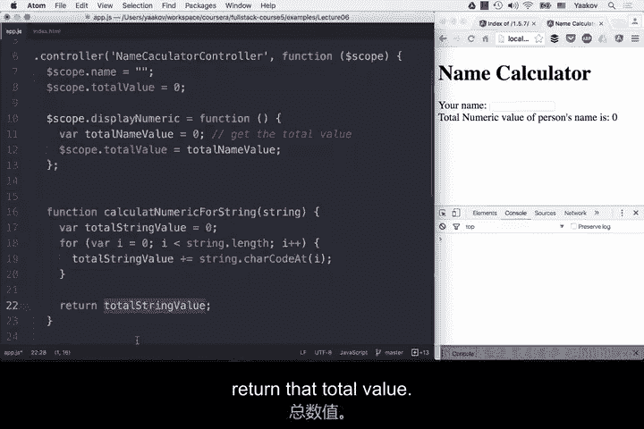
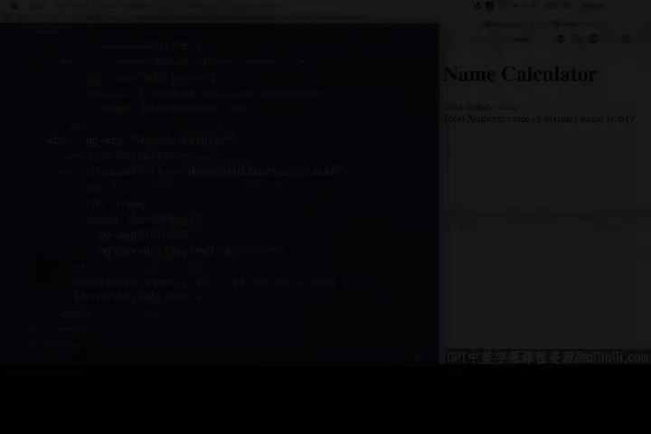

# 约翰霍普金斯大学《使用 AngularJS 开发单页 Web 应用｜Single Page Web Applications with AngularJS》中英 - P14：13_第6讲：在AngularJS中实现名称计算器示例.zh_en - GPT中英字幕课程资源 - BV1dsFDeZEQr

🎼。

In this lecture， we're going to go back to the application we originally wrote and rewrite the whole thing in Angular JS。

 seeing the concept of model view， view model architecture come alive right in our code。

Right now I'm in my editor looking at folder lecture 06。

 which is located in full stack dash course 5 s examples folder and as you can see I've already set up some things in my HTML file as well as I started browsing so I could see my HTML already on the screen Now let me go to my editor and close the file browser and as you can see we're already set up Angular JS here and we've set up our A Js here as well the rest of the HTML is fairly bare at this point and just has name calculator is H1 and has one text box as an input field So let's go to our AJS and start our application。

Here I already preset up for myself the ifffy as well as saying that I'm going to use strict here so I don't make any mistakes so the first thing I'm going to do is I'm going to create an angular module and the way I do that is saying angular thatt module and let's name it something like name calculator。

😊，And as far as dependencies， it doesn't have any dependencies。

 so we'll just leave it as an empty array。Then we're going to create our controller and we'll call the controller name calculator。

Calculator， controller。And the function that's going to be responsible for that controller is going to be right here We'll close the semicole here and we'll go go ahead and specify scope in here and that's that object that we're going to use to communicate with our view which is index that HTML so so far so good we've declared the two things the module。

 the application and the controller and now we have to do is we have to wire them in into our view。

 which is an index that HTML So where we specify the NG app。

 which is the application for the entire thing really doesn't matter as long as it's really above the controller that we're going to also bind and also kind you encompasses a nice chunk of HTML that we're going to have to work with so usually we could put it in write an HTML but this time let's go ahead and change it a little bit let's do NG app on the body itself and we'll give it the name of whatever we specified in our app that Gs for module。

which is name calculator， let's copy that and paste it right here so now name calculator app。

 the module has been bound to the body so it's controlling anything from beginning of the body tag until the end。

And here we have a couple of dips here， it doesn't matter which one we bind the controller into。

 let's go ahead and bind an N controller to that and I believe that's called name calculator controller here the editor is helping me out a little bit okay so as I save it I should have no errors and I don't and now we've bound the two things together there are a couple of things that we want to share between our controller and our view one is is we want to share the name of the person that is going to be entering the name here so we're going to go ahead and specify scope that name and we'll initialize it and at this point is just going be an empty string and the other thing is the value。

 the initial value that we want this to show and since it's an empty string。

 the initial value should be zero so scope that total value is equal to zero。Okay。

 so if we save that， we could at this point now output these things straight on the HTML page so we could go to the index HTML and say that total numeric value a person's name is and that's going to be our total numeric value which is our expression。

 our handle bars or mo or double curly braces， however we want to call it since scope is assumed we're going to go ahead and say total value and save the second we do that the total value now is showing a zero because it's pooling this zero from our scope。

dollar scope， the name we haven't really bound yet， so let's go ahead and do that right now。

Let's go to the HTMLtl and where we want to bind the name is into the input element。

 So the way we do this binding， as you remember from previous lecture is we do Nng model and we say that Nng model we want to bind to name So as the name changes in this input box the name in our scope our dollar scope object will change as well and if we want we could quickly verify that that's the case by just putting yet another value right here called name and now as we type right here that value is going to show up beneath this total numeric value。

 So let's go ahead and remove that。 So we need somehow some way to let our controller know every time a user presses the key that we should go ahead and look at the model recalculate model meaning our name recalculate the total value and go ahead and output that total value right here simply by updating it on the scope So the way we could do that and let's go ahead and make。

😊，A couple of indents here， the way we could do that is by saying Nng key up Nng key up and we're going to bind something else on the scope and in this case let's bind a function which we haven't really written yet。

 but let's call it display numeric。😊，And we'll go ahead and give it parentheses。

 we can even give it a semicolon and when I save it。

 nothing's really going to happen since we haven't really defined this function yet。

 so let's go ahead to our app do Gs and define display numeric on the scope so it's visible to our view as well display numeric and that's going to be a function and the function is going to create a total name value and we're going to get it somehow don't know yet how so let's just give it a zero and we'll just make a comment get the total value。

😊，And once we get that total value， we're going to go ahead and update our scope variable。

 total value on our scope variable to our local variable， which is total name value right here。

 So the only thing that's left is to actually calculate it。

 Let's go ahead and write a function that's going to do that for us here。

 we could write a regular function。 and we'll call it calculate numeric。😊，For string。

And we'll pass it a string。And here I'll go ahead and copy and paste some of the code that I already prewritten before and we'll go ahead and paste it right here and all it's doing here is just saying I'm going to start with a zero。

 I'm going iterate over the string and every position in the string I'll figure out what the character code is add that to the total value and return that total value so at this point we're good right here and all we need to do now is substitute the call instead of the zero so we're going call that function and what we're going to pass to that function is our scope that name because that's what is going to get update as I keep typing something in here so once I get that let's go ahead and take that comment out of here once we calculate that name or calculate that numeric value。

 it's going to get saved in the total name value variable and then we're going to copy that right into the scope which is going to then update the scope and automatically update。

The total value in the view。 So let's go ahead and save that。

 And right now if we start typing in here and let's put my name in here。

 you see as I type or as I erase things， the value is changing automatically。

 So let's take a look at our code a little bit in a more design perspective So we have our app js and as you can see we never really reached out into the view and try to figure out how the view is implemented there is no even any Is in the view at all。

 All we did was declaratively said that this input field should be bound to the name on the scope to our view model and whenever theres an event meaning somebody presses a key or lets the key up it should call this function that is also bound to our view model which is our controller and particularly the dollar sign scope This allows us quite a bit of flexibility on our view or in our HTMLtl is we could change this whole thing around however we want and。

😊，Still have the functionality be completely untouched， in other words。

 nothing in Abda Js will ever have to change， no matter how you end up displaying that numeric value of that name or how you even end up getting the name from the user the code in Abda JS will stay the same。

