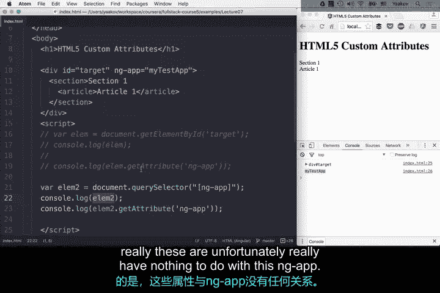

# 约翰霍普金斯大学《使用 AngularJS 开发单页 Web 应用｜Single Page Web Applications with AngularJS》中英 - P15：14_第7讲：魔法背后的原理：自定义HTML属性.zh_en - GPT中英字幕课程资源 - BV1dsFDeZEQr

🎼。

In the previous lecture lecture6， we were looking at the NG app and how it got linked together with our appJS module with the same name。

 as well as an index。htm， we were looking at NGcont and how that got linked together with namecalculator controller again in app。

jS。And this linking or this binding was done for us by Angular sometimes when you first beginning with a framework like Angular or really any other framework。

 some of these things can become a little bit intimidating simply because it's a little bit of a magic as to what's going on here how does this NG app attribute end up with this name calculator module connect it and bound together so I find it that sometimes it's helpful to take a step back and just to figure out how does these things work kind of pulling the curtain back and see what's behind the magic and the truth matter is there is really nothing magical about this and what we're going to do in this lecture is going to see how does angular able to find this particular NG app attribute and how is it able to deal with it let's go ahead and minimize this and we have here a folder lecture 07 and just the thing does that HTML inside of it so we're looking at lecture 07 folder which is look。

😊，In fulltag dash course 5 examples folder。 and we're looking at a very simple index that HTML page So it's got a body。

 It's got an H1 and has a div with a section and an article in here and a div has an ID with the name target and I already set up my browser saying such that it's actually showing me what is inside this HTML page So what I'm going to do and I'm going to use jascript to try to select this whole chunk of HTML and that's fairly easy and we know how to do that let's go ahead and actually do it straight inside HTML will write a script tag and inside a script tag we'll do let's say var element and we'll say document that get element by by ID let's go ahead and close the file browser you could see a bit better and we'll say target Okay so that's the element we've selected this element right here and really weve selected everything the entire dumb structure that is underneath。

😊，div element so we can actually console that log this and see that we were successful let's go ahead and do console that log and we'll do element and when we save it。

 it should pop out here right here pops out is that we see our div target and if you open it up here in Chrome you'll see that we actually have much more than just the div tag itself。

 we have all the things underneath of it as well。😊，Now， what happens to our HTML page if right here。

 instead of putting， you know， class or something else standard。

 what happens if I put something like greeting？😊，Equals hello。So if I save this。

 let's see what happens to the HTML page Well nothing really happened Why is that Well the reason that is is because greeting is not a standard HTML attribute and the browser the software that runs the browser tries to interpret every one of these tags and every one of these attributes and it doesn't really know what to do with this greeting attribute and therefore just ignores it however there are methods and functions in JavaScript to let us get at the actual attribute and at the value so for example we could go ahead and say element that get attribute。

😊，And give it the name of the attribute， which is greeting。

So if we actually surround this with a console do log so we could see what it actually is getting。

And we'll save it。Once it refreshes the browser right here。

 you'll see that what we got was hello and hello is the value of the greeting attribute so you could see now that any attribute you place inside of an element you're able to get at that attribute and also to get at the value that that attribute contains so let's go ahead and actually replace it and replace this greeting one with NG app equals let's say my test app Now NG app attribute doesn't mean anything in this context because we didn't even load Angular Js into this HTML page however。

 just like the greeting we're able to take this NG app attribute and get the value of it just like before so if we save that you'll see that the value is my test app but theres more to it than that we can if we want to suppose we are the Angular JS authors authors of the Angular JS framework and we want to find where is in our HTML。

😊，An attribute or an element， I should say， with an attribute Nng app such that we need to bind our module to that particular element and everything below it and the same goes for the Nng controller So let's go ahead and try that and we could do that very simply by doing this let's go ahead and erase all that actually we'll just comment it out and what we'll do is we'll call vL called element2 equals document that query selector。

😊，And what we want to do is create a query selector that finds an element with an attribute NG app。

 and that's exactly what we're doing here with these square brackets。

 we're saying find me an element， find me the first element with the attribute NG app let's go ahead and save that and we'll do console。

 log on the element to and when we save it and we see that we found the same element that we found before and everything underneath of it and we found it by using our NG app attribute。

😊，And obviously once we have that element we could say console。logs， we could see it LM2。

 get attributebut and we know which attribute that is。

 it is NG app and if we save it we'll see that we now can get at my test app and once we have my test app it certainly is very feasible for you to understand at this point that if you have some code which is Angular GS code that is declaring a module with my test app I could marry these two very easily since I have a handle on the element that is responsible for that NG app。

 and at that point I would have a handle on the actual function that is responsible for the piece of content that is attached to this element too。

I'll mention one more quick thing in this lecture There's a new set of custom attributes that HTML5 introduced and those are called data dash star attributes and really these unfortunately really have nothing to do with this NG app you could go ahead and say data dash and it will be 100% compliant with the HTML5 specification。

 however Angla does not require you to have that compliance and you could look up in Google yourself what data attribute star actually means it's just basically a much more convenient way at getting a custom attributes that hold custom data but for Angular JS just NG app or NG something that something really is good enough and you don't need to use the new HTML5 data star custom attribute setup up。

