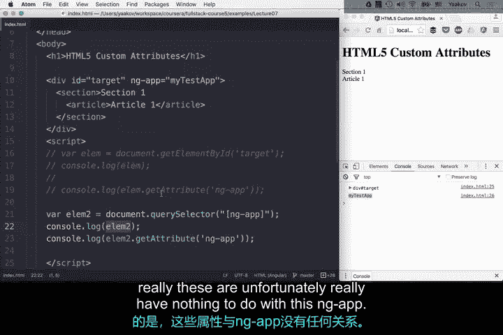

# 使用 AngularJS 开发单页 Web 应用：P15：第7讲：魔法背后的原理：自定义HTML属性 🧙‍♂️


在本节课中，我们将揭开 AngularJS 框架中“魔法”的面纱，探究像 `ng-app` 这样的自定义属性是如何被识别和处理的。我们将通过简单的 JavaScript 示例，理解 AngularJS 在幕后是如何找到并绑定这些属性的。

## 概述

上一讲我们介绍了 `ng-app` 和 `ng-controller` 如何与 JavaScript 模块和控制器进行链接绑定。对于初学者来说，这种自动绑定可能显得有些神秘。本节我们将退后一步，通过基础的 JavaScript 操作，来理解 AngularJS 实现这种“魔法”的基本原理。

## 自定义HTML属性初探

首先，我们来看一个非常简单的 HTML 页面。它包含一个 `div` 元素，其 `id` 为 “target”。

```html
<body>
    <h1>示例页面</h1>
    <div id="target">
        <section>...</section>
        <article>...</article>
    </div>
</body>
```

我们可以使用 JavaScript 轻松地选中这个元素。

```javascript
var element = document.getElementById('target');
console.log(element);
```

执行上述代码，我们可以在控制台看到选中的 `div` 元素及其所有子结构。

## 非标准属性的行为

现在，让我们尝试给这个 `div` 添加一个非标准的 HTML 属性，例如 `greeting="hello"`。

```html
<div id="target" greeting="hello">
    ...
</div>
```

保存后，页面看起来没有任何变化。这是因为浏览器无法识别 `greeting` 这个非标准属性，所以选择忽略它。然而，JavaScript 提供了方法来获取这些自定义属性及其值。

```javascript
var attrValue = element.getAttribute('greeting');
console.log(attrValue); // 输出：hello
```

通过 `getAttribute` 方法，我们成功获取了 `greeting` 属性的值 “hello”。这说明，任何设置在元素上的属性，我们都可以通过 JavaScript 访问到。

## 模拟 AngularJS 的查找机制

接下来，我们将 `greeting` 属性替换为 AngularJS 风格的 `ng-app` 属性。

```html
<div id="target" ng-app="myTestApp">
    ...
</div>
```

此时，`ng-app` 属性本身在这个没有加载 AngularJS 的页面中并不起作用，但我们依然可以获取它的值。

```javascript
var ngAppValue = element.getAttribute('ng-app');
console.log(ngAppValue); // 输出：myTestApp
```

现在，假设我们是 AngularJS 框架的作者，我们需要在页面中**找到**所有带有 `ng-app` 属性的元素，以便将模块与它们绑定。我们可以使用 `document.querySelector` 方法来实现。

```javascript
var element2 = document.querySelector('[ng-app]');
console.log(element2);
console.log(element2.getAttribute('ng-app')); // 输出：myTestApp
```

代码 `[ng-app]` 是一个 CSS 属性选择器，它会返回页面上第一个拥有 `ng-app` 属性的元素。一旦我们获得了这个元素，我们就获得了操作它的入口。在 AngularJS 的实际运行中，框架会找到这个元素，读取 `ng-app` 的值（例如 “myTestApp”），然后在已定义的 JavaScript 模块中寻找同名的模块，最终将两者绑定起来。`ng-controller` 等指令的工作原理也与此类似。

## 关于 HTML5 自定义数据属性

最后需要说明的一点是，HTML5 引入了一套标准的自定义属性格式，即 `data-*` 属性（例如 `data-app="myTestApp"`）。使用 `data-*` 前缀可以确保代码完全符合 HTML5 规范。

然而，AngularJS 为了保持简洁，并没有强制要求使用 `data-*` 前缀。`ng-app`、`ng-controller` 这样的写法在 AngularJS 中是完全有效的。你可以查阅资料了解 `data-*` 属性的详细规范，但对于学习和使用 AngularJS 而言，直接使用 `ng-` 前缀就足够了。

## 总结




本节课我们一起学习了 AngularJS “魔法”背后的基本原理。我们通过 JavaScript 演示了如何获取元素的自定义属性，以及如何使用选择器查找带有特定属性的元素。这揭示了 AngularJS 框架在启动时，是如何通过查找 `ng-app` 等指令属性来初始化应用并建立绑定的。理解这个底层机制，有助于我们消除对框架的神秘感，并为其更高级的功能学习打下坚实的基础。