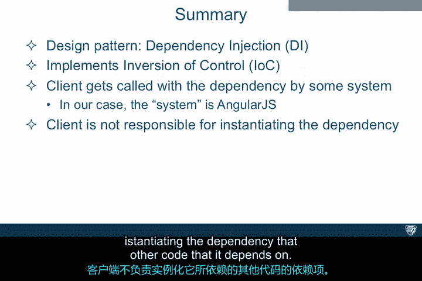

# 约翰霍普金斯大学《使用 AngularJS 开发单页 Web 应用｜Single Page Web Applications with AngularJS》中英 - P16：15_第8讲：依赖注入.zh_en - GPT中英字幕课程资源 - BV1dsFDeZEQr

🎼。

In this lecture， we're going to speak about one more very important concept that is actually used throughout Angular JS and that is dependency injection。

😊，I'm sure by now you have seen this contract where we create the module that we're going to use in Angular Js and we also create the controller with an associated function that is responsible for the functionality and kind of the glue code of that controller to the view and you've seen the dollar sign scope that we pass into the controller's function but where does this Do sign scope come from who instantiate we've seen that when we do console that log on this dollar scope it's a pretty complex object so who instantiates that object and the answer is that Angular Js instantiates this object for us and the way we get that object is part of our controller is through something called dependency injection。

So dependency injection is yet another design pattern we've seen one model view view model。

 and now there's another called dependency injection。

 so it's a design pattern that implements something called inversion of control for resolving dependencies so inversion of control is a construct or an approach for resolving dependencies to understand what inversion of control means。

 let's take a look at how we usually go about architecting a couple of components in let's say a shopping cart。

So the regular control would be if we have a shopping cardt。

 we can have a separate module called Car Prague bank1。

 basically a card processing credit card processing for bank1 module and it has one method charge given the number the credit card number and the amount and the reason we have a credit card for particular bank is because for that particular bank we might have a particular URL that we have to contact the bank through and that particular bank can have its API so we don't want to take all that code and stick it directly into the shopping card because our shopping card would be very much very closely tight would be have tight coupling with a particular bank API we don't want to do that so the way we would instantiate the card processing is we would create that card processing module inside shopping card and then we would just call charge and code charge giving it the number and the amount and clearly in this diagram we see that the shopping card module depends on the card processing。

Module for Bank1 but what happens if tomorrow we decide that we don't like this bank or we want to use a different bank because it has better prices for credit card processing fees or something like that。

 Well the way we would do that if we would have to write a separate car processing bank2 that also would have the same type of charge with a number and an amount and in that case it means that our shopping card code would have to slightly change and now when we create the instance of the credit card processing module we would have to create it with obviously credit card processing for bank2 and then as before we would call that charge method passing it a number and amount and here again you clearly see that the shopping card again depends on this card processing for bank2 module。

But we have a huge problem here we have to change the code inside the shopping cart。

 which means we have tight coupling again， just because we switched which bank we process our cards through。

 we need to change the code inside the shopping cart。And how do you test the shopping cart。

 Let's say you only have a couple of simple methods add to cart and remove from cart in this scenario。

 you would have to instantiate a whole credit card processing system just to see if your cart。

 your shopping cart can place something in the right array and remove something from that array。

 keeping counts of total value of the shopping cart。

 total taxes and etc that would be insane we can of course create a fake credit card processing module and instantiate that instead inside the shopping cart but that would once again require us to change the code in the shopping cart and having to temporarily change the code in the very function that we're trying to test seems like a really backwards in a bad idea who says we won't mess up something while changing the code for the test and then putting it back the way it was So what's the solution The solution is in the version of control and in this particular approach our shopping cart function or module。

😊，Excepts a credit card processing module as an argument and we still have that line where we call the charge method on that card processing module。

 but it now is using the instance that we were passed from somewhere else。

 we could still have those separate modules， but in this case some overall system is going to be the one who is going to instantiate that credit card processing so in this case will instantiate the credit card processing for Bank1。

And then we're going to call the system is going to call the shopping cart passing it the new instance of credit card processing for Bank1。

 So in this scenario， if we need a different bank for card processing。

 the shopping cart code is left completely untouched it will not change This is by the way why IOC or in version of control is sometimes jogonly cold。

 don't call us will call you because as you could see the shopping cart no longer calls out to instantiate the card processing module。

 but instead we， the system calls the shopping card module providing the card processing instance to use inside of the shopping cart。

So just to summarize， we learned yet another pattern called dependency injection for short it's called DI dependency injection。

 which implements an approach called inversion of control and if you read things online or in other literature you'll see that inversion of control is often times referred to as I lowercase O uppercase C。

 so IOC inversion of control and in that approach client gets called with the dependencies by some other system and in our case obviously that other system that's surrounding ecosystem is Angular JS and the whole point of it here is is the client is not responsible for instantiating the dependency that other code that it depends on。

😊。

