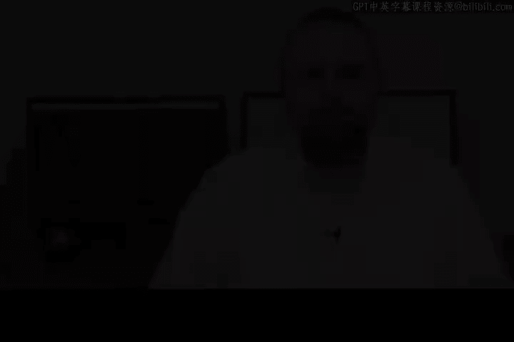
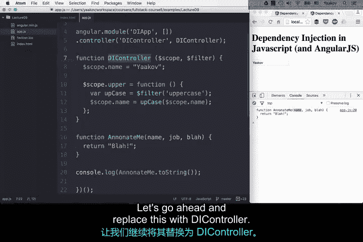
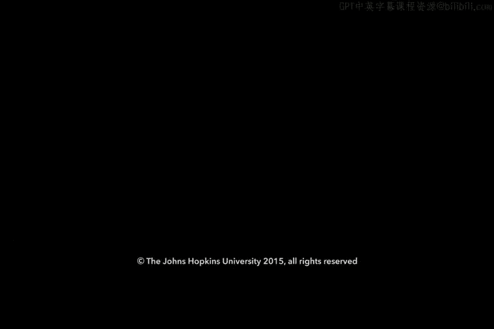

# 约翰霍普金斯大学《使用 AngularJS 开发单页 Web 应用｜Single Page Web Applications with AngularJS》中英 - P17：16_第9讲：依赖注入在JavaScript中的工作原理.zh_en - GPT中英字幕课程资源 - BV1dsFDeZEQr

🎼。

Now that we understand the idea of dependency injection。

 let's look at some code and delve a little deeper to understand how dependency injection can be implemented in JavaScript and in particular how it is implemented in Angular JS Let's understand this magic that somehow allows Angular to figure out where to dynamically insert what type of object。

😊，In order to do that， we're going to build a small Angular JS application and explore a couple of special Angular JS services。

Right now I'm located in lecture 09 folder， which is in the fulltag dash course 5 examples folder and it's a very simple app and so far we just instantd and bound the app to this D app name and we also have just one controller here called D controller and in it we bound the name property of the scope remember that scope that the glue between the view model and the view which is our HTML that scope Deine scope is going to have a property called name so it's going to be completely bound so let's go and take a look at our app dojs in our app dogs you can see that I am creating a module with the name D app which is matching the NG app attribute that I placed in my index that HTML and I'm creating one controller DI controller and the Di controller the function is going to be responsible for that controller is called D controller when I'm passing here is the value of the function and in the next line here I'm going。

😊，Defin that function with the dollar sign scope by the way， anything in angular。

 pretty much anything in angular with the dollar sign in front of it。

 not only does it belonged to angular， but it's also referred to as a service So from now on。

 when I refer to dollar sign scope I'm really going to just refer to the scope service So as you could see I'm defining a property on the scope service and I'm giving it the string yaakov and of course since this is bound to our index at HTML under model。

 the scope service is binding this property name it automatically gets this yaakov right inside of the text box So what I would like to do next is create a functionality such that when the text box loses focus like that whatever is inside this text box should get uppercase and for that I'm going to introduce you to one more service called dollar sign filter and we can inject it the same way we injected the dollar sign scope so the filter。

😊，Is a service that lets us create filtering functions that are used for formatting the data that eventually gets displayed to the user。

 So let's go ahead and create a function that our view will declaratively call when the text box loses the focus。

 So for now we'll just go ahead and call it dollar sign scopepe。

 We need to put it on the scope service since we need to be able to expose it to our view and we'll call it upper and upper is a function what I' need a name。

😊，Put a semicolon here。 and the first thing we'll do is we'll create the uppercase function using the filter service。

 We'll call it upcase， and that's the name of a function。

 and we'll call filter and we'll just call it。😊，Upper case， that's the type of filter we want to get。

 And once we have that upcase function filter， we go ahead and say scope that name equals upcase。

 So we're calling that function we just created and we're passing it scope that name。

So at this point， scope that name would have been updated。

 so the only thing that's left is to go to index that HTML。😊，And go ahead and bind the NG blur。

 which is when the text box will lose focus and we bind it to upperpper。

And we'll call upper right here and we'll go ahead and save it。

 so let's go ahead and see if it works， we'll go to our textas right here， we'll type Coursera。

 we'll go ahead and click out of it， and as you can see once we clicked out of it with the NG blur。

 which bound our upper function on our scope went ahead and called this upper function which updated the name property of the scope service。

 which of course immediately got updated on our view。😊。

So the question still remains how did Angular know that this is where the filter service should have been injected and this is where the scope service should have been injected Let me go ahead and show you how that's done first what we're going to do is we're going to create just a completely irrelevant function to anything we'll just call it function and we'll call it annotate me。

And we'll give it whatever name， job。And blah parameters。

And the function is going to be fairly simple。 It's going to just return some string。

 It's call it blah Okay so now we're returning string blah and if we were to go ahead and console that log。

 whatever blah return So we'll invoke the annotate me function and it doesn't matter what we pass since we're not using any of those variables anyway。

 and we're gonna to and save that， let's go ahead and see what it's going to come out here and it comes out blah okay so that got invoke but what happens if we don't invoke it what happens if you just console that log just the actual function value。

 let's go ahead and save that look at that console output it looks like it's just a string which is the function definition itself and if we actually do one better we'll call two string on it。

😊，If we save that， we'll see that this is going to be just the string that represents the entire code of the function Well what does that mean one thing it means is that if we take that string and start parsing it if we're smart enough here。

 we could go ahead and find the parentheses find some string。

 find the comma yet another string comma so what we could do is we could parse it and the second we see this name here we could match this name with whatever services we have available and then instantiate those services let's say we have a name service and go ahead and call the annotate me with that service and we'll know that we need to inject it or we need to call annotate me with the name service in position one as the argument and we could do exactly the same thing unless DI controller let's go ahead and replace this with DI controller and when we save it。

😊。

Brow the syncnc updated our console here， refresh the browser。

 and you see that the function DI controller now is showing up in its full glory as just a regular string。

 so what Angular does is it can actually go ahead and parse out these names and find a matching service and then go ahead instantiate those services and then call GI controller with those instantiations。

The service that does all this in Angular is called dollar sign inject and we can actually even inject that service as well。

 so let's go ahead and do that and see what it can do Do sign injector actually I should say so let's go ahead and maybe move this down here so it'll be a little bit easier to read。

😊，So what can this injector do Well， we have this function called DI controller。

 let's go ahead and console。 log。And have DI controller。Instead of just logging the eye controller。

 what we're going to do is we're going to surround it with dacine injector that annotate。

So if we call that， let's go ahead and close this and save it。

You'll see that our Dign injector that annotate gave us an array of the argument names to the function DI controller。

 and this is exactly what Angular is using internally in order to figure out where to inject which services。

 and that's the magic， the magic has been revealed。

