# 约翰霍普金斯大学《使用 AngularJS 开发单页 Web 应用｜Single Page Web Applications with AngularJS》中英 - P18：17_第10讲：保护依赖注入不受代码压缩影响.zh_en - GPT中英字幕课程资源 - BV1dsFDeZEQr

🎼。

Not that we understand how dependency injection works in JavaScript and in particular how it works in Angular JS。

 we need to talk about protecting our dependency injection from minification you'll see why that's necessary in just a minute。

First of all， what isification Wellification is the process of removing all unnecessary characters from source code and what's here I italize here is without changing the functionality of the source code so it should be clear that magification is going to be the process that's going to make our code completely unreadable yet at the same time 100% functional as before In fact many muification programs actually call themselvesuglify so theyuglify the code so the miification process takes out a whole bunch of things it takes out whitespaced characters new line characters comments it even removes some curly braces that we use for code readability。

😊，So what's the purpose of all that well it's actually pretty simple it reduces the amount of data transferred from the server once all these characters are removed from the JavaScript file。

 the file itself becomes much much smaller。😊。

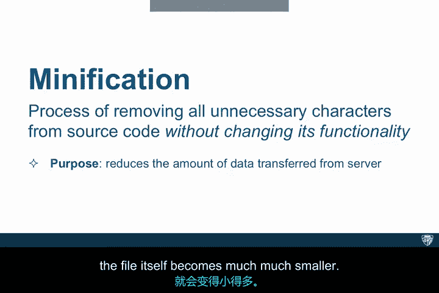

By the way， if you want a fun read， if you go to my LinkedIn page， which is LinkedIn。

com// yaakovhikin and I will give you a link to that as well you're more than welcome first of all to connect with me I accept pretty much all the invitations from any of the students but it can also look in my published by me articles and one of them if you want to have a fun read is called Why is JQury Mintcode such MS Now notice that I did write this on April 1 2016 you can also read a little bit about me and what I do as well as my boasting that the first course HTMLCsS and JavaScriptscript web developers became number one top rated course on Coursera in that state actually there for three weeks and hopefully at the time you're watching it it still remains a topd course For now however。

 let's go ahead and jump into our editor and see how Muification can actually ruin our dependency injection and break our application and what to do about it。

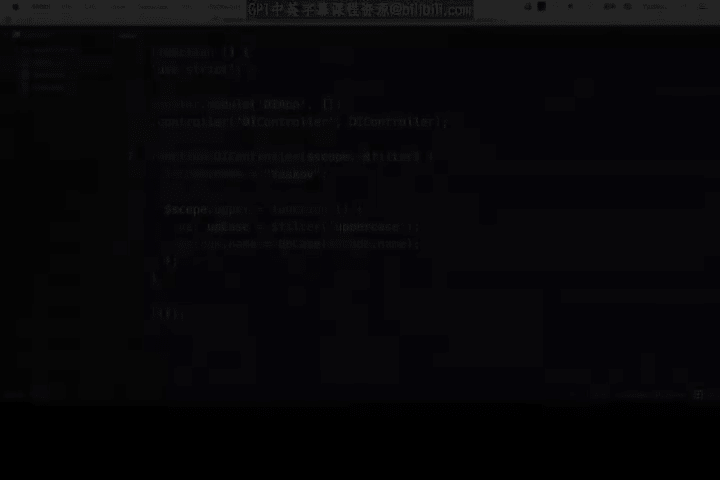

Okay， I'm back in my editor and I'm located in the lecture 10 folder。

 which is located in the full stackag dashash courseurse 5/lashexles folder。

And this is the same application we've seen before。

 which basically just uppercase the contents of a text box once it loses focus。

 so if we click on it and click out of it again， you could see that uppercase。

 everything inside the text box。

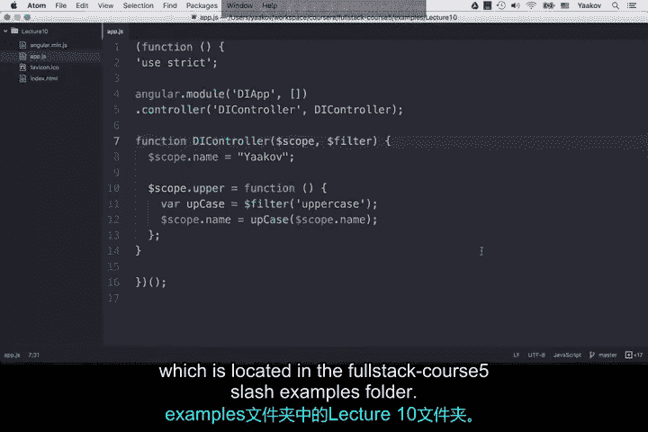

Let's go back to our code and actually select the whole thing。

 we'll copy it and we'll go to a website called JavaScript Minifier and you could Google four different Minifiers out there。

 but I showed this one it's JavaScriptscriptminifier。

com and what you could do is you could paste your JavaScriptvascript code here and click Minfi and this is the Minfi JavaScriptvascript and you go ahead and copy that。

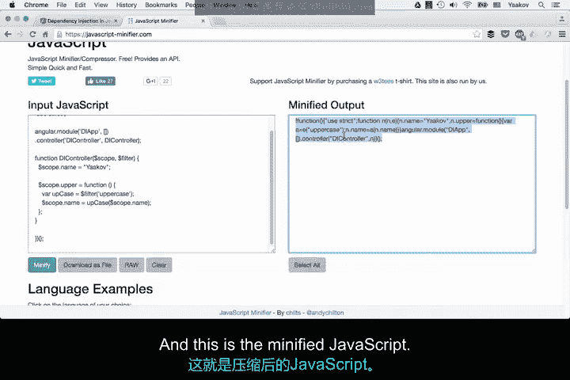

But go back to our code editor， we could comment out everything that we have there and just literally just substitute it with this new Minified version and save that。

 And since the browser sync is running already， should be able to go back to our page oh look at that it's not working Why isn't it working click on the slinger is showing as an error It will give us what the error messages and it's error something to do with the injector the injector in the D controller is not working。

 Well the reason it's not working is actually pretty simple and that's because that dollar sign scope and Dine filter really disappeared。

 you can't see it anywhere here and those are the names that Angular was looking for in order to know what to inject into this D controller that is no longer called D controller but if you look closely here it's now called n it's the n function So it just basically Minified the entire name D controller into n So how do we solve this Well let's go ahead and。

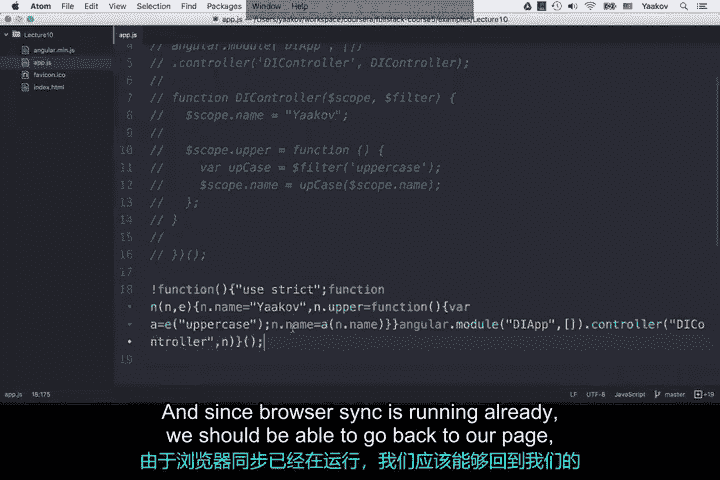

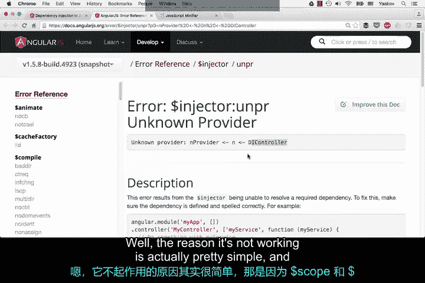

rasse this code again and we'll select all of this code and uncomment it and to solve the problem we have a couple of approaches number one is in the controller function itself the second argument right now is a function value but the truth is it doesn't have to be it can be an array and it's an array of strings with the last element in the array being the function that is responsible to be the controller function and in this case we can actually specify what this controller function is supposed to expect so who say scope and we also say dollar sign filter。

What we've told Angular is that scope and filter in this order is going to be appearing as the arguments into this Di controller function。

 which is right here。 the first one is scope and a second one is filter and the reason we can even have an array like that which is a string and another string and a function value is because as in jascript allow different types to be items in that array。

 Now these strings are protected from muification， because these are string literals。

 Similarlyly this name yaov right here is a string literal and it'll obviously will never get minified because it's real data。

 So the miniifier doesn't really know that this is kind of our code data and not the real data and therefore it will leave this alone。

 So let's go ahead and try that。 let's select all this copy it we'll go back to our miniifier we'll close this we'll go back to our miniifier we'll select all this paste our new code click Minify and。

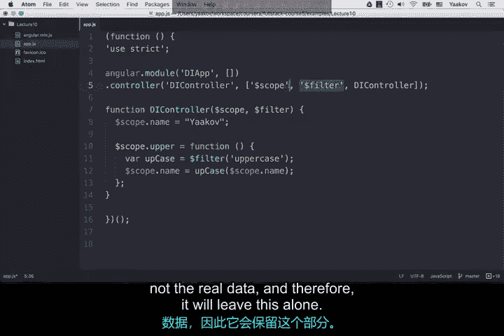

Now we'll take this whole thing， copy it。 Go back to our code。

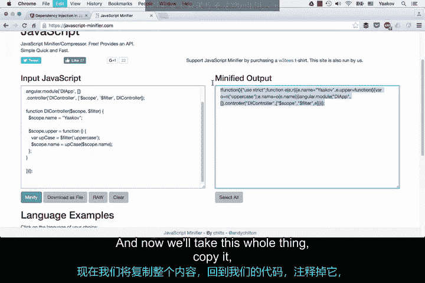

Comment it out and we'll paste this new code in and we'll hit save and let's go back to our page and see if there's an errors。

 Does't look like it。 So we'll click in here， click out。 it's working 100%。 So that's great。

 but I think we can improve it a little bit more in terms of style。

 Let's go ahead and erase all this and again will uncomment our code and you should just know that when you look online a lot of the examples online show you this technique in an even more uglier fashion。

 And let me show you what I mean by that。 So here I'm passing a function value but I don't have to I could if I wanted to actually create a function right here straight in line and go ahead and specify scope and then specify filter right here in line and I could just copy the contents of my controller function right here and paste it right there。

 So that's the same function In fact if I save that right now it should probably still work let's take a look and。

😊。

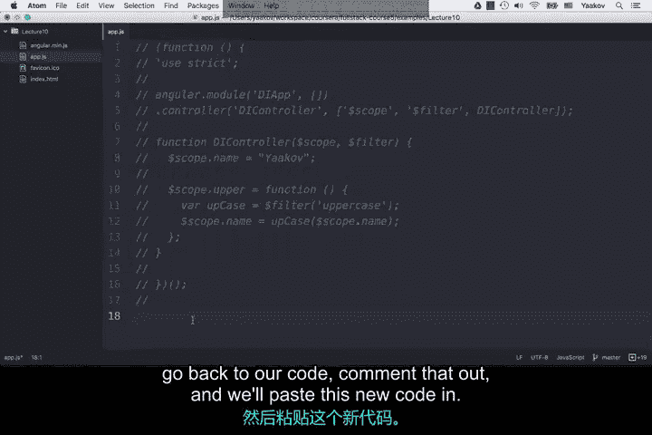

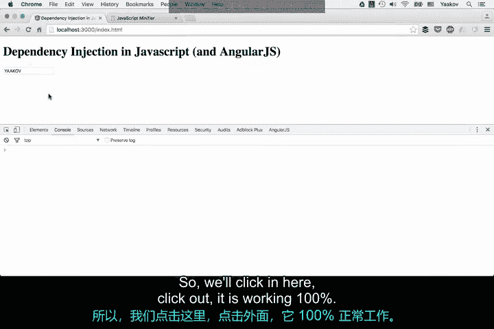

Sure enough it works because now the code that's being executed is inside this function。

 So I just did this in line as opposed to taking it outside of the statement。 And as you can see。

 it's very hard to read。 first of all， we're mixing a whole bunch of things in an array。

 which is already hard to read。 And even though that's legal jascript readability really suffers here。

 So let's go ahead and undo this real quick。 and do one better。 instead of specifying it here。

 we're going leave this alone and leave it as it was before without the array contract in the controller call。

 what we're going to do instead is attach an extra property to the controller function value itself。

 So what we're going to do is we're gonna to say D controller do dollar sign。😊，Inject。

And we're going to have that equal。First scope。And second filter， Dasine filter and if we do that。

 one angular is going to look for this function is going to also look and check to see whether or not we have a Dasign inject property on the function that is supposed to be the controller and if it finds it it will use that array as guidance to see which service to inject into which argument on the controller function itself。

 so if we save this and go ahead and copy it， go to our miniifier。

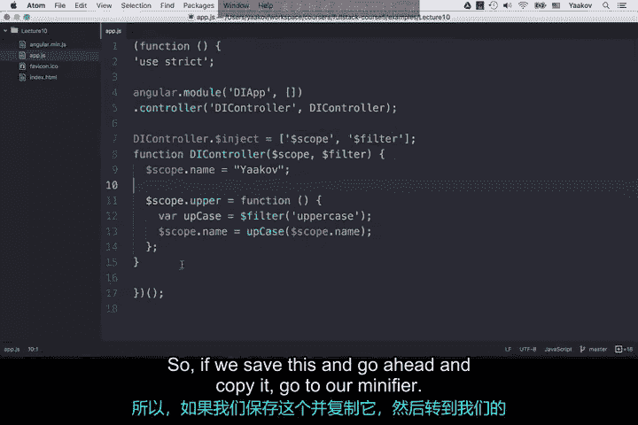

Let's miniify that。And we'll copy it again， go back， select this and comment it out。

 and we'll paste the Minified code and when we save it。

 let's go back to our web page to see if this works and as you can see it worked。

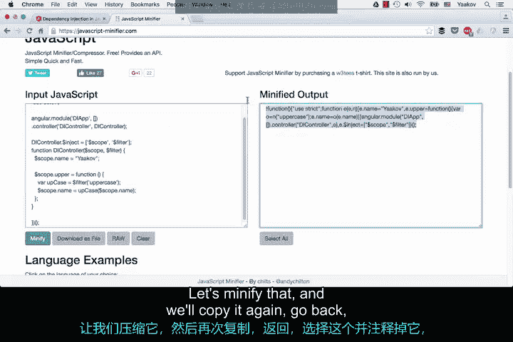

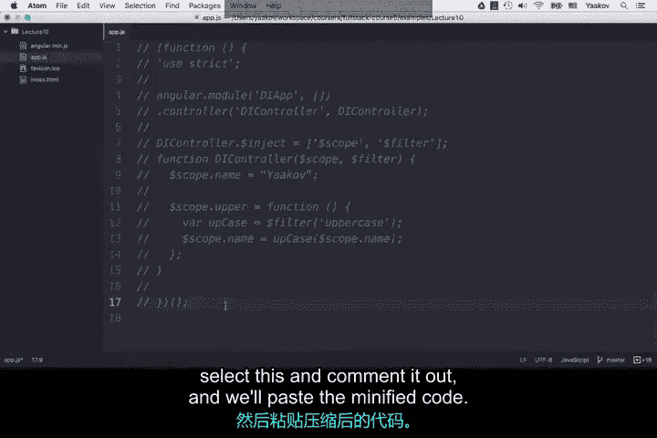

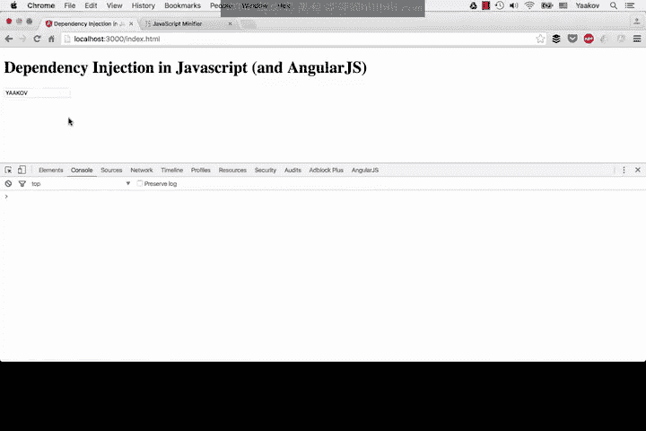

In fact， let's this again， in fact， this is really a much more elegant solution and the readability improves tremendously。

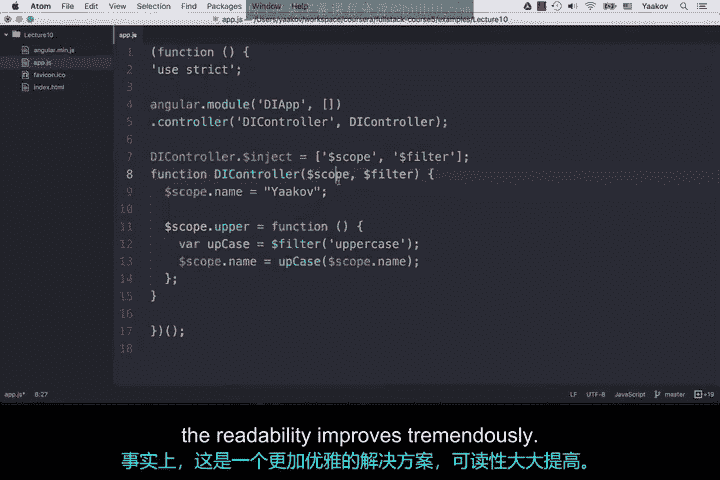

So to summarize， we spoke about muification， which is the process of reducing the size of our JavaScript and the way magification works is it removes extra characters which are actually very important for us when we read the code but completely irrelevant for the JavaScript engine when it runs it and therefore it's advantageous to actually miniify your code especially when you go to production because the size of the file is going to be smaller and therefore your web page will load faster because it will download a smaller file size。

 so the lessons learned from that is that dependency injection in angular needs to be muification proof。

And the way to do this is a couple of methods， number one is we can have an inline array with function as the last element in the array that works。

 but a more elegant way is to attach a dollar signine inject property to the function object that is being injected into an angular will look for that dollar sign inject property and will use that dollar sign inject property or I should say the value it which should be that same array we spoke about minus the last element as the function just the array of the names of the arguments。

 it will use that as a guide to know where to inject which service。

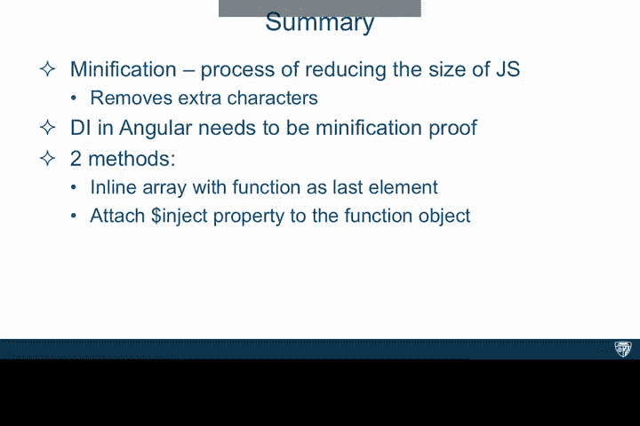