# 使用 AngularJS 开发单页 Web 应用：P18：第10讲：保护依赖注入不受代码压缩影响 🔧


在本节课中，我们将要学习如何保护 AngularJS 应用中的依赖注入机制，使其在代码压缩后依然能够正常工作。我们将首先理解什么是代码压缩，然后探讨它如何破坏依赖注入，最后学习两种有效的解决方案。

## 什么是代码压缩？ 📦

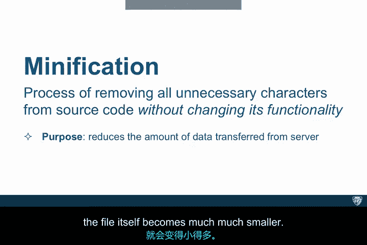

上一节我们介绍了 AngularJS 中依赖注入的工作原理。本节中我们来看看代码压缩是什么，以及它为何会对依赖注入造成影响。

代码压缩是一个从源代码中移除所有不必要字符的过程，**关键点在于**它不会改变源代码的功能。因此，压缩过程会使我们的代码变得完全不可读，但同时保持 100% 的功能性。许多压缩工具甚至自称为“丑化”工具。

以下是代码压缩通常会移除的内容：
*   空白字符
*   换行符
*   注释
*   某些用于提高代码可读性的花括号

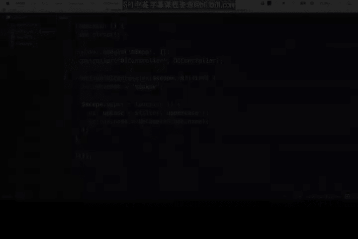

那么，代码压缩的目的是什么呢？其实很简单：**减少从服务器传输的数据量**。当所有这些字符从 JavaScript 文件中移除后，文件本身会变得小得多，从而加快网页加载速度。

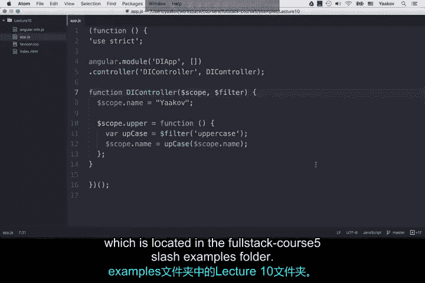

## 代码压缩如何破坏依赖注入？ ⚠️

现在我们已经了解了代码压缩，接下来我们通过一个实例来看看它是如何破坏依赖注入并导致应用失效的。

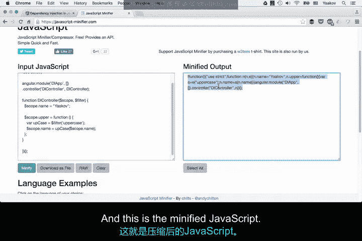

我们有一个简单的应用，其功能是在文本框失去焦点时将其内容转换为大写。其核心控制器代码如下所示：

```javascript
app.controller('DIController', function($scope, $filter) {
    // 控制器逻辑
});
```

当我们使用在线工具压缩这段代码后，变量名 `$scope` 和 `$filter` 会被替换成简短的字符（例如 `a`, `b`）。AngularJS 依赖注入机制原本是通过查找这些**参数名称**来确定要注入哪些服务的。压缩后，这些名称消失了，AngularJS 便无法正确注入依赖，导致应用出错。

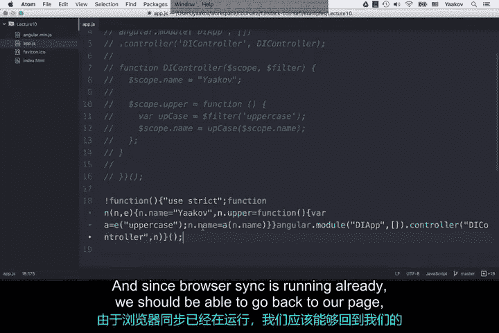

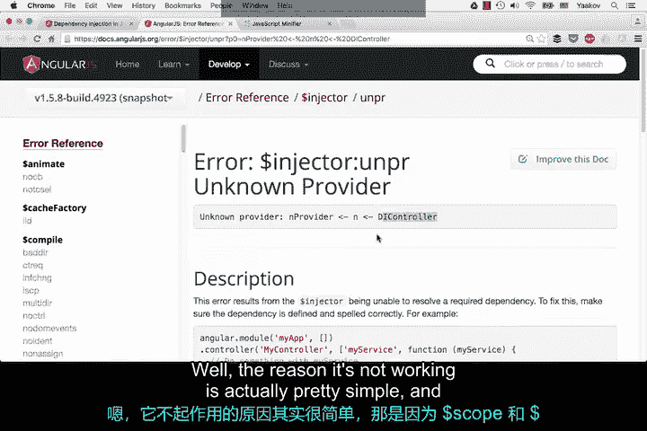

## 如何保护依赖注入？ 🛡️

既然我们看到了问题所在，本节中我们将探讨两种保护依赖注入免受代码压缩影响的方法。

### 方法一：使用内联数组注解

第一种解决方案是在定义控制器时，不使用函数作为第二个参数，而是使用一个数组。数组的最后一个元素是控制器函数本身，而前面的元素是字符串，用于指定控制器函数期望接收的参数。

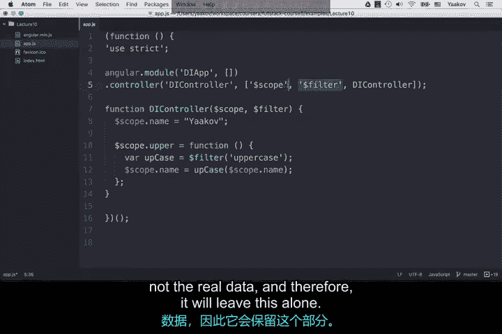

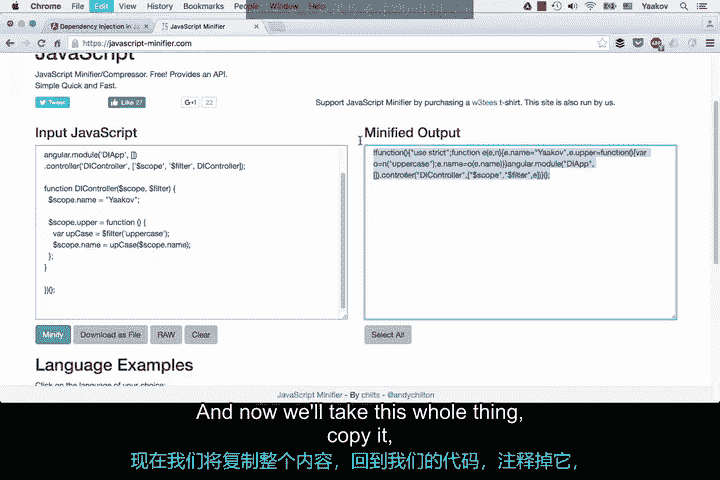

```javascript
app.controller('DIController', ['$scope', '$filter', function($scope, $filter) {
    // 控制器逻辑
}]);
```

在这个例子中，我们告诉 AngularJS：`$scope` 和 `$filter` 将按此顺序作为参数注入到控制器函数中。由于字符串字面量（如 `‘$scope’`）在压缩过程中不会被修改，因此依赖注入得以保护。

然而，这种方法将字符串、函数混合在一个数组中，降低了代码的可读性。

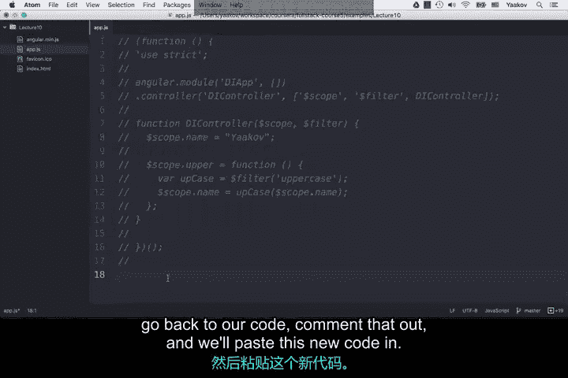

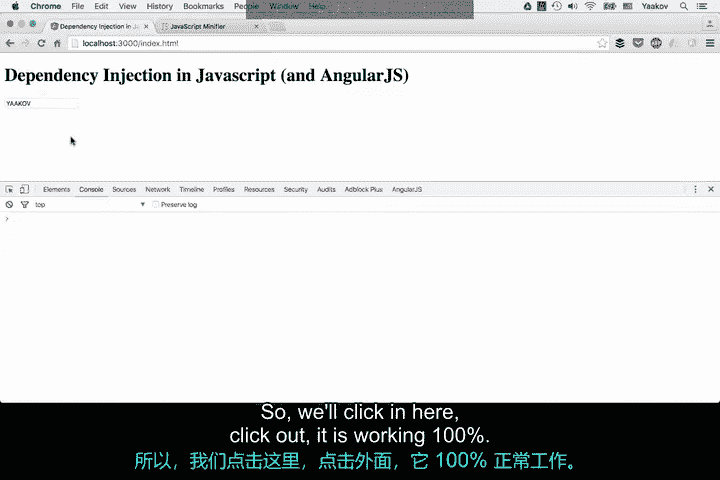

### 方法二：使用 `$inject` 属性注解

更优雅的解决方案是保持控制器函数定义不变，然后为这个函数对象附加一个 `$inject` 属性。

```javascript
function DIController($scope, $filter) {
    // 控制器逻辑
}
DIController.$inject = ['$scope', '$filter'];
app.controller('DIController', DIController);
```

AngularJS 在查找要注入的函数时，会同时检查该函数是否拥有 `$inject` 属性。如果找到，它将使用该属性数组（即依赖服务的名称列表）作为指南，来确定将哪个服务注入到函数的哪个参数中。

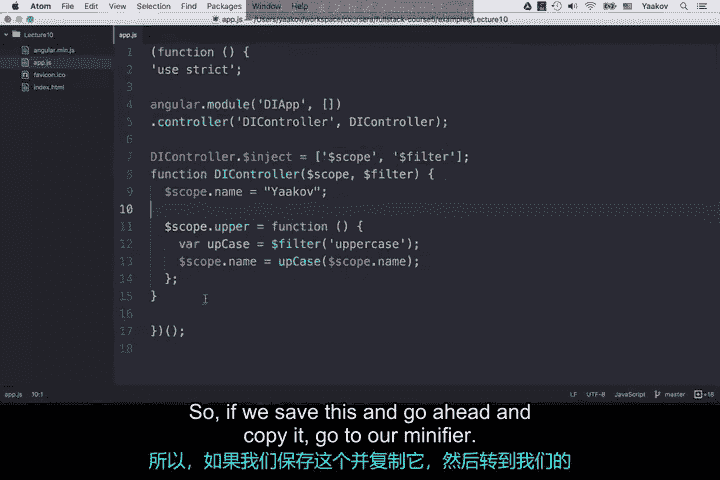

这种方法将依赖声明与函数定义分离，显著提高了代码的可读性和可维护性。

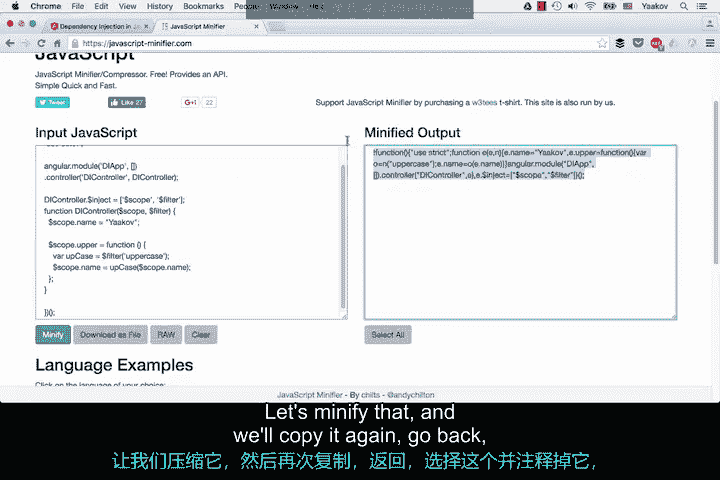

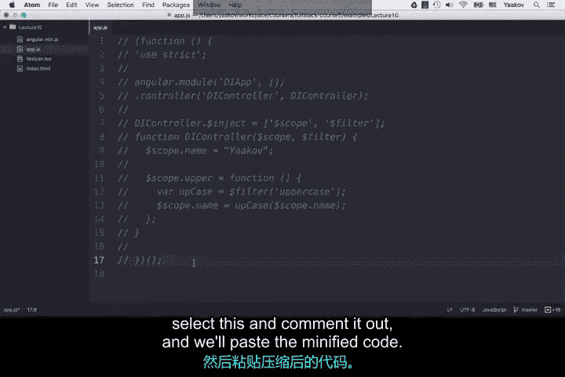

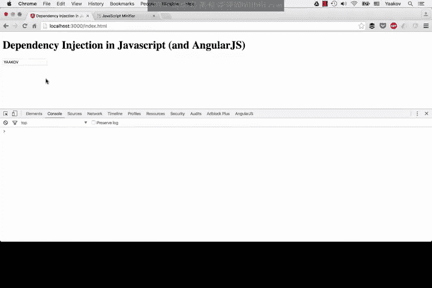

## 总结 📝

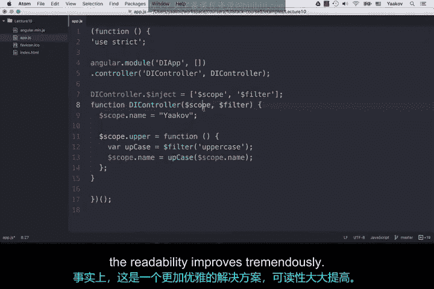

本节课中我们一起学习了保护 AngularJS 依赖注入免受代码压缩影响的重要性与方法。

我们首先了解了代码压缩，它是一个通过移除不必要的字符来减小文件大小、提升加载速度的过程。然而，压缩会破坏 AngularJS 依赖注入所依赖的参数名。

接着，我们学习了两种解决方案：
1.  **内联数组注解**：在控制器注册时使用数组，将依赖名作为字符串字面量提供。
2.  **`$inject` 属性注解**：为控制器函数定义附加一个 `$inject` 属性数组来声明依赖。

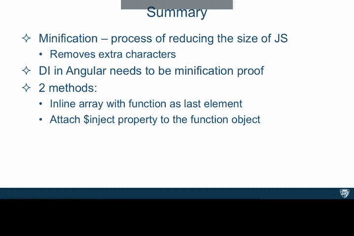

其中，使用 `$inject` 属性的方法是更受推荐的做法，因为它能更好地保持代码的清晰度和组织性。确保在生产环境中部署应用前采用这些技术，你的 AngularJS 应用就能在压缩后依然稳健运行。