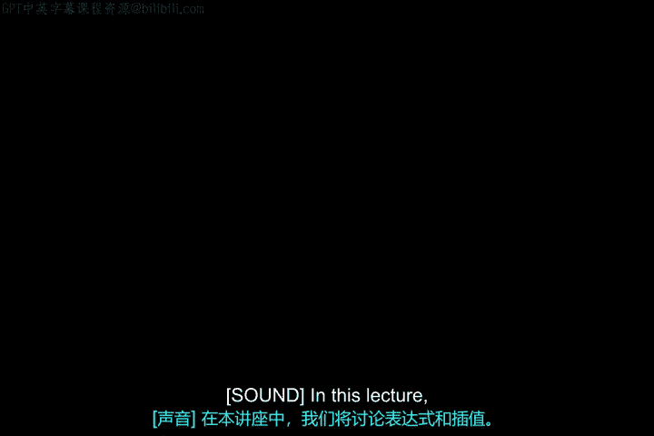
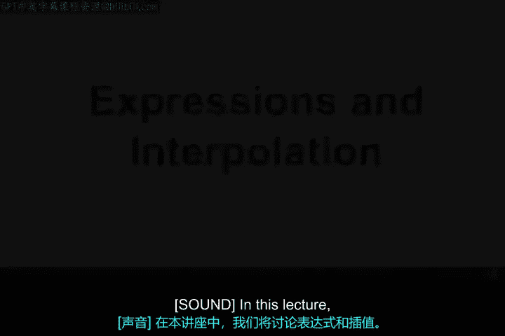
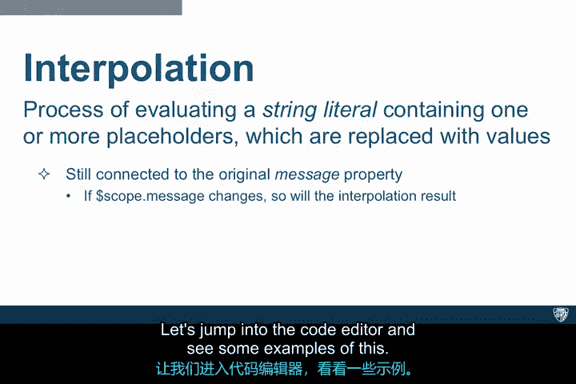
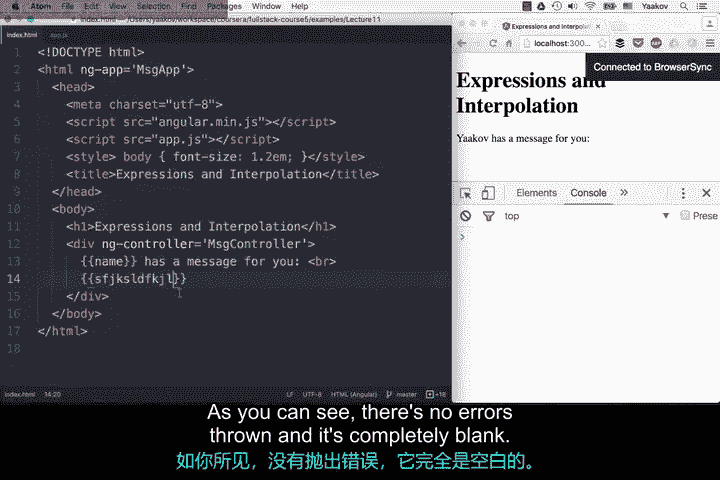
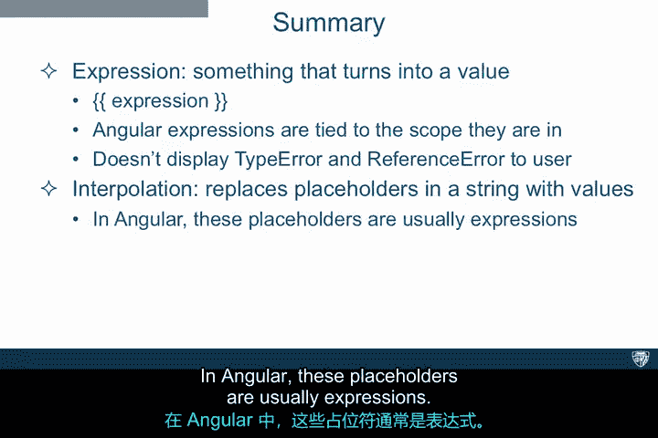

# 约翰霍普金斯大学《使用 AngularJS 开发单页 Web 应用｜Single Page Web Applications with AngularJS》中英 - P19：18_第11讲（第1部分）：表达式和插值.zh_en - GPT中英字幕课程资源 - BV1dsFDeZEQr

🎼。

In this lecture， we're going to speak about expressions and interpolation。😊。

Now what is an expression Well an expression is something that evaluates to some value an angular we've seen expressions already and those are the things that sit in the middle of those double curly braces or handlebar or musts however you want to call those Now expressions are processed by angular and if you have to think about them they roughly are similar to the result if you call eval on some ja except it's different in certain very key ways number one is it's executed in the context of the scope and that's the scope the dollar scope that we've been referring to and it has access to properties that are placed on the dollar sign scope Also if the expression evaluates and results in a type error or a reference error。

 it does not throw those errors it simply displays an empty string and empty value also unlike the eval statement control flow functions like if statements and so on are not allowed inside of the angular expression。

It can also accept a filter or filter chain to format the string output in a certain way。

 and we're going to take a look at filters in a later lecture。😊。

Now the term interpolation is very computer science fancy speak for process of evaluating a string literal containing one or more placeholders which are then replaced with real value so you have a string that has some sort of placeholders in it。

 you could parse that string find those placeholders and replace those placeholders with a value that correspond to whatever that placeholder name is so for example。

 in angular this string messages with curly brace， double curly brace message。😊。

Provided that the message is equal hello， the message property is equal hello is interpolated into this string。

 which is message is hello。And one important note here is that message variable of that message property is still connected to the original message property that's sitting on the scope。

 and if the scope data Science code message changes in any way or by some other process。

 so will the interpolation result change as well， let's jump into the code editor and see some examples of this。

Okay， I'm back in my editor and I'm located in lecture 11 folder in the fullt dash course 5 examples folder And here we're dealing with very similar setup。

 we have an index at HTML。 we have app dojs which is going to drive our app obviously angularmin so let me go ahead and close the file browser of Adam that way we could see this a little bit better。

 so let's take a look at what we have here so we've set up the application at Ng app and the name of our app is message MSsg app and we also have one controller Ng controller that's called msg controller and it's controlling this piece of HTML right here。

 which for now just says message is with a break tag in our app dojs we obviously created our module with our message app and we've registered one controller with the message controller function as the driver for that controller and in order to protect ourselves against the muification of this code we're going to attach。

😊，A dollar inject property to the function object that is our controller And for now all we're doing is is we're placing a name property on our dollar sign scope service and we're just gonna have that as a string yaov so we've seen this interpolation before and at least the valuation risk expression before if we go to our HTML we could just say double curly braces name save that since I have my browser sync working already it will just go ahead and updated message is yaov but we can do more than that we can also define a method or function that is going to be attached to our dollar sign scope service that is going to be exposed again for us to be able to use inside of an expression so let's go ahead and define a scope do save message。

😊，And that's going to be a function， I don't need the name， let's put the semicolon right here。

And it's just going to return Yaakov likes to eat healthy snacks at night exclamation point。

 we'll put a semicollon here Okay so once that's done。

 we could go to index that HTML and here we could say say message and we have to put the parents behind it because this is a function we'm want to execute that and if I save that you'll see here now it says yaakov likes to eat healthy snacks at night so believe it or not what's really going on here is that Angular is evaluating the strings that are right here between the beginning of and controller and end controller and it's interpoolating them in other words it's looking for these placeholders and it goes ahead and evaluatings them in this case it's evaluating a function call。

So if you take a look at the page source。Not the actual dump， but the page source。

 you could ignore this document that right but that's just an injection that browser sync does for you so ignore that。

 but if you look at the page source you see our energy controller and you see it's an original state here。

 same message with those curly braces， but if we close that。

And look at elements and look at our NG controller right here。

 you can see that it's really two strings， messages。

 BR and yaakov likes to eat healthy snacks at night。

 two strings concatetic together and that's how we get our yaakov likes to eat healthy snacks as one string together with this messages。

And we can not concatenate more than one placeholder， so for example， instead of messages。

 we could say something like name。Has a message for you。

Colon and we'll save that and now will say Yaakov has a message for you and Yaakov likes to eat healthy snacks at night。

 and you could see here that we concatenated all these strings together to form the contents of the body of this div。

Now I also told you that if you place something that throws a reference error or type error。

 it will just print nothing， so let's go ahead instead of save message。

 we'll go ahead and put some some nonsense in here that doesn't really exist and we'll save that。😊。

As you can see there's no errors thrown and it's completely blank in in fact if we look at the elements。

 you'll see that there's just nothing there， it evaluated to an error。

 obviously this is an error because there's no such property sitting on the scope and since this is a type error maybe it's a reference error I can remember but I think it's just a type error either way it's not going to output anything it's just going to leave it as a blank and if we change it back and finally have something that does evaluate it to a method to a function on the scope you could see that it's back and browser sync updated for us yaakov likes to eat healthy snacks at night。

So to summarize， we spoke about expressions in angular and an expression is something that turns into some value。

 and an angular is denoted by double curly braces or some people call them musts and some people call them handlebar。

Angular expressions are also tied to the scope they're in。

 so whatever the scope that you are currently located in within your HTML or the piece of the HTML page you' are in。

 the expressions at Angular will feed off of that scope。

And also the important point is the expressions in Angular don't display type error or reference error to the user。

 which is very helpful because if there's such an error。

 you certainly don't want that showing up right in the HTML page。We also spoke about interpolation。

 which is basically a process that takes these placeholders in a string literal and replaces them with some values in Angular。

 these placeholders are usually expressions and the result is automatically updated when the placeholder value changes so if anything changes that property on the scope。

 the result of that expression in the HTML page will automatically be updated by angular。

