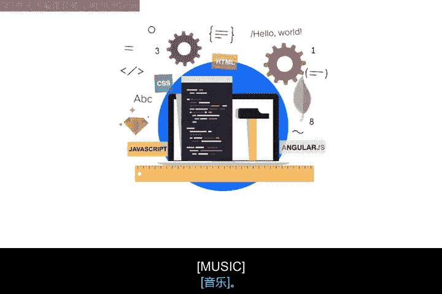
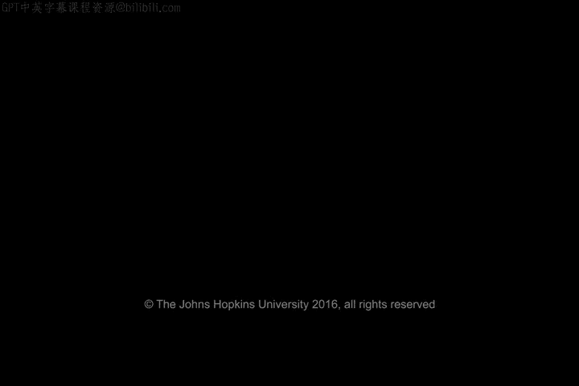

# 约翰霍普金斯大学《使用 AngularJS 开发单页 Web 应用｜Single Page Web Applications with AngularJS》中英 - P1：0_课程介绍.zh_en - GPT中英字幕课程资源 - BV1dsFDeZEQr

In the previous course， HTML， CSS and JavaScript for web developers will learn how to effectively use CSS to produce responsive websites that automatically adjust to any screen size。

 allowing the user to interact with a website on any device from a desktop to a mobile phone。

We also delved into JavaScript and AjaX the technologies that bring our pages to life with functionality and external data。

 however， as I mentioned in the introduction to one of the modules of the previous course。

 we went beyond the simple basics and really dug deep to understand this most popular and perhaps the most misunderstood programming language in the world。

 JavaScript。But we didn't stop there and used all of our newly acquired skills to build a real website for a real client as part of the course curriculum。

The course was wildly successful and became the number one top rated course on Coursera and stayed in the number one spot for three consecutive weeks。

In this course， we're going to build on top of those basic skills and take the student to the next level of web development mastery。

Angular JS is the most popular framework for building single page applications It's open source and is backed by Google General this framework is not an easy undertaking it's known to have a steep learning curve however in this course I believe that students will discover a much easier experience learning this framework。

This is because we go step by step， explaining not only how to do something， but the why behind it。

We also explain concepts that don't only pertain to Angular JS。

 but discuss how these concepts apply to the general practice of software development。

This approach will not only give the students the skills to quickly develop outstanding web apps。

 but will also enrich them with the knowledge of standard development practices and approaches。

I have mentioned this before， but it's worth repeating that what makes these courses special is that they're being taught by people who aren't simply skilled in teaching。

 but that actually work with these technologies in their day to day jobs。

 so what the students are getting is a real world perspective of how to approach commonplace software development problems。

 especially in the area of web development。As I mentioned。

 one of the most fun parts of the previous course was our visit to a real client and then developing a real website for that client in this course we will not disappoint we're going to take the website we built in the previous course and rebuild it from scratch using Angular JS plus exp with some more features。

By building a real website in Angular JS that real users will actually use。

 the students will be able to see a real world practical application of what we learned in this course。

Anyone with the basic knowledge of HTML CSS and the JavaScript programming language can take this course and take their skills to a whole new level。

 plus as usual well have some fun along the way， so all that's left is to enroll。

