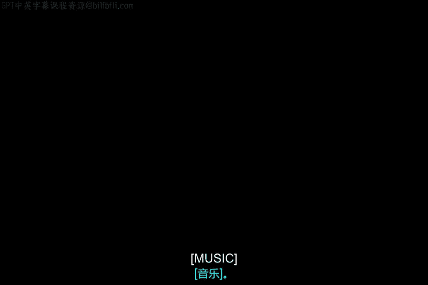
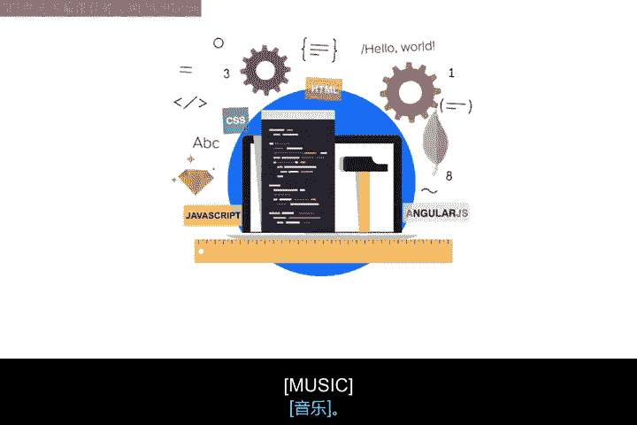
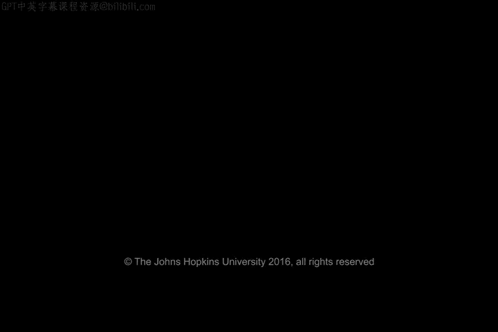

# 使用 AngularJS 开发单页 Web 应用：P1：0_课程介绍 🎬

在本节课中，我们将要学习这门课程的背景、目标以及它如何建立在先前知识的基础上。我们将了解 AngularJS 框架的重要性，并预览本课程将如何通过实践项目帮助你掌握它。

## 课程背景与基础

上一门课程《面向 Web 开发者的 HTML、CSS 和 JavaScript》教会了我们如何有效使用 CSS 来创建响应式网站。这些网站能自动适配任何屏幕尺寸，让用户可以在从台式机到移动电话的任何设备上与网站交互。

我们还深入探讨了 JavaScript 和 Ajax 技术，这些技术通过功能和外部数据使我们的页面变得生动。

然而，正如我在上一门课程某个模块的介绍中提到的那样，我们超越了简单的基础知识，真正深入挖掘，以理解这种世界上最流行、或许也是最容易被误解的编程语言——JavaScript。

但我们并未止步于此。作为课程的一部分，我们运用所有新获得的技能，为一个真实的客户构建了一个真实的网站。

这门课程取得了巨大成功，成为了 Coursera 上评分最高的课程，并连续三周保持第一名的位置。

## 本课程目标与 AngularJS 介绍

在本课程中，我们将以这些基本技能为基础，将学生带到 Web 开发精通的下一阶段。

AngularJS 是构建单页应用程序最流行的框架。它是开源的，并得到谷歌的支持。总的来说，掌握这个框架并非易事，它以陡峭的学习曲线而闻名。然而，在本课程中，我相信学生们会发现学习这个框架的体验会轻松得多。

这是因为我们会循序渐进，不仅解释如何做某事，还会解释其背后的原因。

我们还会解释那些不仅适用于 AngularJS 的概念，并讨论这些概念如何应用于软件开发的一般实践。

这种方法不仅将赋予学生快速开发出色 Web 应用程序的技能，还将用标准开发实践和方法的知识来丰富他们。

## 课程特色：真实世界视角

我之前提到过这一点，但值得重复的是，这些课程的特别之处在于，授课者不仅擅长教学，而且在实际工作中每天都在使用这些技术。

因此，学生们获得的是如何应对常见软件开发问题（尤其是在 Web 开发领域）的真实世界视角。

正如我提到的，上一门课程最有趣的部分之一是我们拜访了一位真实客户，然后为该客户开发了一个真实的网站。在本课程中，我们不会让人失望。我们将使用 AngularJS 从头开始重建我们在上一门课程中构建的网站，并添加更多功能。

## 实践项目与学习成果

通过用 AngularJS 构建一个真实用户将实际使用的真实网站，学生们将能够看到我们在本课程中学到的知识的真实世界实际应用。

任何具备 HTML、CSS 和 JavaScript 编程语言基础知识的人都可以学习这门课程，并将他们的技能提升到一个全新的水平。此外，像往常一样，我们会在学习过程中获得一些乐趣。

所以，剩下要做的就是注册课程了。

---

本节课中我们一起学习了这门 AngularJS 课程的介绍。我们回顾了先修课程的基础，了解了 AngularJS 作为流行框架的地位和本课程的教学方法，并预览了通过真实项目进行实践学习的特色。现在，我们已经为开启 AngularJS 单页应用开发之旅做好了准备。