# 约翰霍普金斯大学《使用 AngularJS 开发单页 Web 应用｜Single Page Web Applications with AngularJS》中英 - P20：19_第11讲（第2部分）：表达式和插值.zh_en - GPT中英字幕课程资源 - BV1dsFDeZEQr

🎼。

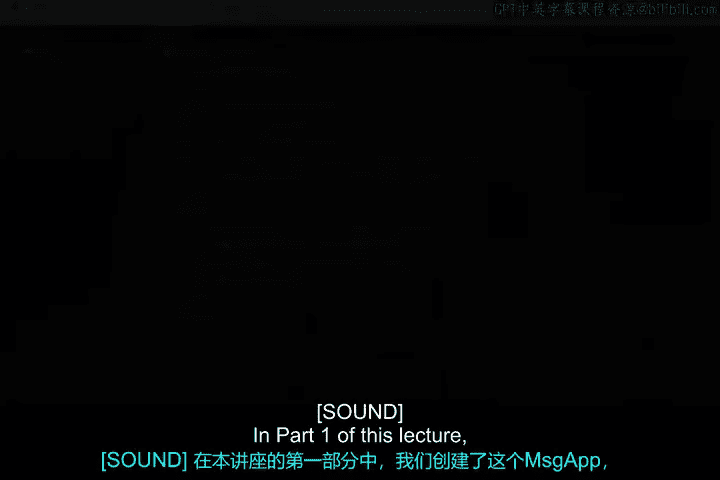

In part one of this lecture we created this message app that was able to use interpolation and expressions in order to output some messages that we set on the dollar sign scope inside of our controller What I'd like to do now is show you something a little bit more fun but at the same time demonstrate that the expressions don't necessarily have to go only in the body of tag they could also be part of tags themselves and using that technique you could actually achieve something pretty neat so I'm still located in lecture 11 folder 11 in the full stack course 5 examples folder and the only thing that I added is I edit a couple of images one is called yaakov underscore Fed and the other one is called Yaakov_ Hungry both of them a PNG file so there are images so we're going do is we're going to go ahead and create a div notice that our div is sitting inside our div that is annotated with attribute of Nng controller it has to be inside if we were to communicate with that particular controllers scope。

And the only reason we're making India of here is just to separate visually these messages from what we're about to do。

 So what we want to accomplish is have an image displayed in the web page that is going to be something like yaakov that's hungry and then we're gonna have a button that says feed yaov and when you click that button the image should flip to the other image that's yaov fed in other words yaakov has been fed so we're going to start with creating a button and the button is going to say feed yaakov and uncl of that button。

 we want to do something but since we want the angular and the controller to handle this uncl we're going say nng click so onng click we want some functionality to occur。

 meaning the flipping or the changing of the image so we'll just say feed yaov and that's going to be our function that we're going have to implement and so far so good so we'll go ahead and put maybe a break here and usually I would style is very well but since we're concentrating on functionality right now。

Lway Page is good enough。And now we need to have a placeholder for this image so we'll say IG and the source will leave the al for now out of this and the source is going to be images since where the image is allocate images and slash yaakov underscore and here's where we don't know which image to display it we want to display the image that is kind of yaakov state right and yaakov probably originally is hungry and then he's fed but we don't know that so we need to put our expression here and that's what we're going to do here we're going to say state of being what is the yakov state of being and of course after that since it's going get concatenated or otherwise known as interpolated here we need to put the period and PG so it'll be yaakov underscore if the state of being is fed and it'll say feded that PG or hungry itll stay hungry that PG。

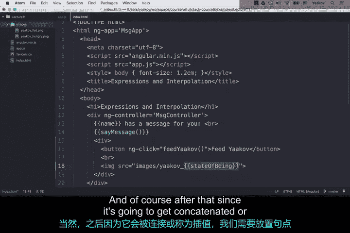

So let's go ahead and take a look at our webage and you can see the Fiiaov buttons here and we're getting an error here and kind of makes sense since we don't really have an image yet because it's just an expression and we haven't really set those variables on the dollarscopiia let's go back to our code editor and we need to define the state of being property and also define the function called Fiiaakov let's go ahead and go to appjS and we'll go ahead and add another property on scope called state of being and we'll call that Hungry。

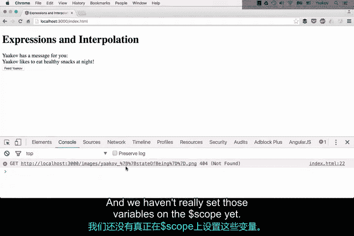

So that's the first data of being we'll put another space in here。

 And if we save that and go quickly to our webage you'll see that the image now is showing up so we have the image that's the yaov underscore hungryung image that's showing up you'll see that we're still getting this 404 error and because it can't find the image and that's kind of strange but we'll take a look at that in a minute let's go back to our editor and still need to define the message because if we do this right now let's go back if we do this right now and click feed yaov nothing is really gonna happen because we don't really have that defined yet so let's go back to our editor and define the function feed yaakov we need to obviously put it on the scope so we'll say feed yaakov there it is popping up here and it's a function don't need the name we'll put a semicon here and all we really need to do is switch our state of being variable to be fed after it gets clicked so let's go ahead and say scope that state of being。

😊。

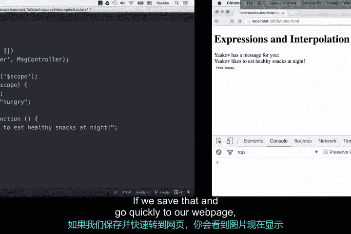

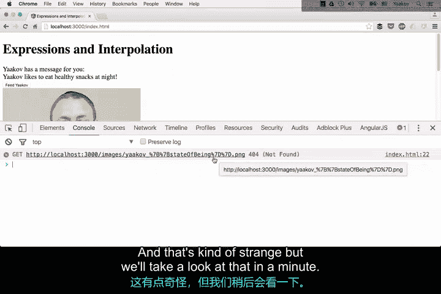

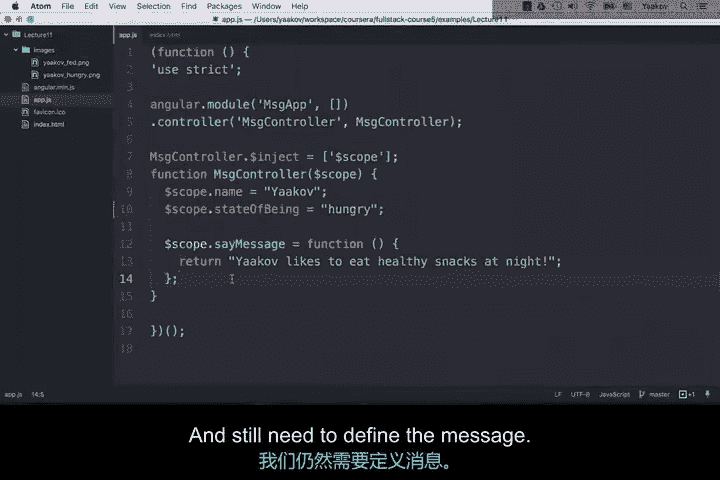

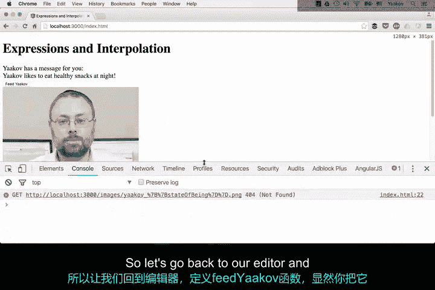

Zels feded。So we' saved that， let's go back to our browser。

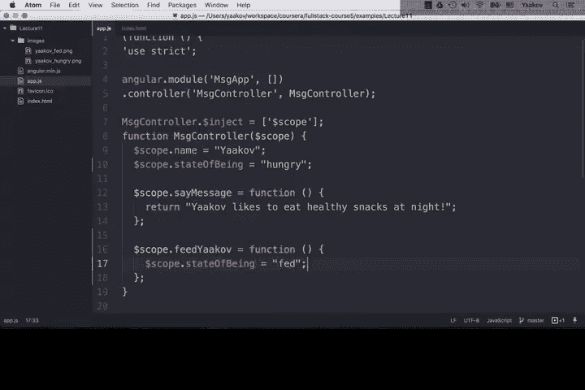

So let's minimize this a little bit more and so when we click feed Yaakov。

 now the different image shows up， obviously Yaakov looks all happy and the cookie is almost gone。

But what's strange here is if you take a look at our console we're still getting this error that it's not found so this image is not found now why is this image not being found Well actually that makes 100% sense because HTML gets processed sequentially and when this HTML page is being processed line by line by the time it gets this image the line and processing the image our state of being is not yet defined yet in fact Angular JS has not yet processed this chunk of HTML and hasn't yet looked for these placeholders and substitute these expressions with values so what ends up happening is that the browser gets this line and tries to fetch this image at this URL and of course this is a bogus URL if it still has those must and curly braces in it and therefore it gives you a 404 but once of course Angular takes care of this it substitutes this URL for the proper one and then we still see the image but yet the 404 error message remains in our console。

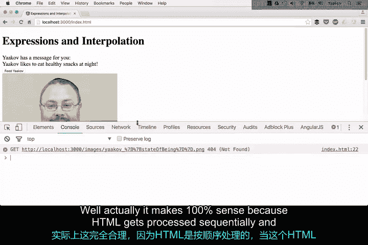

How can we take care of this？Well， we cannot take care of this using regular HTML tricks。

 but we can take care of it using Angular。 we need somehow to tell the browser not to try to fetch this URL but at the same time fetch it only when Angular is ready for interpretation of these placeholders Well one way of doing it is is to put an Angular attribute on here instead of the standard HTML one and the Angular attribute is just NG dash source So if we save that now go back you'll see that there's no errors anymore because the image only got fetched once Angular got a hold of this HTML and translated all the expressions into their values and now if we refresh the page again just to make sure even though browser sync is working here now you see Yaov with a cookie and if you click feed Yaakov our state of being variable that is saved on the scope on the Dallas size scope will change its value to underscore Fed and now Yaakov is happy because he ate almost the whole cookie。

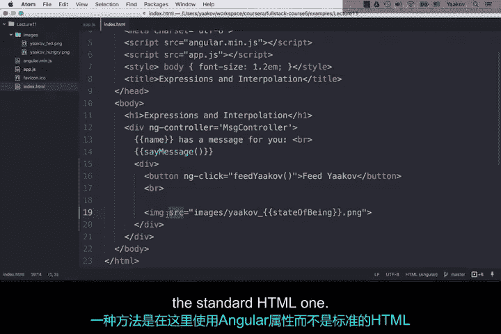

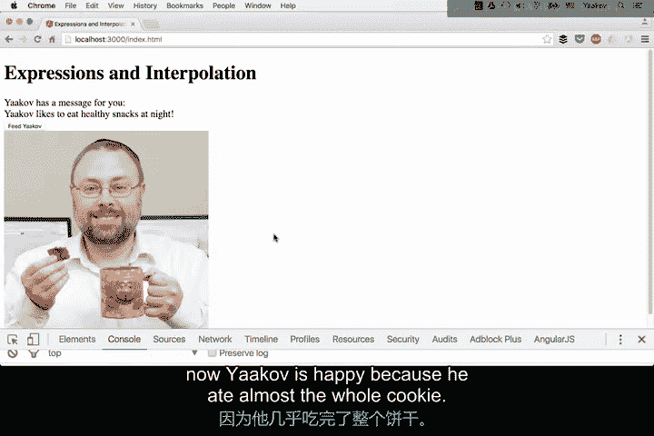

So what we've seen in this part of a lecture is really nothing super new。

 but you've seen another expression or another idea of how to use expressions。

 and since you could use expressions even inside the attribute values。

 you can achieve pretty interesting behavior that otherwise would be pretty difficult to implement。😊。

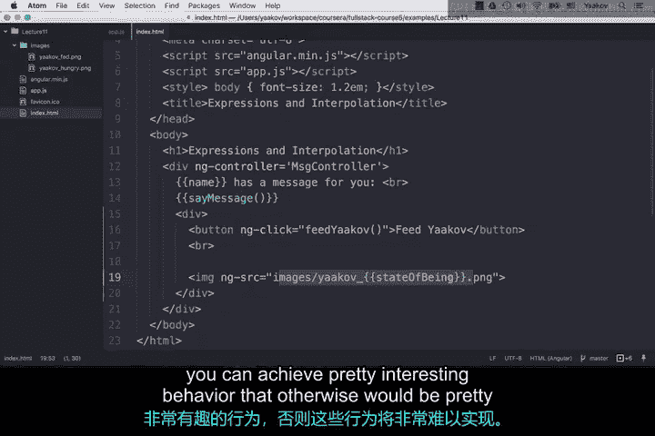

