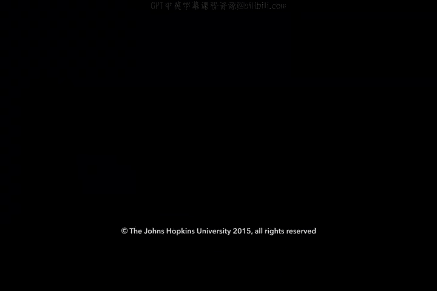

# 约翰霍普金斯大学《使用 AngularJS 开发单页 Web 应用｜Single Page Web Applications with AngularJS》中英 - P22：21_欢迎进入模块2.zh_en - GPT中英字幕课程资源 - BV1dsFDeZEQr

🎼。

🎼The。🎼。🎼，Welcome to moduledule 2。We will start this module by learning how to use Angular filters to manipulate the data into the format we want and learn how to create our own custom filters we will then dive deep into the digest cycle。

 which is the process Angular JS uses to magically update our web page with the bound data from our view model or the controller。

Understanding this process is crucial to getting comfortable with Angular JS。

We'll also see some cases where we'll need to assist that process somewhat and understand why that is。

After that， we'll learn one of the most fundamental concepts in the JavaScript programming language。

 which is prototypal inheritance。Clear understanding of that topic is a must before we talk about inheritance between Angular JS controllers in our application。

We'll finish up the module by learning how to create our own custom Angular services as well as how to configure them。

With custom Angular services， we'll be able to share data across different controllers or other components in our application。

We will also learn a few useful Angular directives that allow us to place looping and conditional logic directly into our HTML you'll see that by the end of this module you'll have the skills to create a fairly sophisticated web application that starts to use some of the more advanced software architecture techniques so have a seat grab a be of cookies and I'll see you in the module。

🎼。

