# 约翰霍普金斯大学《使用 AngularJS 开发单页 Web 应用｜Single Page Web Applications with AngularJS》中英 - P23：22_第12讲：过滤器.zh_en - GPT中英字幕课程资源 - BV1dsFDeZEQr

🎼。

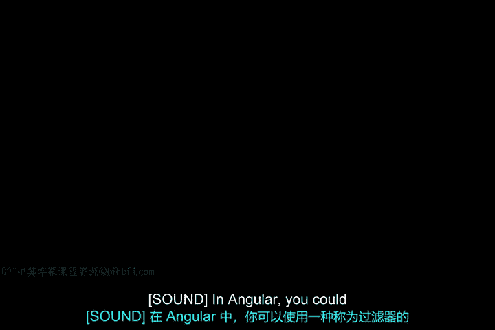

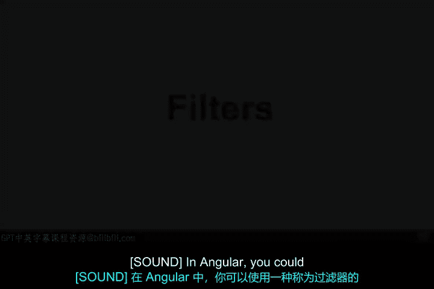

In Angular， you could use a special construct called a filter to change the output of an expression。

 and you can do that either in HTML or in JavaScript。

So here we have an example of a filter being applied to some value and it's an uppercase filter。

 which means whatever the value is， it will go ahead and take that string and uppercase it。

Angs supplies us with some pretty fine filters like the one you see uppercase。

 there's also lowercase， currency， number， etc obviously we would need to inject the filter service in other words dollar sign filter in our controller first so we could use that in our code。

So the filter service is a filter function creating service so in other words。

 this part of the statement creates a filtering function and then it gets executed using the Pars right after it so we just put the whole thing in one line but really could have created the filtering function first and then called it with the parents value filtering function sometimes have custom arguments that change the way the filtering function is filtering or changing the expression output to change the way the filtering function changes the output you pass it custom arguments and the arguments are specific custom arguments to each particular filter so in this case we see that the currency filter and you could pass it a couple of arguments which we'll actually see in examples when we jumped the code editor。

😊，A really neat feature and Angular is that you could also use these filters straight in your HTML file just by placing a pipe between the output of some expression and the name of the filter。

Now obviously the expression doesn't have to be a string literal as I placed here in this example。

 but it could be anything that is a dollar sign scope， that value， whatever the value would be。

 which in this case will evaluate a hello in the controller so you can attach a value to the scope service and then just output value right here instead of a string literal hello and as I said。

 when you place an expression followed by a pipe and the name of the filter to apply。

The output of this entire expression will be hello in all uppercase。

We could likewise apply custom arguments inside the HTML as well。

 all we have to do is separate those custom arguments by a colon。

 so in this case you see the currency filter is being applied with some custom arguments separated by a colon。

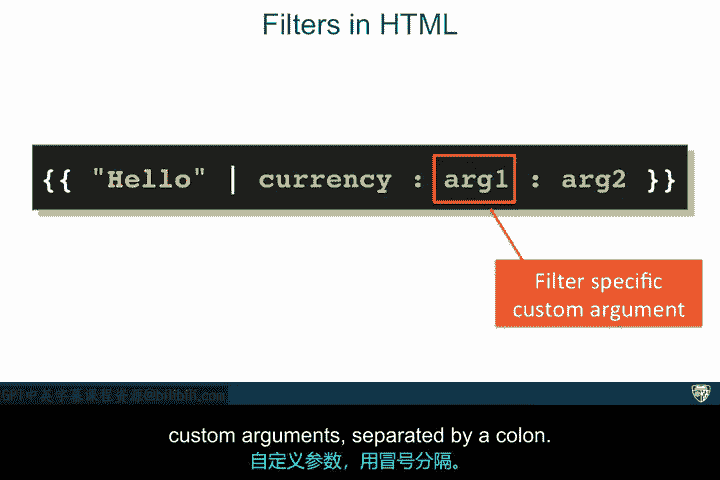

Let's jump into the code editor and see some examples of this。

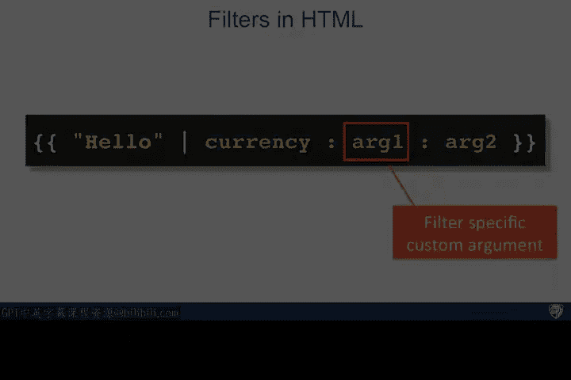

So we're back in our code editor and I'm located in lecture 12 folder。

 which is located in full stack course 5 slash examples folder and since my browser sync is already started。

 I can take a look at my same app basically a copy with feedD yaov1 has this message that we keep outputting from a method called yaakov likes to eat healthy snacks at night Well let's go ahead and in our app Gs change this phrase Yaakov likes to eat healthy snacks at night to all uppercase and where we're going to do that is we're going to use the filtering service So the first thing we need to do is we need to augment our dollar sign inject property that we placed on our message controller and we'll go ahead and do that and tell it that we're also going to inject a filter service and obviously we actually need to go ahead and place the filter service so it gets injected properly So now we're done what we could do is we could create a var cold message。

😊。

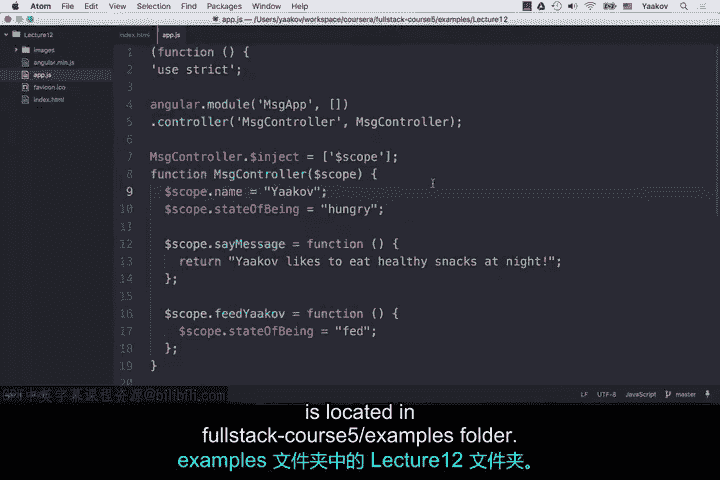

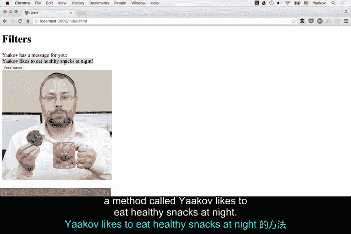

I'll just call it for short MSG， and we'll just copy this whole thing and make that the message。

Let's go ahead and copy that。And what we're going to do is we're going to use a filtering service to create a filtering function that will uppercase everything。

 but we'll go ahead and apply the message as a value to it at the same time。

 so we'll go ahead and say output and now we need to create the filtering service and the filtering service will use uppercase filter。

😊，And once we have the upperppercase filter function。

 we can now execute it with our message as the argument， now that we're done。

 we have to substitute this with our output， so that's going to be the output。😊。

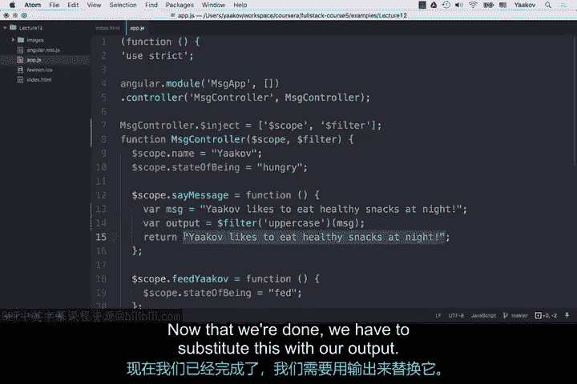

We'll save it， go to our HTML page， and as you can see that everything now is in uppercase。

So the question of course is how did I know where did I figure out this uppercase。

 where did that come from let's go back to the browser and go to Anglajs。

org and if you go underDevelop andDevelop guide，😊。

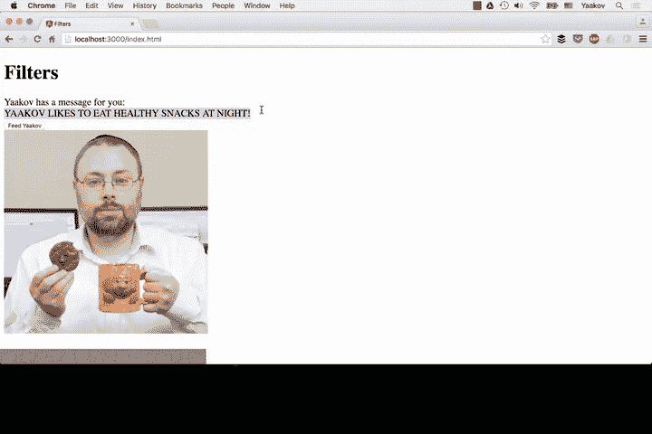

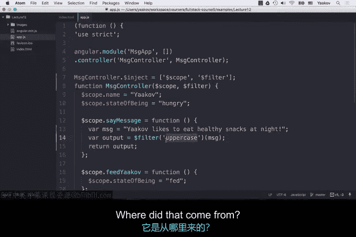

You'll see that a whole bunch of different topics here one of them is filters so if we click on this filters one it will explain you a whole bunch of things about filter。

 but one of the things it will link to you is Angular comes with a collection of builtin filters so let's go ahead and click on that and you could see the names of all these builtin filters right here and one of them is uppercase as we've been using and if you click on it you'll get some documentation as to how to use it in JavaScript which is what we did just now and how to use it inside of an HTML template or inside of HTML。

Let's go ahead and back out of this for a minute and go to the currency filter and take a look what we have available here。

 so the currency filter can be applied just as we applied the uppercase filter with the first argument being the amount。

 then the symbol like a dollar sign， and then the fraction size like 0。00， 0。000 and so on。

Let's go ahead and use this documentation， but let's use the HTML version of it and create a little line that will show us the cost of the cookie Yaovvis eating。

 so let's go to the HTML page and right after the button right here we'll go ahead and say cost and we'll give it an expression and say cookie cost and we'll give it a filter of currency。

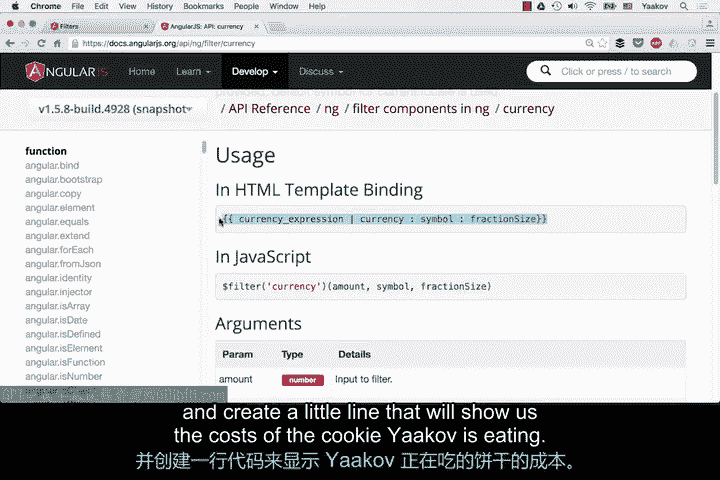

And we'll just leave it deck like that for now， of course。

 nothing is gonna work yet since we didn't define what the cookie cost is on our scope service。

 let's go back to the app and let's define the cookie cost。

 let's go scope that cookie cost and let's give it 45 cents 0。

45 notice we're not giving it dollar sign 45 or dollar sign a 0。

45 as a string we're giving it as a real number so we can actually do then let's say some cookie calculation or something if I you know meeting 100 cookies instead of just one It's possible if I try hard enough。

So now that we've defined the cookie cost on the scope service。

 we could go to our webpage and see that it updated with dollar sign 0。

45 so it knew to insert 0 to that string to keep the period and then 45 and put the dollar sign in front of it。

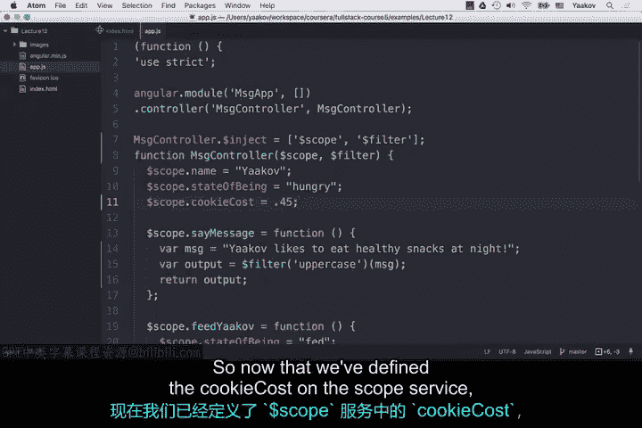

So let's customize this a little bit。 and instead of the dollar sign。

 let's create a sign for my own currency， which I'm obviously going to make up and we'll also extend the 45 to have a couple more zeros afterward。

 So because my own currency is super exact。 So if I go back to my editor and go to my HTML page so I can use the colon to supply its first argument or its first custom argument。

 which is the currency sign and in my case is going to be number sign bh but we also wanted to extend the point000 and make it as exact as4 decimal places instead of just two。

 so we'll put another column there and we'll put number4 we'll save that we'll go back and you could see now the cost of this cookie is number sign or hash sign bh045 and we're going now to four decimal points instead of just two and all our previous functionality obviously still work。

 So let's go ahead and feed yaakov just for fun of it。😊。

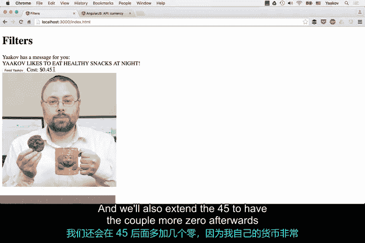

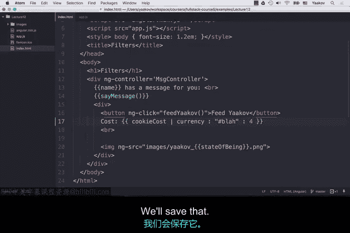

꼭。

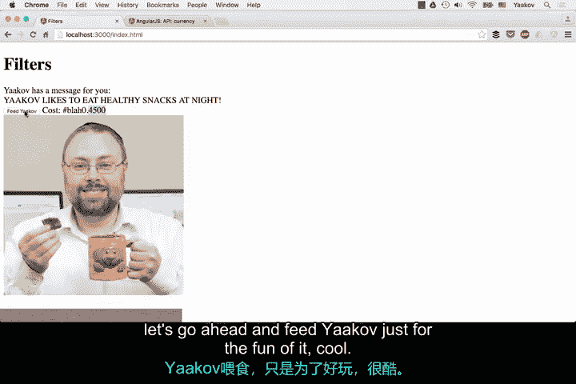

