# 使用 AngularJS 开发单页 Web 应用：P23：第12讲：过滤器 🔧

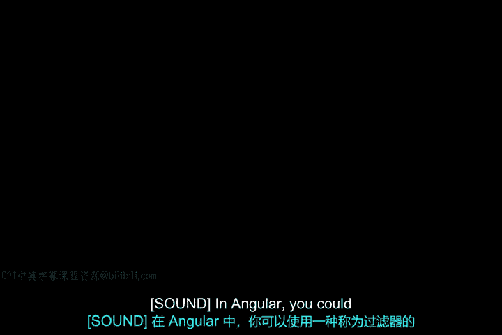

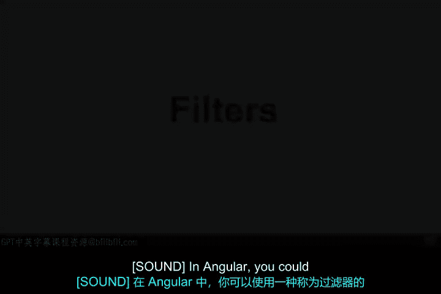

在本节课中，我们将要学习 AngularJS 中一个非常实用的功能——过滤器。过滤器可以改变表达式在视图中的输出格式，例如将文本转换为大写、格式化货币等。我们将学习如何在 JavaScript 代码和 HTML 模板中使用它们。

---

## 什么是过滤器？ 🧐

在 AngularJS 中，过滤器是一种特殊的构造，用于改变表达式的输出。你可以在 HTML 模板或 JavaScript 代码中使用过滤器。

例如，这里有一个应用了 `uppercase` 过滤器的例子。无论原始值是什么，这个过滤器都会将字符串转换为大写。

```html
{{ expression | uppercase }}
```

AngularJS 提供了一些内置过滤器，例如 `uppercase`、`lowercase`、`currency`、`number` 等。要在 JavaScript 代码中使用过滤器，我们需要先在控制器中注入 `$filter` 服务。

---

## 在 JavaScript 中使用过滤器 💻

`$filter` 服务是一个用于创建过滤函数的服务。以下代码演示了如何创建并使用一个过滤函数：

```javascript
// 注入 $filter 服务
app.controller(‘MyController‘, [‘$scope‘, ‘$filter‘, function($scope, $filter) {
    // 创建过滤函数并立即执行
    var output = $filter(‘uppercase‘)(‘hello‘);
    // output 的值现在是 ‘HELLO‘
}]);
```

这段代码首先通过 `$filter(‘uppercase‘)` 创建了一个大写过滤函数，然后立即用参数 `‘hello‘` 执行它。你也可以将创建函数和调用函数分开写成两行。

有些过滤器接受自定义参数来改变其行为。例如，`currency` 过滤器可以接受货币符号和小数位数作为参数。

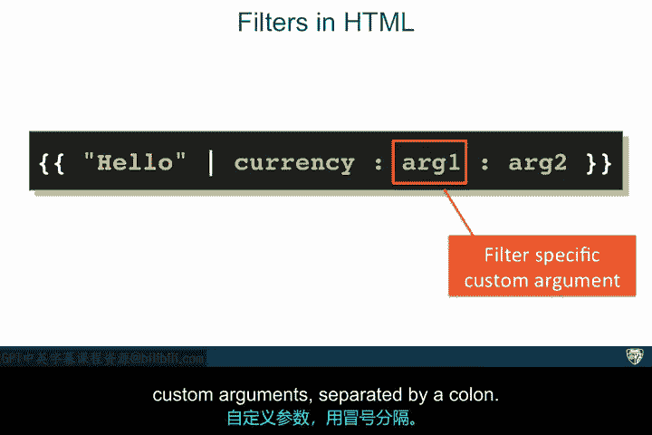

---

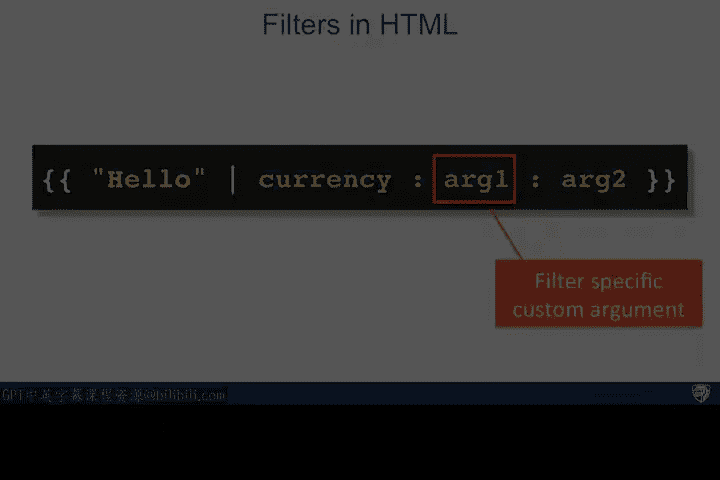

## 在 HTML 模板中使用过滤器 📄

AngularJS 一个非常方便的特性是，你可以直接在 HTML 文件中使用过滤器。只需在表达式和过滤器名称之间添加一个竖线（`|`）即可。

```html
<!-- 使用内置的 uppercase 过滤器 -->
{{ ‘hello‘ | uppercase }}
<!-- 输出： HELLO -->
```

表达式不一定非得是字符串字面量，它可以是任何绑定在 `$scope` 上的值。

```html
<!-- 假设 $scope.greeting = ‘hello‘ -->
{{ greeting | uppercase }}
<!-- 输出： HELLO -->
```

同样，你也可以在 HTML 中为过滤器传递自定义参数，参数之间用冒号（`:`）分隔。

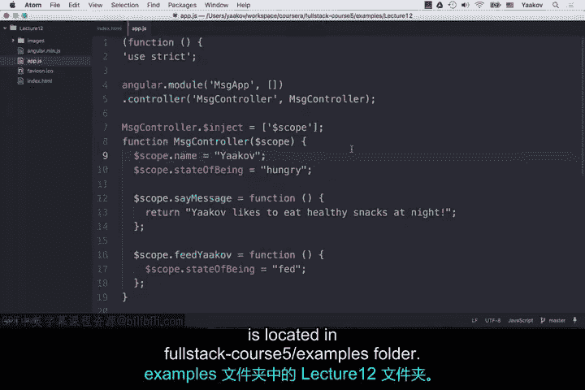

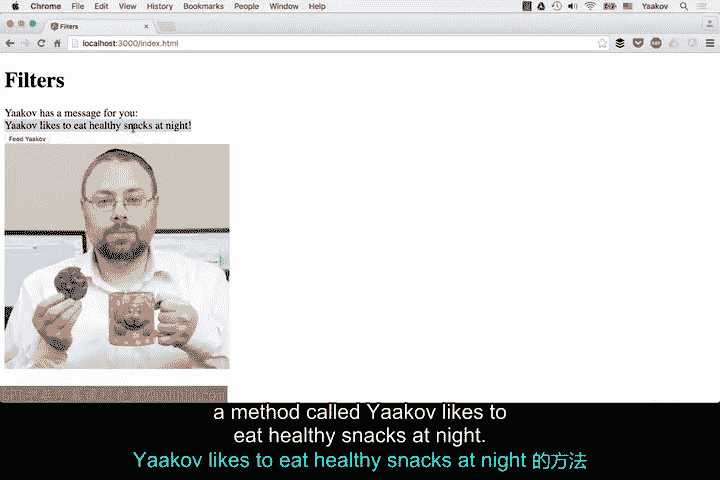

```html
<!-- 使用 currency 过滤器并自定义参数 -->
{{ cost | currency : ‘¥‘ : 4 }}
<!-- 假设 $scope.cost = 0.45， 输出： ¥0.4500 -->
```

---

## 实战演练：代码示例 🚀

现在，让我们进入代码编辑器，通过实际例子来巩固对过滤器的理解。

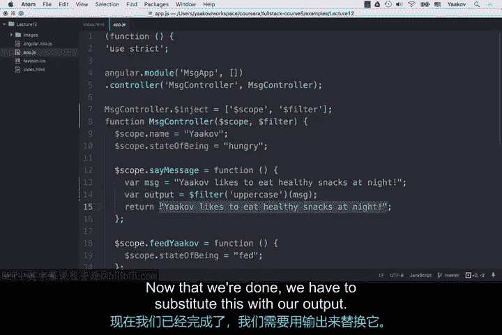

我们位于 `lecture 12` 文件夹中。我们的应用目前显示一条信息：“Yaakov likes to eat healthy snacks at night”。我们将使用过滤器将其转换为大写。

首先，我们需要修改控制器，注入 `$filter` 服务。

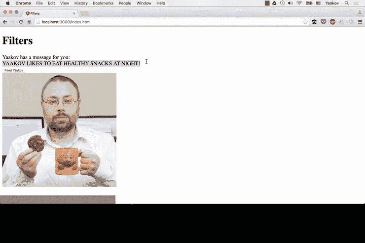

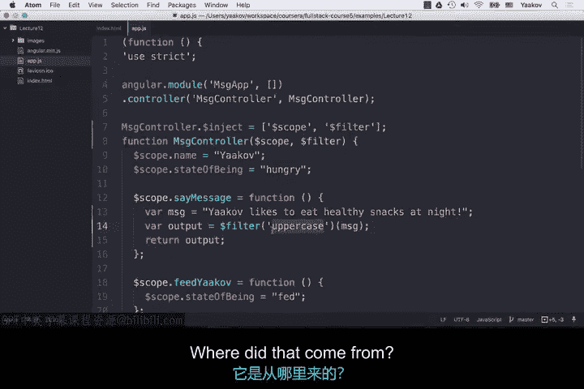

```javascript
app.controller(‘MsgController‘, [‘$scope‘, ‘$filter‘, function($scope, $filter) {
    // ... 控制器逻辑
}]);
```

接着，我们使用 `$filter` 服务来转换信息。

```javascript
// 原始信息
var msg = “Yaakov likes to eat healthy snacks at night“;
// 使用 uppercase 过滤器
var output = $filter(‘uppercase‘)(msg);
// 将转换后的结果赋值给 $scope
$scope.message = output;
```

保存代码并刷新页面，可以看到信息已全部变为大写。

你可能会问，如何知道有哪些内置过滤器？可以访问 AngularJS 官方文档的“开发指南”部分，查看“过滤器”章节，其中列出了所有内置过滤器及其用法。

---

## 使用 Currency 过滤器 💰

让我们尝试另一个内置过滤器：`currency`。我们将展示 Yaakov 吃的饼干的价格。

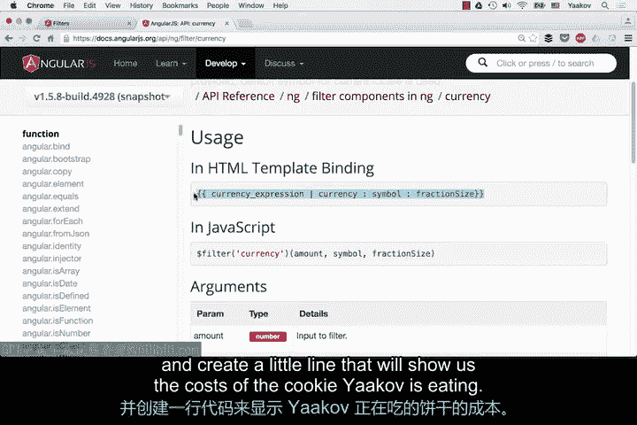

首先，在控制器的 `$scope` 上定义一个价格。

```javascript
$scope.cookieCost = 0.45; // 这是一个数字，不是字符串
```

然后，在 HTML 模板中使用 `currency` 过滤器来格式化显示。

```html
<p>Cost: {{ cookieCost | currency }}</p>
<!-- 输出： $0.45 -->
```

现在，让我们自定义这个货币格式。假设我们使用一种虚构的货币，符号是“#bh”，并且要求显示4位小数。

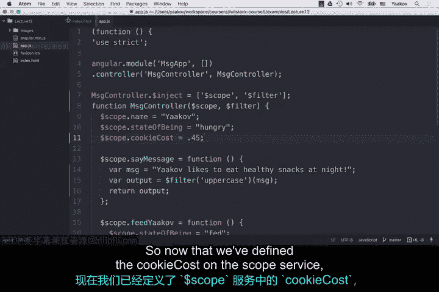

```html
<p>Cost: {{ cookieCost | currency : ‘#bh‘ : 4 }}</p>
<!-- 输出： #bh0.4500 -->
```

保存并查看页面，可以看到价格已按照我们的自定义格式显示。同时，之前的大写转换功能依然正常工作。

---

## 总结 📝

本节课中我们一起学习了 AngularJS 过滤器的核心概念和用法。

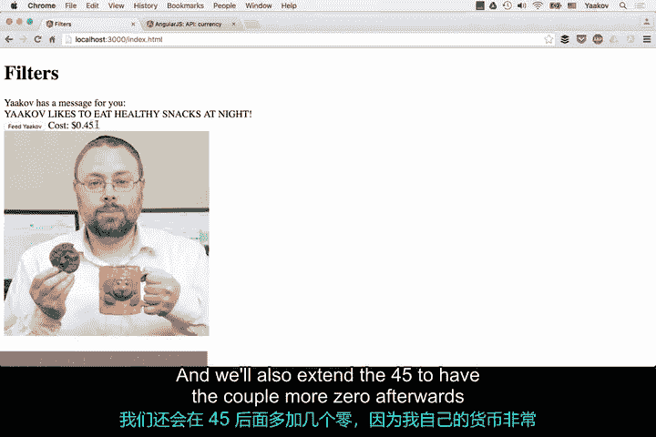

*   **过滤器的作用**：改变表达式在视图中的输出格式。
*   **两种使用方式**：既可以在 JavaScript 控制器中通过 `$filter` 服务使用，也可以直接在 HTML 模板中使用管道符号（`|`）调用。
*   **内置过滤器**：AngularJS 提供了诸如 `uppercase`、`lowercase`、`currency`、`number` 等实用的内置过滤器。
*   **自定义参数**：许多过滤器接受参数来定制输出，在 HTML 中使用冒号（`:`）分隔多个参数。

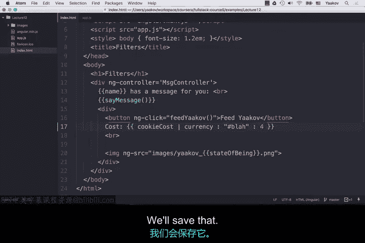

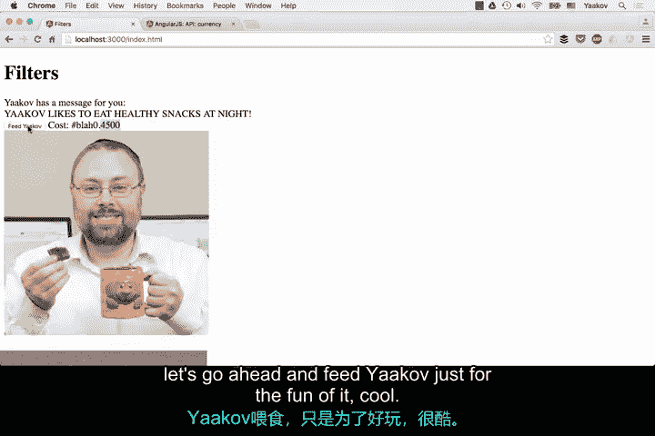

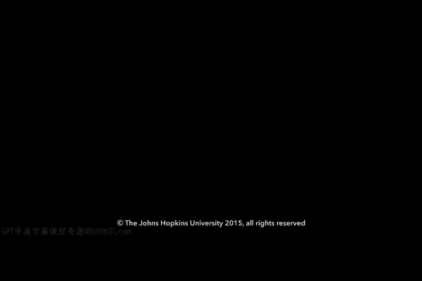

通过本讲的学习，你已经掌握了使用过滤器来格式化数据的基本技能，这能让你的应用界面更加专业和用户友好。