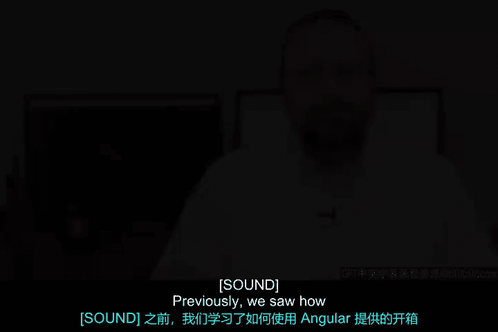
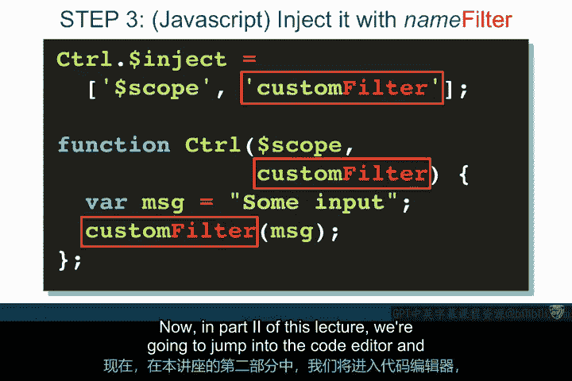

# 约翰霍普金斯大学《使用 AngularJS 开发单页 Web 应用｜Single Page Web Applications with AngularJS》中英 - P24：23_第13讲（第1部分）：创建自定义过滤器.zh_en - GPT中英字幕课程资源 - BV1dsFDeZEQr

🎼。

Previously we saw how to use a filter that angular supplied out of the box。

 but that's not always enough， so in this lecture we're going to learn how to create our own custom filters There are a few steps in this process。

😊。

First， we need to define the filter factory function， and just like it sounds。

 this is actually an example of a factory design pattern。

 a factory is a central place in your code that produces new objects or functions In our case this factory function called custom filter factory produces our filtering function for the whole filtering mechanism to work。

 Anglo JS expects us to create a factory that produces the filtering function。At a minimum。

 the filter function itself takes some input as an argument and then usually returns some manipulated version of that input。

 in other words， the filtered output。The second step in the process is to register the filter factory with our module and we do it in a very similar way that we register controllers。

 for controllers we call that controller on the module and we give it a name and a function that's responsible for the controller and for the filter we call the filter method on the instance of our module specifying the name for our filter and referencing the filter factory function that's responsible to create a filter functions。

Now the name of the filter must be a valid Angular JS expression identifier a safe bet for naming the filter is to use anything that would be a valid variable name in JavaScript The name of the function itself which in this case is custom filter factory can be anything you want there's no correlation between the name of the function and the name will register the factory with in Angular JS however。

 it's nice to name it similarly so you don't get confused down the road。

We now need to inject our filter into whatever contract we're planning to use it in In this example。

 we're planning to use it instead of a controller in other words directly in the JavaScript itself。

 instead of the HTML， so we need to inject it into the controller function。

And we do it an the usual way we've done before， which is add one more value into the array on the dollar sign inject property of the controller function。

 and then specify that as an argument in the same position when we define the controller function。😊。

Obviously the whole point of injecting a filter is to eventually use the filter。

 so in the last line you could see that we're using our custom filter。

 passing it our message as the input。😊，Notice that the name of the filter we're injecting is not the name we registered the filter factory with in fact。

 the name we use is their originally registered name plus the word filter just as shown in red。

Also notice that unlike the filter service that we've seen before。

 calling custom filter actually calls the filter function。

 If you recall calling the filter service doesn't actually call the filter function but simply creates the filter function for us。

 These two facts are not a coincidence。 Let's go back for a moment。😊，Remember。

 when we register our filter， what we're really registering is a factory that creates our filter function。

On the other hand， we've seen before that when you call the filter service specifying filter function you want to instantiate。

 like uppercase， for example， the filter service calls the uppercase filter factory。

 which is already supplied by Angular to create the upper casing filter function。

Having gotten the filter function， you can execute it with a supplied value。However。

 when we're injecting our custom filter straight into the controller。

 Angular callss our registered filter factory for us， for example， custom filter factory。

 and allows us to inject the product of that factory or whatever that factory returns。

 which is our actual filter function。In the process。

 Angular names the actual filter function we inject。

 using the name we registered our factory function plus the word filter appended at the end。

So if we registered a factory function calledCustom。

 EnngloGS will execute our factory to create the actual filter function and name itCustom filter。

 appending the name filter to the end of the registered factory name。As a side note。

 it's probably therefore a bad idea to register your custom filter factory with the name filter at the end of the name。

 so for example， if you registered the custom filter factory function， with the name custom filter。

 Angular would append the word filter to that and you would be forced to inject it with the name custom filter filter kind of awkward。

 so avoid that。O， that was a lot of background detail。

 but it does help you understand what's going on， so you're not memorizing strange rules。

But that was a lot， so if you didn't get it all on the first try。

 I suggest you go back and rewatch this part again for now， let's review the essential steps again。

The first step is to define our filter factory function。

This is a function that creates and returns an instance or filter function。

The second step is for us to register our filter factory with a module and we do that with calling the filter method。

 giving it the name of our filter， and specifying the filter factory function that is responsible for creating our filter function。

😊，The third step， at least if you're trying to use your filter directly inside of JavaScript。

 like in a controller or something similar to that。

 then you need to inject the filter with the name of the filter that you registered plus the word filter attached to it。

 as in this case custom filter。Now， in part two of this lecture。

 we're going to jump into the code editor and see these concepts in action。😊。

