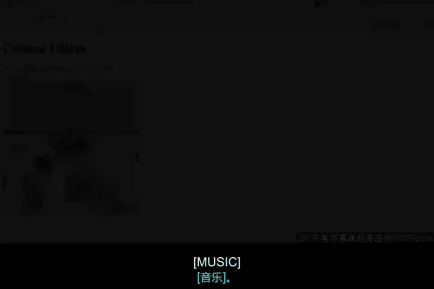
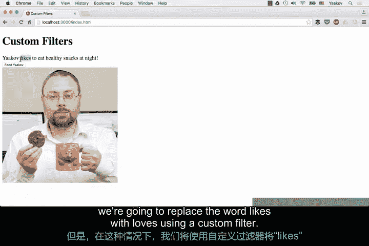
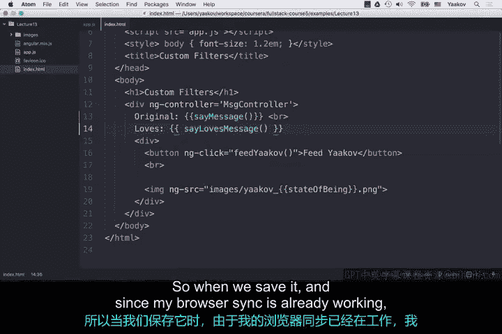
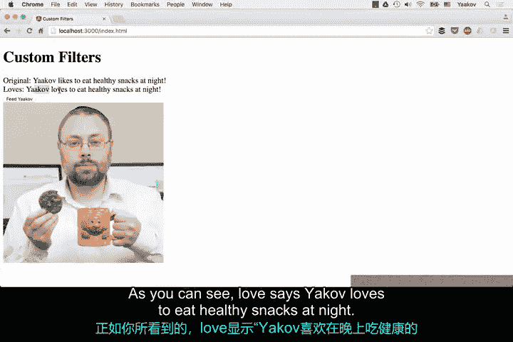
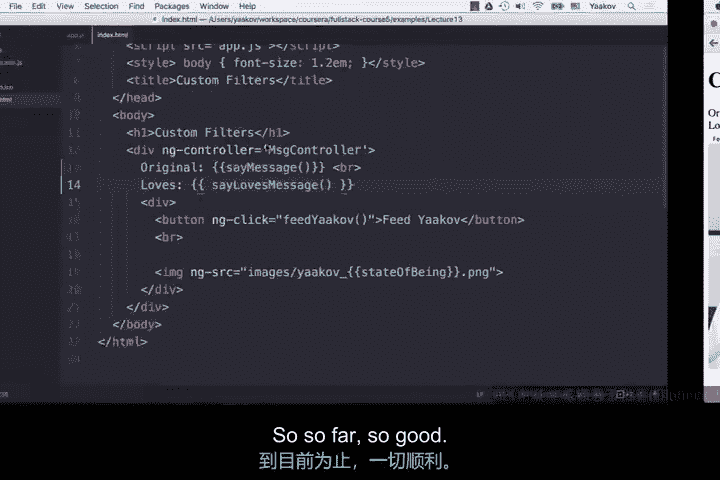
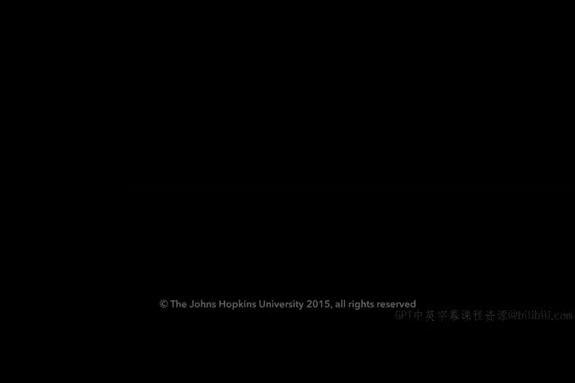

# 约翰霍普金斯大学《使用 AngularJS 开发单页 Web 应用｜Single Page Web Applications with AngularJS》中英 - P25：24_第13讲（第2部分）：创建自定义过滤器.zh_en - GPT中英字幕课程资源 - BV1dsFDeZEQr

🎼。

In part one of this lecture we went over the process of how to create custom filters in this lecture we're going to go ahead and implement some of the custom filters in the application that we've been dealing with so far so as you could see here one of the messages we're returning from our controller is Yaakov likes to eat healthy snacks at night so let's bump it up a bit let's not say likes。

 let's say love but in this case want to replace the word likes with loves using a custom filter。😊。

So let's go to our code editor and the first step is to create our filter factory function so let's go ahead and see where the controller ends so we could put our function right underneath that and we'll call this function loves filter and since it is a factory function it needs to return another function and that function is going to take an input and we need to put a semicone here and basically the first thing we're going to do is make sure that our input actually exists。

 so we'll say if it's input or if it's not there we'll just give it an empty string and then we'll just replace the input by saying input that replace。

And we'll replace the word likes with the word。Loves okay。

 and then obviously we need to return that newly created input。 So so far so good。

 Now we need to register our factory filter with the angular application。

 So let's go back up and instead of terminating the controller， we'll do one more statement。

 we'll say filter。😊，And we want to call it loves and give it our factory function。

 which is loves filter。 Okay， so now we need to use this loves filter。

 This is where we have a function called say message。

 We'll go ahead and copy that and we'll create another one called say loves。😊。

Or maybe say loves message okay and in this case what we're going to do is we're going to apply our filter but before we could do that we need to inject it into our controller so we'll go ahead and append one more array item into the dollar sign injector array that's attached to our controller function and we'll call it loves filter and remember this loves comes from the filter name and the filter is going to be appended by Angular Js for us so we have to name our filter loves filter and we also need to give it as a second argument since we placed it as a second item in the array of the injections okay so now it's loves filter here too。

And now we could use this loves filter inside of our say loves message。

 So we're going to do is we're going to take this message and we're going to call loves filter。😊。

Passit this message and actually we'll just override the message using that。

 and that will return the message。 So so far so good， if we go to the index at HTML。

 we'll see our original message， which is right here。 Let's call it original。

And we'll put a break here， it's a little ugly， but it will do。Love's message will be similar。

 but this one will say， sayLo's message。And we'll give it a par。 so we'll execute that function。

 So when we save it。 and since my browser sync is already working， I'll go to my browser。

 As you could see， love says Yaakov loves to eat healthy snacks at night。😊。

So so far so good， and in this say loves message， what we ended up doing is using a custom filter inside of our JavaScript。

😊。

And in part three of this lecture， we're going to take a look as to how to create custom filters with extra custom arguments。

 as well as how to use our custom filters straight inside the HTML template。😊。

