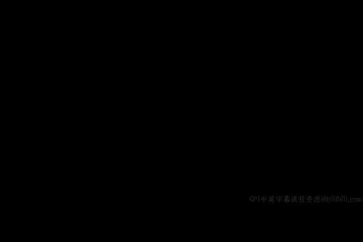
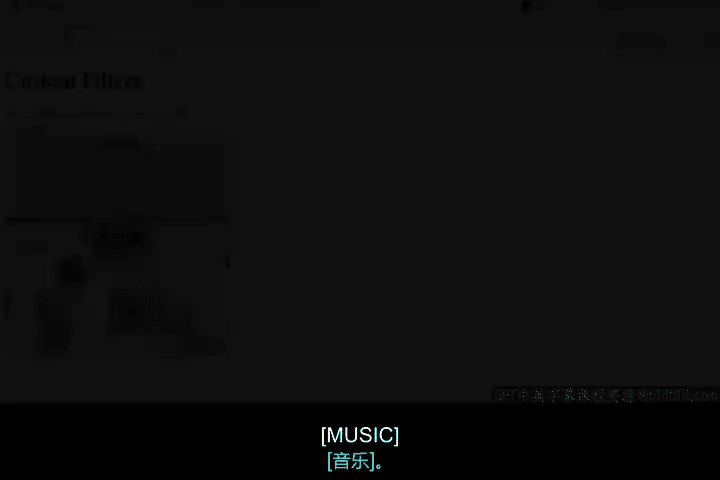
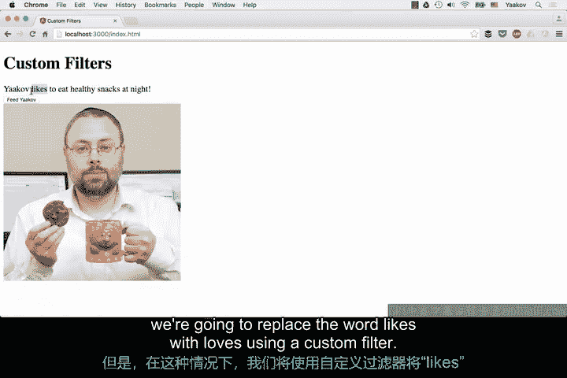
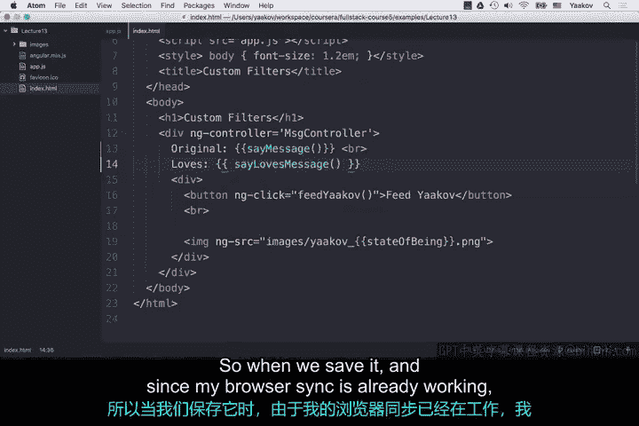
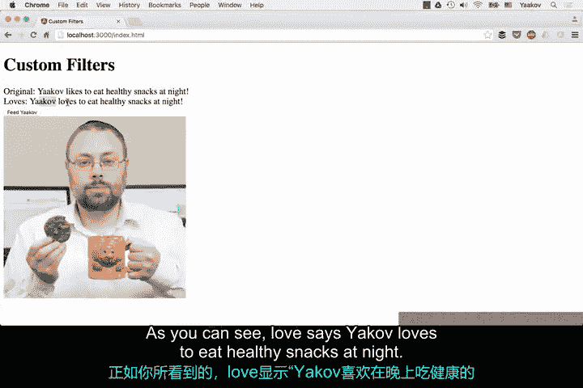
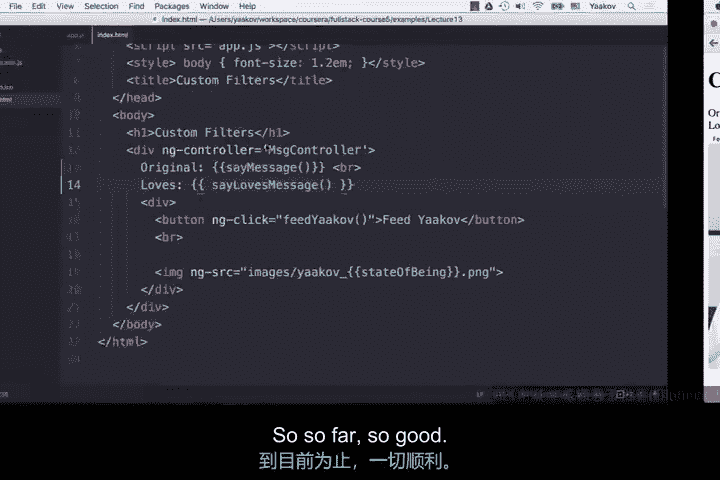
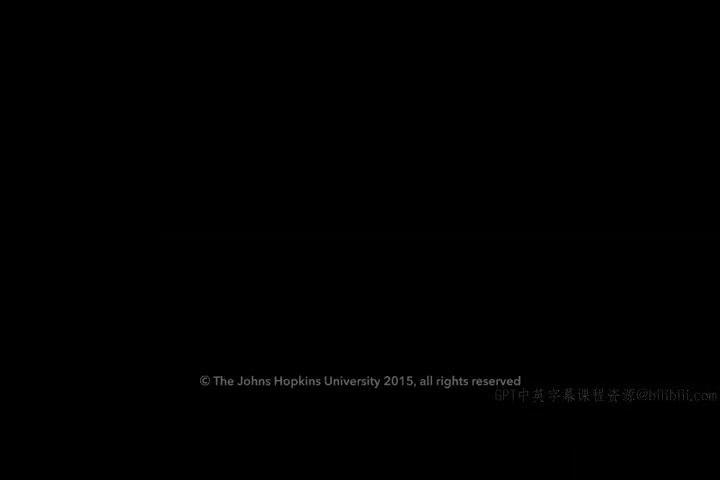

# 使用 AngularJS 开发单页 Web 应用：P25：第13讲（第2部分）：创建自定义过滤器 🎼






在本节课中，我们将学习如何在 AngularJS 应用中实现自定义过滤器。上一节我们介绍了创建自定义过滤器的基本流程，本节中我们来看看如何将自定义过滤器应用到实际项目中。



我们的控制器返回了一条消息：“Yaakov likes to eat healthy snacks at night”。现在，我们想通过一个自定义过滤器，将句子中的“likes”替换为“loves”。


首先，我们需要在代码编辑器中创建过滤器工厂函数。找到控制器定义结束的位置，在其下方添加我们的函数。

我们将其命名为 `lovesFilter`。由于它是一个工厂函数，它需要返回另一个函数。这个返回的函数将接收一个输入参数。

```javascript
function lovesFilter() {
  return function(input) {
    // 确保输入存在
    input = input || '';
    // 替换单词
    input = input.replace('likes', 'loves');
    // 返回处理后的结果
    return input;
  };
}
```

接下来，我们需要将这个工厂函数注册到 AngularJS 应用中。回到控制器定义的上方，在结束控制器定义之前，添加一个 `filter` 语句。

```javascript
app.filter('loves', lovesFilter);
```

现在，我们需要在控制器中使用这个 `loves` 过滤器。首先，我们必须将其注入到控制器中。

以下是控制器中注入依赖的数组，我们需要在其中添加 `lovesFilter`。

```javascript
app.controller('MyController', ['$scope', 'lovesFilter', function($scope, lovesFilter) {
  // 控制器逻辑
}]);
```

然后，我们可以在控制器中创建一个新的函数来使用这个过滤器。假设我们有一个 `sayMessage` 函数，我们将复制它并创建一个 `sayLovesMessage` 函数。

```javascript
$scope.sayLovesMessage = function() {
  var message = "Yaakov likes to eat healthy snacks at night";
  // 应用自定义过滤器
  return lovesFilter(message);
};
```

最后，我们需要在 HTML 模板中调用这个新函数。在 `index.html` 文件中，我们可以添加以下代码来显示原始消息和处理后的消息。

```html
<p>原始消息: {{ sayMessage() }}</p>
<br>
<p>处理后消息: {{ sayLovesMessage() }}</p>
```

保存文件后，由于浏览器同步工具已启用，我们可以立即在浏览器中查看结果。你将看到处理后的消息显示为：“Yaakov loves to eat healthy snacks at night”。





至此，我们成功地在 JavaScript 代码内部使用了一个自定义过滤器。




在本讲的第三部分，我们将探讨如何创建带有额外参数的自定义过滤器，以及如何在 HTML 模板中直接使用自定义过滤器。





本节课中我们一起学习了如何创建并注册一个自定义 AngularJS 过滤器，将其注入到控制器中，并在控制器函数内调用它来修改数据。这是构建更动态、更个性化应用的重要一步。