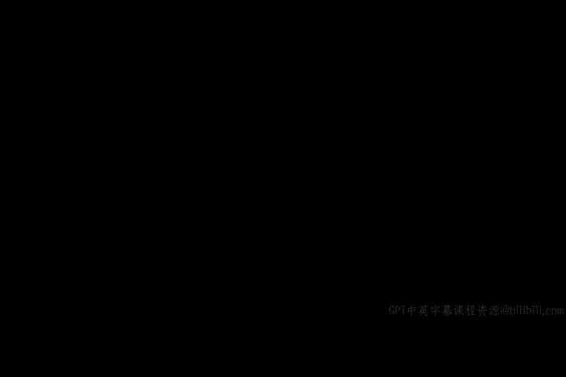
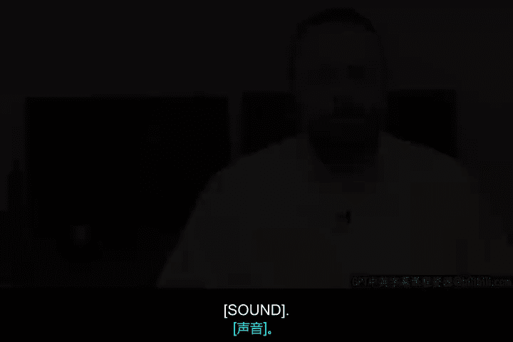
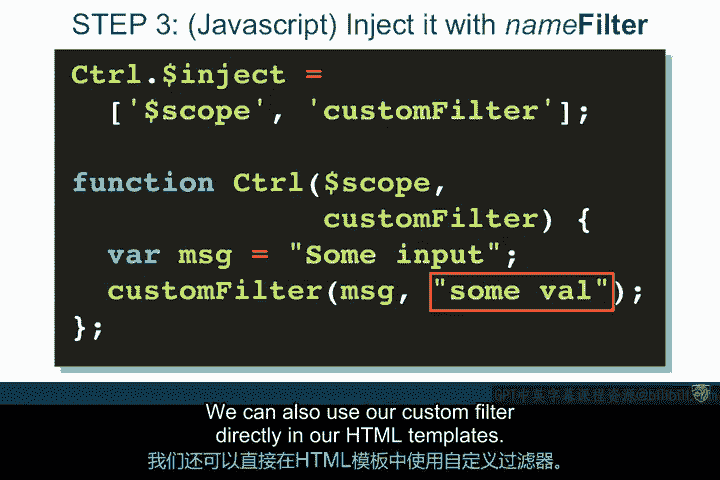
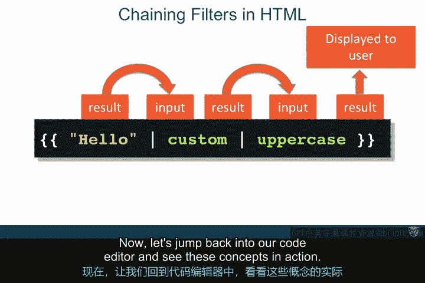
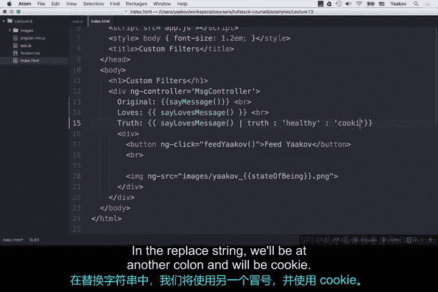
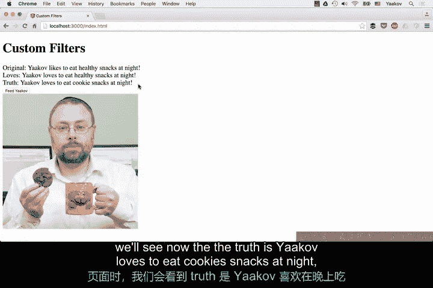
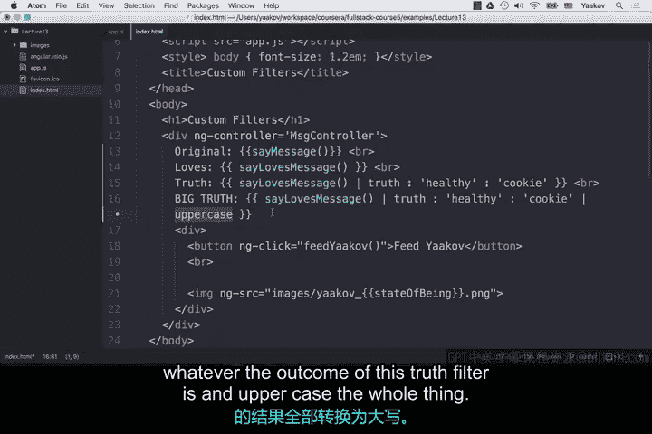
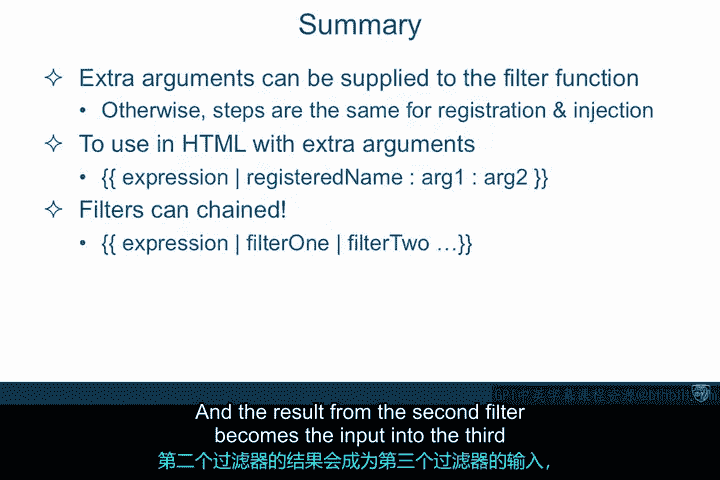

# 约翰霍普金斯大学《使用 AngularJS 开发单页 Web 应用｜Single Page Web Applications with AngularJS》中英 - P26：25_第13讲（第3部分）：创建自定义过滤器.zh_en - GPT中英字幕课程资源 - BV1dsFDeZEQr

🎼。

In the previous lecture we saw how to create and use a custom filter with just the input expression as the argument and no additional arguments to the filter function In this lecture we're going to go over how to create a custom filter that accepts additional custom arguments as well the process for that is pretty much the same as before。

😊，The first thing you need to do is to define the filter factory function。

 except this time what you return is a created filter function with some additional arguments besides the very first one。

 which is the input。The second step is exactly as it was before。

 you registered the filter factory function， except this filter factory function is the one that's now returning a filter function that has custom arguments besides the input attached to it as well。

 so in this step there is no change。The third step is fairly similar as well。

 you have to inject your filter into your controller or whatever other JavaScript construct you're trying to inject it into and obviously when you use the filter。

 you wouldn't just give it the input which in this case is message but you would also give it some additional value that would correspond to that extra custom argument in this case it's a string literal called subV we can also use our custom filter directly in our HTML templates。

The process for creating such a filter is exactly the same。

 The only difference is the last step when you actually use it inside of an HTML template instead of inside of your JavaScript。

 you still have to create your filter factory function and then register it with a module。😊。

The name you register the filter factory with the module is the name you use inside of your HTML template。

 you do not append the word filter to it。And since we're inside HTML。

 there's no need to inject the filter into a controller at all。

 Angular takes care of these references for you automatically Now if you need to use extra custom arguments inside of your filter inside of the HTML template。

 you simply follow the name of your filter by a colon and an argument and in another colon and another argument and keeps going until you satisfied all the arguments that you have in your custom filter。

You can also chain filters by simply separating them with a pipe character。

 which will make the result of one filter be the input to the next one in the chain until the very last filter。

 which outputs a result that displayed directly to the user。😊。

Now let's jump back into our code editor and see these concepts in action。

Okay， so we're back in our code editor and we are exactly where we left off from the previous part。

 let's create another filter and then use it inside of HTML。

 And since Yaakov loves to eat healthy snacks at night， It's not exactly 100% accurate。

 Let's go ahead and create another filter， we'll start by creating the filter factory function。

 and we'll call this one。😊，Function。Truth filter。 and since the factory function willll need to return again a function。

 oops， not the fun， but the function。this time， let's go ahead and specify some custom arguments。

 I will call one target and the other one replace， I want to be able to let the user of this filter specify what the target string is and what we should replace that string with。

And it's easy enough to code up this function because it's exactly the same as this one。

 we'll just copy and paste right here and instead of likes and loves。

 we'll just say target and replace we'll save that the next step is for us to register our filter factory with the Angular Gs module so let's go up again and again we'll instead of terminating that line we'll continue it。

 we'll say another filter and this filter is going to be called truth and the name of our factory is truth filter。

😊，We'll save that and since we're going to be using it inside of HTML。

 we don't really need to inject it inside of our message controller。

 we could just jump straight to the HTML and start using our truth filter。Let's go back over here。

And let's create another BR。And will say truth。And we'll say again， say loves message。

In this time since we're using the filter inside of HTML。

 we'll specify it using a pipe and the name that we register our factory function with。

 which is truth， and since we need to not just give it the name but also the arguments that we're looking for。

 the first one was target and in this case we'll say healthy。In the replace string。

We'll be at another colon。And it will be cookie。

Let's put a space here， so when we save that and go back to our HTML page。

 we'll see now the truth is Yaakov loves to eat cookie snacks at night。Much closer to the truth。

But we're not done yet。It turns out that in angular you could do something even cooler than that。

 you could actually chain these filters one after the other。

 so let's go ahead and put another break right here and we'll say big truth。Big truth。

And in this case， what we're going to do is we're going to copy the same line that we had before。

Right here。We'll paste it right here， but instead of stopping at this replacement filter。

 our custom replacement filter truth， let's put a pipe over here。

 one more pipe and we'll say uppercase。We'll call the uppercase filter right on the output of our truth filter。

 So now we're chaining our filters。 There's one。 there's actually a filter inside of that that switches our message from likes to love。

 And the truth filter kicks in and filters that message and takes out healthy with the word cookie and then the uppercase filter should take whatever the output of this truth filter is and uppercase the whole thing。

 So let's go ahead and save that。 go to our HTML page and sure enough， the big truth is。

 Yaakov loves to eat cookie snacks at night。 And he is looking a little sad。

 So let's feed him that's much， much better。😊。

So let's summarize， we went over the steps to create a custom filter。

 the first thing you need to do is to define the filter factory function。

 that's the thing it' is going to create the function that is actually the filter。😊。

Then we take that filter factory function and we register it with our module Now to use our custom filter in JavaScript。

 we simply need to inject the filter function， registered name with the word filter attached to the back of it into our controller or some other construct that we're trying to use it in inside of our JavaScript。

 the registered name is the name you registered the filter factory function with。

To use it inside HTML， we don't need to inject anything into the controller。

 we simply take an expression followed by a pipe and give it the name of our filter and that's again the registered name that you registered the filter factory function with in the module。

Now you can also create custom filters that take some extra arguments besides the actual input that the filter will work on in order to do that。

 all we have to do is really specify those extra arguments on the actual filter function that we specify inside of our factory function otherwise the steps for the rest of the procedure is exactly the same It's the same registration and the same injection if you want to use it inside of your JavaScript to use a custom filter with extra arguments inside of your HTML all you have to do is follow an expression by a pipe with a registered name of the factory function followed by a colon and an argument colon and an argument and so on。

One of the really neat features in Angular JS is that filters can be chained。

In order to change the filters， you take an expression followed by a pipe。

 followed by the filter name， followed by another pipe and the next filter name。

 and the result from one filter becomes the input into the second filter and the result from the second filter becomes the input into the third and so on。

