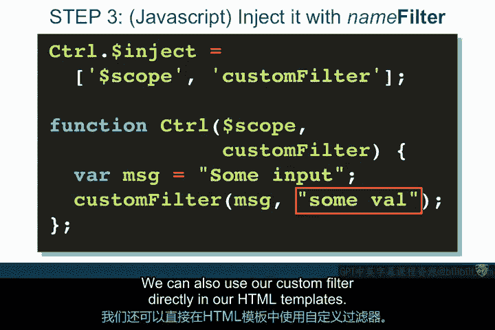
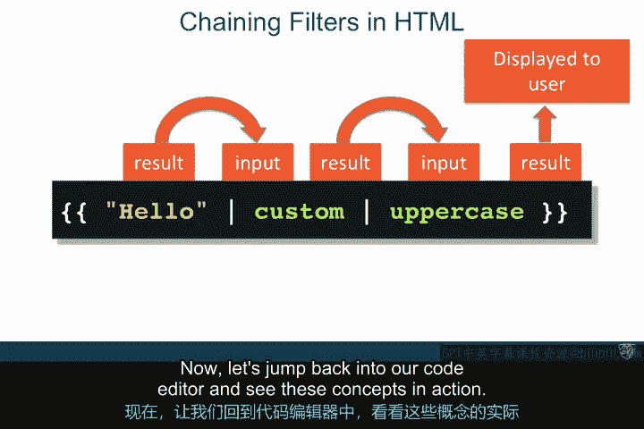
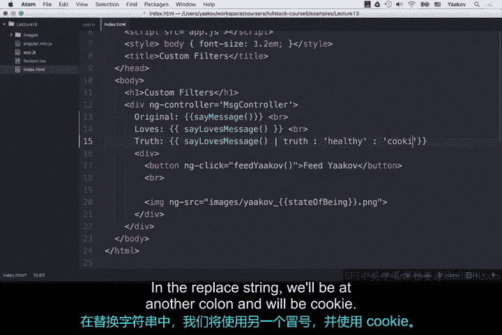
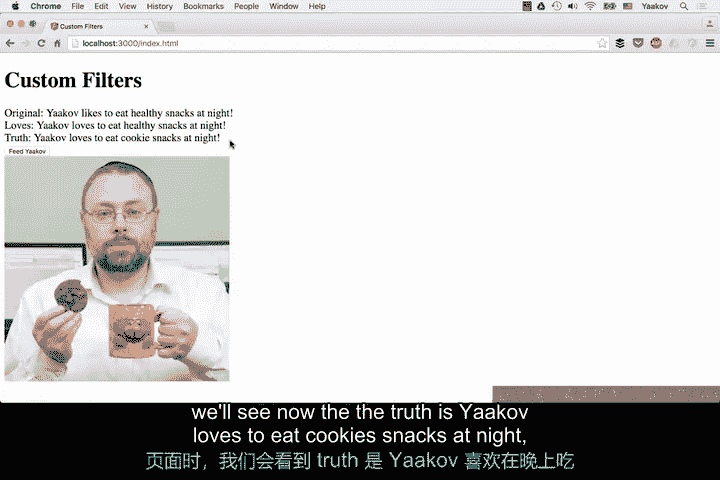
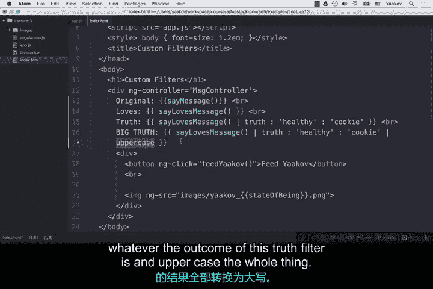
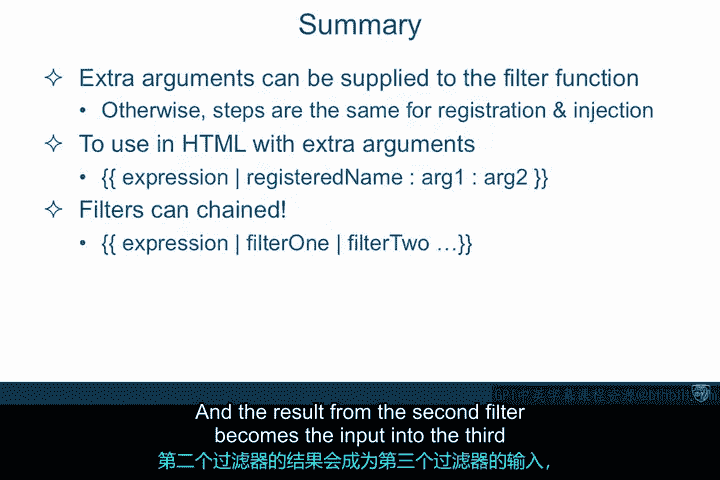

# 使用 AngularJS 开发单页 Web 应用：P26：创建自定义过滤器（第二部分）


在本节课中，我们将学习如何创建能够接受额外参数的自定义过滤器，以及如何在 HTML 模板中直接使用和链式调用过滤器。

## 概述

上一节我们介绍了如何创建和使用一个仅接收输入表达式作为参数的自定义过滤器。本节中，我们来看看如何创建一个能接受额外自定义参数的自定义过滤器。

## 创建带参数的自定义过滤器



创建带额外参数的自定义过滤器，其过程与之前基本相同。

以下是创建此类过滤器的步骤：

1.  **定义过滤器工厂函数**：与之前不同，这次工厂函数返回的过滤器函数除了第一个输入参数外，还可以接收额外的自定义参数。
2.  **注册过滤器工厂函数**：此步骤与之前完全相同，将工厂函数注册到模块中。
3.  **使用过滤器**：在控制器中注入过滤器，或在 HTML 模板中直接使用。使用时，除了输入值，还需提供额外的参数值。

## 在 HTML 模板中使用自定义过滤器

在 HTML 模板中使用自定义过滤器更为便捷，无需在控制器中注入。



以下是具体方法：

*   在 HTML 模板中，通过管道符 `|` 后跟过滤器注册名来使用过滤器。
*   无需在注册名后附加 `filter` 字样，Angular 会自动处理引用。
*   如需传递额外参数，只需在过滤器名后使用冒号 `:` 分隔并依次提供参数值。
*   过滤器可以链式调用，只需用管道符 `|` 将它们连接起来。前一个过滤器的输出会成为后一个过滤器的输入。

## 代码示例与实践

现在，让我们回到代码编辑器，通过实践来理解这些概念。

我们将创建一个名为 `truth` 的新过滤器，它允许用户指定要查找和替换的字符串。

首先，定义过滤器工厂函数：

```javascript
function TruthFilter() {
  return function(input, target, replace) {
    return input.replace(target, replace);
  };
}
```



接着，将这个工厂函数注册到模块中：



```javascript
angular.module('myApp', [])
  .filter('truth', TruthFilter);
```

现在，我们可以在 HTML 模板中直接使用这个过滤器。假设我们有一个变量 `message` 的值为 `"Yaakov loves to eat healthy snacks at night"`。

```html
<p>{{ message | truth:'healthy':'cookie' }}</p>
```

渲染结果将是：`Yaakov loves to eat cookie snacks at night`。

更进一步，我们可以链式调用过滤器。例如，先将 `message` 通过 `truth` 过滤器处理，再将结果转换为大写：



```html
<p>{{ message | truth:'healthy':'cookie' | uppercase }}</p>
```

最终输出将是：`YAAKOV LOVES TO EAT COOKIE SNACKS AT NIGHT`。

## 总结

本节课中我们一起学习了创建和使用 AngularJS 自定义过滤器的进阶知识。

我们回顾了创建自定义过滤器的步骤：首先定义过滤器工厂函数，然后将其注册到模块。要在 JavaScript 中使用自定义过滤器，需要将其注入到控制器中，注入名称为注册名后附加 `filter`。要在 HTML 中使用，则无需注入，直接通过管道符和注册名调用即可。

我们重点掌握了如何创建能接受额外参数的自定义过滤器，只需在工厂函数返回的过滤器函数中定义这些参数即可。在 HTML 中使用带参数的过滤器时，通过冒号分隔参数。

最后，我们了解了 AngularJS 一个非常强大的功能——过滤器链式调用。通过管道符连接多个过滤器，可以实现数据的连续处理。




通过本课的学习，你应能创建更灵活、功能更强大的自定义过滤器，并熟练地在模板中应用它们。