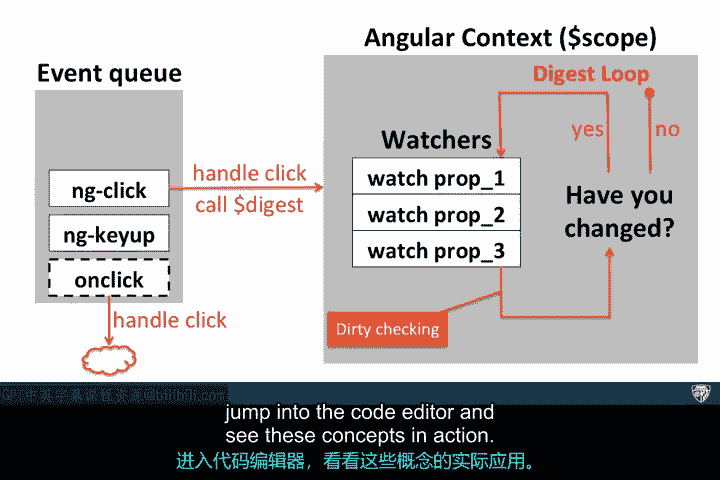
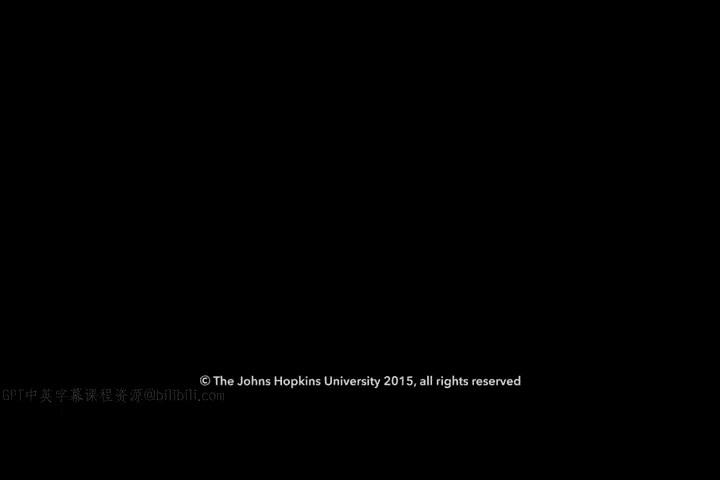

# 约翰霍普金斯大学《使用 AngularJS 开发单页 Web 应用｜Single Page Web Applications with AngularJS》中英 - P27：26_第14讲（第1部分）：脏检查周期.zh_en - GPT中英字幕课程资源 - BV1dsFDeZEQr

🎼。

Angular JS may seem a bit magical at first how does it know how to update some part of the web page when I type something into a text box Let's pull back the curtain and see a bit of how this magic works。

 It's always easier to understand how to use something when you understand how things work behind the scenes。

😊，We've seen this code set up before you declare some property using NG model attribute on an input element Now when the user types something in。

 the interpolation of the name property in the div below is magically echoed so how does that work Let's take a look at a diagram to understand the process and then we'll jump into the code and try it out。

😊，We're familiar with the event queue When a user clicks something or type something in those click and key press or up events go onto the event queue if inside the Angular application they use the regular method of catching those events and handling them in a regular JavaScript fashion。

 the angular app will not know that anything happened in our page。 however。

 the process is a bit different if we use the special directives as they're called like Enng key app or Nngcl which are events that are synonymous with a regular click and key app events。

 when we use NG key app or Nngcl those key app and click events will be handled by some handler that we bound to those events in the angular context。

 In other words， those handlers that are declared on the dollar sign scopepe or the scope service。😊。

But things don't stop there the angular context or the dollar sign scope has a special array of watchers that goes through every property on which a watch has been set up to check if any of the properties have changed as a result of the event that just happened。

Angular kicks off that process with a special function called doine digestigest。

There are a number of ways to trigger Angular to automatically set up these watchers for the properties we've defined on the dollar sign scope。

One that we've seen already is when you surround a scope property with double curly braces in your H。

 Another is when you specify anng dash model equal to some scope property。 In both circumstances。

 Angular will set up a function to watch for these changes to those properties。

 that function is called a watcher。 The digest goes through all the watchers and checks that everything is unchanged。

 If truly unchanged， the loop ends If something has changed。

 Angular goes through the whole list of watchers once again。

 This keeps repeating until all the watchers report that no changes occurred。

 So most of the time the s runs twice。 Once the detect that something changed and another time to make sure nothing is changed。

 The iteration over the watchers is called the digest loop。

 and the whole procedure is called the digest cycle。😊。

So why does the loop have to run yet another time to verify everything is unchanged Well。

 that's because one change can trigger something else to change and the digest cycle won't be able to detect it on the first try so for example。

 the change to property number three may trigger something that changes the value of property number two if at that point Angular already checked property2 and didn't see any changes。

 you won't know that it actually changed until another time through the loop。

This process is actually very common in game development and is cold dirty checking Once the final digest loop runs and verifies that nothing has changed in any of the watchers。

 Angular updates the dom whatever values have changed， repains parts of the page。

 and you see the updated page in front of you。Well， that's enough theory。

 in part two of this lecture， we'll jump into the code editor and see these concepts in action。

