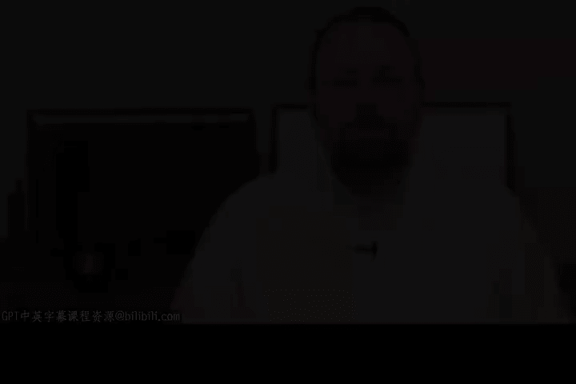
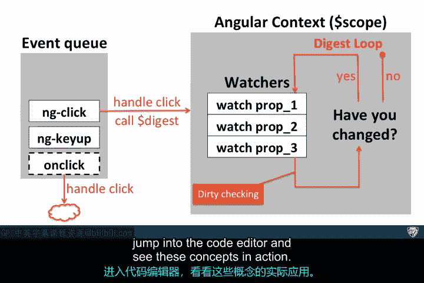

# 使用 AngularJS 开发单页 Web 应用：P27：第14讲（第1部分）：脏检查周期 🔄

在本节课中，我们将要学习 AngularJS 的核心机制之一——脏检查周期。我们将揭开 AngularJS 如何自动更新页面的神秘面纱，理解其背后的工作原理。

---

AngularJS 起初可能显得有些神奇：当我在文本框中输入内容时，它如何知道更新网页的某个部分？让我们拉开帷幕，看看这个魔法是如何运作的。

理解事物背后的工作原理，通常能帮助你更好地使用它。

## 从现象到原理

我们之前见过这段代码：你在一个输入元素上使用 `ng-model` 属性声明了一个属性。当用户输入内容时，下方 `div` 中对 `name` 属性的插值就会神奇地同步更新。这是如何实现的呢？让我们通过一张图来理解这个过程，然后我们将深入代码进行实践。

## 事件队列与 Angular 上下文

我们熟悉事件队列。当用户点击或输入时，这些点击和按键事件会进入事件队列。如果在 Angular 应用内部，我们使用常规的 JavaScript 方法来捕获和处理这些事件，Angular 应用将不会知道页面上发生了任何变化。

然而，如果我们使用特殊的指令，过程就有所不同。这些指令被称为 `ng-keyup` 或 `ng-click`，它们与常规的 `keyup` 和 `click` 事件同义。

当我们使用 `ng-keyup` 或 `ng-click` 时，这些 `keyup` 和 `click` 事件将由我们在 Angular 上下文中绑定到这些事件的处理器来处理。换句话说，这些处理器是在 `$scope` 服务上声明的。

## 脏检查与 `$digest` 循环

但事情并未就此停止。Angular 上下文或 `$scope` 有一个特殊的观察者数组。它会遍历所有设置了观察的属性，检查是否有任何属性因刚刚发生的事件而改变。

Angular 通过一个名为 `$digest` 的特殊函数来启动这个过程。

有多种方式可以触发 Angular 为我们定义在 `$scope` 上的属性自动设置这些观察者。

以下是设置观察者的两种常见方式：

*   **插值表达式**：当你在 HTML 中用双花括号 `{{ }}` 包裹一个 `$scope` 属性时。
*   **`ng-model` 指令**：当你指定 `ng-model="someScopeProperty"` 时。

在这两种情况下，Angular 都会设置一个函数来监视这些属性的变化，这个函数被称为 **观察者**。

`$digest` 循环会遍历所有观察者，检查是否一切未变。如果确实没有变化，循环结束。如果某些内容发生了变化，Angular 会再次遍历整个观察者列表。这个过程会不断重复，直到所有观察者都报告没有发生变化。

因此，大多数情况下，`$digest` 循环会运行两次：一次检测到变化，另一次确保没有其他变化。遍历观察者的过程被称为 **`$digest` 循环**，整个流程被称为 **脏检查周期**。

## 为什么需要多次循环？

那么，为什么循环需要再次运行以验证一切未变呢？这是因为一个变化可能触发其他变化，而脏检查周期在第一次尝试时可能无法检测到。

例如，对属性三的更改可能触发属性二的值发生变化。如果此时 Angular 已经检查过属性二并且没有发现任何变化，那么它只有在下一次循环中才会知道属性二实际上已经改变了。

这个过程在游戏开发中实际上非常常见，被称为 **脏检查**。一旦最终的 `$digest` 循环运行并验证所有观察者中没有任何变化，Angular 就会更新 DOM 中已改变的值，重新绘制页面的相关部分，你就能在眼前看到更新后的页面了。

理论已经足够，在本讲的第二部分，我们将进入代码编辑器，亲眼看看这些概念的实际运作。

---

本节课中，我们一起学习了 AngularJS 脏检查周期的核心概念。我们了解到，通过 `$digest` 循环，Angular 能够自动追踪数据变化并更新视图。关键在于观察者列表和循环检查机制，这确保了即使一个变化引发连锁反应，视图最终也能正确同步。理解这个机制，将帮助你更好地编写和调试 AngularJS 应用。