# 约翰霍普金斯大学《使用 AngularJS 开发单页 Web 应用｜Single Page Web Applications with AngularJS》中英 - P28：27_第14讲（第2部分）：脏检查周期.zh_en - GPT中英字幕课程资源 - BV1dsFDeZEQr

🎼。

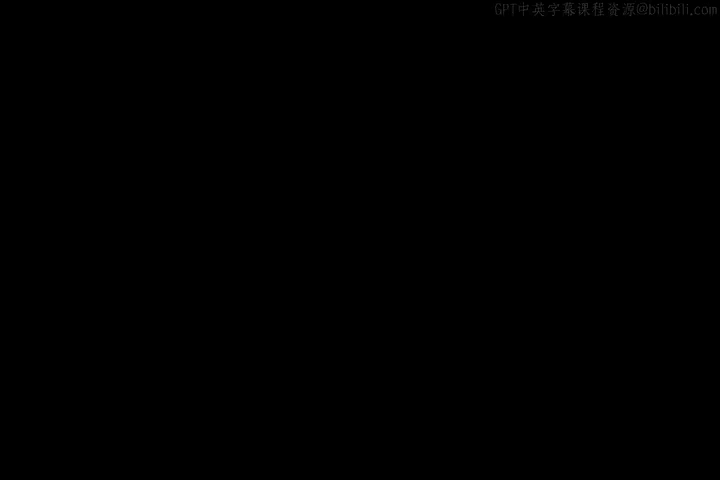

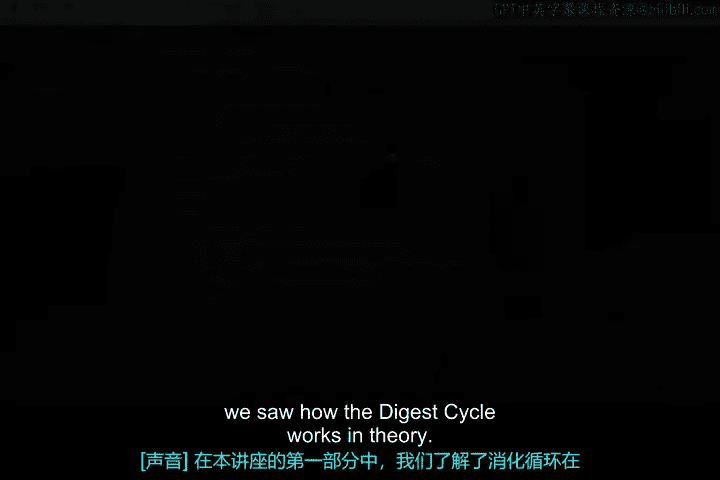

In part one of this lecture， we saw how the digest cycle works in theory。In part two of this lecture。

 we're going to dive in into the code and see a bit of a practice of how this actually gets implemented。

😊，I'm located in lecture 14， which is located in Fulltag dash Cose 5 examplesles folder and here I have a very simple Angular JS app setup called Count app and I have one controller called counter controllerroller so far all we have really in our page is a button that has an NG click bound to this function called show number of watchers function。

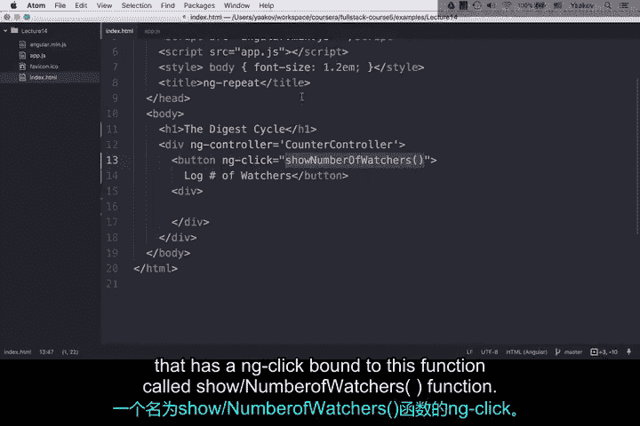

And if we go to the browser， nothing' is actually going to happen because we haven't implemented that function yet。

 So let's go ahead and go to Ab do Js and see that we already have the stop for this function here and for now all we'll do is we'll do logging of just the scope itself the scope service if we go back to our page and click number of watchers you'll see that the scope service or the scope object was output in the console So let's take a look inside of it a little bit So one of the things we see here you could see our show number of watchers function。

 but there's something else here。 you see dollar sign dollar sign watchers and that's an array that at this point is simply null and you see another dollar sign dollar sign watchers count and that's account of how many objects are there in this watcherss array and you could see right now it's still zero Now the dollar sign dollar sign the double dollar sign is always indicative of something that is internal to Angular JS。

😊。

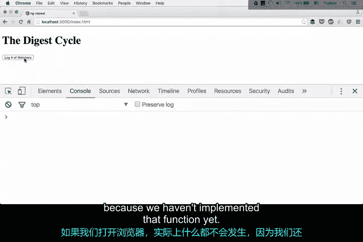

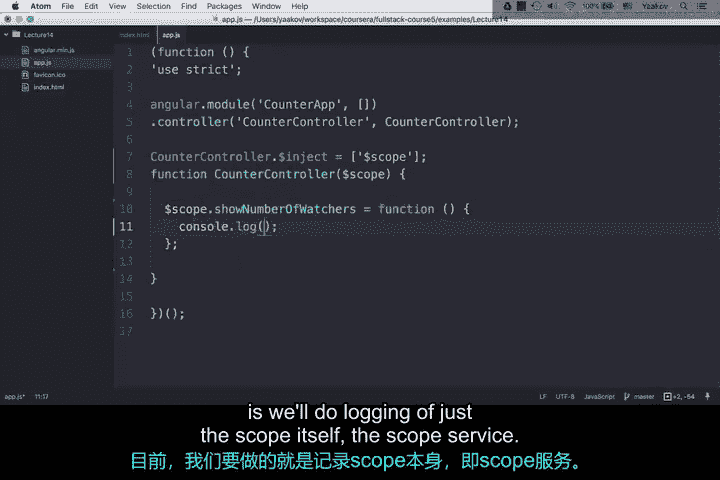

Which means you should never interact with this directly。 However， in this lecture。

 we will interact with it directly just to see what is going on behind the scenes Since we don't really need this entire object。

 we just need the number of watchers count。 We'll go ahead and modify our code to say。😊。

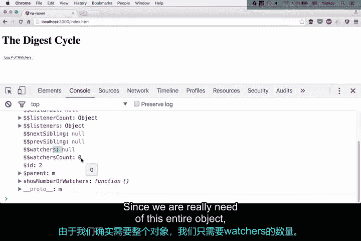

Scope， dollar sign scope do dollar sign dollar sign watchers count。

 and maybe we'll even put a little label here， number of watchers。Okay。

 so if we save that and go back and click this button now now we see number of watches is zero for now let's go back to Abdo Gs and declare a property on Sc called1 counter and we'll equal it to0 to start。

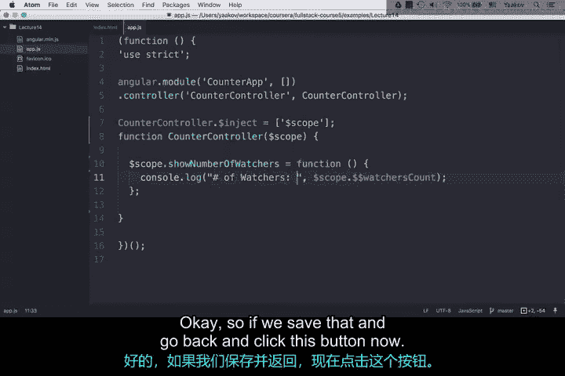

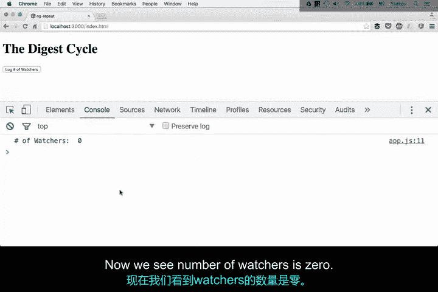

In our index at HTML we'll create a button which I cut and pasteed from before that is going to have an N click bound to it with a function called count once that is obviously this guy has to sit on the dollar sign scope so let's save that we'll copy this and we'll go back to our Abdot JS and we'll actually create this function on a dollar sign scope we'll create count once and that's going to be a function we don't need the name。

And know what function is going to do is assign one to our once counter。

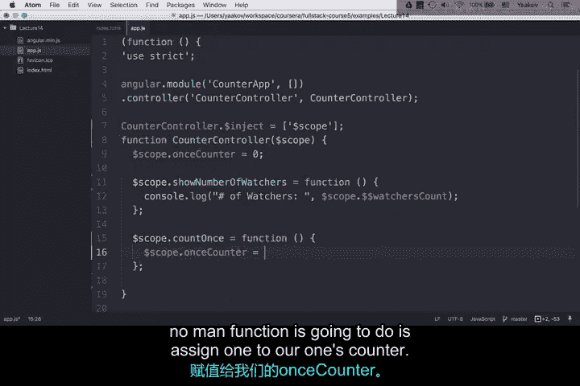

When we save that， go back to our browser， they see that before we click the number of watchers at zero after we click once counter。

 so now our once counter is equal to one， we click the number of watchers again and it is still zero。

 so that didn't really affect the number of watchers we have。

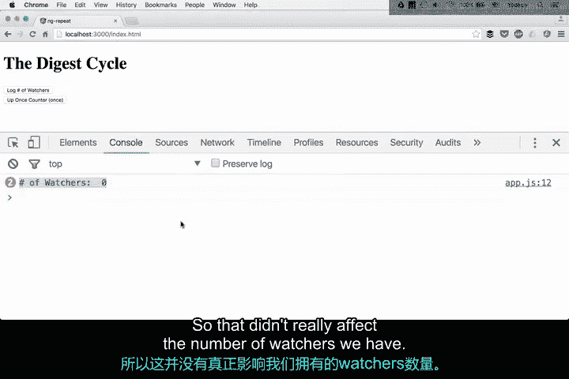

To set up the watchers， there's a couple ways to do that。

One way of doing it is doing it manually for that， there is a special function on the scope service called dollar sign watch。

 and it takes two arguments。 The first one is the name of the property we want to watch in this case is once counter and the second argument is the function that is going to watch these argument which has two values new value。

😊，And old value passed to it by the angular context。 So if we go ahead and log that now。

 we'll say old value。And it's old value， and we'll do it again and saying this time we'll say new value。

New value。If we save that now， so now we've set up a watch for our once counter。

 if we go back to our app， you'll see that the second we refresh the page。

 we already see the old value being0 and the new value being0 meaning something already was already has executed one of our watches if we click the number of watches right now you'll see that the number of watches is now no longer0 it is1 and if we click the up once counter you'll see that our watch gets triggered and the old value0 but the new value is1 if we click the number of watches still1 and if we keep clicking this up once counter。

 you see that nothing else is showing up the reason it's not showing up the reason the old value and the new value is not being printed out anymore is because we only update this once and once we updated once our watch no longer sees the once counter is changing and therefore this function is no longer firing。

😊。

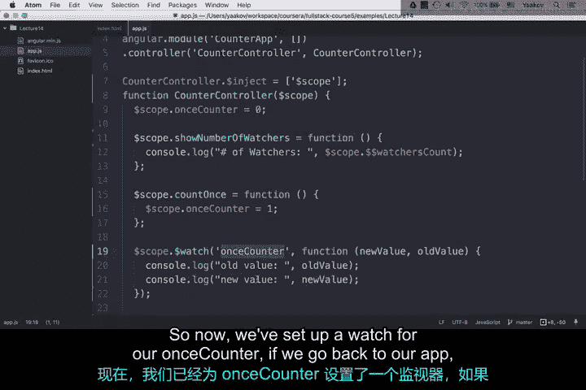

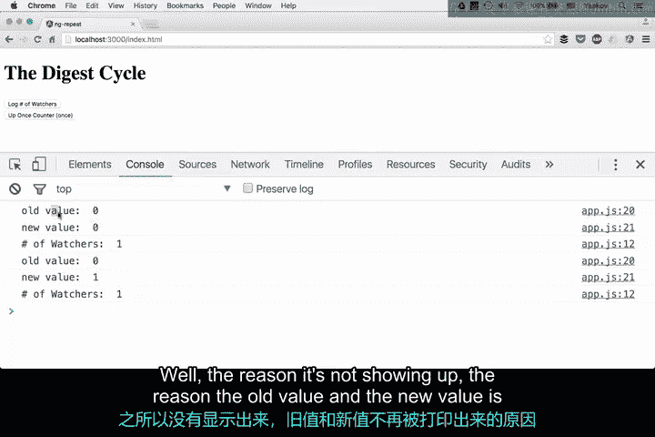

we could declare another property and we'll call it scope do counter and we'll also start it with a0 and this time we'll create a handler that when a button gets clicked。

 this property gets incremented by one every time so let's go ahead and place this right here。

 we'll say scope do app counter equal to a function。And again， when I need the name。

 we'll go ahead and say scope that counter。And we'll say just plus， plus。

Let's save that and then let's provide another button right here， we'll just copy this one。

And this time we'll say app counter。And we'll say。Increment。Counter。We'll save it。

 Let's go back to our page As you could see the once counter when it got initialized。

 got its value of 0 and a new value of 0 before there was no value。

 And if I say increment counter now， you'll see that nothing's really going on on a page。

 And if I say number of watchers。 It's still one。 Well。

 it's because we haven't really set up a watch for counter number two。

 Let's go back to our Abda Js and actually set up a watch for our counter property。

 we'll go ahead and just copy that watch。😊。

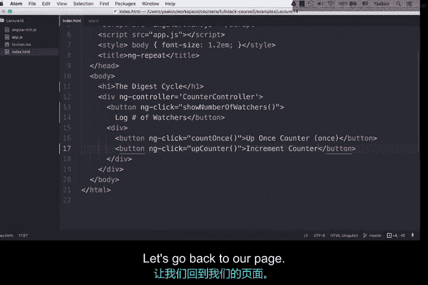

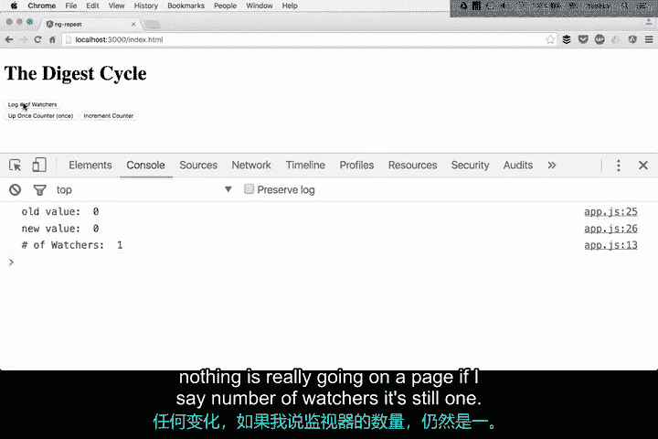

We'll paste it in this case is just going to be just counter and we'll see it's new and old value let's save that。

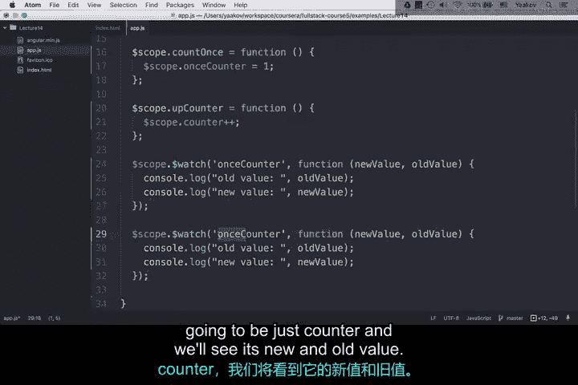

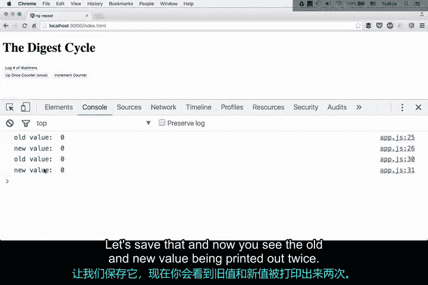

And now you see the old new value being printed out twice。

 we probably should differentiate and say this is counter old value and counter new values so you could see better and this is once counter old value and once counter new value。

 let's save that and now you could see that once counter old value， once counter new value。

 counter and then encounter new value。

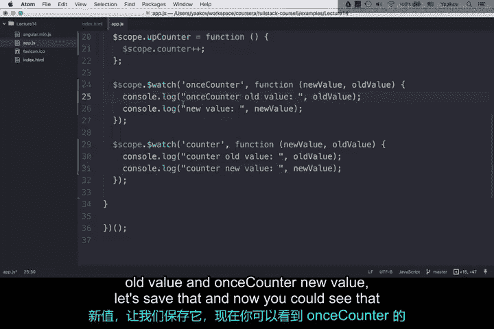

So if we click the number of watchers now， you'll see that now there's number of watchers too。

 and if we increment the counter， you'll see the first time it says counter all value 01。

 click it again， now it's for old value 12 and if we keep clicking it's going to keep changing every single time。

So in part two of this lecture we've learned how to set up watchers manually using the Doar sign watch function in part three of this lecture we'll see a couple more mechanisms that let us tell Angular JS to set up these watchers for us。

😊。

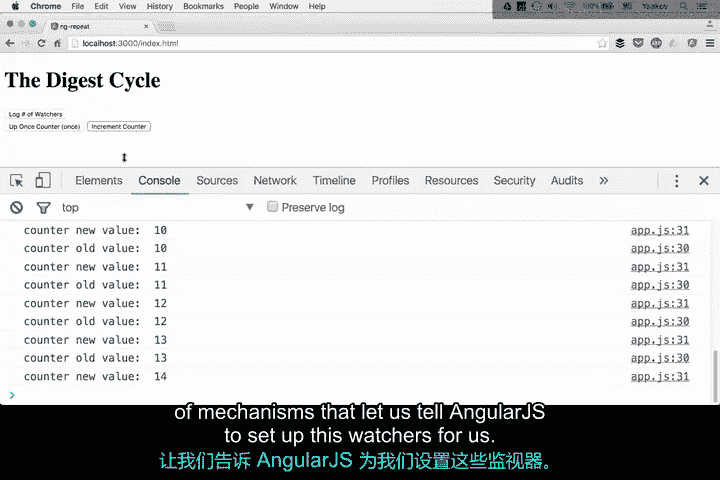

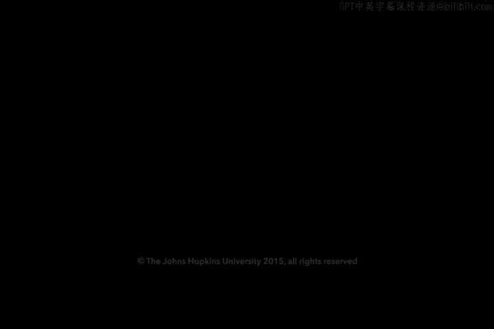