# 使用 AngularJS 开发单页 Web 应用：P28：第14讲（第2部分）：脏检查周期

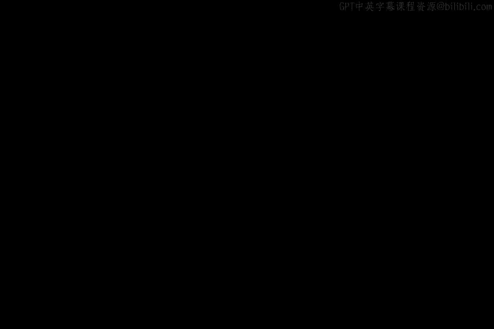

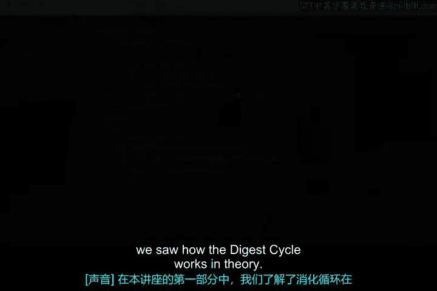

在本节课中，我们将深入代码，学习 AngularJS 中脏检查周期的实际实现方式。我们将通过一个简单的示例应用，手动设置观察者，并观察它们如何工作。

---

上一节我们介绍了脏检查周期的理论基础。本节中，我们来看看如何在代码中实际设置和使用观察者。

我位于第14讲的示例文件夹中，这里有一个名为 `Count app` 的简单 AngularJS 应用。目前，页面中只有一个按钮，它通过 `ng-click` 绑定了一个名为 `showNumberOfWatchers` 的函数。


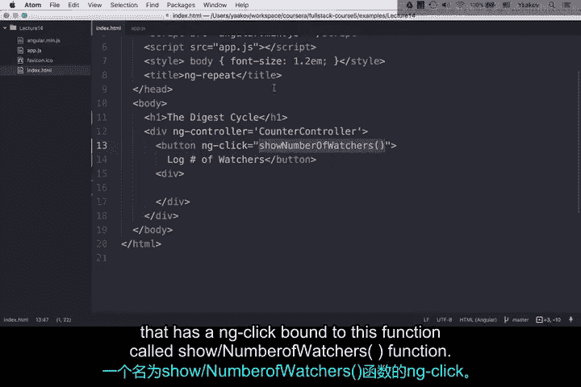


在浏览器中，点击按钮暂时不会有任何反应，因为我们还没有实现这个函数。让我们转到 `app.js` 文件，可以看到这个函数的框架已经存在。目前，我们只是简单地记录 `$scope` 服务本身。

```javascript
$scope.showNumberOfWatchers = function() {
  console.log($scope);
};
```

回到页面并点击按钮，你会在控制台中看到输出的 `$scope` 对象。让我们仔细查看一下这个对象。


在 `$scope` 对象中，我们可以看到 `showNumberOfWatchers` 函数。此外，还有两个以双美元符号 `$$` 开头的属性：`$$watchers` 和 `$$watchersCount`。`$$watchers` 是一个数组，目前是 `null`。`$$watchersCount` 则记录了观察者数组中的对象数量，目前是 `0`。

双美元符号 `$$` 表示这是 AngularJS 内部的属性，意味着你不应该直接与它们交互。然而，在本讲座中，我们将直接与它们交互，以便了解幕后的工作原理。

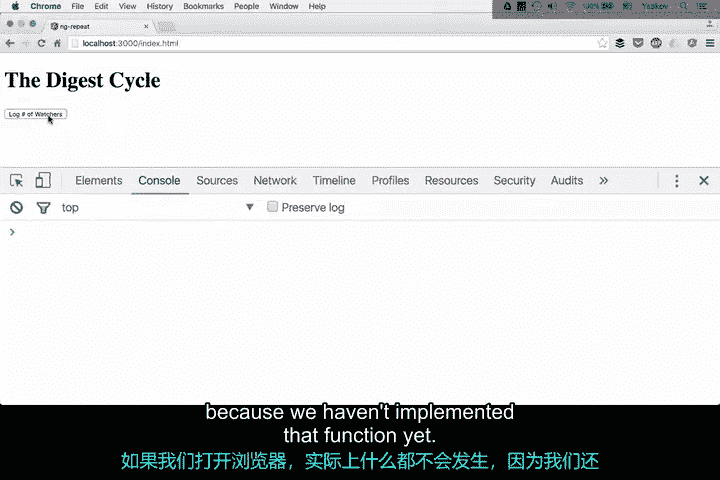

由于我们不需要整个对象，只需要观察者的数量，因此我们将修改代码，只记录 `$$watchersCount`。

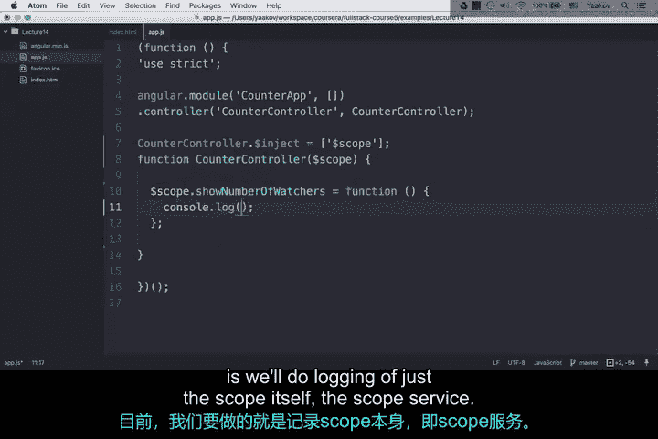

```javascript
$scope.showNumberOfWatchers = function() {
  console.log("Number of watchers: " + $scope.$$watchersCount);
};
```

保存后，点击按钮，现在会显示“Number of watchers: 0”。

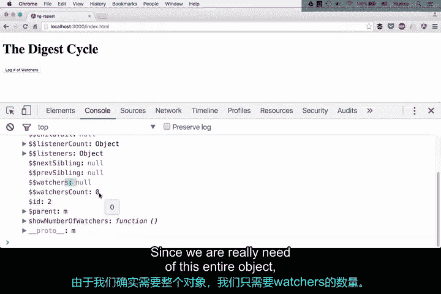

接下来，让我们在 `$scope` 上声明一个属性。回到 `app.js`，添加一个名为 `onceCounter` 的属性，并将其初始值设为 `0`。

```javascript
$scope.onceCounter = 0;
```

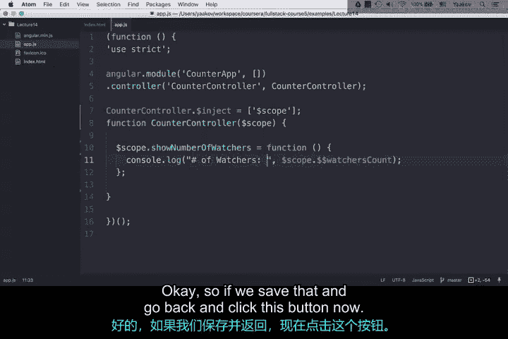


在 `index.html` 中，我们创建一个按钮，其 `ng-click` 绑定到一个名为 `countOnce` 的函数。

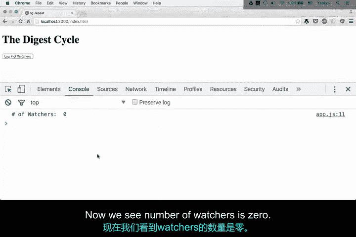

```html
<button ng-click="countOnce()">Up Once Counter</button>
```

显然，这个函数需要定义在 `$scope` 上。让我们回到 `app.js` 创建它。

```javascript
$scope.countOnce = function() {
  $scope.onceCounter = 1;
};
```

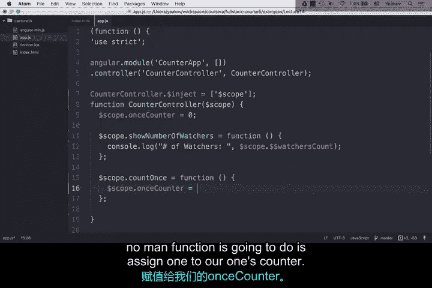


保存后，回到浏览器。点击“Number of watchers”按钮，显示为0。然后点击“Up Once Counter”按钮，`onceCounter` 的值变为1。再次点击“Number of watchers”，观察者数量仍然是0。这说明仅仅设置属性并不会自动创建观察者。

要设置观察者，有几种方法。其中一种方法是手动设置。`$scope` 服务上有一个特殊的函数 `$watch` 用于此目的。

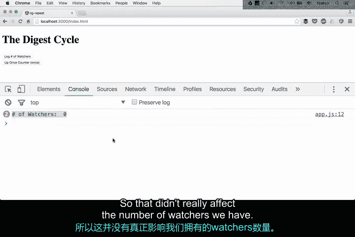

`$watch` 函数接受两个参数：
1.  第一个参数是要监视的属性名（字符串形式）。
2.  第二个参数是监视函数，AngularJS 会将属性的**新值**和**旧值**传递给它。

让我们为 `onceCounter` 设置一个观察者。

```javascript
$scope.$watch('onceCounter', function(newValue, oldValue) {
  console.log('Old value: ' + oldValue);
  console.log('New value: ' + newValue);
});
```

保存代码。现在，我们为 `onceCounter` 设置了一个观察者。

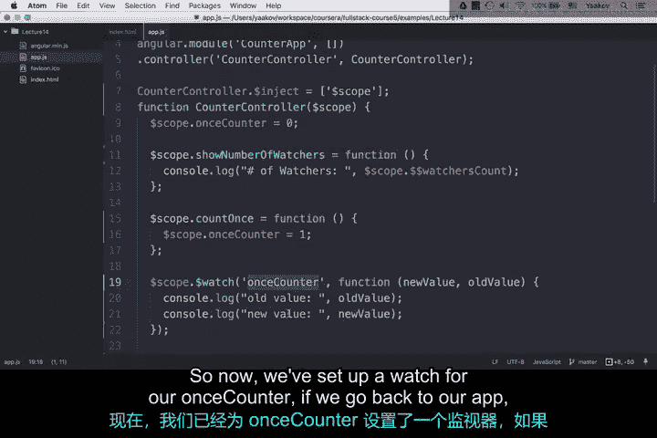

回到应用并刷新页面，你会立即在控制台看到输出：“Old value: 0”和“New value: 0”。这意味着我们的观察者函数在初始化时已经执行了一次。

现在点击“Number of watchers”按钮，你会看到观察者数量变成了1。

点击“Up Once Counter”按钮，观察者被触发，控制台输出：“Old value: 0”和“New value: 1”。

再次点击“Number of watchers”，数量仍然是1。

如果你继续点击“Up Once Counter”按钮，控制台不会再输出新的值。这是因为 `onceCounter` 的值被设置为1后就不再改变，观察者检测不到变化，因此函数不再执行。

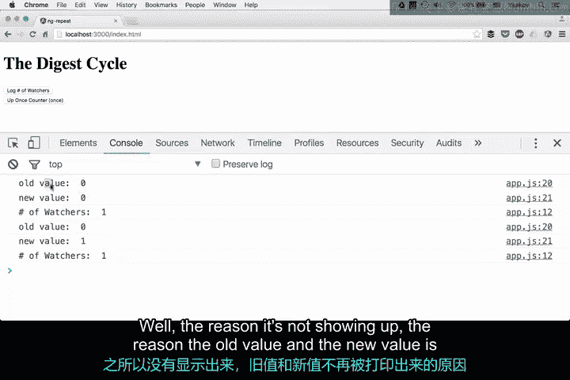

现在，让我们声明另一个属性，并创建一个每次点击都会递增的处理器。


在 `app.js` 中，添加 `counter` 属性。


```javascript
$scope.counter = 0;
```

然后创建递增函数。

```javascript
$scope.incrementCounter = function() {
  $scope.counter++;
};
```

在 `index.html` 中添加对应的按钮。

```html
<button ng-click="incrementCounter()">Increment Counter</button>
```

保存后回到页面。点击“Increment Counter”按钮，页面上没有任何反应。点击“Number of watchers”，数量仍然是1。这是因为我们还没有为 `counter` 属性设置观察者。

让我们回到 `app.js`，为 `counter` 属性也设置一个观察者。

```javascript
$scope.$watch('counter', function(newValue, oldValue) {
  console.log('Counter old value: ' + oldValue);
  console.log('Counter new value: ' + newValue);
});
```

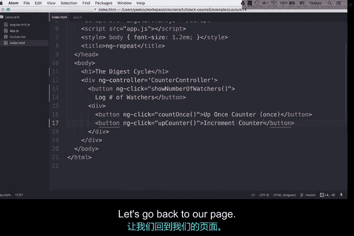

为了更好地区分，我们也修改一下 `onceCounter` 观察者的日志信息。

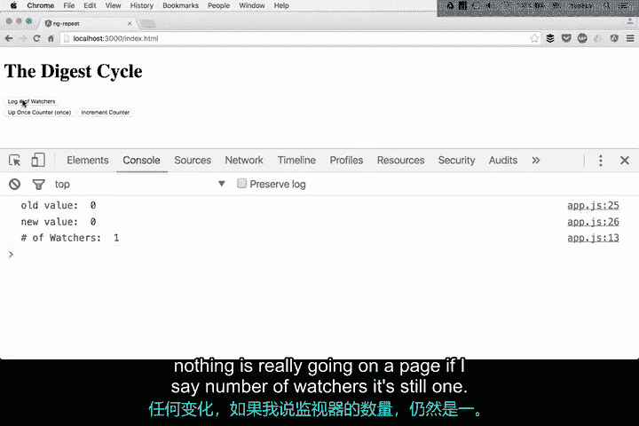

```javascript
$scope.$watch('onceCounter', function(newValue, oldValue) {
  console.log('Once counter old value: ' + oldValue);
  console.log('Once counter new value: ' + newValue);
});
```

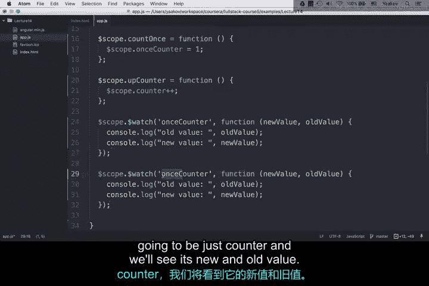

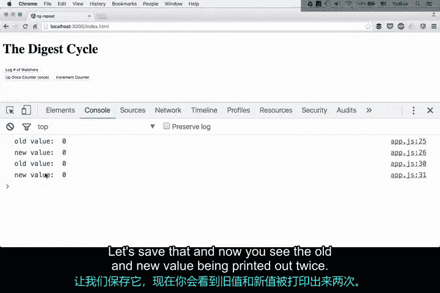


保存代码。刷新页面后，你会看到两组初始化日志。

现在点击“Number of watchers”按钮，观察者数量显示为2。

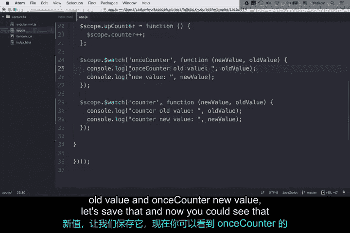

点击“Increment Counter”按钮，你会看到控制台输出 `counter` 的旧值和新值（例如：0 -> 1）。每次点击，值都会更新并触发观察者函数。


---

本节课中我们一起学习了如何使用 `$watch` 函数手动设置观察者，并观察了属性变化如何触发脏检查。在下一部分，我们将探讨更多由 AngularJS 自动为我们设置观察者的机制。

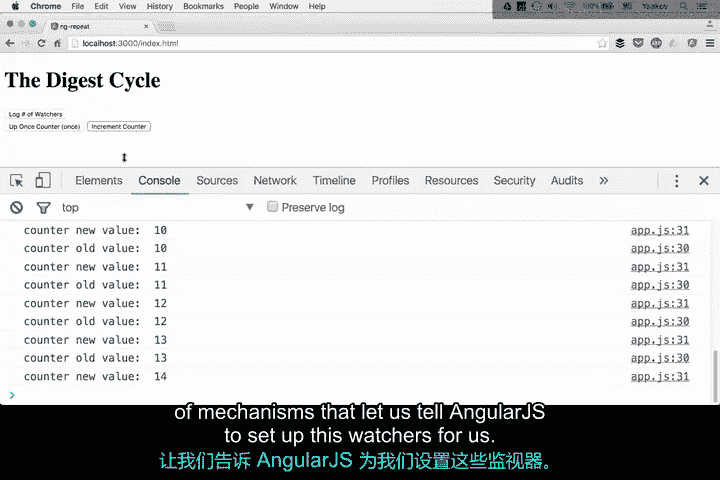


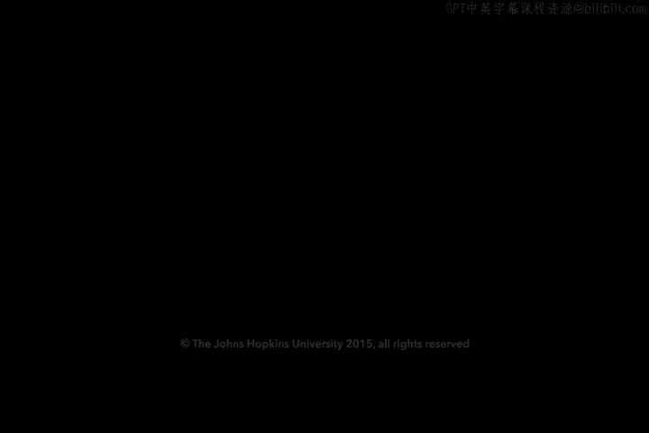

