# 约翰霍普金斯大学《使用 AngularJS 开发单页 Web 应用｜Single Page Web Applications with AngularJS》中英 - P29：28_第14讲（第3部分）：脏检查周期.zh_en - GPT中英字幕课程资源 - BV1dsFDeZEQr

🎼。

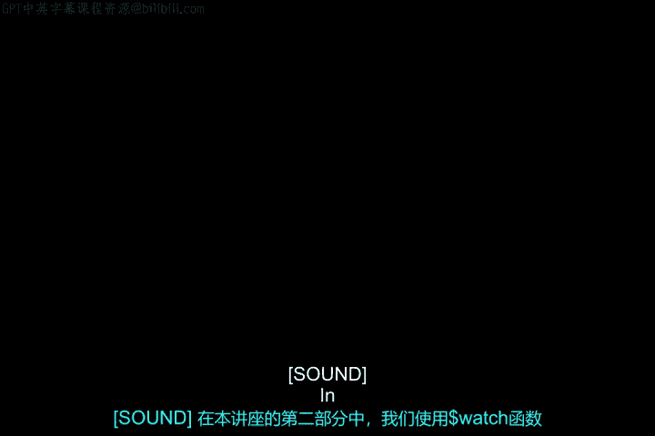

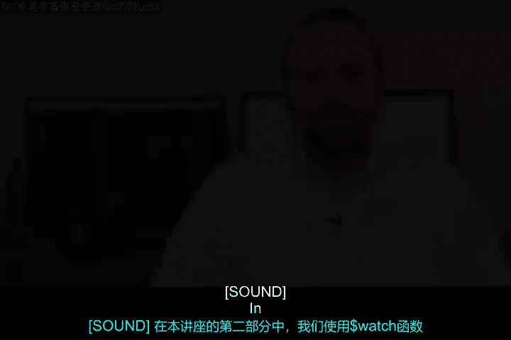

In part two of this lecture we've set up watchers using the dollar sign watch function。

 but that's not the best way of setting up watchers inside of the controller function AngularGS has a more automated way of going about it。

 which we will take a look at now。😊，Now the way we've set up these watches is actually not a recommended way at all。

 you should never have these dollar sign watch functions executed inside of your controller and the reason that is this controllers and the templates or indexex at HTML already have mechanisms that automatically set up these watches for us so how can we do this Well one way you could do this is let's go ahead and comment this out。

😊，And save that， let's go to index at HTML and we'll just open up another div right here and inside the div will say once counter and we'll say interpolation with once counter and we'll put an ugly break here but that will work。

 we'll say regular counter and again we'll say just counter。So now when we go back。

 even though we don't have any more watchers that are at least manual watchers set up。

 if we go back to our HTML page and go ahead and click number of watchers。

 you'll see the number of watchers is still too， and as we keep doing the once counter you see we'll never change but it changed once and the increment counter as you could see is going as many times as we want as we're clicking our increment counter button。

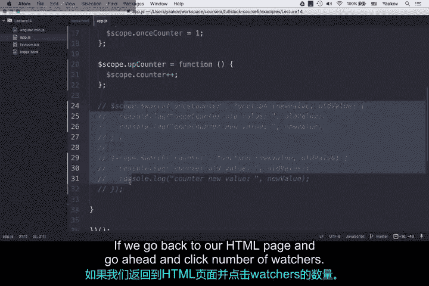

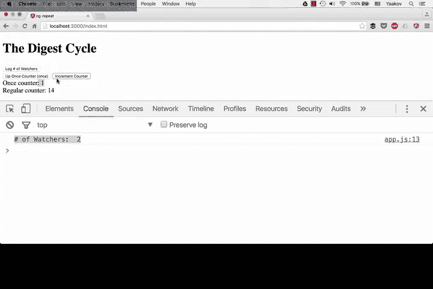

Now there's a really cool trick to actually kind of tie in into the digest loop and to see when it's actually getting executed so far。

 all we've seen is how our watch is being executed But what about the digest loop Well。

 the way we could do this is the following if we say scope that dollar sign watch and now instead of giving it a real property over our scope we'll give it a function。

😊，Because this function is something that is supposed to return the name of the property to watch。

 which means every time through the loop， the digest cycle will want to figure out what property is that and execute it so that means we could catch when the digest loop is actually going through all these watchers so all we have to do is really provide one function and we'll say here。

 log， digest loop fired。

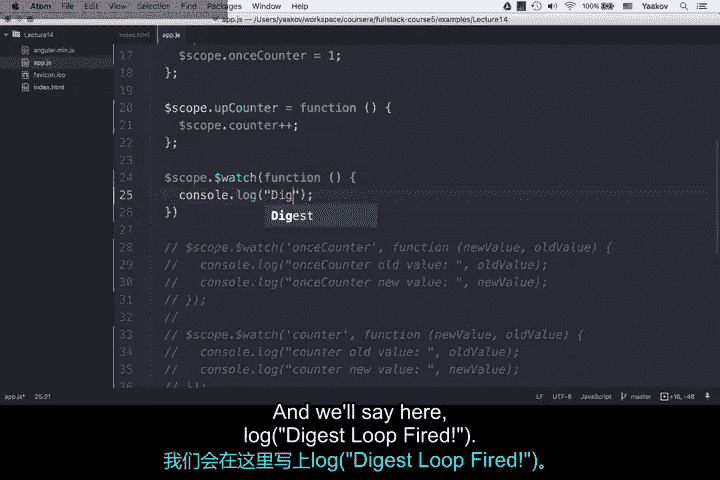

Let's say that。 I'm gonna go back。 You'll see the digest loop already fired twice before we even started anything。

 And the reason that is， is that we go back and look as to what's going on here。

 since our watchers are being set up by the interpolation double curly braces when we have the scope that once counter equals0。

 that means this property gets changed。 And so does this。

 So which means there's already a one time that the properties get changed。

 And since we know that one time things are changing， it will go once through the loop。

 and then we'll go through the loop one more time just to see that everything is clean。

 there's no dirty values， meaning nothing is changed anymore。

 that's why you see here the loop digest loop fired twice。 Now， if we click one up once counter。

 you'll see that again it fired twice because one time was for changing the actual counter and another time to see that nothing is changed Now now that I know that it's changed and will not。

😊。

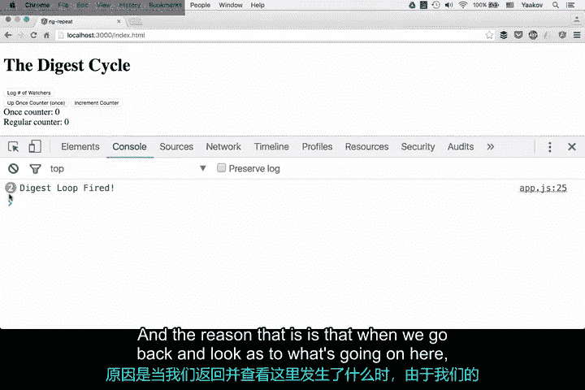

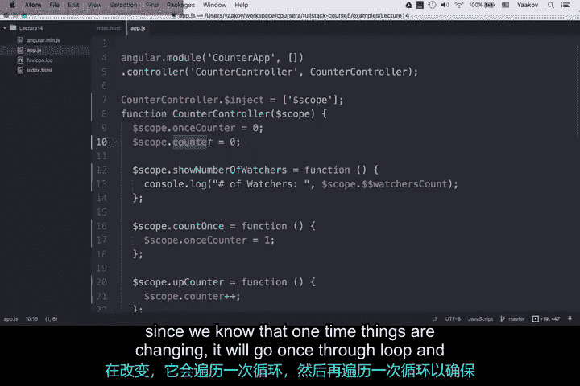

Again， if I click up once counter again， you'll see that it's only changing once。

 Let's actually clear that and you'll see that the digest loop is only getting fired once。

 Let's clear it again and still only get fired once。

 And the reason that is is that through the first time that the digest loop fires。

 it sees that nothing really has changed。 However， if we say increment counter。 Well。

 it's gonna to fire twice once for checking that the counter actually got incremented and once to see that nothing else is changed。

 If we click it and we clear that again， click it again。

 it will once again see that the counter changed。 and then we'll run through all the watchers once again to see that nothing else is changed。

 And therefore every time I click， you'll see that the number of times。

 this console log will get printed out is going to be incrementing by two。 So 6，8，10 and so on。

 In other words， every time I click， there's going be two times that the digest loop goes through the watchers to make sure that everything is updated。

😊。

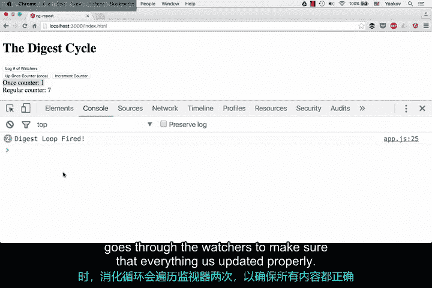

Properly。So now we've seen two ways as to how to set up these watches。

 one is to do it manually through these dollar sign watch functions。

 which are not recommended to be done inside a controller。

 however you could do it inside of a service which we haven't yet covered or a directive or component and the second way is to actually just interpolate using double curly braces some property and that automatically or Angular J has automatically sets up a watch for you because it knows that once this property changes it will need to update the DOm and update your page。

 so therefore a watch is required。There's a third way to set up a watch and that is simply having an input element with an NG model。

 and Nng model is what's called a two way binding and we're going to talk about that in a minute so if I say NG model and it's going to be equal name if I save that and actually create a name right here so we could see something for that property we'll say scope dot name and we'll equal to yaakov。

😊。

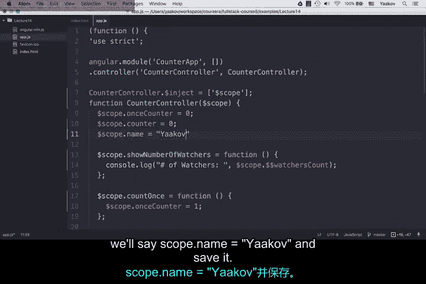

And save it。 if we go back， you'll see the digest again fire twice。

 but that's because we've initialized things here。 If we click on number of watchers。

 you'll see that number of watchers is now four So where did you get number four。

 Well let's go back and take a look at our code。 and let's start counting。

 The first one is the input field that we set here with the Nng model name。

 The second one is the once counter with interpolation。

 The third one is the counter again with interpolation。

 and the fourth one is actually our trick that we made in order for us to watch the digest loop。

 This is also a watch that we're setting up So that's the fourth one。😊。

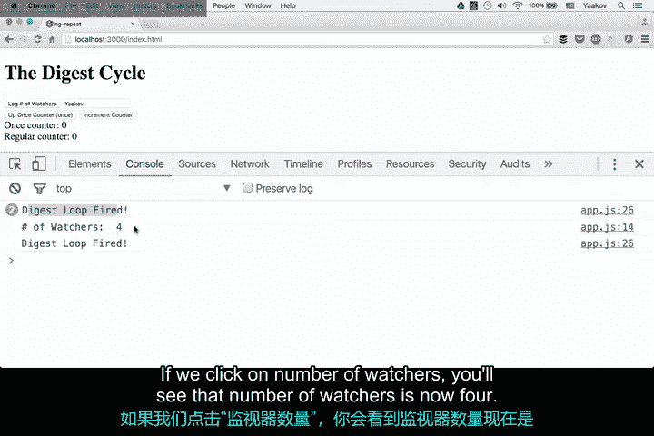

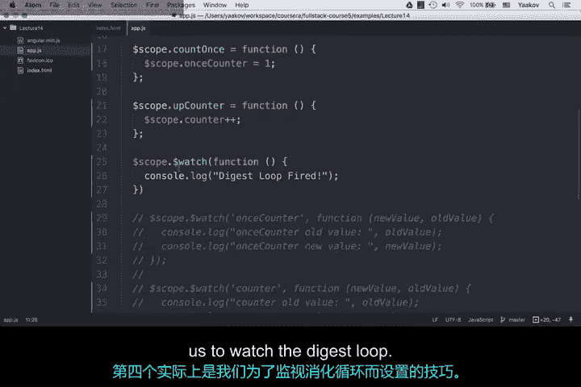

And if we go back to our page， if I start typing in that field。

 you'll see that every time I type the digest loop gets fired twice。

 in fact let's go ahead and clear that and if I start typing anything you'll see that the digest loop fired twice again idea is the same once it fires because we change something about the property that's being washed which is our name property right here and the second time it fires to make sure no other properties were triggered and changed as a result of the first change so every time we type the digest loop will run twice once because of the change and the second time to verify that nothing else has changed in the entire list over the watchers that we have。

So let's summarize so in this lecture we spoke about the digestig cycle which is basically running these digest loops over and over until all watchers report that nothing has changed and this whole process is really not specific to AngjS is really in general called dirty checking to make sure that every one of the watchers is no longer dirty meaning the values have not changed we also saw several ways to set up these watchers that watch a particular property that is set on the dollar sign scope One way to do that is to directly call the dollar sign watch function on the dollar sign scope object and you never want to do this in a controller and the only reason we did this is because that's all we learned about up until this point but it' not a good practice to do that and the reasons not a good practice to do that again is because controllers and templates have their own ways to deal with watchers and set them up for example。

 another way we learned about it is simply to interpolate some property inside the HTML。

empThat alone sets up a watch。Also， if you have an input element that has an NG dash model declared on it。

 that property that is declared an NGD model will have a watch associated with it because Angr will set one up for you。

Now remember everything we've discussed only applies to things done inside of the angular context。

 if the event triggered the whole process， even updating some property inside of the dollar sign scope。

 that is not an angular type of event， it's not triggered inside the angular infrastructure。

 the angular digestig cycle will not know to run and therefore nothing will show to be updated until the next time the digestig cycle runs because of some other events and then it will repaint the browser with the proper values that are already sitting there。

 but it will not show up to the browser immediately because the digestig cycle needs to be kicked off and it only knows to get kicked off if it's inside the angular context。

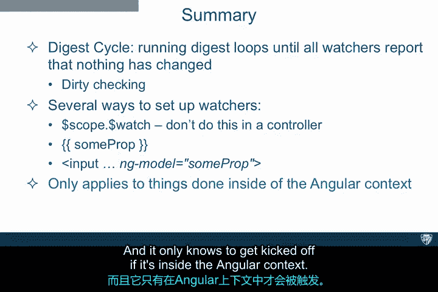

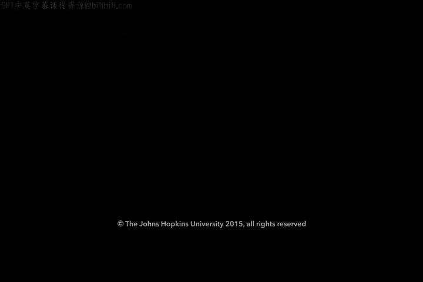