# 使用 AngularJS 开发单页 Web 应用：P29：第14讲（第3部分）：脏检查周期 🔄

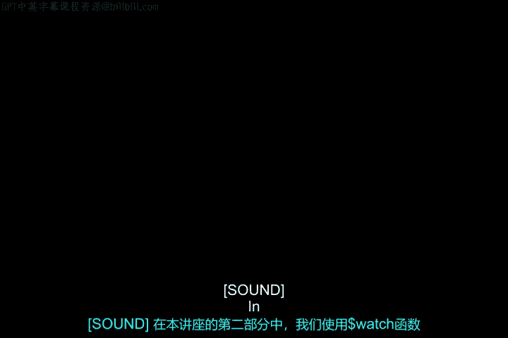

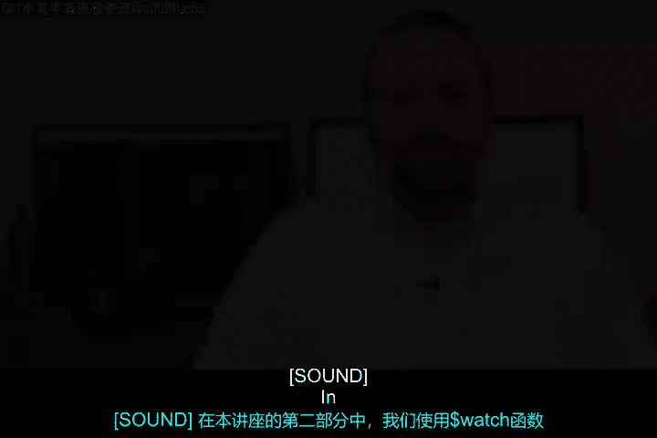

在本节课中，我们将要学习 AngularJS 的核心机制之一——脏检查周期（Digest Cycle）。我们将探讨如何设置监视器（watchers），以及 AngularJS 如何自动管理这些监视器来更新视图。

---

## 自动设置监视器

上一节我们介绍了如何使用 `$watch` 函数手动设置监视器，但这不是在控制器中设置监视器的推荐方式。AngularJS 提供了更自动化的方法，本节中我们来看看这些方法。

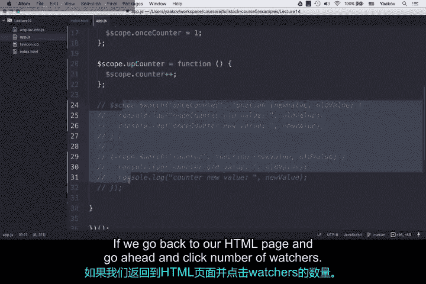

在控制器内部使用 `$watch` 函数并不是推荐的做法。控制器和模板（或 HTML）本身已有自动设置这些监视器的机制。

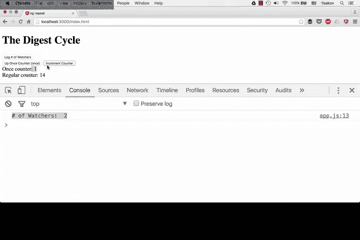

以下是实现自动监视的一种方法。首先，我们注释掉控制器中手动设置的 `$watch` 代码。

```javascript
// 注释掉手动 $watch
// $scope.$watch(...)
```

然后，在 `index.html` 文件中，我们添加一个新的 `div` 元素，并使用双花括号 `{{ }}` 进行插值绑定。

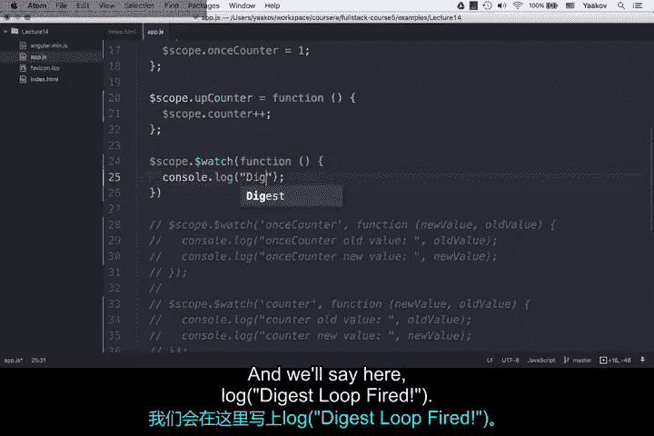

```html
<div>
    Once Counter: {{onceCounter}} <br>
    Regular Counter: {{counter}}
</div>
```

保存更改后，即使我们没有手动设置任何监视器，返回页面并点击“显示监视器数量”按钮，你仍然会看到监视器的数量为2。`onceCounter` 在首次点击后不再变化，而 `counter` 会随着每次点击递增按钮而更新。

---

## 追踪脏检查周期

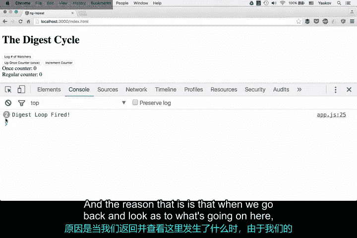

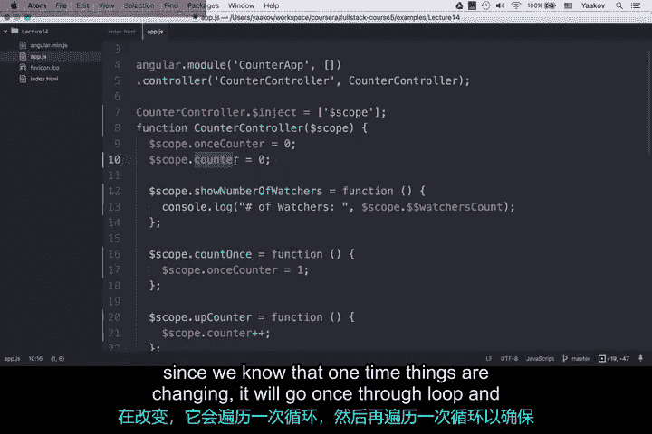

有一个技巧可以帮助我们观察脏检查周期（Digest Loop）何时执行。我们可以通过一个特殊的 `$watch` 函数来记录循环的触发。

我们设置一个监视器，它不监视具体的属性，而是提供一个函数。这个函数会在每次脏检查周期中被调用，从而让我们知道循环何时运行。

```javascript
$scope.$watch(function() {
    console.log("Digest Loop Fired");
    return 'someProperty';
});
```

保存并返回页面，你会看到控制台立即打印了两次“Digest Loop Fired”。这是因为 AngularJS 在初始化时，由于插值绑定导致属性变化，触发了脏检查周期。第一次循环检测到变化，第二次循环确认没有更多变化（即“干净”状态）。

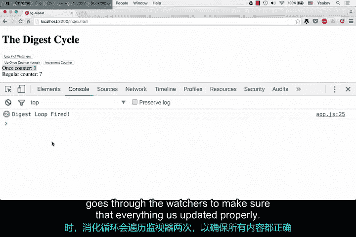

现在，如果我们点击“递增 Once Counter”按钮，控制台会再次打印两次信息：一次是因为计数器实际变化，另一次是为了确认没有其他值变脏。然而，由于 `onceCounter` 的特性，后续点击可能只触发一次循环，因为值不再变化。

点击“递增 Regular Counter”按钮时，每次点击都会触发两次循环：一次检测 `counter` 的变化，另一次确保所有监视器都报告“干净”。

---

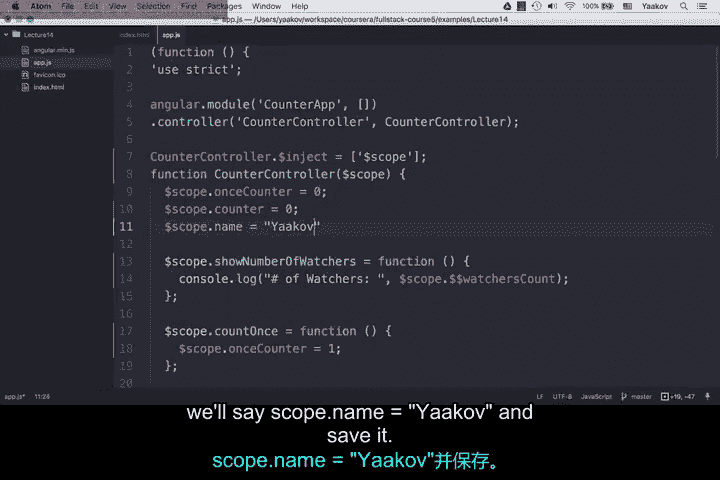

## 设置监视器的三种方式

至此，我们已经看到了两种设置监视器的方法。第一种是手动使用 `$watch` 函数（不推荐在控制器中使用，但可在服务、指令或组件中使用）。第二种是通过双花括号 `{{ }}` 插值绑定属性，AngularJS 会自动为此设置一个监视器，因为它知道当属性变化时需要更新 DOM。

还有第三种设置监视器的方式，即使用带有 `ng-model` 指令的输入元素。`ng-model` 实现了双向数据绑定。

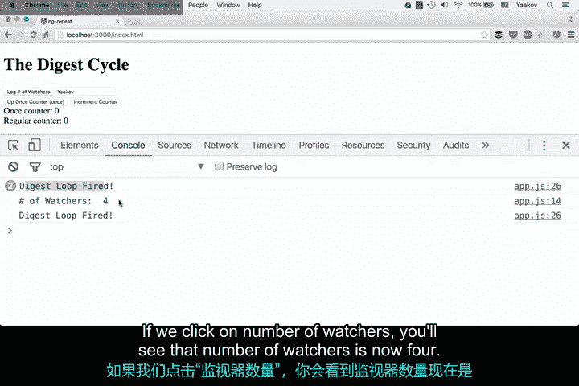

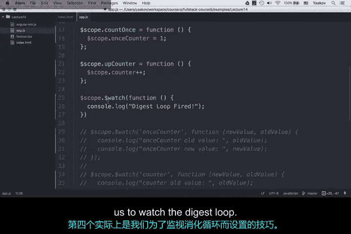

我们在 HTML 中添加一个输入框：

```html
<input type="text" ng-model="name">
```

在控制器中初始化 `name` 属性：

```javascript
$scope.name = "Yaakov";
```

保存后，返回页面。现在点击“显示监视器数量”，你会看到监视器数量变为4。这四个监视器分别是：
1.  输入框的 `ng-model="name"`。
2.  `{{onceCounter}}` 插值绑定。
3.  `{{counter}}` 插值绑定。
4.  我们为追踪脏检查周期而设置的特殊 `$watch` 函数。

当我们在输入框中键入内容时，每次按键都会触发两次脏检查循环，原理与之前相同：一次响应变化，一次验证稳定性。

---

## 总结与核心概念

本节课中我们一起学习了脏检查周期。其核心是循环运行 **Digest Loop**，直到所有监视器都报告没有变化为止。这个过程通常被称为 **脏检查（Dirty Checking）**，目的是确保每个被监视的值都不再“脏”（即未变化）。

我们学习了三种设置监视器的方法：
1.  **手动调用 `$scope.$watch` 函数**：不推荐在控制器中使用。
2.  **使用双花括号 `{{ }}` 插值绑定**：AngularJS 会自动设置监视器。
3.  **使用 `ng-model` 指令**：在输入元素上声明，AngularJS 会自动为其关联的属性设置监视器。

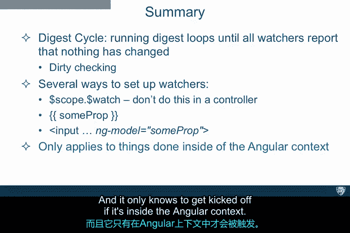


最后，请记住，我们讨论的所有机制都只在 **Angular 上下文（Angular Context）** 中生效。如果一个事件（如更新 `$scope` 上的属性）不是由 Angular 基础设施触发的（例如在原生 `setTimeout` 回调中），那么脏检查周期就不会自动运行，视图也不会立即更新。直到下一个由 Angular 上下文触发的事件启动脏检查周期时，这些已改变的值才会被检测到并更新到视图中。