# 约翰霍普金斯大学《使用 AngularJS 开发单页 Web 应用｜Single Page Web Applications with AngularJS》中英 - P30：29_第15讲：$digest和$apply.zh_en - GPT中英字幕课程资源 - BV1dsFDeZEQr

🎼。

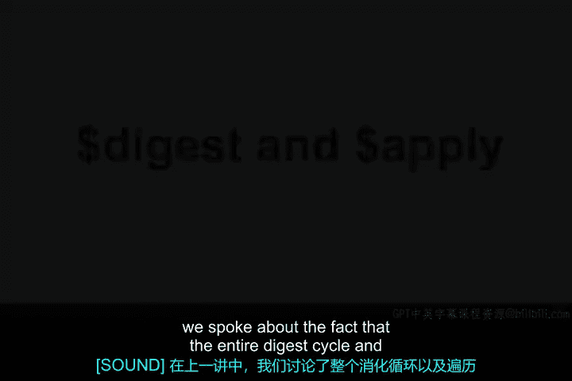

In the previous lecture we spoke about the fact that the entire digest cycle and the digest loops that go over the setup watchers is only triggered when the original event from our event queue is something that is angular aware In other words it knows about the digest cycle and kicks it off as part of the process but what about code that is not inside of our angular application and sometimes still needs to affect the values inside of our angular app This is where the special dollar sign digestig and Do sign apply functions come into play。

Let's take a look at a diagram。So we've seen this diagram before。

 this is the event queue that has an NG click on it that is set up to handle the click event。

 but at the same time is Angular context aware and therefore it's going to eventually at some point called the Dine digestig function。

 but what happens when you have other events on the event queue that are not Angular GSFware like oncl your regular un click event or a timeout that gets put on the event queue and then some functionality gets executed after a certain timeout？

😊，In these cases， we actually need to do something special in order to let Angr know that it needs to run its digest cycle。

In practice it's not the custom timeout events or on click events that we deal with。

 but probably something like a custom library like JQury that has to handle some JQury specific functionality and we want to kind of plug into that and affect some of the values and therefore our UI state inside of our Angular app however in our example we're going to use the timeout simply because it's much easier to deal with than setting up a whole infrastructure with JQury so let's jump into the code editor and see how we can handle this inside of our Angular application。

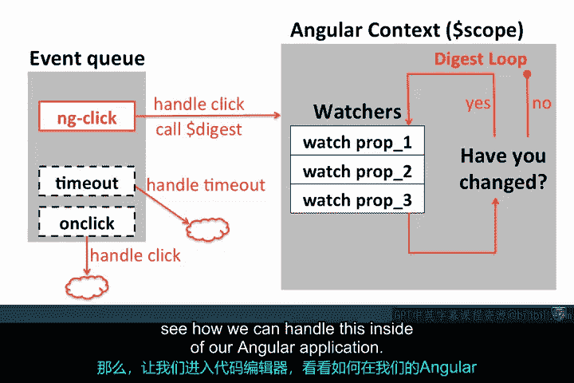

Okay so here I am inside of my editor and I'm located in lecture 15。

 which is located in fulltag dash course 5 examples folder and this is a very simple counter app that we had before except we cleaned up a couple of things to make it even simpler and what we have here is a single controller counterconroll and it has up counter energy click button here that is connected to the up counter function on the scope and it's going to increment the counter and every time it increments it it will kick off the digest cycle and go ahead and update this counter interpolation because obviously double curly braces sets up the watchcha for us let's take a look at our app Js and it's as simple as it could be it has the controller declared and we have our regular injection going here with a scope dial science scope we initialize the counter to zero and then in our app counter we just say scope counter plus plus and as we're just incrementing it So let's go take a look at this inside a browser and you can see。

😊。

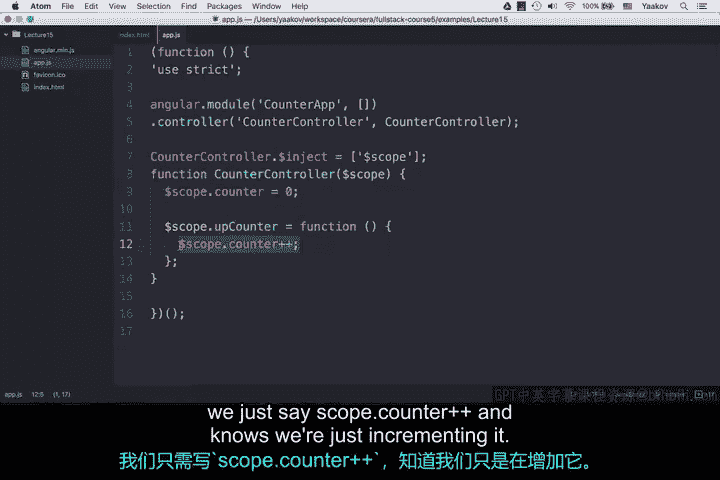

Here。We have our increment counter button and counter0。 so if we keep clicking it。

 our counter keeps going up by one。

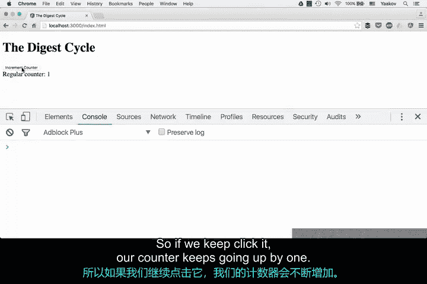

Let's go back to the code and instead of implementing this right away in other words。

 the second a person clicks up counter and invokes the app counter function that the counter should go up。

 let's go ahead and set a timeout to do this in a couple of seconds。

 so let's do set timeout and a timeout takes a function。😊。

We don't need the name and right after the function it takes how long should the function wait or how long should timeout wait before it executes that function in this case we'll say 2000 milliseconds which equals to2 seconds and we'll just go ahead and move that counter right inside of there okay so now that we move it inside of there and let's make sure that it's actually executing so we'll right after we'll say log and we'll say counter。

😊，Incremented。 Okay， now let's say that。

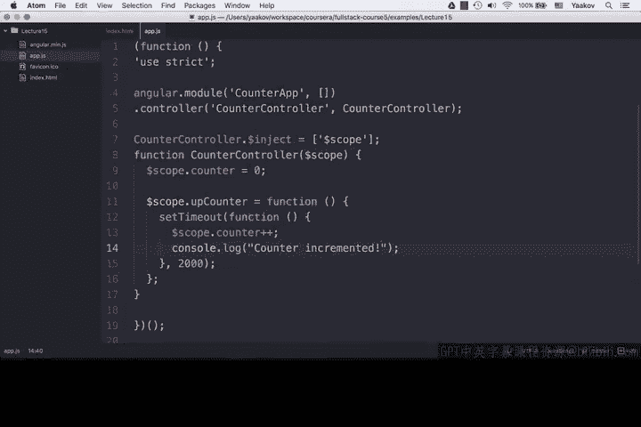

So let's go back to our web page and we'll click the increment counter and should be a couple of more seconds and bam。

 the counter got incremented except there's one problem the regular counter here。

 the interpolation still says zero。😊，How come that is going on Well。

 the reason that's going on is this timeout gets put in the event queue completely separately from this call of up counter。

 it really gets it taken out out of the Angular context altogether。

 it's not being called inside the Angular context。

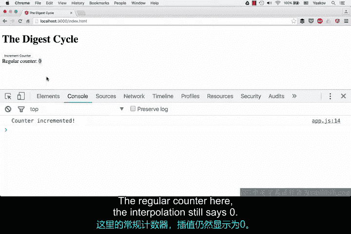

And because it's not being called inside the angular context。

 the digest cycle doesn't know to have to kick off at all， so in order for us to do that。

 what we could do is we could just kick it off manually ourselves we could say doine scope that doine digest。

😊，And if we do that at the end of this， the digest cycle is going to know to get kicked off and the watcher for this counter will therefore be checked and our dump will get updated and repainted。

 the browser will get repainted let's go back to our browser and this case will click increment counter we'll count a couple of seconds and bam the counter is incremented and now you see the counter is one so it did get incremented。

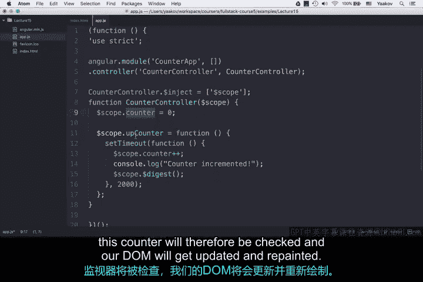

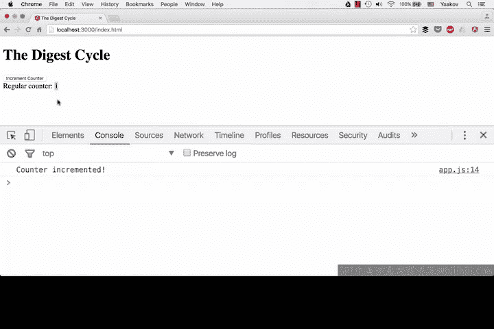

That's all well and good， but there is a better way of doing this than calling digestig。

 The problem calling digestig directly is that if there's any kind of errors or any exceptions that happen in the code we're actually executing the exceptions thrown as part of this code will not be visible to Angular Js。

 So how can we make it visible to Angular Js。 Well。

 there comes the special function called dollar sign apply。

 So let's go ahead and actually maybe we'll just keep it for your reference。

 So we'll copy it comment it out， let's write it again。

 except this time instead of the digest inside the timeout will say dollar signine scope dollar sign apply。

😊，And it takes a function。Inside of which。We could place our code。

So let's cut the code out here and we'll place it right inside of the dollar sign apply so now when the timeout gets executed after two seconds。

 this function will get executed and this function will call dollar sign apply and have another function as part of it and execute that function which will have are the code that we actually will execute but since it's all going to get wrapped inside the apply function not only will we catch any exceptions and angular JS context will catch those exceptions but also at the end of that process the digest the dollar sign digestig will get called automatically by angular and therefore the DOm will get updated so let's go back to our browser and let's click increment counter。

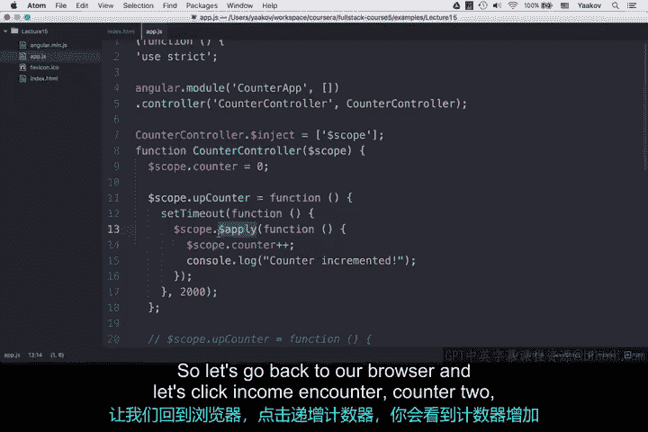

Counter 2 and you can see counter got incremented and one is displayed so we could do it again and counter will get incremented again second time that log message is here and now it's2。

However， in practice you should always try to see if there is an Angular JS alternative that's available that is native to Angular JS In our case。

 there is a service called Do sign timeout that does exactly the same thing as set timeout does except it does it inside the Angular context already so what do you need to do on any of these tricks so let's go ahead and rewrite this one last time but this time we're going to use the Angular timeout service instead of the native set timeout from JavaScriptscript so the first thing we're going to have to do is add one more value to our Do sign inject property on our controller so we'll say dollar timeout and since it dollar time we know it's a native Angular Js service that Angular JS provides out of the box and we'll add it as one of the arguments Do sign timeout。

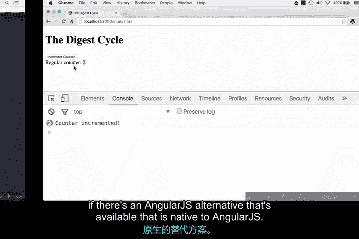

And we'll go ahead and comment this out。 I will copy and comment this out for future reference。

 And meanwhile， we'll just write a new one。 And instead of saying set time out。

 we'll go ahead and actually just erase that and we'll say dollar sign。Time out。

And the first thing is the function that we need to execute and the second argument is the number of milliseconds it should wait。

 which in this case again is 2000， and all we need to do is really just move our two lines that we executed before right here。

 we need to comment this out again and now that we save it let's go back to our web page and we'll click increment counter。

 we'll wait two seconds and sure enough the counter incremented gets displayed and one is displayed on our web page。

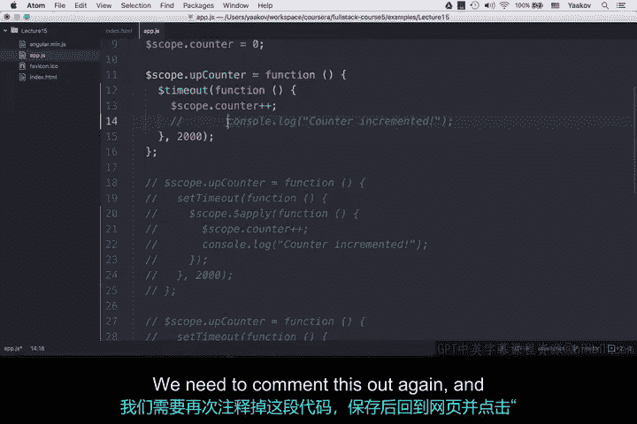

So let's summarize。In this lecture we spoke about the fact that the digest cycle does not get triggered automatically if the events are unaware of angular and certainly unaware of Angular context and the digest cycle itself There are a few different solutions that you could use to take care of this problem The first one is you could call the digestigest dollar sign digest function yourself directly after your custom code that will tell Angular Js to go ahead and kick off the whole digest cycle and your changes that you've made to the scope properties will get detected Numb two is and a better way is to wrap your custom code inside of a dollar signine apply function what that will allow you to do is if your code your custom code throws any exceptions those exceptions will actually be seen by the angular context as opposed to if you just call digestig at the very end the exceptions that might have gotten thrownn beforehand will not get registered in the angular context。

The third way is probably the best of them all is to find Angular specific service that handles the same functionality in our case we use the set timeout which is a JavaScript native functionality。

 but there is a equivalent dollar sign timeout or the timeout service that does exactly the same thing and is already angular aware。

 so you need not do anything else but just use that timeout service。

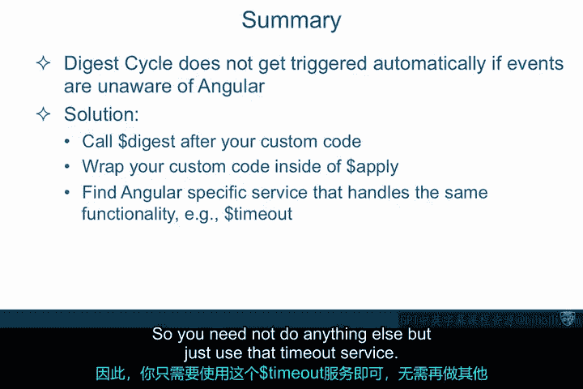

