# 使用 AngularJS 开发单页 Web 应用：P30：第15讲：$digest 和 $apply 🎯


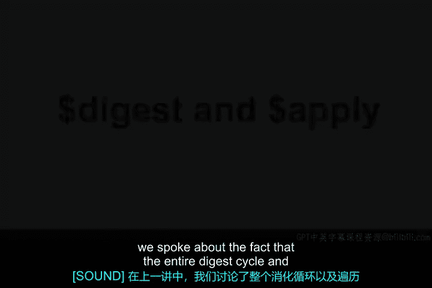

在本节课中，我们将要学习当代码运行在 AngularJS 上下文之外时，如何手动触发数据绑定更新。我们将探讨 `$digest` 和 `$apply` 这两个核心函数的作用、区别以及最佳实践。

## 概述

上一节我们介绍了，只有当事件队列中的原始事件是 AngularJS 所“感知”的（例如 `ng-click`）时，整个 `$digest` 循环才会被自动触发。本节中我们来看看，当代码不在 AngularJS 应用内部，但又需要影响应用内部的数据时，我们该如何处理。这正是 `$digest` 和 `$apply` 函数发挥作用的地方。

## 问题引入：非 AngularJS 上下文中的事件

让我们回顾一下事件队列的示意图。当事件队列中存在一个 `ng-click` 事件时，AngularJS 能够感知到它，并最终调用 `$digest` 函数来启动脏检查循环。

但是，如果事件队列中存在其他非 AngularJS 感知的事件会怎样呢？例如，原生的 `onclick` 事件，或者一个被放入事件队列、在一定延迟后执行某些功能的 `setTimeout` 函数。

在这些情况下，我们需要采取特殊措施来通知 AngularJS 它需要运行其 `$digest` 循环。在实践中，我们可能遇到的是像 jQuery 这样的自定义库，它需要处理一些特定功能，而我们希望介入其中并影响 Angular 应用内部的一些值和 UI 状态。为了简化示例，我们将使用 `setTimeout`，因为它比搭建一整套 jQuery 基础设施更容易处理。

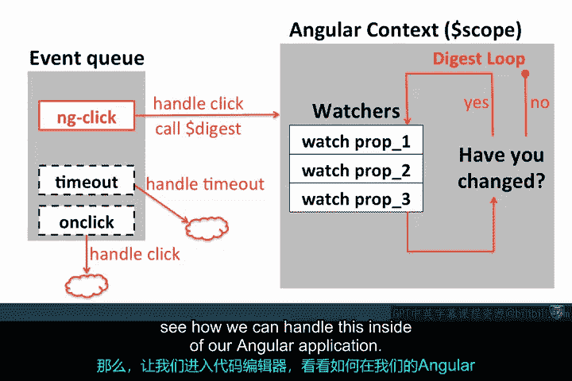

## 代码示例：一个简单的计数器应用

让我们进入代码编辑器，看看如何在 AngularJS 应用中处理这种情况。

我们有一个非常简单的计数器应用。它包含一个控制器 `CounterController` 和一个“增加计数器”按钮。这个按钮连接到作用域（scope）上的 `upCounter` 函数，该函数会递增计数器。每次递增时，它会触发 `$digest` 循环，并更新页面上的计数器插值表达式（`{{ counter }}`）。

以下是 `app.js` 的初始代码：

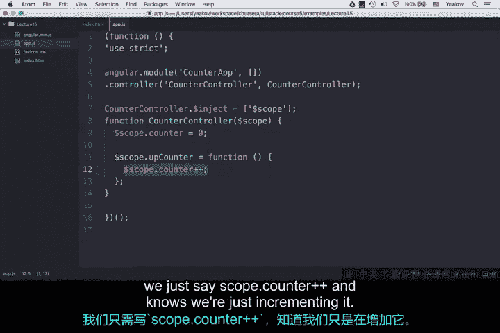

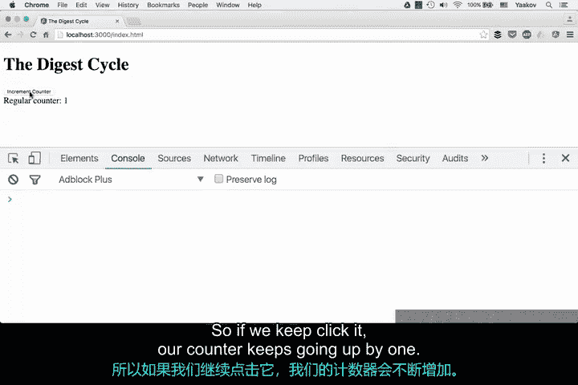

```javascript
app.controller('CounterController', ['$scope', function($scope) {
    $scope.counter = 0;
    $scope.upCounter = function() {
        $scope.counter++;
        console.log('Counter incremented.');
    };
}]);
```

在浏览器中，点击按钮，计数器会正常递增。

## 引入问题：使用 `setTimeout`

现在，我们修改代码，不让人一点击按钮就立即增加计数器，而是使用 `setTimeout` 在两秒后执行递增操作。

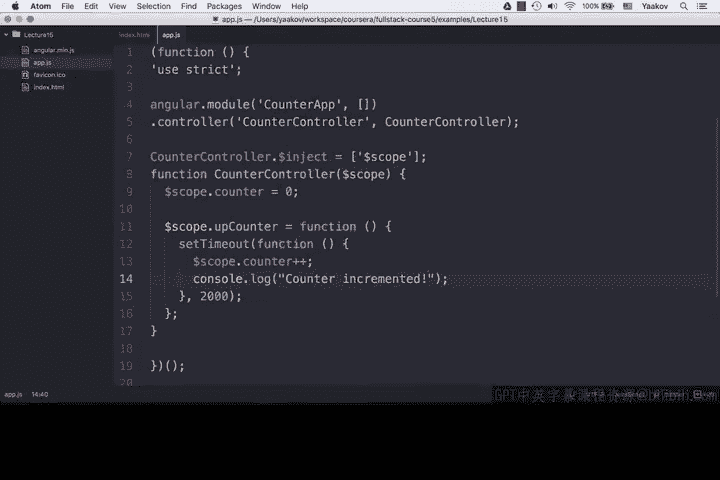

```javascript
$scope.upCounter = function() {
    setTimeout(function() {
        $scope.counter++;
        console.log('Counter incremented.');
    }, 2000);
};
```

回到网页，点击“增加计数器”按钮，等待两秒后，控制台打印了日志，但页面上的计数器显示仍然是 **0**。

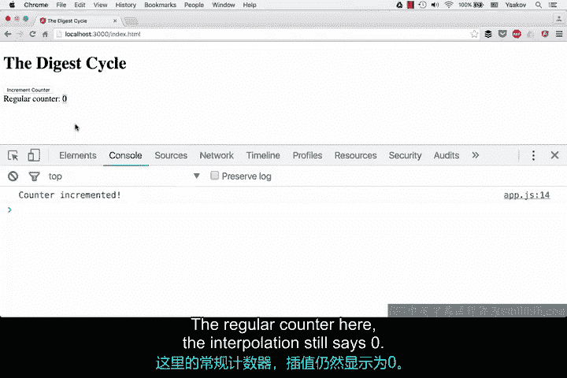

为什么会这样？原因是这个 `setTimeout` 回调函数被完全置于 AngularJS 上下文之外执行。因为它不是在 AngularJS 上下文中被调用的，`$digest` 循环根本不知道需要启动。因此，数据的变化没有被检测到，视图也就没有更新。

## 解决方案一：手动调用 `$digest`

为了解决这个问题，我们可以在自定义代码执行完毕后，手动触发 `$digest` 循环。

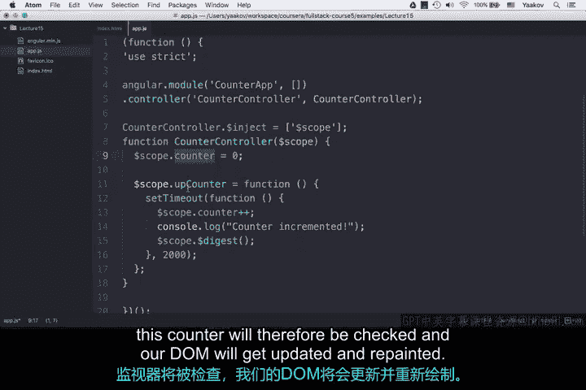

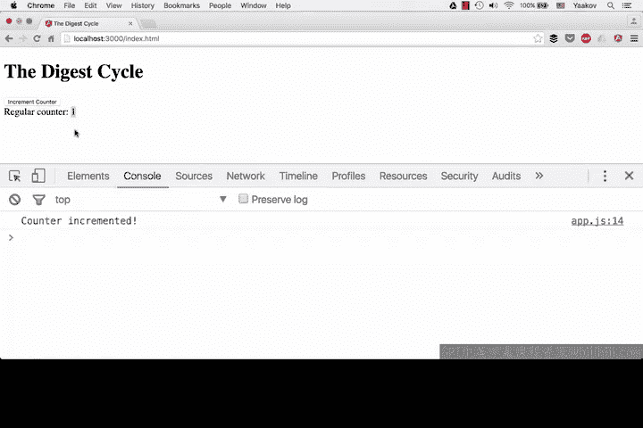

```javascript
$scope.upCounter = function() {
    setTimeout(function() {
        $scope.counter++;
        console.log('Counter incremented.');
        $scope.$digest(); // 手动触发脏检查
    }, 2000);
};
```

现在，再次测试。点击按钮，等待两秒后，计数器成功递增，并且页面显示更新为 **1**。

手动调用 `$scope.$digest()` 会通知 AngularJS 启动脏检查循环，从而检查所有监视器（watcher），更新 DOM。

## 解决方案二：使用 `$apply` 包装代码

虽然直接调用 `$digest` 可以解决问题，但存在一个更好的方法：使用 `$apply`。直接调用 `$digest` 的问题是，如果在我们执行的代码中发生任何错误或异常，这些异常将不会被 AngularJS 捕获到。

`$apply` 函数可以解决这个问题。它接受一个函数作为参数。

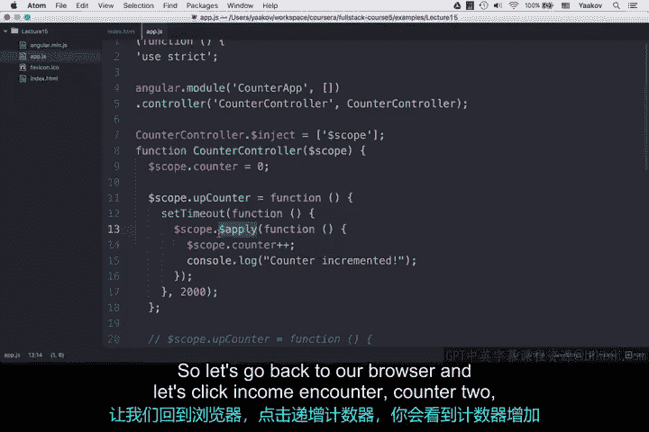

```javascript
$scope.upCounter = function() {
    setTimeout(function() {
        $scope.$apply(function() {
            $scope.counter++;
            console.log('Counter incremented.');
        });
    }, 2000);
};
```

在这个例子中，当 `setTimeout` 在两秒后执行时，它会调用 `$apply`，并将包含我们实际代码的函数传递给它。`$apply` 会执行这个函数，并且在这个过程结束时，**自动调用 `$digest`**。更重要的是，在此过程中抛出的任何异常都会被 AngularJS 上下文捕获。

测试结果与之前相同，计数器能够正常更新。

## 最佳实践：使用 AngularJS 原生服务

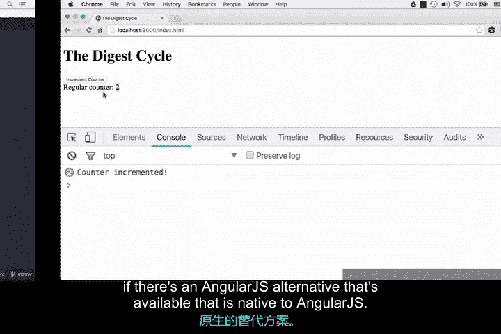

然而，在实践中，你应该始终优先寻找是否存在 AngularJS 提供的、原生的替代方案。在我们的案例中，有一个名为 `$timeout` 的服务，它的功能与 `setTimeout` 完全相同，但**它本身就在 AngularJS 上下文中运行**。

使用 `$timeout` 服务，我们无需进行任何额外操作。

首先，我们需要将 `$timeout` 服务注入到控制器中。

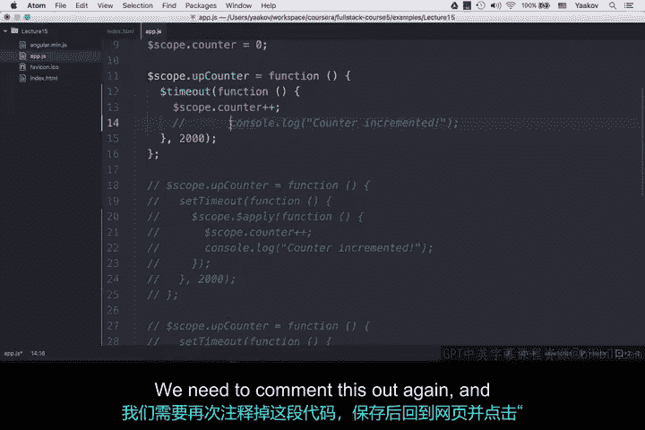

```javascript
app.controller('CounterController', ['$scope', '$timeout', function($scope, $timeout) {
    $scope.counter = 0;
    $scope.upCounter = function() {
        $timeout(function() {
            $scope.counter++;
            console.log('Counter incremented.');
        }, 2000);
    };
}]);
```

现在，我们直接使用 `$timeout` 替代原生的 `setTimeout`。保存代码并测试，计数器会在两秒后成功递增并更新视图。这是最简洁、最推荐的方式。

## 总结

本节课中我们一起学习了当事件不被 AngularJS 感知时，如何手动触发数据绑定更新。我们探讨了三种解决方案：

以下是三种解决方案的对比：

1.  **手动调用 `$digest`**：在你的自定义代码之后直接调用 `$scope.$digest()`。这会告诉 AngularJS 启动整个脏检查循环。但此方法无法让 AngularJS 捕获你代码中可能抛出的异常。
2.  **使用 `$apply` 包装代码**：将你的自定义代码包装在 `$scope.$apply(function() { ... })` 中。这是一个更好的方法，因为它允许 AngularJS 上下文捕获代码执行中抛出的任何异常，并在最后自动调用 `$digest`。
3.  **使用 AngularJS 原生服务（最佳实践）**：尽可能寻找并**使用 AngularJS 提供的等效服务**（例如用 `$timeout` 代替 `setTimeout`，用 `$interval` 代替 `setInterval`，用 `$http` 代替 `$.ajax` 等）。这些服务天生就是 AngularJS 感知的，你无需进行任何额外操作。

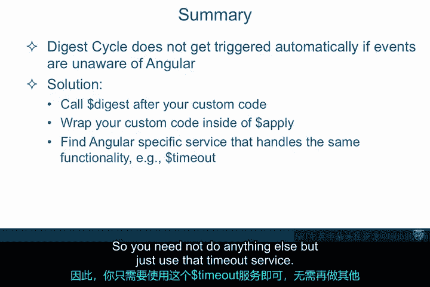


总而言之，当需要在 AngularJS 上下文之外修改作用域数据时，请优先考虑使用 AngularJS 原生服务。如果无法避免，则使用 `$apply` 来包装你的代码。将直接调用 `$digest` 作为最后的选择。