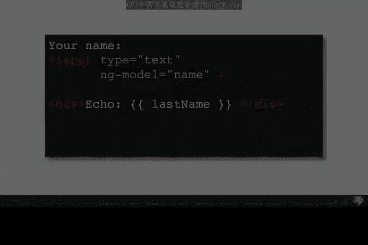
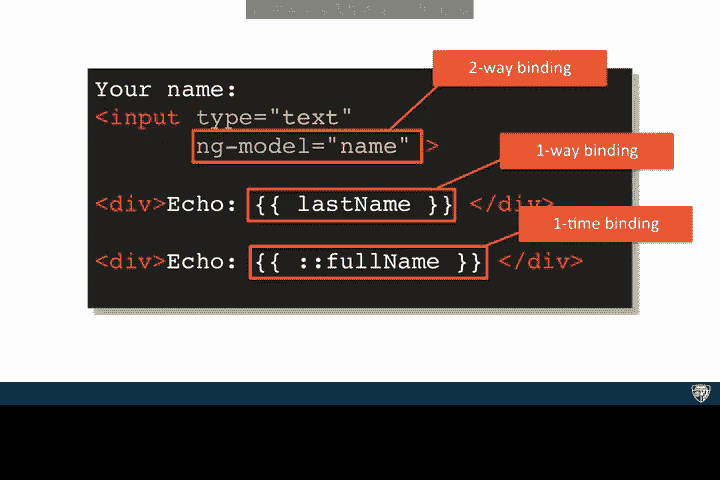
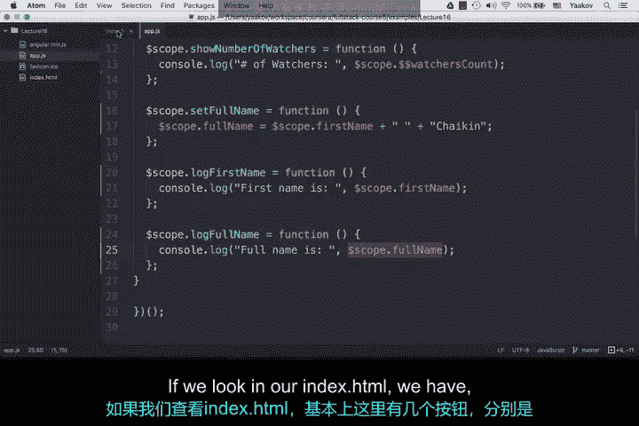
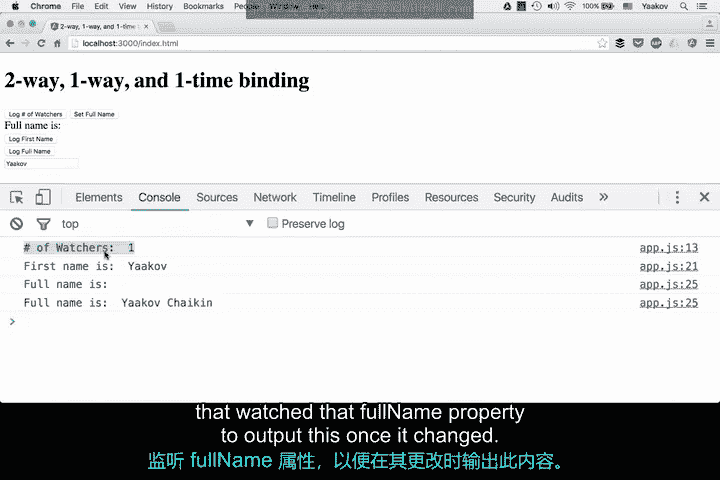
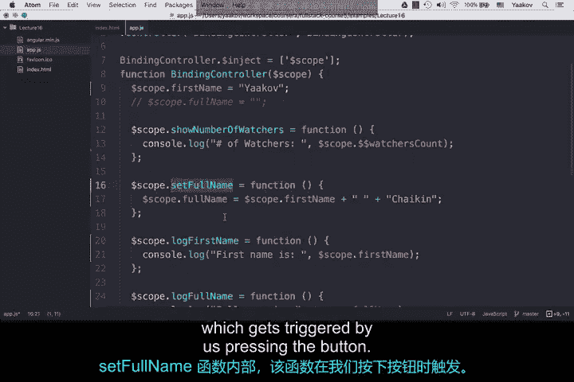
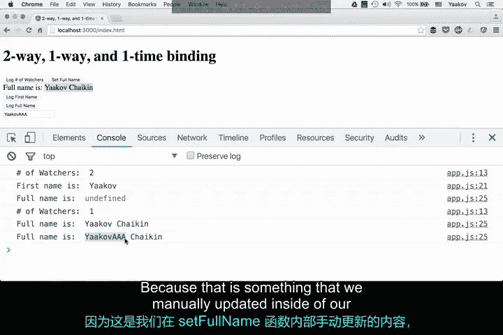
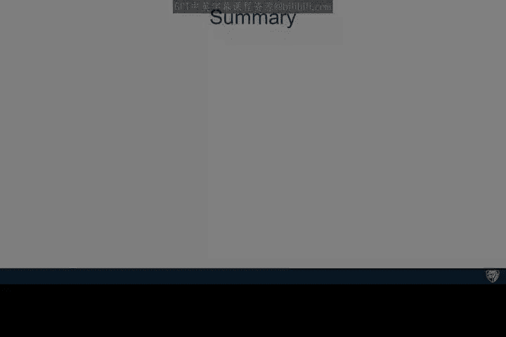
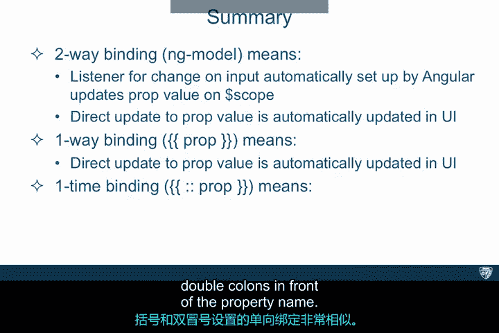

# 约翰霍普金斯大学《使用 AngularJS 开发单页 Web 应用｜Single Page Web Applications with AngularJS》中英 - P31：30_第16讲：双向绑定、单向绑定和一次性绑定.zh_en - GPT中英字幕课程资源 - BV1dsFDeZEQr

🎼。

In this lecture， we're going to speak about two way， one way and one time binding。

The concept of two way and one way binding is something we have already seen。

 and the concept of one time binding is something we're going to explore in a bit more detail in this lecture。

 then we'll compare and contrast these different binding strategies to each other。😊。

So you've seen this code before the first line is an input element that has an NG model defined on it with a name property That's an example of twoway binding and what two way binding means is that not only does Angular Js set up a watcher for your name property that is sitting on the dollar sign scope。

 but it will also set up some sort of listener on the input element such that if the value of the input element changes that change will be reflected in the name property on the dollar sign scope so in that case you really affecting the name property in both ways。

 you can affect by the user because they're typing things in into the text box and the dollar sign scope that name property gets updated and likewise if you update inside of your controller。

 the dollar sign name property， that value will get updated and the UI the browser will get updated automatically which means that text box will display the new value that you update inside of your controller。

は。The second line has our regular interpolation with double curly braces that's an example of one way binding the only way this value will change in the browser is if something inside the controller will update the last name property on the dollar sign scope There's no way for us to at least directly through the double curly braces affect the value of the last name from the browser from the user to the controller。

 so this is an example of one way binding。It shouldn't come as a surprise to you that if we set up a lot of these bindings。

 a lot of watchers will get created for us by Inngela Js。 Well， as you remember。

 the digest cycle goes through the entire list of every watcher that we have and checks for any changes that occurred in the last loop Well these loops can go for a few times and if you have thousands of thousands of these watchers obviously that will take some time and therefore the performance of your application will degrade In fact。

 the rule of thumb is you shouldn't have any more than 2000 watchers per page however。

 I've seen more than 2000 and the app worked pretty well anyway。

 but it's kind of a rule of thumb you could have more you can have less depending obviously what type of machine the user is using how fast it is and how much it can handle。

😊，However， one thing is clear， minimizing the number of live active watchers in your watchers list during the digestig loop is something that's desirable。

 So one way to do that is set up a special what's called a one time binding The one time binding looks very similar to the one way binding except in front of the property name you put double colons with that tells Angular Js is that it should set up a watcher for this property but the second this property gets initialized the Angular Js digestig cycle will kick in it will update that property in our Ui will repaint the browser and the property will be seen to the user and at that point Angular Js will automatically remove the watcher for that particular property so you'll have one less Of course the downside of that is is this only happens one time So if that property war to get updated in the course of your app that update will not be reflected in your UI。

😊，However， for things like， let's say full name of a user that is not expected to change throughout the lifecycle of your application。

 something that we still need to be able to somehow insert into our HTML template。

 but we don't need to watch that property and check that property every single time for the rest of the life of our application。

Let's jump into the code editor and take a look at this concept in action。

Okay， so I'm back in my editor and I'm located in a lecture 16 folder which is located in full stack dash coursese5 examples folder and I'm looking at Ab。

gs and it's basically the same binding app that we had before with that binding controller except we cleaned it up a little bit and changed a couple of things so we have a couple of properties the first one is first name and I initialized that upfront to Yaakov the second one is full name initialized to an empty string up front。

We also have the function we've seen before， which basically shows us the number of watchers we have in our digest cycle and we're going to go ahead and look in into the angular inerts。

 so to speak and look at the dollar dollar watch count and that will tell us how many watchers angular has in its digest cycle。

And we'll bind this function to a button so we could click it at any time and see how many watches we have。

 Another one we have is set full name。 What that will do is it will take a property full name on the scope and it will combine it first name plus space and my last name hikinghen So that will update the full name property and we also have a couple of functions just for us to see what's going on behind the scenes。

 which basically log the first name and also log the full name So the doine scope first name Doine scope full name If we look at our index that HTML we have basically a couple of buttons here that say show number of watchers and set full name the set full name is the thing that will set the full name to be the first name plus whatever that string that I added to it to be the last name。

 So basically my full name。😊。

We'll also have a one time binding here for the full name and a couple of buttons to log the first name and then log the full name。

In addition， we'll also have an input element that has a2 way binding setup using NG model on our first name property。

 which means if we type something in here， the first name property will keep getting updated as we type let's go ahead and take a look at that in our browser so here's our log number of watchers so if we click that right now。

We'll see that number of watchers is one that should already give us a bit of a pause Why is that well we want this property full name here to appear and there's only one watcher well if we go back to our index that HTML we'll see that for sure this creates a watcher。

Which means that this did not create a watcher or something else happen because should have been two watchers。

 Well， let's take a look here。 Let's go ahead and log the first name。 That makes sense。 Yaakov。

 that takes it right from here。 And this actually took it before from our initialized property on dollarine scope。

 And let's log the full name。 The full name right now is an empty space。 Well， that's easy。

 we could set the full name。 Let's set the full name right there。 And if we log the full name now。

 you see it is yaakov hiking。 it's the full name。 The problem is。

 this is still not showing up here at all。 It's just an empty string。 Why is that。

 Why is this happening。 Well， part of the reason we kind of discussed。

 We didn't have an extra watcher that watch that full name property to output this once it changed。😊。

Let's go back to our code and see if we could find the culprit for this problem。

And if you look at the very front here， you'll see that we initialized our full name already to an empty string。

 And that's where the culprit is。 As I told you before。

 the second the property that is one time bound gets initialized That's when the angular digest cycle goes ahead and loops over all the watchers and outputs this value to the browser and then removes the watcher for it。

 that means that the HTML template that has this property one time bound to it will never get updated again because the watcher is no longer there。

 So the way we could fix it is simply by commenting the line out and that means that the very first time that this property will get initialized will be inside of our set full name function。

 which gets triggered by us pressing the button。 So let's go ahead and save that let's go back to our browser let's click number of watchers and now things look much better。

 Now there's two watchers if we log the first name it's the yaov log the full name it's undefined which is。

😊。

Exactly how we wanted at this point because if it was defined already it would have been too late the watcher would have been removed so now if we click set full name you'll see it will appear right here but if we click log number of watchers again it's no longer two it's one because once we bounded one time bounded to our HTML template we no longer need that watch we could save that performance and remove the watcher from our watchers list so therefore that is why we only have one here。

Meanwhile， the two way binding will continue to work so for example。

 if I log the full name right now it's yaakov Hihen， but if I update the name。

 let's say put AAA in here it means that the first name property on the scope would have gotten updated with an extra three letter A's at the end。

 which means that if I execute set full name right now。

 it will make the full name property B yaakov a with AaAs and then my last name hikehen。

 that will not change what is displayed in our HTML template because that was a one time binding。

 however the full name if we reset the full name as you can see here the full name property will actually contain the updated first name because that is something that we manually updated inside of our set full name function making the scope dialine scope that full name the new value of the first name which was updated plus the string the last name。

So let's summarize the two way binding that is set up with the NG model attribute on an input element means a couple of things。

 it means that Angular sets up a listener for change to the value on the input element。

 and any change to that automatically gets updated to the property on the dollar sign scope。

The second thing it means is that any direct update to the property， like inside of a controller。

 any direct update to the property value is automatically updated in U why as well。

 and obviously that's done using a watcher。One way binding on the other hand。

 automatically set up by double curly braces around the property means only one thing the direct update to the property value inside a controller or something similar is automatically updated in the UI and the watcher still stays That's to contrast a one time binding which looks very similar to the one way binding that is set up with the double curly braces and double colons in front of the property name and what that means is the initialized value。

 not any value but only the initialized value of a property is automatically updated in the UI and the watcher for that property is then automatically removed by angular so the user interface never gets updated with any updates to that property again。

