# 约翰霍普金斯大学《使用 AngularJS 开发单页 Web 应用｜Single Page Web Applications with AngularJS》中英 - P32：31_第17讲：ng-repeat.zh_en - GPT中英字幕课程资源 - BV1dsFDeZEQr

🎼。

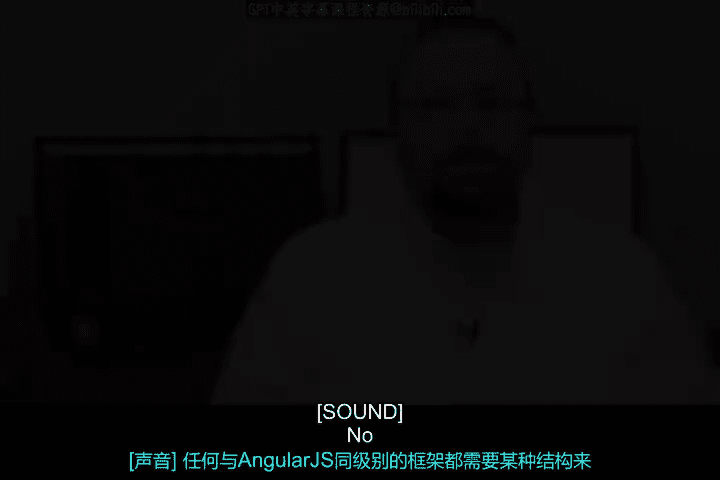

No framework on the level of Angular JS would be complete without some sort of construct to loop over our data and output the result of that looping to the webage Angular JS certainly has that construct and it's called Anng dash repeatpeat and that's what we're going to learn about in this lecture。

Now we've seen directives before， for example， NG app is a directive well NG controller is a directive NG repeatpeat is yet again a directive that we're going to learn about a directive that comes packaged together with Angular Gs out of the box right now I'm in my editor and I'm in lecture 17 inside a full stackag dash coursese 5 examples folder So let's go over this little shopping list app we have the NG app naming the app being a shopping list app。

😊，And we have the shopping list controller where all the magic is going to happen。

Let's switch to Abjs for a second and take a look as to what we have here。

 What we have here is two arrays。 The first one is called shopping list 1 and it has 1，2，3，4，5，6。

788 items in the shopping list and they're all just strings and we also have a shopping list2 which has also elements in it but the elements of shopping list2 are actually objects So it's1。

2，34 objects each object has a name and a quantity property when we declare our module and actually declare our shopping list controller all we're doing here is obviously injecting scope as usual but all we're doing here is placing those arrays as a property on the scope service。

 So now we have a shopping list one property and we have a shopping list to property that is now able to be referenced inside of our HTML template So let's go back to index that HTML and we see here the first shopping list or the first version of a shopping list here is that we have an unordered list and。

😊，LITag has an attribute called NG repeatat， and NG repeatat is very similar to for each type of for loop。

So the construct of item in shopping list one means that we're going to be looping over a shopping list one array or collection or an array and each time through the durationeration。

 the item of that collection that is being iterated over is going to be equal to the item variable that we setting up and in this case right now we're just interpolating that item as the value of the body of the La tag so each time as it's iterating is going to output another item that is equal to one of the items in the shopping list one array the rest of the code so far is just commented out and we'll get to it in a second so let's go ahead to our browser and take a look here and you see here that we have our shopping list and all of our eight items output to the browser let's go ahead and rightcl on this milk item and inspect it and see what the code in HTML is actually looking like as you could see here what we have here is that this NG repeatpe actually repeated the La tag。

😊。

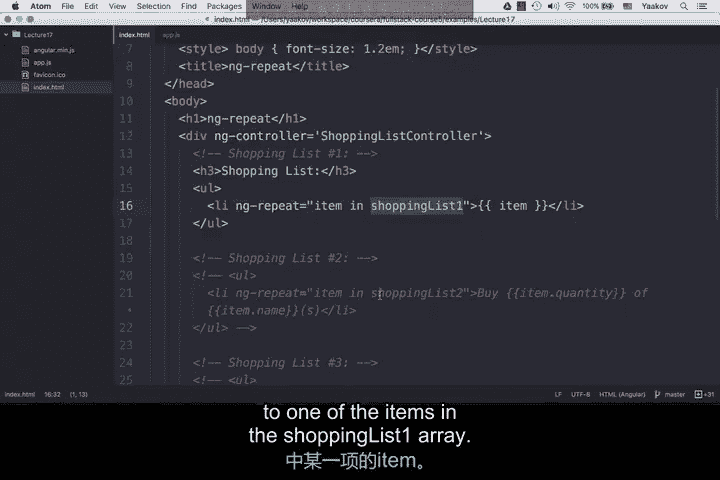

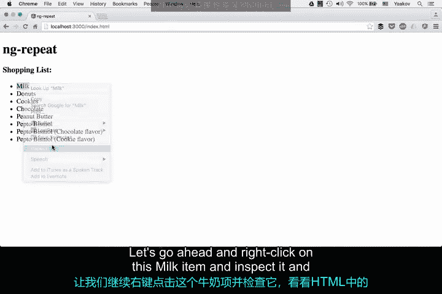

Eight times over and over here， each time interpoolating the item in the array as the content of that particular L item。

 so in this case it's milk， in this case it's donuts， cookies and so on so forth。

So let's close that up and go back to our code editor and on comment a different shopping list。

 we'll just go ahead and comment this out for now。And open the comments up for this one and in this case we're also looping through the array except in this case we're looping through shopping list2 array。

 but shopping list2， as you can remember let's go back to our app do Js。

You see shopping list2 is a list of objects， not just a list of strings。

 so in this case each item in the loop of shopping list2 is going to represent the object not just a particular string so in this case when we interpolate it we say something like buy item that quantity of item that name we're able to traverse the ja object in its usual way using the doc notation and obviously interpolate it with double curly braces so if we save that and go back to our browser you'll see that now we're outputting by two of milk milks that's really not English but's close enough by 200 of donuts and donuts spelled twice with an S again kind of a little bit messed up here but it doesn't really matter you get the idea and buy 300 of cookies and obviously we're going have a cookie party right there。

😊。

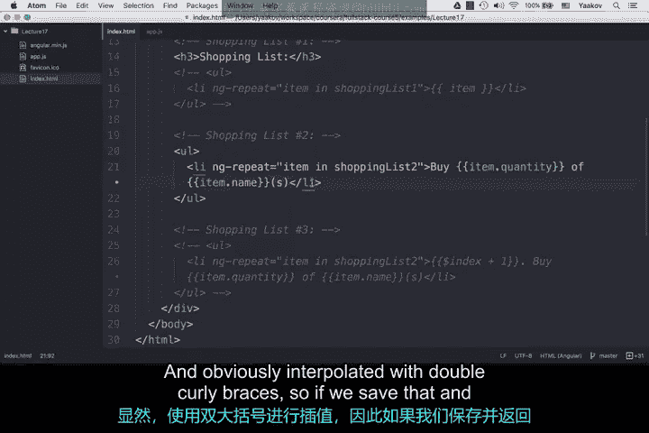

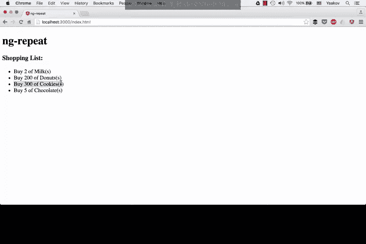

Let's go back to the code editor and now comment this out and uncomment another way of traversing the shopping list。

In this case， what we're doing here is we're doing exactly the same thing except this time around。

 I'd like to be able to number them one by one， even though we're an inside of an unordered list。

 I want to be able to get at the index of the iteration as we go along So item in shopping list2 the N repeat is set up exactly the same except N repeatat directive allows us to access the looping index variable by exposing it to the body of the tag that NG repeat is an attribute of by the dollar sign index so if we say dollar sign index and we try to interpolate that inside of the body of the tag that NG repeat is on it will give us the index or the iteration number through the loop of this collection shopping list2 so we're able to say index dollar sign index plus1 because obviously a or zero based and we don't want to start counting to the user from zero so we're gonna do a plus1 so the very first item will be1 to and so on and then we'll say。

😊，same thing by item quantity of item name， let's save that and go to the browser and you see now every bullet now has one。

 two， three， and four and these numbers came from dollar sign index that is exposed by the NGV directive。

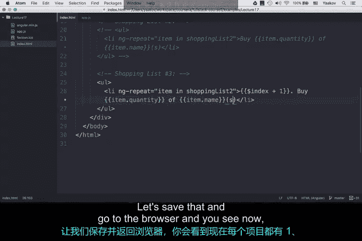

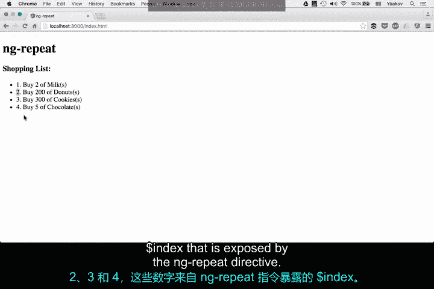

Now obviously， if we go look at our HTML， you'll see that we're setting up watchers for different items inside of our arrayator we're looping over because double curly braces as we learned before。

 sets up watches which means that if we change things inside of their array。

 the changes should appear on the screen automatically and this actually includes even if you are setting up a watch yourself for a pretty deep value inside of the array。

 let's go ahead and create an input element when an energyG model。😊。

That is going to watch as I remember En model sets up a watch is going to watch a shopping list too。

 but not just the whole thing。 We just want to watch the first item in it and we want to watch the quantity of that first item which means that the value inside the input element is going to directly reflect the quantity value of the first item in the list let's save that and let's go back to the browser and you see here it's already appearing as2 and the reason it's appearing S2 is because that's the first item in the list So if I add a zero right here you'll see that the list automatically updates without me doing anything else I could add whatever really I want in here and the list will update with that particular number we can also update the entire list by removing or adding items to the list En repeatpeat also watches the entire collection as a whole and will then rerender the view with the updated data。

😊。

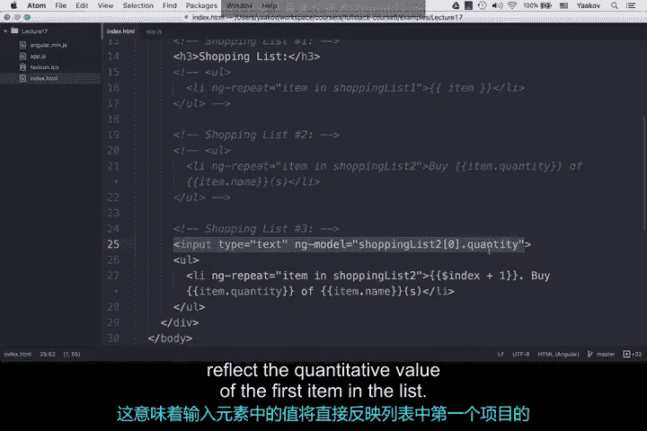

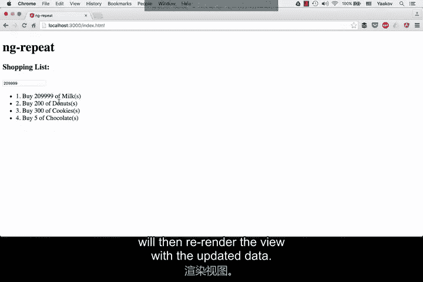

So let's go ahead and do that right now。 We'll put an input field here and we'll say its Nng model is。

Equal to new item name。And we'll put even a placeholder so people know what that is item name and we'll put another input and this time the Nng model is going to be new item quantity and the placeholder will say as item quantity Okay let's close up the sidebar so we could fit it a little bit better and we'll one more thing is we'll add the button to be we'll actually to add that new item to the list and we'll bind an energy click and we'll bind it to some function calleded to list we'll put the pars at the end and we'll say add to list as the label for the button。

 Now what we need to do is we need to actually go ahead and implement this add to list function We'll copy that' go to Ab Gs let's scroll into our controller and we'll say dollar sign scope add to list is a function we don't need the name。

And inside that function， we'll need to create a new item。

And the new item is going to be equal to an object as we know that's objects now。

 the name of which is going to be scope that new item name comma and quantity is going to be of scope that new item quantity and you could see these are the values that we pulled out from the newly created NG model right the NG model that we've set up here created new item quantity and it created new item name so we're able to now reference it right here so once we created that new item we need to now place it onto our array。

 our array is called scope that shopping list too。😊，So we'll do that scshop2。

 push and we'll just say new item Okay let's save that let's go back to our browser as you can see here we have a couple of text boxes and add to list so let's say rich cookie and we'll get like 500 of them and let's get at to list you could see five number five now is by 500 of rich cookies now actually spell properly too。

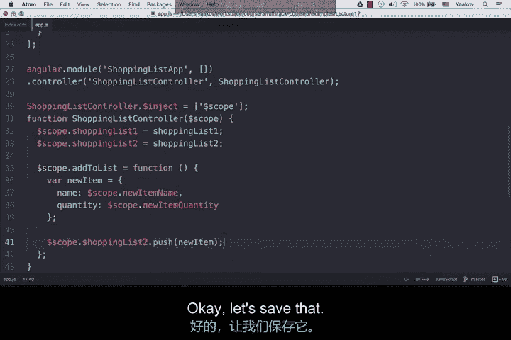

So now that we have lots of food， let's do Coursera course and let's order like you know。

 three of those。And now we have buy three Cosera courses， even though you don't have to buy them。

 they're free and even though we've changed this whole list。

 we could still affect the first deep value， which is the quantity of this first item which is milk。

 so we could still say 200 more and more and so on so we could still watch that item and it will get automatically updated by the watchers they were set up by Inlo Gs through the NG repeatat directive。

So to summarize， we learned about the NG repeat， and NG repeat is a directive that extends the functionality of HTML elements it's applied to。

 and if you think carefully about it， that's an incredible idea that you're able to take regular HTML and actually extend the way it behaves and Angular JS achieves just that。

Enger repeatpe behaves very similarly to for each construct in other languages。

The way it works is energy repeat is an attribute on some element。

 and then you specify some item which is a variable in some collection and collection should be some kind of a property on usually the scope service。

 and each item can now be used in interpolation as an item in the collection at a particular index of iteration。

Now A repeatpeat also exposes a special dollar sign index property to the body of its host tag。

 and what it does is that dollar sign index holds the numeric index of the current item in the loop and you're able to then use it in your interpolation or in some calculations inside of the HTML template。

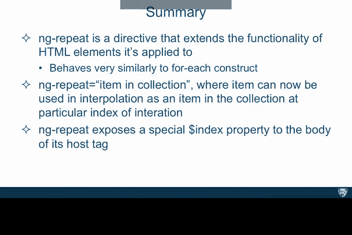